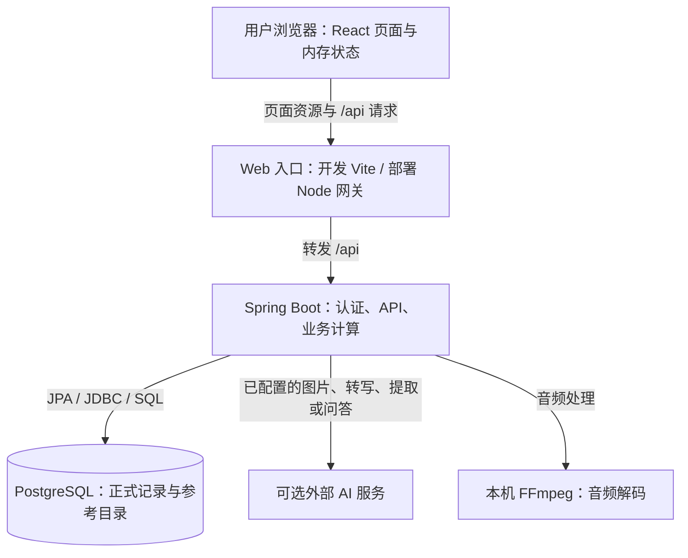
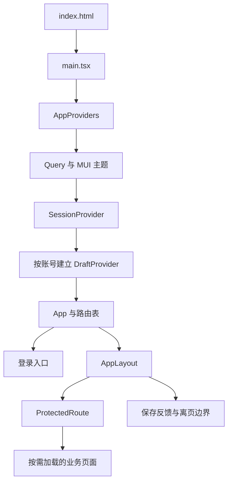
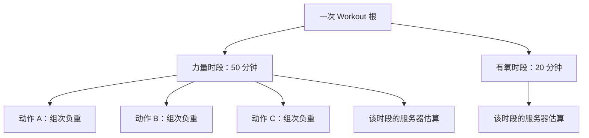
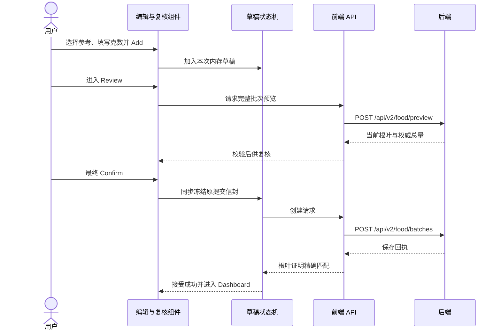
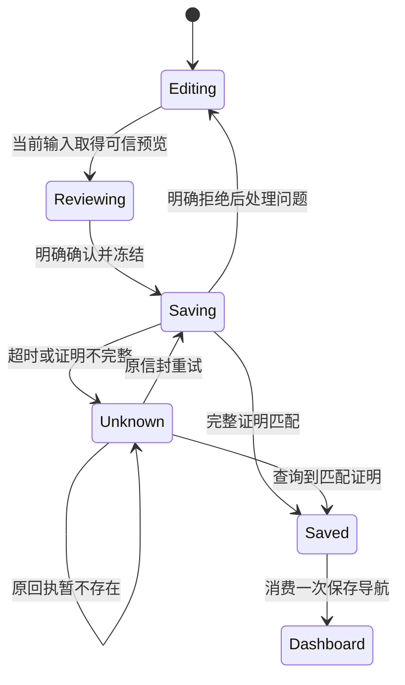
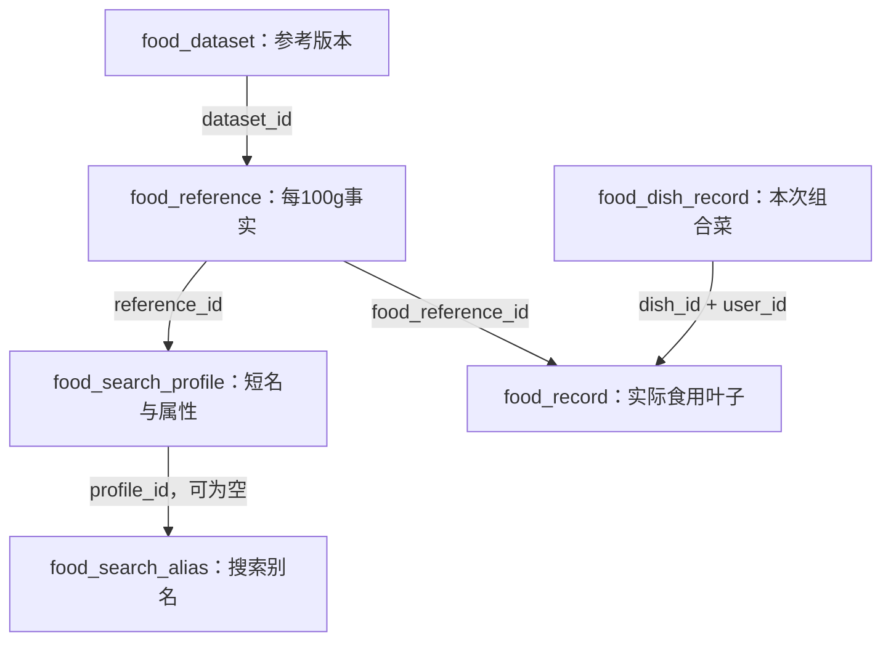
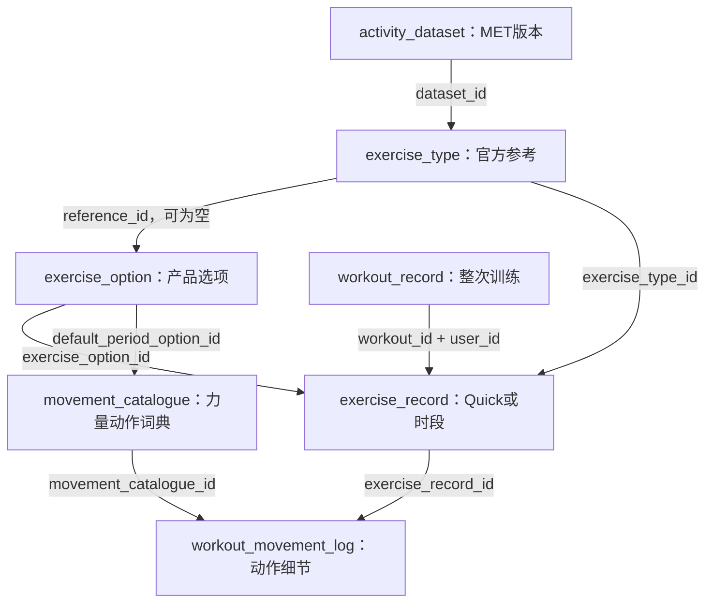
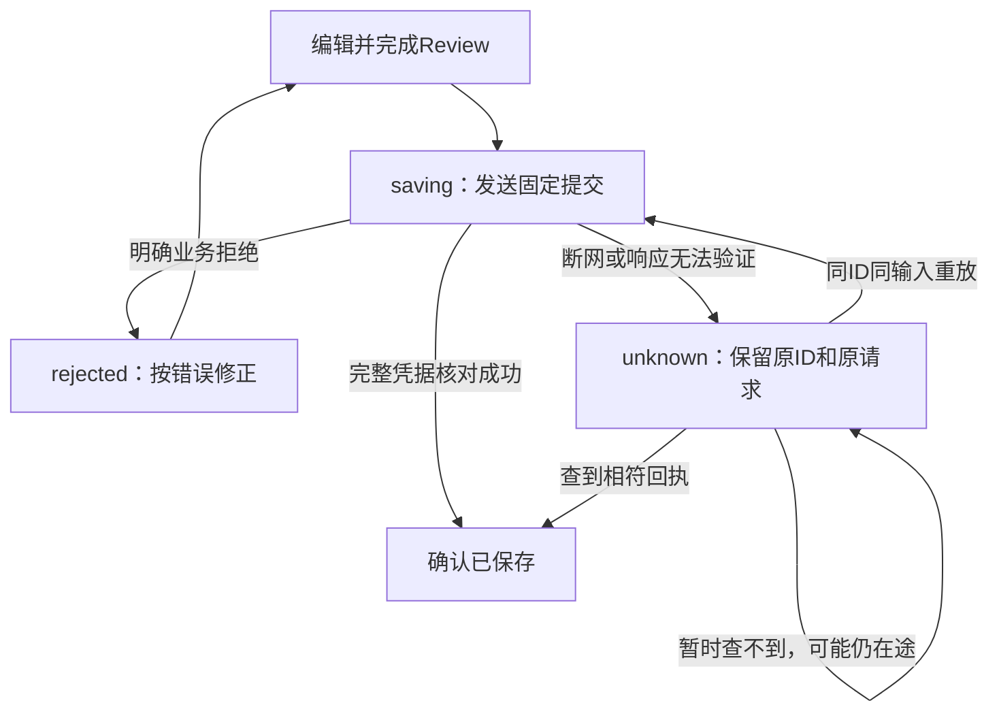

# FitNutri 项目架构与逐文件中文导读

> 分析对象：本次上传的 `Lab_practical_05_Group_6-main (1).zip`。项目根目录为 `Lab_practical_05_Group_6-main/`。  
> 编写日期：2026-10-19。面向有一定计算机基础、尚不熟悉完整 Web 项目的读者。  
> 本文以这份 ZIP 的实际源码、配置、迁移和调用关系为准；历史计划和测试报告用来说明背景，不替代当前代码。

## 阅读目录

- [1. 先知道怎么读这份文档](#chapter-1)
- [2. 先用用户的视角认识它](#chapter-2)
- [3. 整体架构：先把三大块摆对位置](#chapter-3)
- [4. 目录地图：看到一个文件先判断它属于哪类](#chapter-4)
- [5. 前端：页面如何启动、交互、发请求与保存草稿](#chapter-5)
- [6. 后端：请求如何变成可靠的业务操作](#chapter-6)
- [7. 数据库、参考数据、构建运行与测试](#chapter-7)
- [8. 把前端、后端、数据库串起来：七条完整流程](#chapter-8)
- [9. 读代码时最容易看错的地方](#chapter-9)
- [10. 你应该按什么顺序自己打开代码](#chapter-10)
- [11. API总目录怎么用](#chapter-11)
- [12. 逐文件索引的阅读规则](#chapter-12)
- [附录A：前端生产源码与资源（199个文件）](#appendix-a)
- [附录A2：前端测试与测试数据（169个文件）](#appendix-a2)
- [附录A3：前端配置与说明（16个文件）](#appendix-a3)
- [附录B：后端Java生产源码（232个文件）](#appendix-b)
- [附录B2：后端Java测试与测试支撑（142个文件）](#appendix-b2)
- [附录C：数据库资源、构建、脚本与项目配置（95个文件）](#appendix-c)
- [附录D：项目文档、契约、证据与截图（221个文件）](#appendix-d)
- [附录E：文件覆盖与分析依据](#appendix-e)
- [附录F：64项API与真实Controller映射](#appendix-f)
- [附录G：数据库全部字段速查](#appendix-g)

---

<a id="chapter-1"></a>

## 1. 先知道怎么读这份文档

你读完后，应当能回答四类问题：这个项目整体怎么运作；某个页面点击按钮之后发生了什么；正式数据到底存在什么地方；在 IDE 中看到一个文件时，知道它属于哪一层、为什么存在、该继续看谁。

**第一次读，先读正文，不要从后面的上千个文件说明开始背。** 正文先给你整个系统的地图，再讲前端、后端、数据库，最后用完整业务流程把它们串起来。逐文件附录是查字典用的：在 IDE 里看到一个文件名，就在本文中搜索它。

文中的“源码定位”使用项目根目录下的相对路径，例如 `frontend/src/main.tsx`。你可以在 IDE 的“按文件名搜索”里找 `main.tsx`，也可以搜索类名或函数名。路径中反复出现的后端包前缀为 `backend/src/main/java/com/fitnutri/backend/`。

有三个阅读约定：

- **“代码实现了”**：可以从这份源码中找到入口、处理逻辑或相应配置。
- **“历史报告记录了”**：项目原有报告记载的某次检查结果，不代表本次重新执行。
- **“教学示例”**：用假设数据解释真实代码机制；不会把例子里的编号、热量、账号或请求指纹当成真实数据库数据。

这次工作完成了源码结构分析、关键调用链交叉核对和逐文件覆盖检查；还实际运行了不写文件的 API 类型生成一致性检查，确认 **122 组 TypeScript 类型与 Zod schema 没有相对当前 OpenAPI 漂移**，并核对了契约的 **64项HTTP方法/路径与Controller映射一致**。这些是静态结构和契约检查，没有据此声称本机已跑通完整应用、数据库集成测试或真实 AI 服务。

### 1.1 这份 ZIP 到底有多大

总计 **1,074 个文件**，全部进入后面的逐文件索引。文件多，不等于用户看到的页面多：同一个“保存食物”功能会同时涉及页面、请求封装、状态管理、Controller、Service、数据模型、迁移、测试和证据文档。

| 范围 | 文件数 | 怎么理解 |
|---|---:|---|
| `frontend/src/` | 199 | 前端生产源码与资源；其中包含少量当前入口未引用的历史/脚手架文件 |
| `frontend/tests/` | 169 | 前端单元、组件、契约、端到端测试，以及旧 Demo 测试归档 |
| 前端其余文件 | 16 | npm、Vite、TypeScript、lint、测试运行配置等 |
| `backend/src/main/java/` | 232 | 后端正式 Java 源码 |
| `backend/src/test/java/` | 142 | 后端测试代码、测试夹具及数据库测试支撑 |
| 后端其余文件 | 40 | Maven 包装器、应用配置、数据库迁移、数据资源和测试资源 |
| `docs/` | 221 | 121 份 Markdown、API 契约、JSON 证据、变更列表和 84 张截图 |
| `scripts/` | 42 | 数据处理、契约生成、质量检查、数据库维护与这些脚本的测试 |
| `deploy/` | 3 | 构建后前端网关、后端制品固定脚本和部署说明 |
| 根目录等其余文件 | 10 | 根 README、环境模板、Compose、版本/Git 配置、共享计算夹具 |

统计来自本次 ZIP 的实际文件清单。`node_modules/`、`backend/target/` 和 `frontend/dist/` 等安装或构建产物没有包含在这份上传文件中。

<a id="chapter-2"></a>

## 2. 先用用户的视角认识它

项目名是 **FitNutri Assistant**，核心是一套饮食和运动记录应用。一个普通用户先注册和登录、完成个人资料设置，然后记录吃了什么、吃了多少、做了什么运动、持续多久，再查看每天和一段时间的记录、营养和运动估算。

它还支持把若干食材作为“一道菜”记录，把若干运动时段作为“一次训练”记录。图片和语音用于帮助输入；问答是另外一条可选功能链。管理员有账户管理界面。

从用户视角可以这样对应源码：

| 用户在做什么 | 前端主要位置 | 后端主要位置 | 最终涉及的数据 |
|---|---|---|---|
| 注册、登录、退出 | `pages/AuthPage.tsx`、`app/SessionProvider.tsx` | `user/`、`security/` | `app_user`；登录会话由服务器 Session 管理 |
| 完成资料设置 | `pages/OnboardingPage.tsx`、`features/profile/` | `profile/` | `app_user`、`user_profile`、初次 `weight_entry` |
| 后续修改资料、记录体重 | `pages/ProfilePage.tsx` | `ProfileService`、`WeightService` | `user_profile`、按测量日期保存的 `weight_entry` |
| 添加普通食物或组合菜 | `features/entry/food/` | `records/food/`、`foodreference/` | `food_record`；组合菜另有 `food_dish_record` |
| 快速记运动或整次训练 | `features/entry/exercise/` | `records/workout/`、`activity/` | `exercise_record`；整次训练另有 `workout_record` 和动作明细 |
| 确认保存，断网后查结果 | `hooks/useSubmitDraft.ts`、提交状态文件 | `submission/` | 正式记录与 `submission_receipt` |
| 看今天和历史统计 | `pages/DashboardPage.tsx`、`pages/HistoryPage.tsx` | `summary/`、记录读取服务 | 查询已保存且未软删除的快照 |
| 修改、删除、再次记录 | `features/history/`、修改状态与 Review | `FoodEntryMutationService`、`WorkoutMutationService` 等 | 版本校验、已有记录更新/软删除，或独立新建 |
| 用照片、语音辅助录入 | `features/entry/media/` | `food/`、`speech/`、`ai/` | 先返回候选；确认后才走正式记录保存 |
| 询问可选 AI 问答 | `pages/ChatPage.tsx` | `qa/`、`ai/` | 受限读取记录汇总；没有聊天记录数据库表 |
| 管理账户启用/停用 | `pages/AdminPage.tsx` | `admin/` | 只管理最小账户信息，不是查看所有人的饮食历史 |

本表中的前端路径省略了 `frontend/src/`，后端模块省略了 Java 包前缀。**源码定位：**`frontend/src/app/router.tsx`；各业务 Controller；`backend/src/main/resources/db/migration/`。

### 2.1 有些功能是有条件可用的

代码包含图片识别、语音转写/提取和 AI 问答的实现，但默认配置里的 AI 开关为 `false`，还需要后端密钥、模型、对应适配器、数据目录与用户资格。录音还涉及浏览器能力和服务器 FFmpeg。

因此，“存在 `ChatPage.tsx`”不等于“一启动就能问 AI”；“ZIP 里有参考数据 JSON”不等于“你的 PostgreSQL 已经导入这些数据”。`CapabilitiesService` 会检查系统与当前用户的可用条件，前端据此显示可用、不可用及原因。

**源码定位：**`backend/src/main/resources/application.properties`；`capabilities/CapabilitiesService.java`；`ai/AiFeatureRegistry.java`；`frontend/src/hooks/useCapabilities.ts`。

<a id="chapter-3"></a>

## 3. 整体架构：先把三大块摆对位置

**这个项目是 React 单页前端 + Spring Boot 分层单体后端 + PostgreSQL 关系数据库。** 后端按业务包组织，内部使用 Controller、Service、Repository、数据模型及公共基础设施；JPA 和手写 JDBC/SQL 同时存在。

“分层单体”可以拆开理解：**分层**是同一个程序内部有不同职责；**单体**是这些后端模块一起编译、一起在同一个 Spring Boot 应用里运行。`food`、`profile`、`submission` 是不同 Java 包，不是各自部署在独立服务器上的微服务。



箭头表达的是调用或数据访问方向。数据库返回查询结果后，后端组装 JSON；浏览器收到 JSON，再用 React 更新页面。用户看不到 Java 对象或数据库表，只看到页面组件把数据呈现出来。

**源码定位：**`frontend/vite.config.ts`；`deploy/server.mjs`；`backend/pom.xml`；`backend/src/main/resources/application.properties`；各业务服务和 Repository。

### 3.1 三层各自负责什么

| 层次 | 最主要的责任 | 一个具体例子 | 容易混淆的边界 |
|---|---|---|---|
| 前端 | 与用户交互，保存临时输入，发请求，展示结果 | 你选午餐、输入米饭 150g、点击 Review | 草稿加入列表不代表数据库已经写入 |
| 后端 | 校验身份和业务条件，查询参考资料，权威计算，协调事务 | 查询已选食物的每100g数据，计算150g结果，核对提交是否重复 | 前端传来的输入不能代替后端确认；用户身份取自会话 |
| 数据库 | 长期保存数据并实施约束、索引和事务一致性 | 保存食物记录、用户ID、营养快照、日期和版本 | JSON资源、React缓存、测试夹具都不是这份正式记录 |

如果你只记一句：**前端负责让人操作，后端负责决定如何处理，数据库负责可靠地保存和约束数据。** 实际工作有交叉，例如前端也会做输入校验，但最终写入规则由后端和数据库共同落实。

### 3.2 前后端分离，为什么浏览器只请求 `/api`

开发时，浏览器通常打开 `http://localhost:5173`。Vite 提供前端资源，收到 `/api/...` 请求后代理到 `127.0.0.1:8080` 的 Spring Boot。

部署式运行时，React 已经被打包成静态文件。`deploy/server.mjs` 用 Node 提供这些文件，同时转发 `/api` 到 Spring。Node 在这里主要是静态文件服务器和网关；食物计算、账户处理和数据库写入仍在 Java 中。

因此浏览器中的 `apiGet('/profile')` 最终形成 `/api/profile`。请求封装把 `baseURL` 定成 `/api`，不是让每个组件都写死后端主机。前后端源码分开，不意味着浏览器必须用两个不同域名访问它们。

`5432` 是 PostgreSQL 的常见连接端口，主要供后端或数据库工具使用；不是用户在浏览器地址栏里打开应用的地址。新环境的端口、密码和数据库名以你的实际配置为准，旧验证报告里的 `15173/18080/8787` 只是特定历史环境。

**源码定位：**`frontend/src/api/http.ts`；`frontend/src/api/client.ts`；`frontend/vite.config.ts`；`deploy/server.mjs`；`docker-compose.yml`；`docs/getting-started.md`。

### 3.3 Spring MVC、React、分层架构是什么关系

你会在 Maven 里看到 `spring-boot-starter-webmvc`。这里的 Spring MVC 负责 HTTP 请求匹配、参数绑定、调用 Controller，以及把结果转成响应。实际 Controller 使用 `@RestController`，主要返回 JSON。

项目没有使用 Thymeleaf 一类服务器模板来生成整张业务页面。页面由 React 组成，所以不要把“后端用 Spring MVC”理解成“Controller 返回一个 Java 写的网页给你”。

前端组织方式则是按职责与业务功能结合：`pages/` 放页面入口，`features/` 放具体业务交互，`components/` 放复用显示组件，`hooks/` 放复用状态/请求逻辑，`api/` 放接口边界。它们共同组成一个浏览器应用。

### 3.4 四套版本号别混在一起

| 你看到的名称 | 在这个项目里表示什么 | 不表示什么 |
|---|---|---|
| UI/执行规格 `v3`、`v3.1`、`v3.2` | 不同阶段的产品交互与实施变更 | 不是数据库有3.2版表 |
| URL 中 `/api/v2/...` | 新的整体食物/运动记录接口族 | 不是Spring Boot框架版本 |
| 迁移 `V1` 到 `V13` | 数据库结构按顺序演进的13步 | 不是13个数据库 |
| 契约 `mvp-1`、回执 `schemaVersion: 2` | 各自协议/回执格式的标识 | 不要求跟UI版本或迁移编号相同 |

同一份当前代码同时出现这些编号是合理的。后文会把旧兼容接口和当前主界面实际使用的接口分开说明。

<a id="chapter-4"></a>

## 4. 目录地图：看到一个文件先判断它属于哪类

| 目录/文件 | 大白话用途 | 是否直接参与普通用户请求 |
|---|---|---|
| `frontend/src/` | 浏览器应用的主体 | 当前入口可达的文件会参与 |
| `frontend/tests/` | 自动检查前端与完整用户旅程 | 不作为正式界面业务实现 |
| `backend/src/main/java/` | Java服务器的程序主体 | 按配置/入口调用 |
| `backend/src/main/resources/` | 后端运行配置、数据和迁移资源 | 有的随启动读取，有的需显式启用 |
| `backend/src/test/` | 后端测试与合成测试数据 | 运行测试时使用 |
| `docs/api/openapi-mvp.yaml` | 前后端约定的数据和接口格式 | 构建/检查阶段生成或验证契约；不是接口服务本身 |
| `docs/implementation/` | 各阶段设计规格、任务、变更记录 | 不会被浏览器或Spring当业务程序执行 |
| `docs/verification/` | 已有测试报告、追踪矩阵和截图 | 不会让测试自动通过，也不会让页面自动出现 |
| `scripts/data/` | 把来源资料加工为受控目录资源 | 数据准备阶段执行 |
| `scripts/db/` | 检查、初始化/迁移、备份与恢复工具 | 维护阶段显式执行 |
| `scripts/check.sh` | 把多种质量检查串起来 | 开发验证时执行 |
| `deploy/` | 服务构建后前端，并管理后端可执行制品 | 部署式运行时使用 |
| `.env.example` / `.env.test.example` | 配置变量的填空模板 | 复制并配置、导出后供程序读取 |
| `docker-compose.yml` | 定义应用使用的PostgreSQL容器和持久卷 | 启动该容器时使用；不包含React/Java全栈容器 |
| `docker-compose.test.yml` | 测试用的独立数据库环境 | 测试时使用 |

### 4.1 为什么一个功能要拆这么多文件

以保存食物为例：页面需要表单，表单需要草稿状态，请求需要数据类型和解析，服务器要验证输入、读取目录、计算营养、处理重复提交、写入多张表，最后还要验证这些行为。

拆文件的目的，是让每个地方有相对稳定的责任。修改按钮的视觉样式，通常先找组件和主题；修改分餐计算，先找后端份额/营养计算器；新增持久化字段，则需要同时考虑数据库迁移、实体、DTO、接口契约和前端。

因此，**同名概念可能在几层各出现一次，含义却不同**：前端 `foodEntriesV2.ts` 是发HTTP请求的；后端 `FoodEntryV2Controller.java` 接HTTP；`FoodEntryV2Service.java` 组织保存；`FoodRecord.java` 表达数据库记录；迁移SQL创建/调整真实表。这不是重复实现五遍同一件事，而是一次业务流程需要经过的不同环节。

### 4.2 扩展名先学会认

| 扩展名 | 本项目中通常装什么 | 阅读方法 |
|---|---|---|
| `.tsx` | TypeScript逻辑加React组件标记 | 找组件名、props、hook、事件处理和return里的页面结构 |
| `.ts` | 类型、请求、状态机、计算/输入辅助函数、测试 | 找export、函数输入/输出和调用者 |
| `.java` | Java类、接口、record、枚举、配置与测试 | 先看package、注解、构造参数，再看public方法 |
| `.sql` | 建表、改表、索引、约束、查询和数据库检查 | 分清DDL结构变化和SELECT读取 |
| `.json` | 数据资源、manifest、契约样例、包配置和机器报告 | 先看顶层键和一个数组元素，不从第一条看到几千条 |
| `.yaml` / `.yml` | OpenAPI或Compose配置 | 看顶层结构；本项目OpenAPI内容实际采用JSON语法 |
| `.mjs` / `.js` | Node脚本、网关或工具配置 | 先看怎么启动、读哪些参数、导出什么函数 |
| `.py` / `.sh` | 数据加工、检查与维护脚本 | 先看入口、命令参数、读取/写入范围 |
| `.md` | 人读的说明书、计划和报告 | 看日期、版本、适用范围，注意历史措辞 |
| `.png` / `.jpg` / `.svg` | 界面资源或验证图片 | 看它被谁引用；图片自身不会执行业务逻辑 |

下面开始逐层展开。先看浏览器如何启动和管理状态，再看后端如何处理请求，最后看正式数据如何落到表里。

<a id="chapter-5"></a>

## 5. 前端：页面如何启动、交互、发请求与保存草稿

本章在明确讨论前端时，部分路径省略共同的 `frontend/` 或 `frontend/src/` 前缀；源码依据与逐文件附录提供完整定位。TypeScript类型、测试断言与实际运行结果会分别说明。

### 5.1 先建立整幅画面：前端在这个项目里负责什么

FitNutri 的前端是一个 **React + TypeScript 的单页应用**。用户在浏览器中登录、完成资料、输入吃过的食品或做过的运动、复核、保存，再看 Dashboard 与 History。浏览器用 HTTP 请求把用户明确填写的业务输入送给后端，展示后端返回的食品营养、运动估算、记录快照与汇总。

这里的“单页”不表示用户只有一个页面，而表示初始 HTML 提供一个 `root` 容器，后续 `/dashboard`、`/history` 等路径主要由 React Router 决定渲染哪个组件。`index.html` 把 `/src/main.tsx` 作为入口，`main.tsx` 渲染 `AppProviders` 和 `App`，`App.tsx` 把 `router.tsx` 交给浏览器路由器。［源码：`frontend/index.html`；`frontend/src/main.tsx` → `createRoot`；`frontend/src/App.tsx` → `App`；`frontend/src/app/router.tsx` → `routes`］

前端最重要的分工可以分成四件事：

1. **收集输入与帮助用户复核。** 食品参考需要显式选择，克数、餐别、份量和日期要完整；运动需要选实际目录项和时间。
2. **管理暂时状态。** 尚未保存的草稿、正在等待的请求、原提交 ID、未确认的媒体候选都属于浏览器当前会话的内存。
3. **向后端请求权威结果。** 食物营养、按日期及体重估算的运动消耗、完整记录列表和区间统计由后端返回。
4. **验证返回结果属于这次输入。** 不只看“HTTP 成功”，还检查根、配料、时段、身份、版本与预览是否对应本次确认。［源码：`frontend/src/features/entry/draftTypes.ts` → `DraftState`；`frontend/src/hooks/useSubmitDraft.ts` → `useSubmitDraft`；`frontend/src/api/foodPreviewValidation.ts` → `validateFoodPreviewV2`；`frontend/src/api/receiptV2Validation.ts` → `verifyReceiptV2`］

所以，读前端时可以不断问：“这是用户还没保存的输入，还是服务器已经确认的数据？”很多看似复杂的文件，都是为了维持这条边界。

#### 5.1.1 技术依赖分别起什么作用

| 技术 | 本项目中的职责 | 应该去哪里看 |
|---|---|---|
| React | 把状态渲染为组件，响应输入和按钮操作 | `src/pages/`、`src/features/`、`src/components/` |
| TypeScript | 在开发与构建时检查数据类型和联合分支 | `src/api/contracts.ts`、`src/features/entry/draftTypes.ts` |
| Vite | 启动开发服务器、处理 React 模块并产出生产资源 | `vite.config.ts`、`package.json` |
| React Router | URL、页面跳转、角色守卫和离页拦截 | `src/app/router.tsx`、`src/layouts/ProtectedRoute.tsx` |
| MUI + Emotion | 按钮、表单、弹窗、主题与部分样式 | `src/app/theme.ts`、`src/components/presentation.tsx` |
| TanStack React Query | 缓存后端读取结果，管理加载、错误与刷新 | `src/app/queryClient.ts`、`src/hooks/` |
| Axios | 实际 HTTP 传输，发送 Cookie、参数和表单文件 | `src/api/http.ts`、`src/api/client.ts` |
| Zod | 在浏览器运行时检查服务端 JSON 是否满足契约 | `src/api/schemas.ts`、`src/api/validators.ts` |
| Recharts | 展示已有能量、体重和趋势数据 | `src/components/TimeSeriesChart.tsx`、`RecordCharts.tsx` |
| Vitest + Testing Library | 测试纯函数、受控 API 和组件交互 | `tests/unit/`、`tests/contract/`、`tests/component/` |
| Playwright | 测试真实浏览器与后端、数据库链路 | `tests/e2e/`、`playwright.v3.config.ts` |

这是从声明依赖与实际导入得到的用途映射，并非把依赖包的所有能力都视为已经实现。例如 `package.json` 声明了 `react-hook-form`，但主要业务表单实际使用受控输入和 `useState`，不能仅凭包存在就把架构讲成 React Hook Form 驱动。［源码：`frontend/package.json`；`frontend/src/pages/AuthPage.tsx` → `AuthPage`；`frontend/src/features/profile/ProfileSettingsForm.tsx` → `ProfileSettingsForm`］

### 5.2 自上而下阅读：从入口到某一张页面

入口依赖关系可以按下面的图阅读。Provider 是“把某项公共能力提供给所有后代组件”的 React 机制，类似先把共同使用的查询、主题和会话服务准备好，再让页面进入工作。



这张图省略了 JSX 外壳，表达的是能力与页面的嵌套关系。`AppProviders` 只创建一次 QueryClient；`SessionProvider` 使用 `useSyncExternalStore` 订阅 `SessionController`，恢复当前服务器会话；`DraftProvider` 按用户 ID 与会话 epoch 重新建容器。`AppLayout` 负责 Header、主内容 Outlet、保存反馈路由边界及未完成操作保护。［源码：`frontend/src/app/providers.tsx` → `AppProviders`；`frontend/src/app/SessionProvider.tsx` → `SessionProvider`；`frontend/src/app/DraftProvider.tsx` → `DraftProvider`；`frontend/src/layouts/AppLayout.tsx` → `AppLayout`］

#### 5.2.1 真正存在的路由

| URL | 入口组件 | 页面目的与主要下一步 |
|---|---|---|
| `/login` | `LoginRoute` → `AuthPage` | 注册或登录，已登录则按状态跳回合适页面 |
| `/` | `Home` | 根据当前角色、问卷与成年确认状态选择首页 |
| `/onboarding` | `OnboardingPage` | 首次三步资料问卷，最后一次完整提交 |
| `/profile` | `ProfilePage` | 修改资料目标、显示单位、安全回答和按日期体重 |
| `/add` | `AddRecordPage` | 选择食品/运动与手动/语音/图片等可用入口 |
| `/entry` | `EntryPage` | 根据共享草稿类型、来源与版本选择实际编辑器 |
| `/review` | `ReviewPage` | 分发到新建或更正、食物或运动、V2 或兼容复核 |
| `/dashboard` | `DashboardPage` | 日汇总、根记录与近期趋势；新建保存成功的当前落点 |
| `/history` | `HistoryPage` | 日期筛选、统计、趋势、记录详情、更正、删除和复用 |
| `/chat` | `ChatPage` | 符合资格且能力可用时单次问答 |
| `/admin` | `AdminPage` | ADMIN 用户账号搜索、停用和恢复 |
| 其他路径 | `Home` | 回到统一的状态分流，而非单独业务 404 页 |

上表来自实际 `routes`。大多数业务页用 `React.lazy` 延迟加载，放在角色守卫内部；加载时显示 `RouteLoading`，路由异常由 `RouteFailure` 处理。Header 当前提供 Dashboard、History、Profile、Add a record 和账号菜单，**虽然 `/chat` 路由实际存在，顶部导航没有 Chat 项**。［源码：`frontend/src/app/router.tsx` → `routes`、`page`；`frontend/src/app/RouteEntries.tsx` → `Home`、`LoginRoute`；`frontend/src/layouts/Header.tsx` → `Header`］

#### 5.2.2 路由守卫和服务器鉴权分别是什么

`ProtectedRoute` 用于决定浏览器当前展示什么：未登录去 `/login`，普通用户与管理员分开，未完成资料去问卷，需要重新确认成年状态去 `/profile?reconfirm=adult`。它改善导航与页面访问体验。真正的数据权限还必须由后端检查；用户不能因为自己修改浏览器 URL 就获得别人的记录。

`safeReturnTo` 只接受有限站内路径，拒绝外域、双斜线、反斜线及控制字符；`homeFor` 根据角色与资料状态选目的地。后端返回资料读取错误时，`SessionBoundary` 展示重试错误，不能把“没读到”误当“从未填写”。［源码：`frontend/src/layouts/ProtectedRoute.tsx` → `ProtectedRoute`；`frontend/src/layouts/SessionBoundary.tsx` → `SessionBoundary`；`frontend/src/app/sessionRouting.ts` → `safeReturnTo`、`homeFor`］

### 5.3 看懂这个前端的关键：它有几种不同的状态

初学者容易把所有“数据”都叫状态，但它们的寿命、归属和可信度很不一样。

| 状态类别 | 具体内容 | 存在哪里 | 何时丢弃或更新 |
|---|---|---|---|
| 会话状态 | 当前用户、角色、资料、epoch、登录恢复结果 | `SessionController`，由 Context 提供 | 登录、退出、401、账号切换、资料更新 |
| 后端读取缓存 | 目录结果、营养预览、根记录、汇总、体重 | React Query | 输入键改变、主动 invalidate、会话清空 |
| 业务草稿 | 尚未保存的食品、菜肴、运动、动作、日期 | `DraftProvider` 内存 reducer | 显式放弃、确认保存后清理、账号切换、刷新 |
| 冻结提交意图 | 原 submissionId、完整载荷、预览依据 | `DraftState.submission` 或 mutation 状态 | 原意图得到明确结论，或用户明确放弃 |
| 页面表单状态 | 登录输入、资料正在编辑的值、搜索框等 | 对应组件 `useState` 等 | 用户编辑、重设、页面卸载 |
| 媒体临时资源 | 图片对象 URL、音频 Blob、转写文本、候选 | 图片/语音组件与 Recorder | 替换、取消、重新提取、卸载 |
| 保存反馈 | 已保存日期、根定位、提示剩余时间、刷新警告 | 独立 SaveFeedback store | 关闭、消费、会话容器销毁；刷新不恢复 |
| 地址栏状态 | History 日期范围、类型、汇总模式、详情根 | URL 搜索参数 | 导航、过滤更新、浏览器前后退 |

［源码：`frontend/src/app/sessionEpoch.ts` → `SessionState`、`SessionController`；`frontend/src/features/entry/draftTypes.ts` → `DraftState`；`frontend/src/features/feedback/saveFeedbackState.ts` → `createSaveFeedbackStore`；`frontend/src/features/history/historySearch.ts` → `HistorySearch`、`parseHistorySearch`］

#### 5.3.1 Context、Reducer、Hook 在这里怎么配合

- **Context** 让深层组件拿到同一份草稿或会话，不用每层传十几个参数。
- **Reducer** 接收命令和旧状态，返回新状态。例如 `COMPOSER_ADD` 表达“把当前输入加到本次食品列表”，而不是让某个组件随意修改数组。
- **Hook** 把某段协作流程封装起来。例如 `useFoodBatchPreview` 负责根据当前输入查询整批预览，`useSubmitDraft` 负责冻结、保存和恢复。
- **组件** 负责把状态显示出来，并把按钮、输入等动作转为命令。

本项目没有使用 Redux 来管理共享草稿。`draftReducer` 是中心，它进一步委派给 `foodComposerReducer`、`dishDraftReducer`、`groupedDraftReducer`、`submissionV2State` 和旧新 mutation reducer，以便把一大组业务状态转换拆开。［源码：`frontend/src/app/DraftContext.ts` → `DraftContextValue`；`frontend/src/app/DraftProvider.tsx` → `OwnedDraftProvider`；`frontend/src/features/entry/draftReducer.ts` → `draftReducer`、`reduceOwnedDraft`］

#### 5.3.2 owner、epoch、revision 是三道不同的检查

`ownerId` 表示草稿属于哪个账号。`epoch` 表示当前会话是哪一轮：同一个账号退出再登录，也应视为新的一轮。`revision` 表示当前草稿已经变了几次：用户改克数后，先前对应旧克数的结果不能再确认当前输入。

例如 A 账号开始图片识别，网络很慢；随后退出并登录 B。即使 A 的识别结果后来返回，也不能导入 B 的草稿。再例如同一个用户把 100 克改为 150 克，100 克预览晚到也不能显示成 150 克的营养。代码同时使用 AbortController、请求代次和上述身份检查。取消请求只是一种资源控制；检查身份才保证迟到结果不污染新状态。［源码：`frontend/src/app/sessionEpoch.ts` → `clearPrivateResources`、`current`、`hydrate`；`frontend/src/hooks/useFoodSearch.ts` → `useFoodSearch`；`frontend/src/features/entry/media/ImageEntryPanel.tsx` → `process`、`accept`；`frontend/src/features/entry/draftReducer.ts` → `draftReducer`］

#### 5.3.3 生产草稿没有浏览器持久化

真实 `src/` 没有用 localStorage/sessionStorage 保存业务草稿、问答历史或恢复令牌。进入 `/entry` 和 `/review` 之间可以保持，是因为 Provider 仍然活着；硬刷新会重建内存。会话 Cookie 可以让用户仍登录，但 Cookie 不等于草稿数据库。

`useUnsavedChanges` 把真实业务输入、脏表单和未决写操作接到路由 blocker 与 `beforeunload`。用户显式放弃一个未知提交后，后来到达的旧证明也不能把它重新放回编辑器。如果请求已发到服务器，关闭页面本身不能证明服务器撤销事务；刷新后可用 History 查看已经实际保存的记录。这也是专门 E2E 测试覆盖的边界。［源码：`frontend/src/hooks/useUnsavedChanges.ts` → `useUnsavedChanges`；`frontend/src/features/entry/draftNavigation.ts` → `discardDraftForNavigation`；`frontend/tests/component/NoDraftPersistence.test.tsx`；`frontend/tests/e2e/refresh-manual-history.spec.ts`］

### 5.4 从浏览器到后端：API 层的三层保护

#### 5.4.1 传输层：请求发到哪里

Axios 实例的 `baseURL` 是 `/api`，默认携带 Cookie，普通请求十五秒超时。开发环境 Vite 把 `/api` 转到 `http://127.0.0.1:8080`。因此代码中的 `/v2/food/batches` 实际面向浏览器的 URL 是 `/api/v2/food/batches`，不要把它误写成根域 `/v2`，也不要说浏览器直接连 PostgreSQL。［源码：`frontend/src/api/http.ts` → `http`；`frontend/vite.config.ts` → `server.proxy`；`frontend/src/api/submissionsV2.ts` → `createRecordsV2`］

`client.ts` 在非 GET/HEAD/OPTIONS 请求前取得 CSRF：`ensureCsrfToken` 请求 `/api/auth/csrf`，缓存并合并同时到来的令牌请求，再把规定的 `X-CSRF-TOKEN` 头带入业务调用。预览虽然不创建记录，但 HTTP 方法是 POST，仍经过同样的 CSRF 传输规则。

唯一自动重试是明确的 `403 CSRF_INVALID`：刷新令牌后再试一次。它不会对网络超时、普通 500 或未知创建随意重发。FormData 不硬写 JSON Content-Type，浏览器生成 multipart boundary。［源码：`frontend/src/api/client.ts` → `request`；`frontend/src/api/csrf.ts` → `ensureCsrfToken`；`frontend/src/app/queryClient.ts` → `createQueryClient`］

#### 5.4.2 结构层：TypeScript 不会自动检查网络 JSON

`contracts.ts` 和 `schemas.ts` 都由 `scripts/generate_api_types.py` 根据 `docs/api/openapi-mvp.yaml` 生成。前者让开发者写代码时有类型提示；后者是 Zod 可执行模式，实际检查返回 JSON。

服务端若把字符串 ID 返回成数字、漏掉必需的 nullable 字段、返回不认识的枚举或 HTML 页面，`decodeResponse` 不会把它当正常业务对象。它还拒绝包含顶层密码哈希字段的响应。多个 API 适配器对读与写采用不同错误含义：读取结构错误是读取失败，已发出的写请求若 2xx 内容不可信则仍可能已经落库，属于结果未知。［源码：`frontend/src/api/contracts.ts`、`frontend/src/api/schemas.ts` 生成头；`frontend/src/api/validators.ts` → `decodeResponse`；`frontend/src/api/profile.ts` → `writeProfile`；`frontend/src/api/submissionsV2.ts` → `createRecordsV2`］

#### 5.4.3 关系层：格式正确还不够

“这是一个有效 FoodPreview JSON”和“这正是我当前这三项食品的预览”是两个条件。`validateFoodPreviewV2` 把输入与返回的根、配料、ID、参考和克数对齐；运动校验核对时段身份、分钟总量、可用性和已知消耗和；保存回执还需完整覆盖本次 roots 和 leaves。

大整数数据库 ID 使用字符串。例如食品表的 `"7"` 和训练表的 `"7"` 可以同时合法存在，History 用 `kind:id` 组合识别。`clientEntryId` 是前端分配的 UUID，用来贯穿草稿、请求和回执；`rowKey` 是界面行身份；`submissionId` 标识一次已确认创建。这几个 ID 不能互换。［源码：`frontend/src/api/schemas.ts` → `IdSchema`；`frontend/src/api/foodPreviewValidation.ts` → `validateFoodPreviewV2`；`frontend/src/api/exercisePreviewValidation.ts` → `validateExercisePreview`；`frontend/src/features/history/historySearch.ts` → `typedHighlightKey`］

### 5.5 先理解业务对象：根、叶和动作不是同一层

当前主要录入已经是 V2 分组模型。一个“用户眼里的一条记录”叫根；它可以由几片真正参与营养或时长统计的数据组成。

| 用户看到的条目 | 根种类 | 下层结构 | 界面与计量含义 |
|---|---|---|---|
| 一份独立食品 | `SINGLE` | 本身对应一个食品叶 | 一个根、一片食品数据 |
| 一份菜肴 | `DISH` | 多个原料叶 | 一个根，多个原料参与营养计算 |
| 一条快速运动 | `QUICK` | 一个时段 | 一个根，一个计时单位 |
| 一次健身训练 | `WORKOUT` | 多个 `ACTIVITY` 或 `STRENGTH` 时段 | 一个根，多个时段分别计时估算 |
| 力量时段里的具体动作 | movement | 动作名称、组数、次数、负重 | 不是另一个计时时段，不额外累加分钟或能量 |

这解释了为什么测试里“菜肴四个配料加一份独立食品”是 **两个食品根、五片食品叶**，而“五十分钟力量加二十分钟有氧”是 **一个训练根、两个时段、七十分钟**。如果力量段有三个动作，总时间仍是七十分钟。［源码：`frontend/src/features/entry/draftTypes.ts` → `DraftDish`、`DraftPeriod`、`DraftMovement`、`WorkoutDraft`；`frontend/src/features/workout/workoutSelectors.ts` → `workoutMinutes`；`frontend/tests/fixtures/entryRootsV2.ts`；`frontend/tests/component/GroupedHistory.test.tsx`］



图中动作名称只是结构示例，不是预置目录数据。动作信息让用户知道五十分钟里做了什么，不能用“三个动作”把五十分钟乘三。

#### 5.5.1 草稿为何把数字先存成字符串

用户输入过程中可能暂时键入空字符串、`1.` 或不完整分数。这些尚未合法的文本应留在输入框供用户修改，不能一变成数字就强行归零。`quantityGramsInput`、`durationMinutesInput`、分子分母和可选负重都先按字符串保存，再由 `parseQuantity`、`portionInput` 等在准备预览或提交时校验解析。

当前输入规则限制一批 1–20 个食品根、最多 50 个食品组件，一份菜肴 1–20 个配料；运动 1–12 个时段、每力量段最多 30 个动作、总动作最多 100，时段总时间不超过 1440 分钟。克数最多三位小数，分钟最多两位小数。它们是本版本输入边界，历史快照读取有自己的契约，不能把可读旧记录未经确认直接当新输入保存。［源码：`frontend/src/domain/inputRules.ts` → `parseQuantity`；`frontend/src/features/entry/draftValidation.ts` → `validateDraft`；`frontend/src/features/food/portionInput.ts` → `portionInput`；`frontend/src/api/rootReadValidation.ts` → `validateFoodRootRead`］

### 5.6 完整走一遍食品录入

#### 5.6.1 从 Add 开始：创建草稿尚未写记录

`AddRecordPage` 先取得后端 capabilities。食品目录需要当前可用且已验证；图片识别、语音及 Q&A 能力单独判断。用户选择手动食品后，`begin` 创建属于当前账号、业务日期的 food 草稿，同步派发 `START_NEW` 后去 `/entry`。如果已有真正编辑过的草稿，需要明确确认替换。［源码：`frontend/src/pages/AddRecordPage.tsx` → `AddRecordPage`、`begin`；`frontend/src/hooks/useCapabilities.ts` → `useCapabilities`；`frontend/src/features/entry/draftReducer.ts` → `createDraft`］

`EntryPage` 选 `FoodEditor`。手动食品进入 `FoodComposer`，界面有两块互相独立的数据：上方尚未 Add 的 `composer`，以及已经加入这次录入的 `entries`。点击 Add 只是把当前输入加入内存列表，然后开启下一个空 composer。它不会 POST 创建食品记录。［源码：`frontend/src/pages/EntryPage.tsx` → `EntryPage`；`frontend/src/features/entry/FoodEditor.tsx` → `FoodEditor`；`frontend/src/features/entry/food/FoodComposer.tsx` → `FoodComposer`；`frontend/src/features/entry/foodComposerReducer.ts` → `reduceFoodComposer`］

#### 5.6.2 搜索：名字只是找到真实参考的入口

`SmartFoodSearch` 使用 `useFoodSearch` 做三百毫秒防抖，搜索通过 `/api/food-reference/smart-search`，带 query、mode、facets 和分页。界面采用服务端短名、差异描述及 `nextQuestion`，不根据不完整属性补“无油”“生重”等结论。

查询一般至少两个字符，中文字符有单字规则；建议模式先呈现较短列表，用户可以展开完整二十条页或选择明确近似匹配。返回的候选不会自动选中。用户点击之后，才把不可变 referenceId、参考元数据和 EXACT/RELATED/APPROXIMATE/USER_SELECTED 等选择来源放到目标输入。

输入刚改变时，即使还在等防抖，旧结果也先隐藏。缓存键包括 owner、epoch、目录 revision、关键词、模式、条件和页码，避免相同词在不同用户或不同目录版本下复用错误候选。［源码：`frontend/src/features/entry/food/SmartFoodSearch.tsx` → `OwnedSmartFoodSearch`；`frontend/src/hooks/useFoodSearch.ts` → `useFoodSearch`；`frontend/src/api/foodReference.ts` → `validSmartQuery`、`searchSmartFood`］

#### 5.6.3 份量营养：输入在前端，结果由后端给

用户选食品并填克数后，单食品预览经 `useFoodPreview` 请求 `/api/food-reference/by-id/{id}/nutrition?grams=...`。只有返回的参考、克数及必需营养和当前输入一致，界面才能认可。更改克数必须取得新预览；之前的 100 克结果不能直接用在 150 克上。

当前餐别是每条食品自己的字段。改“以后加入的默认餐别”不会重写已经加入的早餐或午餐。移除某条草稿食品立即生效，八秒撤销窗口会把同一个 UUID 放回原位置。准备 Review 时若还有未加入输入，界面让用户选 Add and review、Discard and review 或继续编辑，不能悄悄漏掉最后输入。［源码：`frontend/src/api/foodPreview.ts` → `previewFoodPortion`；`frontend/src/features/entry/food/MyMealList.tsx` → `MyMealList`；`frontend/src/features/entry/food/FoodComposer.tsx` → `FoodComposer`；`frontend/src/app/DraftProvider.tsx` → `OwnedDraftProvider`］

#### 5.6.4 菜肴的两种克数含义

`DishEditor` 默认 PERSONAL：输入每种原料克数，就表示本次本人吃下的那些量。FULL_RECIPE 则输入整锅原始配料，再明确吃了几分之几、多少百分比或几份。

例如整锅配方输入三种原料，份量选择 `1/3`，这里的分母 `3` 会按分数意图保留；不能自动换成 `33.3%`。两者本来就是不同的量。切换 PERSONAL/FULL_RECIPE 会要求确认，保留输入数字、重置份量，并重新解释克数含义。名称或餐别改变不会自行重算营养；配料或份量改变则重新请求相关预览。

服务器返回整食谱与个人份量的结果，前端负责说明原始克数和实际消费量。`foodRootInput` 与 `portionInput` 把字符串表单转成严格 DTO，不发送浏览器自行计算的营养。［源码：`frontend/src/features/entry/food/DishEditor.tsx` → `DishEditor`；`frontend/src/features/entry/food/PortionEditor.tsx` → `PortionEditor`；`frontend/src/features/entry/dishDraftReducer.ts` → `reduceDishDraft`；`frontend/src/features/food/foodInputsV2.ts` → `foodRootInput`；`frontend/src/features/food/portionInput.ts` → `portionInput`］

#### 5.6.5 Review 是完整批次确认，不是重新逐条独立保存

当前食品新建由 `ReviewPage` 分发到 `FoodCreateReviewPage`，其中 `ReviewFoodRoots` 展示全部根、真实餐别和权威总量。`useFoodBatchPreview` 请求 `/api/v2/food/preview`，整批输入签名进入查询键。行内改一份食品的克数，完整批次的有效预览也要更新。

只有在当前草稿合法、所有输入已经加入、没有待替换参考、预览确实绑定本批输入时，`prepareFoodSubmissionV2` 才创建新的 submissionId 和冻结载荷。最后确认由 `useSubmitDraft.confirmV2` 发到 `/api/v2/food/batches`。［源码：`frontend/src/features/entry/ReviewPage.tsx` → `ReviewPage`；`frontend/src/features/entry/food/FoodCreateReviewPage.tsx` → `FoodCreateReviewPage`；`frontend/src/features/entry/food/ReviewFoodRoots.tsx` → `ReviewFoodRoots`；`frontend/src/hooks/useFoodBatchPreview.ts` → `useFoodBatchPreview`；`frontend/src/features/entry/submissionV2State.ts` → `prepareFoodSubmissionV2`］



### 5.7 运动从 Quick 到 Workout

#### 5.7.1 新版选择的是产品选项，动作另有目录

手动运动默认进入 Quick。`ExerciseEntryEditorV2` 可以切到 Gym workout；空草稿直接切换，有真实输入先确认舍弃。V2 普通运动选项来自 `/api/v2/exercise/options`，力量动作来自 `/api/v2/exercise/movements`。类别筛选和动作的身体区域、器材筛选走各自目录。

选一个力量动作时，还必须找到其 `defaultPeriodOptionId` 指向的精确强度选项。`loadExerciseOptionV2` 会有界分页查找那个不可变 ID，找不到就说明，不从第一页拿其他运动替代。与食品相同，搜索结果用 owner、epoch、目录 revision 及输入条件隔离，用户明确选择才写入草稿。［源码：`frontend/src/features/entry/exercise/ExerciseEntryEditorV2.tsx` → `ExerciseEntryEditorV2`；`frontend/src/features/entry/exercise/ExerciseOptionPicker.tsx` → `ExerciseOptionPicker`；`frontend/src/hooks/useExerciseDirectory.ts` → `useExerciseDirectory`；`frontend/src/api/exerciseOptionLookup.ts` → `loadExerciseOptionV2`］

#### 5.7.2 Quick 只需要一段时间，细节可以为空

`QuickExerciseV2` 让用户选择一个实际项目并填分钟。选项可以是活动，也可以是一个力量时段；力量可以附带一个动作及组、次、负重。速度、坡度、距离、机器等级只对 `allowedDetails` 允许的选项显示，填写了不适用值时，改选项要先确认清理。

“可选”不表示“填什么都接受”：空字段合法，填写了就需要合法范围。负重标签清楚说明总杠铃、单只哑铃或器械显示值，前端不会把单哑铃重量偷偷乘二。这些是记录细节，不会在客户端改 MET。［源码：`frontend/src/features/entry/exercise/QuickExerciseV2.tsx` → `QuickExerciseV2`；`frontend/src/features/entry/exercise/EquipmentDetailsEditor.tsx` → `EquipmentDetailsEditor`；`frontend/src/features/entry/exercise/MovementDetailsRow.tsx` → `MovementDetailsRow`；`frontend/src/features/entry/draftValidation.ts` → `validateDraft`］

#### 5.7.3 Workout 的时间从 period 统计

`WorkoutEditor` 管多个时段，每段是 ACTIVITY 或 STRENGTH。`StrengthPeriodEditor` 把很多动作挂在同一段分钟下面，`MovementPicker` 添加具体动作。移除时段或动作可用统一 Undo 恢复原身份，新增有氧段保持时间空白，代码不会编一个默认时长。

`workoutMinutes` 只加 period 的合法分钟。服务器仍负责完整估算：`useExerciseEntryPreview` 请求 `/api/v2/exercise/preview`，缓存键绑当前草稿、业务日期、资料版本与目录版本。因此今天改体重之后读到的新预览，不会在一个已经冻结的未知提交中替换原复核依据。［源码：`frontend/src/features/entry/exercise/WorkoutEditor.tsx` → `WorkoutEditor`；`frontend/src/features/entry/exercise/StrengthPeriodEditor.tsx` → `StrengthPeriodEditor`；`frontend/src/features/workout/workoutSelectors.ts` → `workoutMinutes`；`frontend/src/hooks/useExerciseEntryPreview.ts` → `useExerciseEntryPreview`］

#### 5.7.4 不可估算和请求失败不能混为一谈

后端可以合法返回某个运动没有适用体重或没有适用参考，能量为 null；如果多个时段只有一部分有估算，显示部分可用。用户仍可保存真实做过的运动，因为“做过”并不因缺乏估算依据而消失。

网络断了、HTML 回来了或预览根叶不匹配，含义是“当前没有取得可信预览”，不能当成合法不可估算，也不能补成 0。`ReviewExerciseRoot` 分开显示这些状态，`prepareExerciseSubmissionV2` 要求全体时段的对应计算指纹和完整预览依据，最终创建发 `/api/v2/exercise/entries`。［源码：`frontend/src/api/exercisePreviewValidation.ts` → `validateExercisePreview`；`frontend/src/features/entry/exercise/ReviewExerciseRoot.tsx` → `ReviewExerciseRoot`；`frontend/src/features/entry/submissionV2State.ts` → `prepareExerciseSubmissionV2`；`frontend/src/api/submissionsV2.ts` → `createRecordsV2`］

### 5.8 为什么保存逻辑要拆这么多文件

最容易理解的情况是后端保存后及时返回。但真实网络还有一种情况：**数据库已提交，浏览器没有收到回执**。如果界面直接说失败、生成一个新 ID 再存，就可能重复记录同一餐。这个项目用冻结意图、幂等 submissionId 和精确回执来处理。

#### 5.8.1 三种结果

| 结果 | 能确定什么 | 前端怎么做 |
|---|---|---|
| 明确拒绝 | 已校验的业务错误确认本次意图未被接受，例如合法的输入/版本/依据冲突 | 展示问题，必要时重新预览和再次明确确认 |
| 成功且回执完整匹配 | 这次提交的所有根叶被明确确认 | 清理已提交内容，保存反馈，刷新读取 |
| 结果未知 | 请求可能到达并提交，但超时、断网或返回无法核验 | 保留原 submissionId、完整输入和依据，锁住编辑，先查或原样重试 |

`ApiRequestError` 的 outcome 为 rejected、unknown 或 read-failed，另有 writeAttempted 帮助区分“令牌读取就失败”与“业务写已发出”。不是所有 4xx 都无条件作为已知拒绝，更不能只看 `retryable` 就自动重发。［源码：`frontend/src/api/errors.ts` → `normaliseApiError`、`isKnownRejectedWrite`；`frontend/src/api/client.ts` → `request`］

#### 5.8.2 同步防双击和深冻结

`DraftProvider.dispatch` 先同步计算并写入引用，之后才安排 React 渲染。第一次 Confirm 还没来得及把按钮视觉变灰，第二次调用也已能读到 saving 状态，被状态机拒绝。只禁用按钮是不够的，因为两个组件或两个快速事件都可能发起同一操作。

`freezeSubmissionPayload` 深拷贝、递归 freeze；`prepareFoodSubmissionV2` 和 `prepareExerciseSubmissionV2` 把当前输入与预览准备好后，`reduceSubmissionV2` 校验 owner、epoch、revision 等再进入冻结态。saving 或 unknown 时不能靠改字段、Undo 或换模式偷换已确认请求。［源码：`frontend/src/app/DraftProvider.tsx` → `OwnedDraftProvider`；`frontend/src/features/entry/immutable.ts` → `freezeSubmissionPayload`；`frontend/src/features/entry/submissionV2State.ts` → `reduceSubmissionV2`；`frontend/tests/component/FoodSubmitV2.test.tsx`］

#### 5.8.3 恢复不是“再做一个新的保存”

`useSubmitDraft.recover` 查询原 `/api/v2/submissions/{submissionId}`，拿到证明再对同一个冻结信封校验。如果返回 404，可能原事务还在执行，不能据此断定失败。`retry` 重发的是完全相同的 submissionId 和载荷，不重新分配根叶 UUID。

`verifyReceiptV2` 不满足就仍未知：例如两根五叶的食品批次返回两根四叶，即使 JSON 模式合法，也不能清空用户输入。完整成功后，刷新 Dashboard/History 的 GET 若失败，只提示读取更新暂未完成，不再次创建。［源码：`frontend/src/hooks/useSubmitDraft.ts` → `retry`、`recover`、`acceptV2`、`refreshV2`；`frontend/src/api/receiptV2Validation.ts` → `verifyReceiptV2`；`frontend/tests/e2e/save-unknown-v3.spec.ts`］



图中 Editing、Reviewing 是帮助理解的阶段名，不声称每个都直接对应源码中相同命名的 enum；实际 reducer 状态以 `SubmissionState` 为准。

#### 5.8.4 当前保存后的真实页面行为

V2 成功先由 reducer 生成今天的空输入上下文，保留下一次合适的餐别或模式偏好。`useSaveNavigation` 消费一次成功事件，replace 到 `/dashboard`。从 `/entry` 或 `/review` 离开时，`useDraftNavigationLifecycle` 清掉这个没有业务输入的空草稿。

保存信息仍在独立 SaveFeedback store 中。Dashboard 真正显示时 `SaveFeedbackHost` 才开始消耗两秒提示时间，后台暂停，不抢焦点，不造成布局跳动。短暂提示消失后，`SavedRecordContext` 仍能显示保存日期和 View records 链接。保存过去某天也会进入 Dashboard，链接精确指向那天和回执里的 typed roots。［源码：`frontend/src/features/entry/submissionV2State.ts` → `emptyContinuation`；`frontend/src/features/feedback/useSaveNavigation.ts` → `useSaveNavigation`；`frontend/src/hooks/useDraftNavigationLifecycle.ts` → `useDraftNavigationLifecycle`；`frontend/src/features/feedback/SaveFeedbackHost.tsx` → `SaveFeedbackHost`；`frontend/src/features/feedback/SavedRecordContext.tsx` → `SavedRecordContext`］

目录里仍有 `SavedFoodNotice.tsx`、`SavedExerciseNotice.tsx`，代码包含继续录入旧日期等操作，但生产没有 import 它们。因此不能据这些文件或旧文字说明把现行流程讲成保存后一直停在录入页。当前源码事实是 Dashboard 落点和独立保存反馈。

### 5.9 Dashboard 和 History：读已保存的事实

#### 5.9.1 汇总和列表分开请求

Dashboard 对同一选择日期请求 `/api/summary/daily`，也请求 `/api/v2/food/entries` 与 `/api/v2/exercise/entries` 根列表；近期趋势来自 `/api/summary/trends`。UI 的卡片可以只加载二十条一页，汇总必须覆盖完整区间，因此不能遍历屏幕上这些卡片凑当天总量。

History 用 `useInfiniteQuery` 分别加载食物和运动根，`EntryRootPagination` 提供加载更多。`mergeRootPages` 按 `kind:id` 去重并采用最高 version，保留首次出现顺序，处理分页期间记录被更正导致的位移。Dashboard 会比较汇总根数与列表 total，明显不一致时提示刷新，而不是偷偷修改其中一边来“对齐”。［源码：`frontend/src/pages/DashboardPage.tsx` → `DashboardPage`；`frontend/src/hooks/useRecordQueries.ts` → `useEntryRootQueries`；`frontend/src/features/history/mergeRootPages.ts` → `mergeRootPages`；`frontend/src/features/history/EntryRootPagination.tsx` → `EntryRootPagination`］

#### 5.9.2 零、缺失和没有记录必须读成三件事

界面会区分没有记录、记录但估算未知、真实数值零，以及多段中部分已知。`PeriodStatistics` 使用服务器给出的总量、平均值和该指标自己的 knownDayCount。不能把已知日平均改成总量除以所有日历天数，否则没有记录的日子会被悄悄算成零。

`TimeSeriesChart` 使用线性折线、关闭插值填补，`connectNulls` 不跨缺失点连线。体重图只显示真实测量日期，不把前一次体重自动前向填充。单位切换只把 kJ 显示成 kcal；保存快照保持原规范值。普通 RuleSummary 是确定性的服务器事实文本，不经过 Q&A 模型，也不需要用户先授权问答。［源码：`frontend/src/components/PeriodStatistics.tsx` → `PeriodStatistics`；`frontend/src/components/TimeSeriesChart.tsx` → `TimeSeriesChart`；`frontend/src/components/RecordCharts.tsx` → `WeightChart`；`frontend/src/domain/trendSeries.ts` → `buildTrendSeries`；`frontend/src/components/RuleSummary.tsx` → `RuleSummary`］

#### 5.9.3 History 的 URL 就是可恢复的查询条件

`parseHistorySearch` 解析 from/to/type、period/daily/weekly 汇总模式，以及旧 highlight 和新 typed roots。默认缺省范围是七个日历日；完整范围最多 366 天、不允许未来日期。重复参数、无效日期和错误根类型会被明确拒绝。

新式定位包含 single、dish、quick、workout 种类，不会因为两个表同有 ID 7 就只高亮一个。详情用按 ID 接口读取，所以目标记录不在当前加载页也能找到；若更正后移到了别的日期，界面解释真实日期并提供定位。浏览器 Back/Forward 会恢复 URL 过滤，而非丢掉查询现场。［源码：`frontend/src/features/history/historySearch.ts` → `parseHistorySearch`、`rootLocation`；`frontend/src/pages/HistoryPage.tsx` → `HistoryPage`；`frontend/src/features/history/EntryRootDetailsDialog.tsx` → `EntryRootDetailsDialog`；`frontend/src/components/RecordDetailsDialog.tsx` → `RecordDetailsDialog`］

### 5.10 更正、删除、再记一次：三个操作的身份规则

| 操作 | 是否修改原记录 | 身份与版本 | 主要入口 |
|---|---|---|---|
| Edit / 更正 | 是 | 保留根和被保留子项身份、来源，以原快照作基线，携 expectedVersion；新子项用新 UUID | `EntryRootActions` → `draftFromOwnedRoot` → `RootCorrectionReviewPage` |
| Delete / 删除 | 是，整根删除 | 用当前根 kind/id 和 captured expectedVersion | `EntryRootActions` → `useRootMutations.remove` |
| Log again / 再记一次 | 否，创建新的输入 | 全新 UUID；旧值只是可采用提示 | `EntryRootActions` → `reuseEntry`、`loadFoodRootForReuse` |

#### 5.10.1 更正保留历史快照上下文

`draftFromOwnedRoot` 读取当前拥有的根，在初始化更正草稿时带入原 source、当前 root/leaf clientEntryId、expectedVersion 和冻结 original。original 是比较及冲突核对的基线，不表示正式记录所有旧营养或子项永久不变。更正保留根及继续保留子项的身份，新加子项使用新 UUID；保存会更新相应正式快照，移除子项与动作明细实体替换按后端规则处理。食品原参考失效，不表示历史记录变成不存在；在“更正这条自己的旧记录”上下文可以有明确兼容处理，新创建则不能自动接受失效参考。

`rootCorrectionInput` 提取完整根输入，`rootCorrectionDirty` 规范化比较数值与空值，避免 `100`、`100.0` 或不影响业务的指纹差异制造假变更。更正预览走 `/api/v2/.../entries/{kind}/{id}/preview`，确认 PUT 同一个根路径。更正成功由 `correctedRootLocation` 回到原 History 上下文，并定位实际保存日期，不走新建的 Dashboard 落点。［源码：`frontend/src/features/history/reuseEntry.ts` → `draftFromOwnedRoot`；`frontend/src/features/entry/rootCorrectionIntent.ts` → `rootCorrectionInput`、`rootCorrectionDirty`、`prepareRootCorrection`；`frontend/src/features/entry/RootCorrectionReviewPage.tsx` → `RootCorrectionReviewPage`；`frontend/src/features/history/historySearch.ts` → `correctedRootLocation`］

#### 5.10.2 expectedVersion 用来处理并发编辑

假设用户在两个窗口都读到 version 2，先保存的窗口把记录更新了；后保存的窗口仍带 2，应得到冲突而非覆盖新内容。前端保留该窗口的输入与原版本，提供读取最新记录和比较。只有用户明确选择采用最新，才替换草稿。

未知更正或删除同样冻结原意图，不能换成 create。`useRootMutations.recover` GET 当前根，若满足原修改意图，可说明“当前保存状态已匹配”；这不是证明只有本窗口执行了写入。仍不匹配则保留原 expectedVersion 供原样重试或冲突处理。旧平面记录也有对应 `useRecordMutations` 状态机。［源码：`frontend/src/hooks/useRootMutations.ts` → `recover`、`retry`；`frontend/src/features/entry/rootMutationState.ts` → `matchesRootCorrection`、`reduceRootMutation`；`frontend/src/hooks/useRecordMutations.ts` → `useRecordMutations`］

#### 5.10.3 再记一次为什么先清空数量

复用的目的是少重复找食品和训练结构，并不能证明用户今天仍吃了同样克数或做了同样分钟。`reuseEntry` 和 `foodRootReuse` 分配全新身份，source 为 MANUAL，原始根作为 origin 关联或提示来源；本次克数、时间、设备详情和食谱份量保持空白。Use last 仅明确填入仍为空的输入，不覆盖用户刚输入的新值。

因此“再记一次”不会把保存的 Dish/Workout 对象直接拿来当可变草稿，也不会自动改原数据库行。这与 Edit 的保留原身份正好形成清楚的两种操作。［源码：`frontend/src/features/history/reuseEntry.ts` → `reuseEntry`；`frontend/src/features/food/foodRootReuse.ts` → `loadFoodRootForReuse`；`frontend/src/features/entry/draftReducer.ts` → `copyFoodRootForReuse`、`copyWorkoutForReuse`］

### 5.11 图片与语音怎样接进普通录入

#### 5.11.1 图片候选不是保存记录

图片路径是选择文件、本地预览、明确 Process、查看候选、明确接受、补齐参考餐别克数、共享 Review/Confirm。选择文件本身不上传。`imageFileProblem` 在前端检查 JPEG/PNG/WEBP 和八 MiB 字节上限，界面还说明图片尺寸上限；像素上限的强制验证属于服务端，本前端函数并不完整解码图片像素。

`recognizeImage` 发送实际 FormData 文件至 `/api/food/recognize`，使用七十秒期限。`mapImageCandidates` 分配独立行与客户端身份，保留建议克数但不选参考、不补餐别。文件替换会 abort 旧请求、revokeObjectURL，再用请求代次确保无法取消的迟到响应也不覆盖新图。［源码：`frontend/src/features/entry/media/ImageEntryPanel.tsx` → `choose`、`process`、`accept`；`frontend/src/api/recognition.ts` → `imageFileProblem`、`recognizeImage`；`frontend/src/features/entry/media/imageDraft.ts` → `mapImageCandidates`］

#### 5.11.2 语音有三个服务含义不同的阶段

| 阶段 | 输入与输出 | 是否已创建记录 |
|---|---|---|
| 浏览器录制 | 麦克风 → 真实 WebM/MP4 Blob | 否 |
| 转写 | `/api/speech/transcribe`：音频 → 文本 | 否 |
| 结构提取 | `/api/speech/parse`：已编辑文本 + kind + 悉尼基准日 → 待确认候选 | 否 |
| 共享录入与确认 | 候选补齐真实参考、数量、餐别等 → V2 创建及精确回执 | 成功确认后才是已保存 |

Recorder 构造或支持检查不会直接请求麦克风，用户点击开始才 `getUserMedia`。支持实际 MIME，最长六十秒与八 MiB，停止时等待最终 dataavailable 再形成 Blob。授权迟到、取消、卸载都释放音轨和计时器，不把 WebM 改个扩展名冒充 WAV。［源码：`frontend/src/features/entry/media/Recorder.ts` → `Recorder`、`isSupported`；`frontend/src/domain/media.ts` → `RECORDING_MIME_TYPES`、`MAX_RECORDING_MS`；`frontend/src/api/speech.ts` → `transcribeAudio`、`parseTranscript`］

`VoiceEntryPanel` 把录音、转写、文本编辑、提取和采用分开。用户改了文本，旧候选变 stale，必须重新提取或明确保留当前详情；直接手输 `/review` 也绕不过 `voiceInputStale` 校验。食品候选可能带明确餐别和克数，但参考仍待选；运动候选生成 **未选择 OPTION 的 Quick**，进入新版目录选择和 V2 Review，并不因为来自语音而自动退回旧运动接口。［源码：`frontend/src/features/entry/media/VoiceEntryPanel.tsx` → `changeText`、`extract`、`keepCurrent`；`frontend/src/features/entry/media/voiceDraft.ts` → `voiceImportAction`；`frontend/src/features/entry/draftValidation.ts` → `validateDraft`；`frontend/tests/component/MediaEntryV3Compatibility.test.tsx`］

### 5.12 资料、体重、问答与管理员怎样接在一起

#### 5.12.1 首次问卷是最后一次完整提交

`ProfileSettingsForm` 的 onboarding 模式按关于用户、目标和安全信息组织三步。前后切换仅保存本地表单，最后向 `/api/profile/onboarding` 一次 POST 完整快照，包含初始体重。拒绝 Q&A 同意是合法明确值，不代表不能完成问卷或不能手动记录。

之后 `/profile` 的普通设置使用 PUT `/api/profile`，不夹带体重。未保存表单保持初始化时的版本基线，后台刷新不能突然替换用户正在输入的姓名或目标。成功响应不可信时可读服务器资料核对，版本冲突要用户明确处理。［源码：`frontend/src/features/profile/ProfileSettingsForm.tsx` → `ProfileSettingsForm`、`submit`、`checkSaved`；`frontend/src/features/profile/profileForm.ts` → `onboardingPayload`、`settingsPayload`；`frontend/src/api/profile.ts` → `completeOnboarding`、`updateSettings`］

#### 5.12.2 单位显示和体重时间线分开

`profileForm.ts` 保留规范 kJ 目标。只切换 kJ/kcal 显示不改变物理量；用户真正修改 kcal 输入时，用 BigInt 十进制定点方法一次舍入到规范精度。目标清空明确传 null。

`WeightEntryForm` 针对明确 recordDate 查 `/api/profile/weight`，新增当天测量带 expectedVersion null，更正带原版本，POST 同端点。校验 20–400 kg 及两位小数。冲突读取当前项并再次明确确认，未知先核对同一天。测量历史改变并不使前端重算所有旧保存运动；旧记录仍展示保存时估算依据，新的预览由服务器按日期选重量。［源码：`frontend/src/features/profile/profileForm.ts` → `changeEnergyUnit`、`editEnergyTarget`；`frontend/src/features/profile/WeightEntryForm.tsx` → `submit`、`checkSaved`；`frontend/src/api/weight.ts` → `fetchWeights`、`upsertWeight`；`frontend/tests/component/profile-settings-weight.test.tsx`］

#### 5.12.3 问答是单次后端服务

Chat 资格同时检查 USER、启用状态、成年确认、问卷、安全答案、Q&A 同意和后端 qaEligibility，再看 capabilities.qa。资料不满足与服务未配置是不同提示。

发送只携当前 question、可选明确日期范围与 zone。不会上传整段浏览器聊天历史，也不会把前端自己合计的饮食数据或 profile 当权威上下文；后端根据当前会话自行取其允许的数据。范围最多三十一天。返回 GENERAL、RECORD_SUMMARY、REFUSED 等类型，按普通 React 文本渲染，不执行回答中的 HTML。消息只留页面内存，取消、清除、账号或同意改变会停止等待并忽略旧结果；429 根据有界 Retry-After 等待，没有自动问答重试或固定假答案。［源码：`frontend/src/pages/ChatPage.tsx` → `eligible`、`OwnedConversation`、`send`；`frontend/src/api/qa.ts` → `qaRequestProblem`、`askQuestion`；`frontend/src/api/errors.ts` → `normaliseApiError`］

#### 5.12.4 管理员管理的是账号访问状态

`AdminPage` 以二十条分页查询 `/api/admin/users`，搜索交服务器，状态过滤若仅作用于当前页会明确说明。停用或恢复用 PATCH `/api/admin/users/{id}/deactivate|reactivate`，请求带捕获的 expectedVersion，操作前确认，自己的停用被禁止。

未知结果用 `readAccountState` 有界搜索确切账号核对。UI 没有查看任意用户健康记录，也没有实际密码重置页；生成契约中出现 `ResetPasswordRequest` 只能证明契约类型存在，不能证明管理界面实现了此按钮。［源码：`frontend/src/pages/AdminPage.tsx` → `AccountConsole`；`frontend/src/api/admin.ts` → `fetchAccounts`、`changeAccountStatus`、`readAccountState`；`frontend/src/api/contracts.ts` → `ResetPasswordRequest`］

### 5.13 前端实际 API 索引

下表路径都补上真实 `/api` 前缀。大括号是动态部分，参数细节见相应适配器；这张表列出前端已编写的 API 适配入口，不声称每个导出都被当前页面调用，也不等于后端全部 Controller。

| 用途 | 方法与路径 | 前端函数 |
|---|---|---|
| CSRF | GET `/api/auth/csrf` | `csrf.ts` → `ensureCsrfToken` |
| 注册、登录、退出 | POST `/api/auth/register`、`/login`、`/logout` | `auth.ts` → `register`、`login`、`logout` |
| 当前用户 | GET `/api/auth/me` | `auth.ts` → `fetchCurrentUser` |
| 能力 | GET `/api/capabilities` | `capabilities.ts` → `fetchCapabilities` |
| 资料 | GET/PUT `/api/profile` | `profile.ts` → `fetchProfile`、`updateSettings` |
| 首次问卷 | POST `/api/profile/onboarding` | `profile.ts` → `completeOnboarding` |
| 日期体重 | GET/POST `/api/profile/weight` | `weight.ts` → `fetchWeights`、`upsertWeight` |
| 食品智能搜索 | GET `/api/food-reference/smart-search` | `foodReference.ts` → `searchSmartFood` |
| 食品旧搜索适配器，当前生产无调用 | GET `/api/food-reference/search` | `foodReference.ts` → `searchActiveFood` |
| 参考及份量 | GET `/api/food-reference/by-id/{id}`、`.../nutrition` | `getFoodReference`、`previewFoodPortion` |
| 食品完整预览 | POST `/api/v2/food/preview` | `foodEntriesV2.ts` → `previewFoodV2` |
| 食品新建 | POST `/api/v2/food/batches` | `submissionsV2.ts` → `createRecordsV2` |
| 食品分页、最近 | GET `/api/v2/food/entries`、`/api/v2/food/recent` | `fetchFoodEntriesV2`、`fetchRecentFoodV2` |
| 食品根读改删 | GET/PUT/DELETE `/api/v2/food/entries/{single\|dish}/{id}` | `fetchFoodEntryV2`、`updateFoodEntryV2`、`deleteFoodEntryV2` |
| 食品更正预览 | POST `/api/v2/food/entries/{single\|dish}/{id}/preview` | `previewFoodCorrectionV2` |
| 运动选项、动作 | GET `/api/v2/exercise/options`、`/api/v2/exercise/movements` | `fetchExerciseOptionsV2`、`fetchMovementsV2` |
| 运动预览 | POST `/api/v2/exercise/preview` | `previewExerciseV2` |
| 运动新建、分页 | POST/GET `/api/v2/exercise/entries` | `createRecordsV2`、`fetchExerciseEntriesV2` |
| 最近运动 | GET `/api/v2/exercise/recent` | `fetchRecentExerciseV2` |
| 运动根读改删 | GET/PUT/DELETE `/api/v2/exercise/entries/{quick\|workout}/{id}` | `fetchExerciseEntryV2`、`updateExerciseEntryV2`、`deleteExerciseEntryV2` |
| 运动更正预览 | POST `/api/v2/exercise/entries/{quick\|workout}/{id}/preview` | `previewExerciseCorrectionV2` |
| V2 原提交回执 | GET `/api/v2/submissions/{submissionId}` | `submissionsV2.ts` → `fetchSubmissionV2` |
| 旧创建 | POST `/api/records/food/batch`、`/api/records/exercise` | `submissions.ts` → `createRecords` |
| 旧记录列表和详情 | GET `/api/records/food`、`/api/records/exercise` 及 `/{id}` | `records.ts` → `fetchFoodRecords` 等 |
| 旧记录更正删除 | PUT/DELETE `/api/records/{food\|exercise}/{id}` | `recordMutations.ts` → `updateFoodRecord`、`updateExerciseRecord`、`deleteRecord` |
| 旧运动类型与估算 | GET `/api/records/exercise/types`、`.../estimate` | `exerciseTypes.ts` → `loadExerciseTypes`、`previewDatedExercise` |
| 旧创建回执 | GET `/api/submissions/{submissionId}` | `submissions.ts` → `fetchSubmissionReceipt` |
| 汇总；today 导出当前无生产调用，Dashboard 用 daily | GET `/api/summary/today`、`/daily`、`/weekly`、`/trends` | `summary.ts` → `fetchTodaySummary` 等 |
| 图片识别 | POST `/api/food/recognize` | `recognition.ts` → `recognizeImage` |
| 语音转写、提取 | POST `/api/speech/transcribe`、`/api/speech/parse` | `speech.ts` → `transcribeAudio`、`parseTranscript` |
| 问答 | POST `/api/qa/messages` | `qa.ts` → `askQuestion` |
| 管理账号 | GET `/api/admin/users`；PATCH `/api/admin/users/{id}/{deactivate\|reactivate}` | `admin.ts` → `fetchAccounts`、`changeAccountStatus` |

接口定义的共同底座是 `frontend/src/api/client.ts` → `apiGet/apiPost/apiPut/apiPatch/apiDelete`。每一行的实际 URL 来自表中相应 `frontend/src/api/` 文件；更严格的字段形状来自生成契约与适配器本身。

### 5.14 如何理解目录层级与测试文件

| 目录或文件组 | 职责 | 初读优先级 |
|---|---|---|
| `src/main.tsx`、`App.tsx` | 浏览器入口和路由挂载 | 先读 |
| `src/app/` | Provider、会话、路由、查询键、主题 | 先读会话与路由，再看细节 |
| `src/layouts/` | 页面外框、角色守卫、跨页保护 | 与路由一起读 |
| `src/pages/` | 各 URL 的页面编排 | 按一个真实用户流程读 |
| `src/features/entry/` | 草稿、编辑、复核、创建、更正、媒体 | 食品或运动任选一条先走通 |
| `src/features/food/`、`workout/` | 表单输入转 DTO、份量、复用与选择器 | 与编辑器对应读 |
| `src/features/history/` | 根卡片、筛选、详情、操作、分页 | 保存流程通后读 |
| `src/features/profile/` | 问卷、设置及日期体重 | 与会话资格一起读 |
| `src/features/feedback/` | 成功提示与落点，独立于草稿 | 保存成功那一步再读 |
| `src/hooks/` | 对查询、创建、变更与导航的复用编排 | 顺着页面导入读 |
| `src/api/` | 传输、契约、领域端点和回执核对 | 理解前后端边界时必读 |
| `src/domain/` | 日期、单位、输入规则、标签等纯工具 | 遇到日期/null/小数再看 |
| `src/components/` | 页面共享展示、图表和确认保护组件 | 区分纯展示与有业务编排的组件 |
| `src/styles.css` | 实际入口引入的全局响应式外观 | 最后结合页面类名查 |
| `tests/unit/` | 29 个纯逻辑测试文件 | 看状态机不变量与示例 |
| `tests/contract/` | 35 个传输/结构/身份契约测试 | 看“什么返回才可信” |
| `tests/component/` | 49 个组件和路由场景测试 | 看按钮和状态如何互动 |
| `tests/fixtures/` | 12 个合成数据或测试替身文件 | 配合测试读，勿当生产数据 |
| `tests/e2e/` | 35 个真实浏览器测试、步骤、核验工具与说明文件 | 看跨层验收设计，不把全部视为 spec |
| `tests/legacy-demo/` | 8 个隔离旧演示文件 | 最后读，不能混入生产架构 |

以上数量来自本次完整文件清单，不是按 package 声明推测。测试文件本身也是项目一部分：fixture 表明某个边界用什么样例测试，`.d.mts` 给共享 `.mjs` 步骤提供类型，故障代理用于制造真实响应丢失，数据库核验脚本给测试结果独立对照。

#### 5.14.1 哪种测试能说明哪一层

Vitest 配置运行 unit、contract、component，jsdom 中挂载组件。里面的 Axios adapter、受控 Recorder 和 API mock 能验证前端边界，却不是实际麦克风、AI 模型或真实数据库证据。

Playwright E2E 面向明确准备的本地 React、Spring 与隔离 PostgreSQL。`fault-proxy.mjs` 转发真实业务请求，仅有界丢弃已经返回的创建 ACK 以制造未知；`owned-db-verification.mjs` 对合成账号执行固定查询，并能临时拿测试 owner 行锁制造事务等待；`owned-v3-verification.ts` 核验菜肴、训练、时段、动作和叶账本。E2E 不是简单地 `route.fulfill` 返回假成功页面。［源码：`frontend/vitest.config.ts`；`frontend/tests/setup.ts`；`frontend/playwright.v3.config.ts`；`frontend/tests/e2e/fault-proxy.mjs` → `createFaultProxy`；`frontend/tests/e2e/owned-db-verification.mjs`；`frontend/tests/e2e/owned-v3-verification.ts`］

本次文档工作没有运行这些场景。读测试时应表述为“这里设计了这样一条校验链路”，需要当前执行日志才能说当前环境跑通。

### 5.15 版本并存：哪些是兼容代码，哪些目前没接入

这个仓库不能简单概括为“所有旧代码都死了”，也不能因为看见旧 store 就说生产把数据存在浏览器。

#### 5.15.1 仍在生产调用图中的兼容分支

- `ExerciseEditor.tsx` 和 `api/exerciseTypes.ts` 仍处理旧 REFERENCE 型运动草稿与未映射旧记录更正。
- `CorrectionReviewPage.tsx`、`correctionIntent.ts`、`useRecordMutations.ts` 和旧记录 API 仍用于旧平面快照更正。
- `RecordDetailsDialog.tsx` 仍服务旧式 `highlight=food:id` 或 `exercise:id` 定位。
- `ReviewPage.tsx` 中旧 CreateReviewPage 和旧 submission 状态保持兼容，但当前手动食品、Quick/Workout 与接受后的语音运动主流程已经走 V2。
- 图片或语音食品仍用 `ReviewedFoodRows` 编辑待确认建议，但最终可以进入 V2 食品整批复核保存；“旧形状编辑组件”不等于“全部调用 V1 创建”。

［源码：`frontend/src/features/entry/ReviewPage.tsx` → `ReviewPage`；`frontend/src/pages/EntryPage.tsx` → `EntryPage`；`frontend/src/features/history/EntryRootActions.tsx` → `adopt`；`frontend/src/features/entry/draftSelectors.ts` → `usesExerciseV2`；`frontend/src/features/entry/FoodEditor.tsx` → `ReviewedFoodRows`］

#### 5.15.2 当前生产入口没有使用的文件

从 `src/main.tsx` 沿项目内 import 检查，199 个 `src/` 文件中 189 个进入依赖闭包，另外 10 个如下。这里“进入闭包”包含 TypeScript 类型依赖与样式，不等于十足都会产出运行时代码；未接入则说明当前入口没有这条使用关系。

| 文件 | 实际情况 |
|---|---|
| `src/App.css` | 旧模板样式，未被生产引入 |
| `src/index.css` | 旧模板全局样式，未被生产引入 |
| `src/assets/hero.png` | PNG 素材，未见生产引用 |
| `src/assets/react.svg` | React 模板图标，未见生产引用 |
| `src/assets/vite.svg` | Vite 模板图标，未见生产引用 |
| `src/domain/types.ts` | 仅类型转发，当前没有生产调用 |
| `src/features/entry/exercise/SavedExerciseNotice.tsx` | 旧保存后继续录入 UI，实际反馈已迁移 |
| `src/features/entry/food/SavedFoodNotice.tsx` | 同上，不能代表当前成功落点 |
| `src/features/food/foodDraftSelectors.ts` | `flattenFoodLeaves` 未被生产引入 |
| `src/components/RecordList.tsx` | 仅 `tests/component/record-presentation.test.tsx` 使用，当前页面用根卡片列表 |

`public/icons.svg` 也未见当前 HTML/源码引用；`public/favicon.svg` 则在 `index.html` 明确引用，二者应分别说明。未使用素材并不妨碍运行，但读代码时无需先花时间把它们解释成页面关键链路。

#### 5.15.3 真正隔离的 legacy-demo

`tests/legacy-demo/src/domain.ts` 有本地营养与运动算法，`store.ts` 有 localStorage/sessionStorage、模拟账号、规则提取和固定回答，`seed.ts` 有合成示例。它们只服务独立旧 Node 测试，主 `src/` 不导入。

正确理解是：保留旧演示的历史回归材料，现行应用已经接真实 API。复用 Demo 品牌和表格视觉也不意味着复用 Demo 存储。源码生成头还提醒契约目标与实现状态要分开；看到一个类型或遗留文件不能推导成已经接入的功能。［源码：`frontend/tests/legacy-demo/README.md`；`frontend/tests/legacy-demo/src/store.ts`；`frontend/tests/legacy-demo/source-manifest.json`；`frontend/package.json` → legacy 测试脚本］

### 5.16 建议实际读代码的顺序

第一遍不要从 384 个文件首字母一路读下去。按下面顺序走一条真实流程，每一步都能回答一个问题。

1. **浏览器从哪里启动？** `index.html` → `main.tsx` → `providers.tsx` → `App.tsx` → `router.tsx`。
2. **我是谁，哪些页面能打开？** `SessionProvider.tsx` → `sessionEpoch.ts` → `ProtectedRoute.tsx` → `AuthPage.tsx`。
3. **输入究竟存哪里？** `DraftProvider.tsx` → `draftTypes.ts` → `draftReducer.ts`，先看 `createDraft` 与 owner/revision 检查。
4. **如何加一条食品？** `AddRecordPage.tsx` → `EntryPage.tsx` → `FoodEditor.tsx` → `FoodComposer.tsx` → `SmartFoodSearch.tsx`。
5. **当前食品预览是谁算的？** `useFoodPreview.ts` / `useFoodBatchPreview.ts` → `api/foodPreview.ts` / `foodEntriesV2.ts` → `client.ts`。
6. **最后确认会发生什么？** `FoodCreateReviewPage.tsx` → `submissionV2State.ts` → `useSubmitDraft.ts` → `submissionsV2.ts` → `receiptV2Validation.ts`。
7. **为什么保存后到 Dashboard？** `useSaveNavigation.ts` → `saveFeedbackState.ts` → `SaveFeedbackHost.tsx` / `SavedRecordContext.tsx`。
8. **怎么读已经保存的记录？** `DashboardPage.tsx` → `useRecordQueries.ts` / `useSummary.ts` → `HistoryPage.tsx` → `EntryRootCard.tsx`。
9. **怎么改原记录而不新增？** `EntryRootActions.tsx` → `reuseEntry.ts` → `RootCorrectionReviewPage.tsx` → `rootCorrectionIntent.ts` → `useRootMutations.ts`。
10. **再读第二种业务。** `ExerciseEntryEditorV2.tsx` → `QuickExerciseV2.tsx` / `WorkoutEditor.tsx` → `useExerciseEntryPreview.ts`，对照前面已经理解的食品保存协议。
11. **最后接入辅助方式和配置。** `ImageEntryPanel.tsx`、`VoiceEntryPanel.tsx`、`ChatPage.tsx`、资料体重、测试和构建配置。

读完任一功能，可以用四个问题自查：用户操作发生在哪个组件？内存改变由哪个 reducer 管？HTTP 由哪个 API 函数发？成功或未知的结果由谁核对？如果这四个问题都能顺着 import 回答，前端逻辑基本就已经串起来了。

### 5.17 带着需求找文件的速查表

| 想弄懂的现象 | 先定位这些文件与符号 |
|---|---|
| 为什么账号切换后旧请求不能显示 | `app/sessionEpoch.ts` → `clearPrivateResources`；`app/SessionProvider.tsx`；对应查询键 |
| 为什么改了克数预览暂时消失 | `hooks/useFoodPreview.ts`、`useFoodBatchPreview.ts`；输入签名与 Zod/关系校验 |
| 点击 Add 为什么 History 还没新记录 | `food/FoodComposer.tsx`；`foodComposerReducer.ts` → `COMPOSER_ADD` |
| 1/3 与 33.3% 为什么不互相替换 | `food/PortionEditor.tsx`；`features/food/portionInput.ts` |
| 训练三个动作为什么不乘三倍分钟 | `exercise/StrengthPeriodEditor.tsx`；`workoutSelectors.ts` → `workoutMinutes` |
| 点击两次 Confirm 为什么不会发两份独立创建 | `app/DraftProvider.tsx`；`submissionV2State.ts`；`useSubmitDraft.ts` |
| 超时后为什么不能直接改输入重存 | `api/errors.ts`；`SubmissionRecovery.tsx`；原冻结信封和回执查询 |
| 回执已经成功，为什么还有读取警告 | `useSubmitDraft.ts` → `refreshV2`；`SavedRecordContext.tsx` |
| History 为什么一张菜肴卡包含多配料 | `EntryRootCard.tsx`；`api/contracts.ts` → `FoodRootV2` |
| 旧记录为什么还能显示无营养、失效参考 | `api/rootReadValidation.ts`；`reuseEntry.ts`；旧快照兼容契约 |
| 更正冲突为什么要求读最新而不直接覆盖 | `RootCorrectionReviewPage.tsx`；`rootMutationState.ts`；expectedVersion |
| 录音完成为什么没有自动保存 | `Recorder.ts` → `VoiceEntryPanel.tsx` → `voiceDraft.ts` → 共享复核 |
| 拒绝 Q&A 同意为什么仍可看统计 | `ChatPage.tsx` 的 eligibility 与 `RuleSummary.tsx` 的独立读取边界 |
| 修改 CSS 为什么没效果 | 先确认 `main.tsx` 只引入 `styles.css`，不是 `App.css` 或 `index.css` |

上述路径省略了共同的 `frontend/src/` 前缀；完整逐文件定位请查配套目录。整个前端最终可以串成：用户明确输入，内存草稿组织，服务器预览并确认，精确回执核验，读取已保存快照与统计，再以版本化原记录操作完成更正或删除。每一步的独立文件都在维护其中一段职责与边界。

<a id="chapter-6"></a>

## 6. 后端：请求如何变成可靠的业务操作

本章的源码定位使用两个缩写：`J/`代表 `backend/src/main/java/com/fitnutri/backend/`，`T/`代表 `backend/src/test/java/com/fitnutri/backend/`。例如 `J/user/AuthController.java#login` 表示在该后端Java目录下打开 `user/AuthController.java`，搜索 `login` 方法。

### 6.1 先弄清整个后端是什么形态

这个项目的后端是一个 Spring Boot 应用，内部按业务领域分包，再由控制器、业务服务、数据访问类等角色分工。适合称为**按业务组织的分层单体**：账户、资料、食物、运动、汇总、AI都在同一个Java应用中，调用彼此的方法，主要使用同一个PostgreSQL数据库；不是每个包一个可独立部署的微服务。

`BackendApplication.main` 是启动按钮。它调用 `SpringApplication.run`，让 Spring 找到带注解的组件并装配它们。比如创建 `FoodEntryV2Controller` 时，需要一个 `FoodEntryPreviewService`；Spring找到并创建这个服务，再把它放进控制器构造方法。开发者不需要在每个请求到来时手动 `new` 一整串对象。`@Service`、`@Component`、`@Repository`等注解在这里主要告诉框架：这些对象属于应用的一部分，请负责装配。

项目 `backend/pom.xml` 声明 Java21、Spring Boot4.1.1，并依赖 Web MVC、Spring Data JPA、Security 和 PostgreSQL。这里的 Spring MVC 负责HTTP分发、参数绑定与JSON转换。生产控制器使用 `@RestController` 返回数据；这份后端没有用Thymeleaf把网页模板拼出来再交给浏览器。用户最终看到的页面由前端React负责。说“有Spring MVC”并不能直接推导成“后端还包含一套服务器HTML View”。

**源码依据：** `J/BackendApplication.java#main`；`backend/pom.xml`；各 `*Controller.java` 的 `@RestController` 与返回类型。

#### 6.1.1 每一层分别解决什么问题

| 层次 | 大白话 | 实际例子 | 不宜混淆的边界 |
|---|---|---|---|
| Controller | 接待窗口，知道哪个HTTP地址对应哪项功能 | `FoodEntryV2Controller.create` | 不在这里直接算营养、写一串SQL |
| Request DTO | 用户交来的表单格式 | `FoodEntryInputs.BatchRequest` | 不是数据库实体，也不能随意加owner或营养字段 |
| Service | 执行业务规则的工作人员 | `FoodEntryV2Service.createBatchV2` | 要检查资料、参考、版本、预览和事务 |
| Repository / SQL读取器 | 与数据库交涉的数据访问层 | `FoodRecordRepository`、`FoodEntryReadRepository` | 两者写法不同，但都落到同一个数据库世界 |
| Entity | Java对一张表中一行数据的映射 | `FoodRecord`、`User` | 带关联关系、字段和版本，通常不直接发给网页 |
| Response DTO | 准备交还网页的一份数据单 | `SubmissionReceiptV2Response` | 只挑选允许暴露的字段，不一定等于某张表 |
| 公共策略 | 多个窗口都要遵循的共同规则 | `RecordDatePolicy`、`RecordMutationGuard` | 防止各功能自行定义不同日期、版本和用户规则 |

读一个陌生功能时，不必按文件名首字母顺序读。先找到URL对应的控制器，查看它调用哪个service，再往下看repository和entity。这样每个文件都会出现在一条有目的的调用链里。

#### 6.1.2 为什么同时出现 JPA 和 JdbcTemplate

Spring Data JPA仓库像一个懂对象的数据助手。`FoodRecordRepository extends JpaRepository<FoodRecord, Long>` 表示框架已经提供基本保存、查询、删除等方法；代码再补上“必须是这个用户、这段日期、未软删除”等查询。Hibernate负责对象与表之间的转换。

JdbcTemplate则允许开发者明确写SQL。例如历史页面需要把独立食品与组合菜合在一起分页，或者每天同时统计“有几条食材叶、用户看见几条录入根”。这种查询在 `FoodEntryReadRepository` 和 `SummaryRepository` 中用SQL表达较直接。组合根更正也使用显式SQL精确控制根只升一次版本、哪个子项真正变了。

这不意味着有两个数据库，也不意味着项目没有统一事务。代码让同一业务事务管理这些读写。更准确地说，它对简单实体操作使用JPA，对复杂根分页、批量快照、汇总和部分修改使用SQL。读写路径有不同优化，但源码没有实现一整套独立事件流、消息总线与另一个查询库，因此不要把它包装成完整的CQRS或事件溯源架构。

**源码依据：** `J/records/FoodRecordRepository.java#findOwnedRange`；`J/records/food/FoodEntryReadRepository.java#listRoots`；`J/summary/SummaryRepository.java#foodDays`；`J/records/food/FoodEntryMutationService.java#updateOwnedRoot`。

### 6.2 第一次看 Java 文件时，哪些字最容易看错

`record`有两层含义。业务上的food record是“饮食记录”；Java语言的 `public record ...` 是一种精简的数据载体语法。`FoodRecord`是JPA实体类，而 `FoodRecordResponse` 是用Java record语法写出的响应DTO。不能因为两者都带Record就以为都对应数据库表。

`@Entity`表示这个类参与数据库映射。`@Table(name="food_record")`给出实际表名。`@Id`是主键，`@GeneratedValue`表示新插入时由数据库产生主键。`@ManyToOne`可以理解成“很多食物记录可以引用同一个食品参考”；`@JoinColumn`指定关系存在哪个外键列。这里主键在Java里常是Long，到了网页接口通常转换成字符串，避免JavaScript无法精确表示过大的整数。

`@MappedSuperclass`与普通实体不同。`BaseRecord`集中定义用户、时间、版本和软删除等共享字段，`FoodRecord`及`ExerciseRecord`继承这些字段，但数据库并没有因此多出一张承载所有记录的 `base_record` 表。组合菜根 `FoodDishRecord` 和训练根 `WorkoutRecord` 也有自己的用户、日期、版本等字段，它们没有继承这个父类。

`@Version`是乐观版本字段。它记录“这条内容已经经历了几次修改”，不是软件版本号，也不是数据库迁移的V13。`@Transactional`则定义一次数据库业务的整体成功或失败边界。只读事务的 `REPEATABLE_READ` 可以理解成：一次组合查询尽量看同一时刻的一张数据库照片，避免前半段读到修改前、后半段读到修改后的结果。

`@Getter`、`@Setter`、`@NoArgsConstructor`等来自Lombok，用来减少重复的取值、赋值和构造代码。文件短不意味着这些行为不存在，编译工具会补上。`BigDecimal`用于精确十进制；营养与体重的正式计算不靠浮点Double临时凑数。某些实体仍留着旧Double字段，是历史兼容需要，必须看当前service到底读写哪个字段。

**源码依据：** `J/records/BaseRecord.java#BaseRecord`；`J/records/FoodRecord.java#quantityGramsSnapshot`；`J/records/ExerciseRecord.java#estimatedKj`；`J/common/StrictIdDeserializer.java#deserialize`。

### 6.3 用户身份如何从浏览器一路跟到数据行

#### 6.3.1 实际使用 Session 和 CSRF

本项目用的是HTTP Session。浏览器登录后保留会话Cookie，服务器通过会话恢复Authentication。`SecurityConfig.securityContextRepository`明确选择 `HttpSessionSecurityContextRepository`，CSRF令牌也存放在会话里。源码没有用“登录返回JWT，之后自己拼Bearer token”的方式实现用户认证。AI上游请求里出现Bearer是调用模型服务的凭证，与用户登录是另一回事。

初次修改数据前，前端可GET `/api/auth/csrf`，收到应该使用的headerName和token；之后POST登录、注册或修改记录时带上它。`permitAll`只表示某些URL不要求已经登录，不等于那些POST绕过CSRF检查。登录成功后，`AuthController.login`会调用会话认证策略，轮换Session ID和CSRF，再明确保存新的安全上下文；前端需要配合更新安全令牌。

每一次已登录请求还有 `ActiveAccountFilter` 查数据库。如果管理员已经停用了账户，旧Session不能继续用；如果数据库中的角色改变，旧会话携带的角色也不能继续说了算。若暂时连不上数据库，过滤器返回503而不销毁会话；它不能在无法核实账户时放行，但也不能把数据库宕机直接当作用户主动注销。

**源码依据：** `J/security/SecurityConfig.java#filterChain`、`#sessionAuthenticationStrategy`；`J/security/CsrfController.java#token`；`J/user/AuthController.java#login`；`J/security/ActiveAccountFilter.java#doFilterInternal`。

#### 6.3.2 owner不是前端想填谁就填谁

`CurrentUserService.requireGeneralUser(auth)`先验证Authentication，再回查真实User，确认启用且角色为USER，返回其ID。大部分个人数据控制器用这一ID调用service。正式请求DTO没有让前端随意指定userId的权利。

接下来数据库查询仍加 `WHERE user_id = 当前用户`。例如 `FoodSnapshotReader.batchOwnedRoots`查根和食材时都带owner，不能只按id找一行；外人的id与不存在的id都返回404。安全不是“网页上没显示别人的按钮”就够了，而是每一步知道自己处理谁的数据。

ADMIN在这里有账户管理范围，不自动获得普通用户的私人饮食、体重、问答权限。管理员可以看受限账户列表和停用、恢复、重置密码，但 `AdminUserSummary`只给六个字段，不能顺带把健康资料全部返回。用户主动调用接口时，后端仍会阻止角色不符的操作。

**源码依据：** `J/common/CurrentUserService.java#requireGeneralUser`；`J/records/food/FoodSnapshotReader.java#batchOwnedRoots`；`J/admin/AdminService.java#searchAccounts`；`J/admin/AdminUserSummary.java#AdminUserSummary`。

### 6.4 账户资料与体重：不要误以为所有东西在user表

`app_user`是登录账户：邮箱、密码哈希、名称、角色、启用与版本。`user_profile`是一对一资料：出生年、成人确认、身高、活动水平、显示单位、目标、安全回答与同意等。`weight_entry`是一对多的有日期测量：每一次体重都有自己的记录日期与版本。

第一次完成onboarding时，`ProfileService.completeOnboarding`锁账户，核对账户版本和资料版本，再保存资料和初始体重，最后标记完成。它们在同一事务里：假设保存资料后、写体重时失败，前面资料也要回滚，不能留下“资料已完成但没有初始体重”的半成品。

后续更新资料走 `updateSettings`，并不追加体重。体重走 `WeightService.upsertByDate`：当前用户同一天若没有测量，空expectedVersion表示新建；同一天已有测量且同值、没有期待版本可被识别为重复；真正要改变已有值就要给当前版本。带旧版本即使数值看起来一样，服务也不会绕过冲突。

“当前体重”按测量日期最新确定，补录去年体重不会把当前体重倒退成去年那条。运动估算又有另一种需求：查询运动当天或之前最近的体重。假设10月10日70kg、10月17日75kg，那么补录10月12日运动应该用70kg，不是75kg。已经存好的10月12日运动不会因为今天更正体重就自动改变；只有明确编辑其计算条件时才进入重新审核流程。

`dailyTargetKj`是用户明确设置的目标。`CalorieTargetCalculator`虽然保留了BMR公式和自动增减热量逻辑，但被标记Deprecated，没有Spring Bean或正式接口消费者。不能因为看到这个文件，就向用户说现行Dashboard会自动制定增肌热量。正式SummaryService只查 `findDailyTargetKjByUserId`，没有目标就明确无目标比较。

**源码依据：** `J/user/User.java`；`J/profile/UserProfile.java`；`J/profile/WeightEntry.java`；`J/profile/ProfileService.java#completeOnboarding`、`#updateSettings`；`J/profile/WeightService.java#upsertByDate`；`J/records/ExerciseEstimateService.java#compute`；`J/summary/CalorieTargetCalculator.java`；`J/summary/SummaryService.java#pair`。

### 6.5 正式参考库与用户历史，是两类完全不同的数据

食品参考库回答“这个版本的食品每100g是多少营养”；个人记录回答“这个用户某天某餐实际吃了多少克，当时确认的营养是多少”。用户搜索选中一项后，记录保存其不可变referenceId，同时把计算结果和名称保存为历史快照。

`FoodDataset`记录来源发布与修订、摘要、验证情况；`FoodReference`记录这一版本的具体食品。不同版本可以有同一个publicFoodKey或同样显示名称，但数据库id不同。publicFoodKey是公开来源键，不是数字主键。`active`表示当前是否允许新选择，不表示原参考会被删除。旧版本停用后，历史详情仍应能解释当时使用什么依据。

正式导入不是启动时随便插几条rice和chicken。`ReferenceManifestReader.prepare`先检查原始来源文件、标准化JSON、摘要、数量、键与核心营养，再允许 `ReferenceImportService` 打开写事务。新版本在事务里创建，并整体切换激活状态；同版本不同内容报冲突，同版本同内容是重放。测试fixture里的合成值只是测试材料，不能说它们是生产食品库。

智能搜索还多一层“帮人找到正确食品”的元数据：`FoodSearchProfile`的简称、常见排名与facets，以及 `FoodSearchAlias`的中英文别名。这些字段不改变营养。`SmartFoodQuery`从明确出现的“cooked”“无油”等条件中提取信息，没说加油不等于无油；`SmartFoodSearchService`优先精确匹配、本人最近使用与常见排名，并在确有区别需要确认时给nextQuestion。此处“smart”主要来自审核元数据和规则，不是实时AI生成一套食品营养。

运动也有相同区分。`ExerciseType`承载正式MET与年龄范围；`ExerciseOption`是前端容易选择的产品，例如某类器械或活动方式，并带映射依据；`MovementCatalogue`是具体力量动作及可填写组次负重。某个选项明确UNAVAILABLE时，表示可以记录这个产品，但没有合适能量估算依据；服务不能从别处借一个MET来补空。

**源码依据：** `J/foodreference/ReferenceManifestReader.java#prepare`；`J/foodreference/ReferenceImportService.java#importPrepared`；`J/foodreference/search/SmartFoodQuery.java#parse`；`J/foodreference/search/SmartFoodSearchService.java#search`；`J/activity/catalogue/ExerciseOption.java`；`J/activity/catalogue/MovementCatalogue.java`；`J/activity/catalogue/ExerciseOptionCatalogueReader.java#validateOptionMapping`。

### 6.6 V2为什么要有根和叶

用户认为一次录入“番茄炒蛋”是一道菜，但营养需要从蛋、番茄、油等食材分别计算。代码把用户看到的一次录入称作根，把真正承担计算的最小记录称作叶。这样既能按整道菜显示、编辑和删除，又能明确营养到底来自哪几个食材。

| 录入类型 | 用户看到的根 | 数据库根位置 | 计算叶 | 关键关系 |
|---|---|---|---|---|
| SINGLE | 一项普通食品 | `food_record`本身 | 还是同一行 | 根与叶的id及UUID相同 |
| DISH | 一次组合菜 | `food_dish_record` | 多行`food_record` | 子项通过dish_id归组 |
| QUICK | 一项快速运动 | `exercise_record`本身 | 还是同一时段行 | 根与叶身份相同 |
| WORKOUT | 一次组合训练 | `workout_record` | 多行`exercise_record`时段 | 子项通过workout_id归组 |

workout里还可以有 `workout_movement_log`。它记录动作名、组数、次数与负重，但它不属于这套能量计算叶。一次力量时段已经以分钟和MET算过能量，再按卧推、飞鸟、推肩动作各算一次会重复计数，所以动作表没有独立时长和能量列。

菜根也不保存另一份总营养；训练根也不保存另一份总分钟或总能耗。总数从叶快照加出来，避免根保存1700而食材相加变1699时不知道相信谁。历史页面先按根分页，再批量拉子项，保证20条根的页面不会把某道菜最后两个食材挤到下一页。

`originDishId`与`originWorkoutId`只是“这次复用了哪次历史输入”的来源联系。新记录是一份独立发生的历史，改这次菜不会改上次，也不会改一个全局共享食谱。原始UUID与新发生UUID的区分，使“同样内容重试一次”与“今天又吃了一次同样的菜”能够被程序区分。

**源码依据：** `J/records/food/FoodDishRecord.java`；`J/records/workout/WorkoutRecord.java`；`J/records/workout/WorkoutMovementLog.java`；`J/records/food/FoodEntryReadRepository.java#listRoots`；`J/records/workout/ExerciseEntryReadService.java#listRoots`；`J/submission/SubmissionReceiptV2Response.java#validateTypedProof`。

### 6.7 完整调用链一：食品从搜索到真正提交

#### 6.7.1 搜索只是找依据

用户搜索rice，浏览器请求 `/api/food-reference/smart-search`。`SmartFoodSearchController.search`解析条件和模式，用当前用户ID调用 `SmartFoodSearchService.search`；数据库返回正式参考与区别提示。用户点中某项时只是选好了referenceId，数据库还没有新增这次午餐。

#### 6.7.2 预览是后端计算，但尚未保存

前端送 `POST /api/v2/food/preview`，包含日期、时区、来源和entries。`FoodEntryV2Controller.preview`调用 `FoodEntryPreviewService.previewNewBatch`。服务先做输入形状和日期校验，再批量加载参考，逐叶交给食品或菜计算器。响应包括每个根的叶、营养总数、fingerprint、calculationPolicy和inputSignature。

普通食品公式是“每100g营养 × 实际克数 ÷100”，最后才把每项持久化营养舍入到三位小数。组合菜则用原食材克数再乘一个精确比例。例如整锅配方中某食材300g，你吃三分之一，内部保留分子1与分母3；不能先把三分之一写成近似33.333%，也不能提前把很小的食用克数取整为0。`PortionNormalizer`负责验证并化简，`DishCalculationService`负责直接计算最终叶。

fingerprint是这次计算依据的SHA摘要，inputSignature是该输入的摘要；两者帮助前端和后端识别当前显示的是哪份预览。它们不是用户授权，也不是不可伪造的签名。最终是否允许保存，仍要由登录用户、当前可选参考和服务端重算共同决定。

#### 6.7.3 确认需要再核对一次

用户审核后送 `POST /api/v2/food/batches`。原预览输入之外增加submissionId和previewFingerprint。调用顺序如下：

1. `FoodEntryV2Controller.create`解析当前用户并调用 `FoodEntryV2Service.createBatchV2`。
2. `CanonicalEntryHasherV2.food`对输入形状和规范内容生成提交摘要。
3. `SubmissionService.withSubmissionV2`打开最外层事务并锁住用户，检查相同提交是否已经成功。
4. 若已有同内容回执，直接返回原创建证明；若相同提交号内容不同，409冲突；都不再次插记录。
5. 真正新建时，服务核实成人资料、锁定按ID排序的参考，再调用 `previewNewBatch`重算。
6. 新指纹必须与确认的指纹一致。通过后保存SINGLE或DISH根、每个FoodRecord计算快照。
7. 生成并校验完整roots/leaves证明，写入回执，记录和回执一起提交完成后返回。

任何一个食材不存在、已不能新选、计算不合法或数据库插入失败，整个创建事务回滚，不能只保存前两个菜。首次提交HTTP201，精确重放HTTP200，响应含 `Idempotent-Replay` 和 `replayed`。这比只在前端把保存按钮灰掉多了一层真正的数据库保护。

**源码依据：** `J/records/food/FoodEntryV2Controller.java#preview`、`#create`；`J/records/food/FoodEntryPreviewService.java#preview`；`J/records/food/DishCalculationService.java#calculateScaledReference`；`J/records/food/PortionNormalizer.java#normalisePortion`；`J/records/food/FoodEntryV2Service.java#createBatchV2`；`J/submission/SubmissionService.java#withSubmissionV2`。

### 6.8 完整调用链二：一场健身如何计算和保存

用户先请求 `/api/v2/exercise/options`找到运动产品，需要具体力量动作时再请求 `/api/v2/exercise/movements`。选项的category用于列表分类，periodKind决定这个时段是STRENGTH还是ACTIVITY；这些不是同一个维度，不能把“有氧/力量分类”和“每个目录类型”混写。

前端构建QUICK或WORKOUT预览，POST `/api/v2/exercise/preview`。`WorkoutEstimateService.previewNew`通过 `calculateScoped`检查日期、成人设置、审核选项、可填写器械字段以及动作是否属于该力量时段，然后逐段调用 `ExerciseEstimateService`。

代码采用的计算公式是：`estimatedKj = MET × weightKg × durationMinutes × 4.184 ÷60`。以一个**仅用于解释代码的合成示例**来说，70kg、MET3.5、40分钟的一个力量时段，能量会在最后一步舍入；不管这40分钟里记录了两个还是五个动作，都只按这个时段算一次。器械速度、坡度或负重若只是该产品允许的日志细节，也不会自动覆写参考MET。

估算先检查来源年龄范围。项目只收集出生年，因此它用“活动年份减出生年”判断近似年龄，不是精确生日年龄。若来源年龄不适用，或者活动日之前没有体重，可以保存合法活动分钟，但estimatedKj为空，并返回对应状态和原因。一个workout只有部分时段可估算，knownEnergyKj是已知部分，partial为真；全部时段都不能估算则总能量为空，不能显示成0。

确认POST `/api/v2/exercise/entries`走 `ExerciseEntryV2Service.createEntryV2`，同样借助 `SubmissionService.withSubmissionV2`。先锁产品、真实参考与动作，再计算整根和每个时段指纹；全部相符才写workout根、exercise_record时段、workout_movement_log动作，最后与最小回执一同提交。动作插入最后一步失败也要把前面根和时段一起回滚。

**源码依据：** `J/activity/catalogue/ExerciseOptionController.java`；`J/records/workout/WorkoutEstimateService.java#calculateScoped`；`J/records/ExerciseEstimateService.java#compute`；`J/records/workout/ExerciseEntryV2Service.java#createEntryV2`、`#lockAuthority`；`T/records/workout/WorkoutEstimateTest.java#independentSeventyMinuteExampleCountsStrengthOnceAndDetailsDoNotChangeEnergy`；`T/records/workout/ExerciseEntryV2IT.java#lateMovementInsertFailureRollsBackRootPeriodsAndReceipt`。

### 6.9 完整调用链三：保存没回包，不等于保存没发生

假设后端已经提交完三条食物，准备回201时网络断了。前端只知道没收到响应，不能知道数据库是否提交。若简单换个提交号重发，可能变成六条记录；如果一直显示“失败”也会误导用户。这个项目因此单独设计submission_receipt。

| 字段 | 回答的问题 | 生命周期 |
|---|---|---|
| 数据库id | 这张表中的哪一行 | 数据库创建后确定，JSON通常为字符串 |
| referenceId / optionId | 采用哪个确切目录版本 | 选参考时确定，不能靠名称替代 |
| clientEntryId | 用户这一次草稿中的哪次实际发生 | 创建前生成，重试保持，另一次发生换新UUID |
| submissionId | 这一整次提交是哪一次 | 发送前生成，同次不明结果重试保持 |
| previewFingerprint | 用户确认的是哪套计算依据 | 后端预览生成，计算条件改变需重新审核 |
| expectedVersion | 编辑的是记录的哪一版 | 读取当前详情后获得，更正需匹配 |

恢复时查询 `/api/v2/submissions/{submissionId}`。有回执说明这次创建已提交，响应给出根叶身份；再用这些身份读取当前历史。回执只证明“创建那时产生了什么”，不复制所有营养和用户内容。假设用户后来把菜改了或删了，旧创建回执依然存在，也不会因为重放而把删除撤销。

一次查询返回404也只能说“现在看不到已提交回执”。原POST可能正在等待锁，还没提交；测试专门模拟这种情况。所以在结果不明时必须保持原submissionId和条目UUID，遵守前端恢复流程，而不能把404当作随意换新身份的证据。

最重要的事务设计在 `SubmissionService`：它明确拒绝被外层数据库事务包住，因为否则方法返回“成功证明”时，真正最外层事务还可能没提交。新记录回调也只能做本地数据库校验、计算和写入，不能中途等待昂贵AI网络调用。这样成功响应才能与实际提交保持清晰关系。

同一submissionId重复提交时，摘要相同返回原证明；摘要不同返回 `IDEMPOTENCY_CONFLICT`。跨食品、运动、菜根和训练根复用已经用过的clientEntryId，包括已经软删的身份，会报 `CLIENT_ENTRY_CONFLICT`。同样食品内容但全新submissionId和UUID则是合法另一餐，系统不会把真实第二次发生错误去重。

**源码依据：** `J/submission/SubmissionService.java#withSubmissionV2`、`#findReceiptV2`、`#requireUnusedEntryIdentities`；`J/submission/SubmissionReceiptV2Response.java#validateTypedProof`；`T/submission/SubmissionNetworkRecoveryHttpIntegrationTest.java#actualInFlightPostCanHaveReceipt404BeforeLockReleaseThenCommitOnceWithTheOriginalIds`。

### 6.10 完整调用链四：编辑历史与删除为什么要求版本

两个人或同一个人的两个窗口都读到了菜版本3。A改克数保存，版本变4；B仍拿版本3改餐次。如果没有版本校验，B的旧表单可能把A的新克数覆盖回去。expectedVersion解决的正是“我以为自己在改的内容是否还是数据库当前那一版”。

V2更正通常先POST根的 `/preview`，再PUT根地址。`FoodEntryMutationService.updateOwnedRoot`以及 `WorkoutMutationService.updateOwnedRoot`先锁owner，再锁根，比较版本，按顺序锁相关参考与子项。它们核实根类型、UUID与来源occurrence不变；新增子项也不能盗用另一已保存条目的UUID。

修改标题、餐次或不影响估算的动作详情，不应让历史能量因为今天体重变了而刷新。食品预览在原参考、原克数和原比例都未变时保留叶快照；运动在原选项、原日期与原分钟未变时保留当时估算。真正更换参考、份量、运动日期或分钟才会重新计算，并要求当前预览指纹。业务没有变化且版本仍匹配时，服务可以直接返回旧数据，不制造一次无意义升版。

菜或训练的子项不能绕过根单独修改。旧版FoodRecordService发现dish_id时返回GROUP_EDIT_REQUIRED，旧版ExerciseRecordService发现workout_id时同样拒绝。这既保护用户界面“整道菜”的语义，也保护数据库里所有子项共享餐次日期等关系。

删除使用deleted_at软删除，根和未删除子项在一个事务里标记。历史列表和汇总不再计入，但原id、UUID和回执保留。重复删除已删除根可以返回成功，不意味着删除后可以重用旧身份。更新PUT与创建的幂等回执不是同一机制：PUT主要依靠版本和读取当前详情处理冲突，不能笼统说“所有写接口都由submissionId恢复”。

**源码依据：** `J/records/food/FoodEntryMutationService.java#updateOwnedRoot`、`#softDeleteOwnedRoot`；`J/records/workout/WorkoutMutationService.java#updateOwnedRoot`；`J/records/food/FoodEntryPreviewService.java#calculate`；`J/records/workout/WorkoutEstimateService.java#calculateScoped`；`J/records/FoodRecordService.java#requireUngroupedForLegacyMutation`；`J/records/ExerciseRecordService.java#requireStandalonePeriod`。

### 6.11 完整调用链五：数据库如何变成Dashboard、History与Trends

History按本人业务日期从根及叶快照读取已保存内容。Dashboard和Trends请求 `/api/summary/today`、`/daily`、`/weekly`或`/trends`，所有入口最终调用 `SummaryService`。它用同一规则调用 `SummaryRepository.foodDays`、`exerciseDays`，在PostgreSQL按日期GROUP BY，不依赖前端刚才保存的草稿副本。

食品总能量来自food_record叶；运动总能量来自exercise_record时段。根表不再算一次，动作表也不算。`foodCount`表示食品计算叶数量，`foodEntryCount`表示用户看到的食品录入根数；一个菜三食材是三叶一根。运动时段数与训练根数也分开。这解释为什么某处显示“两次录入”，另一个计算汇总里却有“五条成分”，两者可能都正确。

未知与零严格分开。假设三天可知摄入分别为100、null、0，已知总量100，已知日数2，日均50。不能除以3得到33.333，也不能把第二天当作用户吃0。每种营养和运动能量有自己的已知天数；某天蛋白未知不等于该天能量也未知。一整天空白与“有记录但该指标全未知”还保留不同hasData、记录数和missingValueCount。

`RuleSummaryService`把这些数和覆盖情况写成可复核文字，不调用模型，也不诊断吃得是否足够。目标比较只读取用户当前显式dailyTargetKj，并只比较已有摄入值的日期。它不从运动热量中推出“可以多吃多少”，也不会假装当前目标就是一个月前历史目标。体重变化需要范围内至少两个不同记录日期，以原始十进制差值计算，最后展示才舍入。

查询时区主要决定今天和日期合法性。已保存 `recorded_date` 是业务日期，不会每次拿created_at按当前时区重新划日。因此补录某天午餐，哪怕今天才点击保存，也应该出现在那天历史和那天汇总。一次更正改变日期、分量或软删除，会自然改变之后从数据库重新读取的所有相关汇总。

**源码依据：** `J/summary/SummaryRepository.java#foodDays`、`#exerciseDays`；`J/summary/SummaryService.java#raw`、`#average`；`J/summary/SummaryModels.java#MetricAggregate`；`J/summary/RuleSummaryService.java#buildFacts`；`T/summary/GroupedSummaryConsistencyIT.java#rootAndLeafCountsRemainDistinctAcrossAllViewsAndAllowedQaFacts`；`T/summary/SummaryServiceTest.java#hundredNullZeroAndPartialMetricsUseEachOwnKnownDayDenominator`。

### 6.12 图片、语音与问答在系统中的真实位置

图片路径是上传、实际解码清理、视觉模型候选、正式目录匹配、用户审核、正常食物确认。`OpenAiVisionService`没有User或记录仓库依赖，不能直接替用户保存。模型只返回名字和可空建议克数；数据库ID、正式营养、日期餐次都不能由模型凭空决定。模型没看出食物，就返回空候选，不是自动塞一份演示食物。

音频路径分两次。`AudioValidator`先用本地ffmpeg实际解码上传WebM或MP4，生成去元数据的内存WAV；`TranscriptionService`只得到可编辑文字。用户审核文字后再走 `/api/speech/parse`，`EntryExtractionService`要求模型提取原文片段，`SpeechEvidence`检查名字和数量真的在原文里，并由后端解析日期单位。半小时可明确换30分钟，但一碗饭不会自动换150g；未提餐次时必须留空。当前语音运动解析碰到多个活动会要求拆分，不会只取第一个假装其余不存在。

最终保存仍回到前面正式food/exercise确认链，所以换一种录入方式不等于换一套数据库计算权威。`RecordSource`标注MANUAL、IMAGE或VOICE帮助解释来源，但存进去的正式营养仍来自用户选定的参考和后端计算。

问答则走 `QaService.ask`。先在新短事务里检查账户、成人设置、安全回答和当前显式同意，再检查模型能力；问题由 `QaScopePolicy`做保守范围判断。若用户明确给定最多31天的recordRange，`QaContextBuilder`才调用SummaryService并构造白名单事实。外发内容包括日期、已知量、缺失量、覆盖与当前目标，不包括邮箱、完整资料、食物名和原始体重列表。

模型调用前后会再次检查同意。用户若在请求期间撤回同意，代码可以阻止发送尚未发送的请求，或阻止返回答案；已经发生的合法传输不能倒退撤回，源码也没有假装能这样做。普通记录与客观汇总不因此关停。问答是单次无历史的调用，后端没有这里展示的聊天永久存储表；前端连续展示多条消息不代表每次模型都收到完整历史。

**源码依据：** `J/food/OpenAiVisionService.java#recognizeFood`；`J/food/ImageValidator.java#read`；`J/speech/AudioValidator.java#decode`；`J/speech/EntryExtractionService.java#extract`；`J/speech/SpeechEvidence.java#grams`、`#minutes`；`J/qa/QaService.java#ask`；`J/qa/QaContextBuilder.java#buildAllowedFacts`；`J/qa/OpenAiQaAdapter.java#answer`。

#### 6.12.1 AI传输本身也不是任意联网执行器

`AiTransport`只接受审阅字段和结构化JSON格式，由后端决定model，自动设置store=false、stream=false，限制请求与完整响应体大小。HttpClient禁重定向，处理超时包含响应体读取，不是只等到HTTP头就算成功。上游401会转换成模型配置不可用，不会把当前用户踢出登录；上游限流与坏响应也有固定安全错误。

`AiStructuredOutput`再次检查模型响应完成状态、单一助手文本、准确字段和有限长度；输出不是代码，不会被当工具运行。语音解码的ProcessBuilder也使用固定参数与标准输入输出，不把用户文件名拼成shell命令。这里的保护来自具体边界校验，不能用“用了结构化输出所以内容一定正确”替代后续验证。

**源码依据：** `J/ai/AiTransport.java#sendJson`、`#sendMultipart`、`#validateProviderConfiguration`；`J/ai/AiProviderConfig.java#httpClient`；`J/ai/AiStructuredOutput.java#object`；`J/ai/AiExceptionMapper.java#upstream`。

### 6.13 旧接口、旧字段和测试名，应该怎样读

仓库保留v1风格路径和v2根路径，并不等于两个系统完全互不相干。旧FoodCreationController仍可接收严格的新式单项或批次请求，ExerciseCreationController仍可接收正式参考与指纹的独立运动请求；它们都复用SubmissionService。旧列表主要按计算叶读取，新列表按根展示组合菜与训练。

`LegacyWriteGateTest`这个名字容易误导。实际方法给旧calories写法或不带版本的DELETE发送请求，并要求400且服务未被调用。它说明旧宽松输入不能继续执行，不是说 `/api/records/food` 或全部v1创建已被注销。更新独立记录仍有代码路径；组合子项会要求整根编辑，缺新产品映射的历史运动则有明确兼容读取分支。

类似地，旧 `DaySummary`、`TodaySummaryResponse`、`TrendsResponse`和 `CalorieTargetCalculator`都标记退役。实体里confidence、calories、estimatedCalories或legacy数量字段的存在也不等于现行API接受它们。判断功能的可靠顺序是：HTTP映射到哪个方法、服务读写哪组字段、响应是什么类型、测试到底断言了什么。

**源码依据：** `J/records/FoodCreationController.java`；`J/records/ExerciseCreationController.java`；`J/records/workout/ExerciseEntryReadService.java#unmappedInput`；`T/records/LegacyWriteGateTest.java#oldNutrientWritesHardDeletesAndDefaultWeightEstimatesCannotExecute`；`J/summary/DaySummary.java`；`J/summary/TodaySummaryResponse.java`；`J/summary/TrendsResponse.java`。

### 6.14 测试目录不是另外一套业务系统

单元或组件测试把依赖换成mock或受控对象，专注“给这种输入，会调用谁、返回什么、是否拒绝”。集成测试把Spring、数据库事务和约束接起来；HTTP集成测试再加真实Cookie、CSRF、HTTP请求和JSON。文件名IT或IntegrationTest是线索，最终还要看它继承哪个支撑类、用哪个数据库以及具体方法断言。

`TestDatabase`要求显式本地PostgreSQL16测试连接，创建自己拥有的随机 `fitnutri_it_...` 数据库，并只清理这个数据库；没有H2或应用默认库兜底。`PostgresIntegrationSupport`把它注入Spring测试上下文。Fixture是为了让测试有稳定且可控的食品、运动、时钟和用户；正式来源集成测试另外检查钉住的官方材料，不应把两者混为“已验证所有现实营养”。

受控AI服务 `ControlledAiProvider`是在回环地址启动的测试HTTP服务，可以返回坏JSON、超时或带恶意多余字段的候选，用来检查边界是否可靠。相关测试通过也只证明程序对这些输入有预期反应，不能代替真实模型准确率研究。当前分析没有启动这些测试，文档应写“测试覆盖了哪些设计意图”，不写“本次所有测试全部通过”。

最适合初学者的阅读办法是先读一个成功路径测试，再读一个失败路径。例如看 `FoodEntryBatchV2IT.mixedRootsPersistExactly1700WithPreciseLeavesAndCompleteProof` 理解整批保存，再看 `databaseFailureAfterEarlierInsertRollsBackEveryRootLeafAndReceipt` 理解事务为什么重要。对应每个生产文件的测试还能揭示文件注释没有完全展开的边界。

**源码依据：** `T/support/TestDatabase.java#create`、`#close`；`T/support/PostgresIntegrationSupport.java`；`T/ai/ControlledAiProvider.java`；`T/records/food/FoodEntryBatchV2IT.java`。

### 6.15 数据库迁移在Java侧的接入点

日常请求不应该一边记午饭一边修改数据库表结构。这里 `ControlledMigration` 和 `LegacyBaselineAdoption`是独立维护入口；一个负责在明确目标与批准条件下运行版本迁移，另一个在核对旧结构签名与冲突后显式登记旧V1基线。`LegacyMigrationPolicy`把已确认历史时区注入迁移，未确认不会自动当作悉尼去转换过去时间。

正常应用启动前，`SchemaReadinessCustomizer`调用 `SchemaReadinessGate`读取Flyway历史，要求恰好完整成功的V1到V13。不是“表看起来差不多就可以”，也不是“版本大于等于13都可以”。未知未来迁移、失败或重复历史同样拒绝，因为Java源码只针对当前审阅过的结构、触发器与约束设计。详细SQL表结构应与数据库章节配合阅读。

**源码依据：** `J/common/ControlledMigration.java#migrate`；`J/common/LegacyBaselineAdoption.java#adopt`；`J/common/LegacySchemaVerifier.java#verify`；`J/common/LegacyMigrationPolicy.java#customize`；`J/common/SchemaReadinessGate.java#APPROVED_VERSION`。

### 6.16 建议的后端源码学习路线

先从 `BackendApplication`、`SecurityConfig` 和 `AuthController`知道应用怎样启动、谁能进入；接着用 `ProfileController` 到 `ProfileService` 到 `UserProfileRepository` 学会看一条较简单的分层链。然后读 `FoodEntryV2Controller`、`FoodEntryInputs`、`FoodEntryPreviewService`与两个计算器，理解用户输入和后端计算结果的区别。

理解预览后，再读 `FoodEntryV2Service`与 `SubmissionService`，此时事务、UUID、回执才有具体业务含义。接着看FoodDishRecord与FoodRecord之间的关系，再用FoodEntryReadRepository和FoodSnapshotReader看数据库怎样重新装配成历史页面。最后读根修改服务和SummaryService，就能把创建、更正、删除、统计连成一个完整闭环。

运动沿用相似框架，但额外有产品选项、时段、动作以及有日期体重；读 `WorkoutEstimateService` 时要带着“这一行到底是可展示的产品、一次计算时段、还是只记录动作细节”的问题。AI最后读，因为它只是帮助产生待确认输入或解释有限事实；它没有替代前面账户、参考、计算、回执与数据库规则。

掌握这一条路线后，打开逐文件索引就能知道一个陌生类属于哪一环，而不需要把232个生产文件一口气背下来。

<a id="chapter-7"></a>

## 7. 数据库、参考数据、构建运行与测试

### 7.1 先弄清楚：数据库不是项目里的 JSON，也不是浏览器的某个变量

如果把 FitNutri 想成一个记饮食和运动的服务，浏览器负责让你选择食品、填写克数、看历史；Spring 后端负责判断你是谁、检查输入、找到参考数据、计算和保存；PostgreSQL 负责把结果长期存下来。这三个职责没有因为都放在一个 ZIP 里就变成同一个程序。

`docker-compose.yml` 的 `services.db` 只启动 PostgreSQL 16.15。它定义的 `fitnutri-pgdata` 是数据库持久化的 Docker 命名卷。日常食品记录、运动记录、账号、体重都写进这个数据库，实际数据库文件由 PostgreSQL 管理；它们不是保存回项目里的 `.java`、`.tsx` 或那几份参考 JSON。重新启动前后端后记录仍能存在，依靠的是数据库持久化，而不是 React 把页面一直记住。

`backend/src/main/resources/application.properties` 的 `spring.datasource.url=${DB_URL}` 告诉 Spring 去哪里连接数据库。`DB_USERNAME`、`DB_PASSWORD` 告诉它用什么数据库角色登录。这里的数据库角色也不等于 FitNutri 用户账号：数据库角色是后端连接 PostgreSQL 的身份；`app_user` 中每一行才是通过网页注册的应用账号。通常很多网页用户共享后端的一个数据库连接角色，业务代码再按每条记录的 `user_id` 区分归属。

项目中的 `backend/src/main/resources/data/*.json` 是准备导入的参考材料。例如“某种熟白米饭每100g有什么营养”，不是“Frank昨天吃了多少米饭”。`food_reference` 保存前一种参考事实；`food_record` 保存后一种用户经历。这个区别贯穿整个项目，也解释了为什么保存一条食物记录时要同时留下参考身份和本次营养快照。

### 7.2 读表之前，先理解本项目反复出现的几个词

#### 7.2.1 Table、row、column、primary key

Table 是表，可以暂时理解成一张有固定列名的电子表格；row 是一条记录；column 是这类记录的一项属性。例如 `weight_entry` 是体重测量表，一行表示一次测量，列包括谁的、哪一天、多少千克。数据库比普通电子表格多了类型、唯一性、关联和事务规则，不能随便把“70kg”字符串塞进要求小数的列。

Primary key 是主键，即数据库内部用来唯一识别一行的编号。大部分表使用 `id bigint`，由数据库 identity 自动生成。`user_profile` 比较特殊：它直接用 `user_id` 当主键，所以一个用户最多只能有一份资料。对应 DDL 在 `V1__legacy_schema_baseline.sql`；当前映射见 `profile/UserProfile.java` 的 `@Table` 与 `@Id`。

#### 7.2.2 Foreign key 与“逻辑上有关”不完全相同

Foreign key，即外键，是数据库自己强制检查的关联。例如 `food_record.food_reference_id` 必须指向一条存在的 `food_reference.id`。复合外键则一起核对两个字段：`(dish_id,user_id) → food_dish_record(id,user_id)` 不仅要求菜存在，还要求菜和食材属于同一用户。否则即使拿到别人的菜ID，也不能在数据库中把自己的食材挂上去。定位：`V10__food_dish_records.sql` 的 `food_record_dish_owner`。

另一些信息只是服务层复制或文本关联。例如 `exercise_record.weight_kg_used` 与 `weight_date_used` 是当时用于计算的体重快照，并没有 `weight_entry_id` 外键；`submission_receipt.result_json` 里面的记录ID是创建证明，也不是数据库逐条维护的FK；搜索的 `concept_key` 是文本概念，没有独立 concept 表。讲结构图时必须区分这两种关系，否则会误以为数据库会自动同步所有“看起来有关”的值。

#### 7.2.3 Snapshot、version、soft delete

Snapshot 是快照：把当时确认的计算输入和结果存下来。今天换了食品参考版本，不能悄悄把昨天已经确认的记录换成新营养；今天更新体重，也不能未经明确修正就把过去所有运动消耗重新计算。因此运动记录保存 `met_used`、`weight_kg_used`、`weight_date_used`、`estimated_kj`、`formula_version`，食物记录保存本次克数和营养小数。定位：`V4__record_dates_snapshots_and_receipts.sql`、`records/ExerciseEstimateService.java#compute`。

`version` 是并发修改版本号。假设两个页面都看到版本3，第一个页面成功保存后记录成为版本4；第二个页面如果仍拿版本3来覆盖，后端应当报告冲突，让你重新确认，而不是默默丢掉第一个页面的修改。资料、体重、食品、组合菜、运动与Workout的修改都围绕版本处理，但部分具体SQL更新由服务直接完成，不能把所有版本控制都理解成JPA自动完成。

Soft delete 是软删除：把 `deleted_at` 写成删除时刻，正常历史查询过滤它，原来身份仍然保留。`V13__group_consistency_indexes.sql#protect_entry_identity` 禁止直接物理删除 `food_record`、`food_dish_record`、`exercise_record`、`workout_record`。这样即使记录已删除，原 `client_entry_id` 也不能被另一个请求重新占用。注意 `workout_movement_log` 是根下的可编辑动作细节，修改服务可以替换/删除这些细节行；不能概括成数据库里所有表一律只允许软删除。

#### 7.2.4 业务日期与时间戳

`recorded_date` 是用户说“这顿饭是哪一天”的业务日期；`created_at` 是服务器实际创建这行的时刻；旧版 `recorded_at` 是历史时间戳。补录上周的一顿饭时，业务日期在上周，但创建时刻在今天，这不矛盾。对于旧时间戳，换算成哪天要先知道当时采用的时区，所以V5要求显式历史时区，不能直接套用现在的Sydney时区去猜历史数据。

#### 7.2.5 `NULL`、0 与精度

`NULL` 表示未知、不适用或没有收集，0表示已知就是零。缺体重导致无法估算运动能量时，保存 `estimated_kj=NULL` 和 `MISSING_WEIGHT`，不能保存0让图表误以为运动没有消耗。`SummaryRepository` 用 `sum`、`count(column)` 和总记录数一起生成完整性信息，避免把缺失值当零。当前规范计算使用 Java `BigDecimal` 和 PostgreSQL `numeric`，能量一般落到3位小数；组合菜实际克数保留到12位，避免份额被过早舍入。定位：`foodreference/FoodCalculationService.java#portion`、`records/food/DishCalculationService.java#calculateScaledReference`、`summary/SummaryRepository.java#metricSql`。

### 7.3 数据库整体分组：最终17张应用表

V1–V13重建出来的是17张应用表。Flyway运行后还会管理自己的 `flyway_schema_history`，它记录哪些迁移已执行，不属于饮食/运动业务表。仓库没有名为 `quick_exercise`、`recipe_template`、`chat_history` 的这些业务表；不能仅因为页面上有Quick、复用菜谱或聊天功能，就自行在结构图中添加它们。

#### 7.3.1 第一层关系：用户与自己的数据

| 起点 | 终点 | 实际关系 | 对用户意味着什么 |
|---|---|---|---|
| `app_user.id` | `user_profile.user_id` | 外键，后者同时为主键；一对零或一 | 一个账号最多一套个人资料 |
| `app_user.id` | `weight_entry.user_id` | 外键；一对多 | 一个账号可以记录多天体重 |
| `app_user.id` | `food_record.user_id` 与 `food_dish_record.user_id` | 两个分别存在的外键 | 独立食品、食材和组合菜都明确归属用户 |
| `app_user.id` | `exercise_record.user_id` 与 `workout_record.user_id` | 两个分别存在的外键 | Quick、时段、整次训练都明确归属用户 |
| `app_user.id` | `submission_receipt.user_id` | 外键；一对多 | 每人的提交UUID在自己的范围内识别 |

账号层不是把所有数据塞入 `User` 一个对象。它把登录身份、个人资料、按日期增长的历史分别存放，避免修改展示名字时顺手改动所有身体记录。定位：V1、V2、V4、V10、V12；`user/User.java`、`profile/UserProfile.java`、`profile/WeightEntry.java`。

#### 7.3.2 第二层关系：食品参考、搜索词与一次食用

下面连线均表示所标注字段上的实际外键；从被引用表指向引用表，方便按“一个来源有多个下级”阅读。



`food_record.dish_id` 为空时，这一条就是独立食品；不为空时，它是组合菜内的一项食材。`food_dish_record` 保存菜名、餐次和份额，营养真正存到每一项食材叶子里。搜索短名有自己的修订，不能改写官方营养值。一个别名也可以通过 `concept_key` 逻辑上表示“米饭”这类概念，那条逻辑关系没有画成FK。

#### 7.3.3 第三层关系：官方活动、产品选择、整次训练和动作



Quick没有单独的表：它就是 `exercise_record.workout_id=NULL` 的独立条目。Workout增加一个根，下面的 `exercise_record` 每行代表一个有时长的活动/力量时段。力量动作明细再挂到时段上，存“卧推几组、几次、多重”。不是每个动作都再算一次能量，否则30分钟力量时段和其中5个动作会被叠加算6次。

运动名称与官方参考也不混为一张表。用户看到的“跑步机走路”是产品选项；能否采用某个MET，取决于该选项的明确映射。`UNAVAILABLE` 表示条件不足以匹配，允许保存活动但没有能量估算，不会从一个相似名称硬套功率或速度条件。定位：`V12__exercise_options_workouts.sql`、`activity/catalogue/ExerciseOptionImporter.java`、`scripts/validate_ux_catalogues.py#UNAVAILABLE_OPTIONS`。

### 7.4 张表的逐表重要字段词典

以下列出当前重要字段；完整静态字段名见本文“附录G：数据库全部字段速查”。`migration_created` 是建表版本，不代表某个远程数据库已经执行到该版本。这里的“约束”包括CHECK、唯一索引、FK及触发器，其中部分约束在后续版本被进一步收紧。

#### 7.4.1 `app_user`

登录账号和记录归属根；与身体资料拆表。

| 重要字段 | 大白话解释 |
|---|---|
| `id` | bigint身份主键 |
| `email` | 登录标识；原始唯一约束及lower(btrim(email))唯一索引 |
| `password_hash` | 密码散列值，不是明文密码 |
| `display_name` | 展示名称 |
| `role` | USER或ADMIN |
| `enabled` | 是否允许使用账号 |
| `version` | 并发修改版本号 |
| `created_at / updated_at` | 创建/修改时间戳 |

**关系：** 没有向其他应用表的外键；其他表可引用它。

**重点约束/索引/触发器：** `app_user_role_check`、`app_user_canonical_email_unique`。

**定位：** `backend/src/main/resources/db/migration/V1__legacy_schema_baseline.sql`；`backend/src/main/resources/db/migration/V2__account_profile_weight_integrity.sql`。

#### 7.4.2 `user_profile`

每个用户的一份入门资料、目标、单位、健康回答及同意状态。

| 重要字段 | 大白话解释 |
|---|---|
| `user_id` | 既是主键又是app_user外键，一用户至多一份资料 |
| `birth_year / adult_confirmed` | 出生年份与明确成年确认 |
| `sex / height_cm / activity_level` | 个人基础参数 |
| `goal` | LOSE_FAT、GAIN_MUSCLE、MAINTAIN、NOT_SURE |
| `energy_unit / daily_target_kj` | 展示单位KJ/KCAL；规范目标值仍按kJ存 |
| `health_safety_answer / health_safety_consent` | 健康回答与同意；不是AI调用记录 |
| `ai_qa_eligible / onboarding_completed` | 资格及入门流程状态 |
| `weight_kg` | 由测量历史最新条目同步的便捷字段 |
| `energy_goal_kcal` | 保留旧目标值兼容字段 |
| `version / updated_at / health_safety_updated_at / qa_consent_updated_at` | 并发版本与状态更新时间 |

**关系：** 实际FK：`user_id → app_user.id`；逻辑/快照：`weight_kg → weight_entry.weight_kg`（WeightService同步最新值，没有weight_entry_id外键）。

**重点约束/索引/触发器：** `user_profile_pkey`、`user_profile_energy_unit_check`、`user_profile_daily_target_positive`。

**定位：** `backend/src/main/resources/db/migration/V1__legacy_schema_baseline.sql`；`backend/src/main/resources/db/migration/V2__account_profile_weight_integrity.sql`。

#### 7.4.3 `weight_entry`

带具体日期的体重测量历史，历史运动估算取不晚于运动日期的最新测量。

| 重要字段 | 大白话解释 |
|---|---|
| `id / user_id` | 测量身份与归属 |
| `entry_date` | 业务测量日期 |
| `weight_kg` | numeric(6,2)，20至400kg |
| `version` | expectedVersion并发保护 |
| `created_at / updated_at` | 创建/最后修改时间 |

**关系：** 实际FK：`user_id → app_user.id`。

**重点约束/索引/触发器：** `weight_entry_user_date_unique`、`weight_entry_weight_range`、`weight_entry_user_date_desc`。

**定位：** `backend/src/main/resources/db/migration/V1__legacy_schema_baseline.sql`；`backend/src/main/resources/db/migration/V2__account_profile_weight_integrity.sql`。

#### 7.4.4 `food_dataset`

每一版食物资料来源的说明和内容指纹；不是单条食品。

| 重要字段 | 大白话解释 |
|---|---|
| `id` | 数据集身份 |
| `name / release_name / revision` | 三项一起唯一定位一个资料版本 |
| `source_url / source_note` | 来源及manifest指纹说明 |
| `content_sha256` | 规范化JSON的SHA256 |
| `nutrient_policy` | 每100g营养值的选列策略 |
| `verified / imported_at` | 导入器校验状态与导入时刻 |

**关系：** 没有向其他应用表的外键；其他表可引用它。

**重点约束/索引/触发器：** `food_dataset_version_unique`、`food_dataset_verified_provenance`、`food_dataset_history`。

**定位：** `backend/src/main/resources/db/migration/V3__versioned_reference_catalogues.sql`。

#### 7.4.5 `food_reference`

某版本的每100g食品营养参考事实；同一public_food_key可出现在不同数据集版本。

| 重要字段 | 大白话解释 |
|---|---|
| `id` | V3新引入的稳定数值主键 |
| `dataset_id / public_food_key / survey_id` | 数据集外键及官方食品、调查标识 |
| `official_name / display_name / description` | 原始官方名称、展示名称及派生说明 |
| `energy_kj_100g / protein_g_100g / fat_g_100g / carbs_g_100g` | numeric(12,3)规范每100g数据 |
| `is_active` | 新录入目前可选择的版本 |
| `energy_kcal / proteing / fatg / carbsg / fiberg / sugarg / sodium_mg / food_name` | 保留历史列，部分扩展营养仍被映射 |

**关系：** 实际FK：`dataset_id → food_dataset.id`。

**重点约束/索引/触发器：** `food_reference_dataset_key_unique`、`food_reference_active_key_unique`、`food_reference_canonical_nutrients_valid`、`food_reference_history`。

**定位：** `backend/src/main/resources/db/migration/V1__legacy_schema_baseline.sql`；`backend/src/main/resources/db/migration/V3__versioned_reference_catalogues.sql`。

#### 7.4.6 `food_search_profile`

给某个官方食物参考增加短名称、属性、常见排序和审核证据，不改变营养数据。

| 重要字段 | 大白话解释 |
|---|---|
| `id / reference_id` | 搜索描述身份及food_reference外键 |
| `metadata_revision / review_status / is_active` | 搜索元数据版本、审核状态与当前激活标记 |
| `short_name_en / short_name_zh / concept_key` | 便于用户读懂的英文、中文和概念词 |
| `facets` | jsonb属性，如RAW/COOKED、WHITE/BROWN |
| `common_rank` | 常用程度排序值 |
| `evidence` | jsonb，指出短名和属性依据的官方字段/原文 |
| `search_vector` | 由英文短名生成的tsvector；GIN索引支持检索 |

**关系：** 实际FK：`reference_id → food_reference.id`。

**重点约束/索引/触发器：** `food_search_profile_revision_unique`、`food_search_profile_one_active`、`food_search_active_reviewed`。

**定位：** `backend/src/main/resources/db/migration/V9__food_search_metadata.sql`。

#### 7.4.7 `food_search_alias`

英文或中文搜索别名，可指向具体搜索描述或一个概念；概念不是单独的表。

| 重要字段 | 大白话解释 |
|---|---|
| `id` | 别名身份 |
| `profile_id / concept_key` | 二选一目标 |
| `locale` | en或zh |
| `normalised_text` | 规范化别名 |
| `metadata_revision / review_status` | 适用元数据版本及审核状态 |

**关系：** 实际FK：`profile_id → food_search_profile.id`；逻辑/快照：`concept_key → food_search_profile.concept_key`（concept_key是文本逻辑关联，没有FK，也没有concept表）。

**重点约束/索引/触发器：** `food_search_alias_one_target`、`food_search_alias_profile_unique`、`food_search_alias_concept_unique`。

**定位：** `backend/src/main/resources/db/migration/V9__food_search_metadata.sql`。

#### 7.4.8 `food_dish_record`

一次实际食用的组合菜根记录，描述整锅/个人模式及本次份额；并非可全局修改的食谱模板。

| 重要字段 | 大白话解释 |
|---|---|
| `id / user_id / client_entry_id` | 根身份、用户外键和客户端稳定UUID |
| `name / recorded_date / meal_type / source` | 菜名、日期、餐次及录入来源 |
| `input_mode` | PERSONAL或FULL_RECIPE |
| `portion_input_kind / portion_input_json` | 用户原始份额输入形式 |
| `portion_numerator / portion_denominator` | 约分后的精确有理数份额 |
| `origin_dish_id` | Log again来源，同一用户范围内自外键 |
| `version / created_at / updated_at / deleted_at` | 并发版本、时间戳与软删除 |

**关系：** 实际FK：`user_id → app_user.id`；实际FK：`origin_dish_id,user_id → food_dish_record.id,user_id`。

**重点约束/索引/触发器：** `food_dish_client_unique`、`food_dish_portion_valid`、`food_dish_origin_not_self`、`dish_consistency`、`dish_uuid_namespace`、`dish_identity_history`。

**定位：** `backend/src/main/resources/db/migration/V10__food_dish_records.sql`；`backend/src/main/resources/db/migration/V13__group_consistency_indexes.sql`。

#### 7.4.9 `food_record`

食物营养事实叶子：独立食物直接作为展示根，组合菜中每个食材也是一条叶子。

| 重要字段 | 大白话解释 |
|---|---|
| `id / user_id / client_entry_id` | 服务器身份、用户归属、客户端稳定UUID |
| `recorded_date / recorded_at` | 当前业务日期与保留的时间戳 |
| `food_reference_id / food_name` | 官方参考外键及名称快照 |
| `quantity_grams` | numeric(24,12)，实际吃下的克数 |
| `energy_kj / protein_grams / fat_grams / carbs_grams` | 本次食用营养快照，numeric(12,3) |
| `dish_id / dish_position / active_dish_position` | 可选组合菜归属及活动叶子排序 |
| `ingredient_input_grams` | 录入的食材克数；整锅模式要再乘份额 |
| `nutrition_policy / selection_kind / search_metadata_revision` | 计算策略、用户选用关系及搜索修订信息 |
| `data_quality` | CURRENT或LEGACY_UNVERIFIED |
| `version / deleted_at / updated_at` | 并发、软删除和修改时刻 |
| `quantity_grams_legacy / protein_grams_legacy / fat_grams_legacy / carbs_grams_legacy / calories / confidence` | 保留历史值，不作为当前新录入的权威计算输入 |

**关系：** 实际FK：`user_id → app_user.id`；实际FK：`food_reference_id → food_reference.id`；实际FK：`dish_id,user_id → food_dish_record.id,user_id`；逻辑/快照：`search_metadata_revision → food_search_profile.metadata_revision`（来源追踪文本，不是数据库FK）。

**重点约束/索引/触发器：** `food_record_client_unique`、`food_record_current_complete`、`food_record_dish_shape`、`food_record_dish_position_unique`、`ingredient_consistency`、`food_uuid_namespace`、`food_identity_history`。

**定位：** `backend/src/main/resources/db/migration/V1__legacy_schema_baseline.sql`；`backend/src/main/resources/db/migration/V4__record_dates_snapshots_and_receipts.sql`；`backend/src/main/resources/db/migration/V5__legacy_data_backfill.sql`；`backend/src/main/resources/db/migration/V6__verified_constraints_and_indexes.sql`；`backend/src/main/resources/db/migration/V10__food_dish_records.sql`；`backend/src/main/resources/db/migration/V13__group_consistency_indexes.sql`。

#### 7.4.10 `activity_dataset`

某版本活动/MET资料来源、内容指纹和年龄适用范围。

| 重要字段 | 大白话解释 |
|---|---|
| `id / name / release_name / revision` | 版本身份 |
| `source_url / source_note / content_sha256` | 来源说明及规范化记录指纹 |
| `min_age / max_age` | 此数据集被配置适用的年龄范围 |
| `verified / imported_at` | 资料校验状态及导入时间 |

**关系：** 没有向其他应用表的外键；其他表可引用它。

**重点约束/索引/触发器：** `activity_dataset_version_unique`、`activity_dataset_age_valid`、`activity_dataset_verified_provenance`、`activity_dataset_history`。

**定位：** `backend/src/main/resources/db/migration/V3__versioned_reference_catalogues.sql`。

#### 7.4.11 `exercise_type`

官方活动参考条目，保存原始活动代码、条件说明和MET；产品显示选项另在exercise_option。

| 重要字段 | 大白话解释 |
|---|---|
| `id / dataset_id` | 参考身份与版本外键 |
| `activity_key / source_activity_code` | 应用稳定键与官方活动代码 |
| `display_name / source_description` | 展示名称和适用条件 |
| `met_value` | numeric(6,2)，严格正数 |
| `is_active` | 目前新记录可选择的参考版本 |

**关系：** 实际FK：`dataset_id → activity_dataset.id`。

**重点约束/索引/触发器：** `exercise_type_dataset_key_unique`、`exercise_type_active_key_unique`、`exercise_type_met_valid`、`exercise_type_history`。

**定位：** `backend/src/main/resources/db/migration/V3__versioned_reference_catalogues.sql`。

#### 7.4.12 `exercise_option`

产品里可搜索选择的运动/器械选项；映射到官方MET参考或明确不可估算。

| 重要字段 | 大白话解释 |
|---|---|
| `id / option_key / revision / active` | 产品选项身份、稳定键、修订与启用 |
| `category / period_kind` | 有氧、力量、运动、户外等UI分类；ACTIVITY或STRENGTH时段 |
| `display_name / aliases` | 用户名称与中英文别名 |
| `allowed_details` | 允许用户补充的器械参数集合 |
| `reference_id / mapping_kind` | 可选MET参考及SPECIFIC_REFERENCE、GENERAL_ACTIVITY_ESTIMATE、UNAVAILABLE映射类别 |
| `mapping_evidence / review_status` | 映射依据与审核状态 |

**关系：** 实际FK：`reference_id → exercise_type.id`。

**重点约束/索引/触发器：** `exercise_option_revision_unique`、`exercise_option_one_active`、`exercise_option_mapping_shape`、`exercise_option_strength_kind`、`exercise_option_history`。

**定位：** `backend/src/main/resources/db/migration/V12__exercise_options_workouts.sql`；`backend/src/main/resources/db/migration/V13__group_consistency_indexes.sql`。

#### 7.4.13 `movement_catalogue`

力量动作词典，保存卧推/深蹲等动作以及如何理解负重；不保存动作的MET或时长。

| 重要字段 | 大白话解释 |
|---|---|
| `id / movement_key / revision / active` | 动作词典身份及版本 |
| `display_name / aliases / body_region / equipment_type` | 动作名称、别名、部位与器械 |
| `load_basis` | 总杠铃、单只哑铃、机器显示、额外负重、辅助重量 |
| `allowed_fields` | 是否接受组数、次数、负重 |
| `default_period_option_id` | 对应的已审核STRENGTH运动选项 |
| `review_status` | 审核状态 |

**关系：** 实际FK：`default_period_option_id → exercise_option.id`。

**重点约束/索引/触发器：** `movement_revision_unique`、`movement_one_active`、`movement_default_option_check`、`movement_catalogue_history`。

**定位：** `backend/src/main/resources/db/migration/V12__exercise_options_workouts.sql`；`backend/src/main/resources/db/migration/V13__group_consistency_indexes.sql`。

#### 7.4.14 `workout_record`

一次健身训练的展示根，下面由多个有明确时长的活动/力量时段组成。

| 重要字段 | 大白话解释 |
|---|---|
| `id / user_id / client_entry_id` | 根记录身份和归属 |
| `title / recorded_date / source` | 训练名称、日期和录入来源 |
| `origin_workout_id` | 同用户的再次记录来源；不是与原记录保持同步 |
| `version / created_at / updated_at / deleted_at` | 并发版本及软删除生命周期 |

**关系：** 实际FK：`user_id → app_user.id`；实际FK：`origin_workout_id,user_id → workout_record.id,user_id`。

**重点约束/索引/触发器：** `workout_client_unique`、`workout_origin_not_self`、`workout_consistency`、`workout_uuid_namespace`、`workout_identity_history`。

**定位：** `backend/src/main/resources/db/migration/V12__exercise_options_workouts.sql`；`backend/src/main/resources/db/migration/V13__group_consistency_indexes.sql`。

#### 7.4.15 `exercise_record`

运动能量事实叶子；workout_id为空时就是Quick，非空时是Workout中的一个活动时段。

| 重要字段 | 大白话解释 |
|---|---|
| `id / user_id / client_entry_id` | 记录身份、归属和客户端UUID |
| `recorded_date / recorded_at` | 业务日期及原时间戳 |
| `exercise_type_id / exercise_type` | 官方参考外键与兼容名称 |
| `duration_minutes` | numeric(8,2)，当前记录大于0且最多1440分钟 |
| `exercise_option_id / option_name_snapshot / period_kind` | 产品选择及当时名称、时段类别 |
| `workout_id / period_position / active_period_position` | 可选训练根及顺序 |
| `equipment_details` | jsonb，可选速度、坡度、距离、档位 |
| `estimated_kj / estimate_status` | 能量快照及AVAILABLE/MISSING_WEIGHT/NO_APPLICABLE_REFERENCE/LEGACY_UNVERIFIED |
| `weight_kg_used / weight_date_used / met_used / formula_version` | 计算使用的体重、日期、MET与公式版本快照 |
| `data_quality / version / deleted_at / updated_at` | 质量、并发及生命周期 |
| `duration_minutes_legacy / estimated_calories / intensity` | 保留旧值；未收集强度允许NULL |

**关系：** 实际FK：`user_id → app_user.id`；实际FK：`exercise_type_id → exercise_type.id`；实际FK：`exercise_option_id → exercise_option.id`；实际FK：`workout_id,user_id → workout_record.id,user_id`；逻辑/快照：`weight_kg_used,weight_date_used → weight_entry.weight_kg,entry_date`（快照复制；没有weight_entry_id外键，之后改体重不自动重算历史）。

**重点约束/索引/触发器：** `exercise_record_client_unique`、`exercise_record_current_complete`、`exercise_record_available_complete`、`exercise_record_period_shape`、`exercise_record_period_position_unique`、`exercise_option_snapshot_check`、`period_consistency`、`exercise_uuid_namespace`、`exercise_identity_history`。

**定位：** `backend/src/main/resources/db/migration/V1__legacy_schema_baseline.sql`；`backend/src/main/resources/db/migration/V4__record_dates_snapshots_and_receipts.sql`；`backend/src/main/resources/db/migration/V5__legacy_data_backfill.sql`；`backend/src/main/resources/db/migration/V6__verified_constraints_and_indexes.sql`；`backend/src/main/resources/db/migration/V8__preserve_uncollected_exercise_intensity.sql`；`backend/src/main/resources/db/migration/V12__exercise_options_workouts.sql`；`backend/src/main/resources/db/migration/V13__group_consistency_indexes.sql`。

#### 7.4.16 `workout_movement_log`

某个力量时段的动作细节，记录组数/次数/负重而不再单独累计能量。

| 重要字段 | 大白话解释 |
|---|---|
| `id / exercise_record_id / movement_catalogue_id` | 细节身份、力量时段外键及动作词典外键 |
| `position` | 同一时段内顺序，0至29 |
| `name_snapshot / load_basis_snapshot` | 当时动作名称和负重含义快照 |
| `set_count / repetitions / load_kg` | 可选组数1至100、次数1至1000、负重0至1000kg |

**关系：** 实际FK：`exercise_record_id → exercise_record.id`；实际FK：`movement_catalogue_id → movement_catalogue.id`。

**重点约束/索引/触发器：** `movement_log_period_position`、`movement_log_strength_check`、`movement_workout_consistency`。

**定位：** `backend/src/main/resources/db/migration/V12__exercise_options_workouts.sql`；`backend/src/main/resources/db/migration/V13__group_consistency_indexes.sql`。

#### 7.4.17 `submission_receipt`

一次创建请求的不可变成功凭据，支持响应丢失后的核对与同请求重放。

| 重要字段 | 大白话解释 |
|---|---|
| `id / user_id / submission_id` | 回执身份、用户归属及提交UUID |
| `operation` | FOOD_BATCH、EXERCISE_CREATE、FOOD_BATCH_V2或EXERCISE_ENTRY_V2 |
| `request_sha256` | 规范化请求摘要，用于比较同submissionId内容是否相同 |
| `result_json` | jsonb最小创建证明；V1 records或V2 roots/leaves |
| `created_at / committed_at` | 登记时间及已完成提交的时间 |

**关系：** 实际FK：`user_id → app_user.id`；逻辑/快照：`result_json → food_record / exercise_record / food_dish_record / workout_record.id,client_entry_id`（JSON身份是服务层创建证明，没有逐条数据库FK）。

**重点约束/索引/触发器：** `submission_receipt_user_identity`、`submission_receipt_minimal_result`、`submission_receipt_proof_pair`、`submission_receipt_commit_required`、`submission_receipt_history`。

**定位：** `backend/src/main/resources/db/migration/V4__record_dates_snapshots_and_receipts.sql`；`backend/src/main/resources/db/migration/V11__submission_receipt_v2.sql`。

### 7.5 为什么要有V1到V13：不是13个数据库，而是13步结构演变

Flyway migration可以理解为数据库的版本升级步骤。新空库按V1、V2……V13顺序执行，最后得到当前结构；已到V8的数据库只需要执行后面的版本。Flyway历史表记住版本和校验和，从而知道哪些步骤已经做过。类比应用代码的提交记录，迁移文件把“增加了哪张表、改了什么字段、旧数据怎么处理”变成可审阅的明确SQL。

这里只能从源码确认13个版本都在仓库中。要知道你电脑上的数据库到底执行到几，需要读取那一个数据库的 `flyway_schema_history`；不能从文件夹里有V13就断言数据库已经升级。定位：`backend/src/main/resources/db/migration/`、`scripts/preflight_ux_v3.py#evaluate`。

普通 `application.properties` 同时设置 `spring.flyway.enabled=false` 与 `spring.jpa.hibernate.ddl-auto=validate`。这两个设置针对两件事：Flyway决定要不要执行结构升级；Hibernate validate决定Java映射与现存表是否基本匹配。**validate不会新建表、补字段、导入数据，也不能替代对所有触发器和SQL规则的测试。**因此，空数据库直接运行普通后端失败并不神秘：代码要求的表根本还没有创建。

`application-migration.properties` 只在显式选择migration profile时开启Flyway。`baseline-on-migrate=false` 表示看到已经有表的陌生数据库时不能自动声称“这就是我们的起点”。已有旧库使用 `LegacyBaselineAdoption` 先核对结构签名、数据库身份和冲突，再记录V1基线；新空库才实际执行V1建表。V5只对真实已有时间戳记录需要历史时区批准；空库没有旧行，不需要发明一个历史时区。

| 版本 | 本步结束时应用表数 | 本步做了什么 |
|---|---:|---|
| V1 | 6 | 建立旧版六张基本表、主键、身份序列及用户归属外键，给新空库提供可重复起点。它不灌入业务数据；已存在旧数据库应先经过结构核对再显式baseline，不能重复执行建表语句。 定位：`backend/src/main/resources/db/migration/V1__legacy_schema_baseline.sql`。 |
| V2 | 6 | 先检查邮箱归一化冲突、同日重复体重及无效数值，再增加账户/资料/体重版本字段、资料目标kJ和同意状态信息，把体重转为两位小数并限制每用户每天一条测量。发现冲突时失败，不擅自合并历史行。 定位：`backend/src/main/resources/db/migration/V2__account_profile_weight_integrity.sql`。 |
| V3 | 9 | 把食品与运动参考改为带来源版本的数据集，食物主键从官方文本键转成数值id，保留旧字段和不确定来源标签；增加MET目录及不可变历史触发器，后续升级只添加新修订和切换active。 定位：`backend/src/main/resources/db/migration/V3__versioned_reference_catalogues.sql`。 |
| V4 | 10 | 在食物、运动记录中引入业务日期、精确小数、计算快照、客户端UUID、版本和软删除；同时创建submission_receipt，要求记录与最小成功凭据在同一事务提交，支持网络响应丢失后的恢复。 定位：`backend/src/main/resources/db/migration/V4__record_dates_snapshots_and_receipts.sql`。 |
| V5 | 10 | 把旧数值转换到规范小数列，并给旧记录补客户端UUID；只有获得明确历史时区时才把旧时间戳转成业务日期。保留原字段，缺失参考、体重、公式及来源不推断，旧记录仍标为LEGACY_UNVERIFIED。 定位：`backend/src/main/resources/db/migration/V5__legacy_data_backfill.sql`。 |
| V6 | 10 | 在V5完成后把关键业务日期、客户端身份和食物克数收紧为非空，增加按用户/参考及回执提交时间的索引，并写入数据库字段说明。它提升查询与结构约束，不重新计算已保存营养。 定位：`backend/src/main/resources/db/migration/V6__verified_constraints_and_indexes.sql`。 |
| V7 | 10 | 检查当时的十张规范表是否齐全、约束与索引是否有效、记录回填是否完整，确认旧来源没有被误标为已验证。它是V7阶段的结构自检，不证明V13全部功能或外部AI/参考库已经可用。 定位：`backend/src/main/resources/db/migration/V7__canonical_schema_validation.sql`。 |
| V8 | 10 | 允许exercise_record.intensity为空，保留旧强度值及其LOW/MODERATE/HIGH范围检查。当前预设录入没有询问强度，因此NULL表达未收集，不能默认为某个强度给用户制造事实。 定位：`backend/src/main/resources/db/migration/V8__preserve_uncollected_exercise_intensity.sql`。 |
| V9 | 12 | 增加food_search_profile和food_search_alias，存短名、别名、概念属性、审核证据及常见排序；生成搜索向量和GIN索引。每条搜索描述仍通过外键指向官方食品，产品词表不修改营养。 定位：`backend/src/main/resources/db/migration/V9__food_search_metadata.sql`。 |
| V10 | 13 | 增加一次食用的组合菜根food_dish_record，在food_record附加食材归属与原输入克数；用约分分数表达份额并验证输入形式，扩大实际食用克数精度，通过复合外键保证根和食材属于同一用户。 定位：`backend/src/main/resources/db/migration/V10__food_dish_records.sql`。 |
| V11 | 13 | 扩展submission_receipt允许V2食物批次和运动录入，验证roots/leaves分层证明、身份唯一、日期一致和数量限制；同时保留V1回执格式及原有不可变/原子提交触发器，支持新旧接口共存。 定位：`backend/src/main/resources/db/migration/V11__submission_receipt_v2.sql`。 |
| V12 | 17 | 增加运动选项、力量动作词典、整次Workout根和动作明细；为exercise_record补时段及器械字段，区分Quick与Workout，限定动作只能归入力量时段，并要求参考映射和记录快照一致。 定位：`backend/src/main/resources/db/migration/V12__exercise_options_workouts.sql`。 |
| V13 | 17 | 以延迟触发器核对整笔事务完成后的组合菜和Workout结构、数量、份额和软删除；保护根身份及跨四种记录的UUID唯一性，补强动作/选项一致性和索引，发现旧数据冲突时失败。 定位：`backend/src/main/resources/db/migration/V13__group_consistency_indexes.sql`。 |

V13延迟检查特别值得理解：写一个组合菜时，程序可能先写根，再写食材。如果每插一行都立即要求“根必须已经有完整的所有孩子”，根刚插进去时就会被误判。`DEFERRABLE INITIALLY DEFERRED` 让相关约束等到事务最终状态再判断。此时一个未删除的组合菜必须有1至20个未删除食材，孩子日期、用户、餐次一致，实际克数等于原输入乘份额；未删除Workout必须有1至12个时段、总时长不超过1440分钟、动作总数不超过100。不是允许中间状态永久存在，而是允许程序在同一事务内逐步组装，最终一起通过或一起失败。定位：`V13__group_consistency_indexes.sql#validate_food_group`、`validate_workout_group`。

这里也能看到前端校验、服务层校验和数据库约束的区别。前端尽早告诉用户哪里填错；服务层确认登录归属、参考和计算；数据库挡住最终不一致写入。三层会有重叠，因为前端不是唯一可能发请求的地方，而服务代码未来也可能被修改。它们不是无意义的重复，每层所处的信任边界不同。

### 7.6 Java到底怎样访问这些表：JPA和JDBC一起使用

这版17张应用表全部有JPA实体映射，包括组合菜、Workout、动作、回执与搜索元数据，不能把新增表概括为“只有SQL没有Entity”。例如 `records/food/FoodDishRecord.java`、`records/workout/WorkoutRecord.java`、`records/workout/WorkoutMovementLog.java`、`foodreference/search/FoodSearchProfile.java` 都带 `@Entity @Table`。但“有Entity”不代表每次读写都必须通过Entity。

JPA把一行映射成Java对象，Repository负责常见查询和保存。例如 `FoodReferenceRepository` 找到指定食品，`WeightEntryRepository` 按用户日期查体重，创建时 `FoodRecordRepository`、`WorkoutRepository` 保存对象。你可以把它理解为“用Java对象和方法表达常见数据库工作”，由框架完成相应SQL和映射。`@EntityGraph` 明确某些查询还要一起取得参考数据集，避免业务计算访问懒加载对象时缺上下文。

JDBC则直接写SQL并用参数传值，适合项目中特别精确的联合查询、统计、批量读取和锁操作。它连接的是同一个PostgreSQL，也使用Spring的事务管理器，不是另一个后端或另一个数据库。`JdbcTemplate` 帮忙处理连接、结果和异常；`NamedParameterJdbcTemplate` 让SQL用`:owner`、`:ids`这些名字绑定参数，尤其适合一次查多条。

| 使用场景 | 实际源码 | 这样做的目的 |
|---|---|---|
| 普通账号、资料、体重、参考读写 | `user/UserRepository.java`、`profile/WeightEntryRepository.java`、`foodreference/FoodReferenceRepository.java` | Repository把单表/关联常见操作变成有含义的方法 |
| 组合菜/独立食物混合分页 | `records/food/FoodEntryReadRepository.java` | SQL把独立食品和组合菜根UNION，再统一排序分页 |
| 一批根及其孩子一起加载 | `records/food/FoodSnapshotReader.java#batchOwnedRoots`、`records/workout/ExerciseEntryReadService.java#batchOwnedRoots` | 按用户限定并批量读取根、食材/时段，组合成前端需要的结构 |
| 最近使用记录 | `records/food/FoodRecentService.java`、`records/workout/ExerciseRecentService.java` | 窗口函数给相同参考/选项排序，取最近可复用的记录 |
| 日、周等汇总的数据来源 | `summary/SummaryRepository.java#foodDays`、`exerciseDays` | PostgreSQL按日期GROUP BY，并同时统计已知/缺失状态 |
| 元数据离线导入 | `foodreference/search/FoodSearchMetadataImporter.java`、`activity/catalogue/ExerciseOptionImporter.java` | 精确比较旧修订内容，批量插入并切换active |
| 修改已保存的整组记录 | `records/food/FoodEntryMutationService.java`、`records/workout/WorkoutMutationService.java` | 按版本和用户范围更新多行，保持根叶一致 |
| 提交UUID查重与串行锁 | `submission/SubmissionService.java#requireUnusedEntryIdentities`、`ReferenceImportService.java#importPrepared` | 同一事务内核对四类记录身份及目录切换顺序 |

这属于以单个Spring应用为中心、按业务模块分包、同时使用对象映射和显式SQL的持久化设计。不能因为有很多Repository、Controller，或者有Node网关，就称为“已经拆成许多微服务”。Node负责网页资产及代理，核心用户/食品/运动业务仍在同一个Spring进程里，共享同一应用数据库。

### 7.7 参考数据如何从外部资料进入数据库

这一版的规范数据格式是JSON，不是CSV。食品原始来源是三份固定XLSX，活动原始来源是固定PDF与年龄页面HTML；Python负责准备和验证规范化文件，Java负责再核查后导入数据库。普通网页查询阶段不需要每次联网去下载官方表格。

| 阶段 | 文件/入口 | 产物或作用 |
|---|---|---|
| 取食品原件 | `scripts/data/fetch_ausnut_sources.py#fetch` | 下载三份指定XLSX到 `.local/reference-sources`，验证格式、域名、大小、SHA256 |
| 规范食品事实 | `scripts/data/prepare_ausnut.py#read_sources` / `outputs` | 核对表头、单位及两个连接键，生成3741条规范JSON和manifest |
| 取活动原件 | `scripts/data/fetch_compendium_sources.py#fetch` | 获取固定活动PDF；从gzip恢复历史年龄页面证据，分别验hash |
| 规范活动事实 | `prepare_compendium.py#prepare` / `prepare_compendium_ux.py#prepare` | `pdftotext`提取指定代码，生成r1的15条或r2的26条 |
| 验证产品词表 | `scripts/validate_ux_catalogues.py#validate_food` / `validate_exercise` | 确认短名、属性、别名、映射确有固定来源支持 |
| 导入官方参考 | `FoodReferenceDataLoader#run` / `ActivityReferenceDataLoader#run` | 显式开关启动，核对manifest、JSON及全部原始来源字节，再入PG |
| 导入搜索/动作元数据 | `FoodSearchMetadataDataLoader#run` / `ExerciseOptionDataLoader#run` | 在官方参考已经就位后，写入产品词表及映射 |

`manifest` 像一份版本封条：说明数据集叫什么、哪次发行、哪次修订、规范记录文件叫什么、应该有几条、各份原件的SHA256是多少、营养选哪列。SHA256是对文件内容计算的指纹；同样有3741行并不保证同样内容，所以导入器不会只比较行数。`ReferenceManifestReader.prepare` 先在数据库事务之外读完、核对所有字节和每行字段，只有准备完成才开启写事务；事务里不去等待外网下载。

同一名称/发行/修订再次导入时，如果内容与证据一致，导入服务返回 `replayed=true`，不重复创建目录；若同一个修订名下内容指纹、来源说明或政策变了，就报版本冲突，要求新修订。新修订插入后可停用旧参考的active，但历史行和营养不删除不覆盖。数据库 `protect_catalogue_history` 也保护这条规则。定位：`foodreference/ReferenceImportService.java#importPrepared`、`activity/ActivityReferenceImportService.java#store`、V3。

食品规范化使用 `Public food key` 与 `Survey ID` 连表，还检查官方Food name是否一致；不是按模糊名字把营养凑上去。核心能量、蛋白质、脂肪、碳水缺失就失败，不能用零补齐。食品每100g政策具体写在 `prepare_ausnut.py#MAPPING` 和manifest中，例如能量使用含膳食纤维的kJ列、碳水使用不含糖醇的可利用碳水列。描述这些属于解释源码声明的数据政策，不等于本次重新核验了外部官方来源网页。

#### 7.7.1 r1与r2究竟是什么关系

r1选取15条代表活动；r2完整保留那15条，再加11条，合计26条。它们用同一份固定官方PDF与年龄证据，但选择范围不同，所以规范JSON的SHA256和修订名不同。`application.properties` 没有环境覆盖时仍默认r1；`.env.example` 与新安装指南明确选择r2。`exercise-options-v1.json` 的dataset指向r2，因此要支持新版器械与动作选择，不能只导入r1然后认为运动目录已经完整。

52条食物搜索元数据、38条运动产品选项、36条力量动作是本ZIP内实际文件数组长度。它们不是同一种计数：3741是官方食品事实行；52只是为常见食品特意整理的搜索说明，不表示数据库只有52种食物；26是官方活动参考；38是产品选项，其中某些明确没有可用MET；36是力量动作，不应当再把它们当36种新的能量估计。

保留的 `afcd_foods.json` 有1588条旧食品，但当前正式食品导入入口指定的是AUSNUT r1 manifest。数据库升级为旧来源建立 `LEGACY_AFCD_UNVERIFIED` 标签，说明旧行缺少足够已验证来源；文件命名里有AFCD三个字，不足以把旧数据自动升级为可验证的新目录。

### 7.8 本地开发、打包部署、数据库的启动关系

#### 7.8.1 开发模式

开发时同时运行三个进程：PostgreSQL负责数据；Spring负责API；Vite负责React开发体验。浏览器打开 `http://localhost:5173`，页面中的 `/api/...` 被 `frontend/vite.config.ts#server.proxy` 转发到 `http://127.0.0.1:8080`。Vite没有实现后端业务，它只是让开发时的网页请求能抵达后端。

`.env` 不是Java会自动读取的统一魔法文件。仓库说明采用shell导出，`dev.sh`读取当前进程环境。Docker Compose会使用自己的env处理方式；给Compose正确密码，并不意味着另一个终端启动的Spring一定拿到了这些变量。因此指南要求每个后端终端都导出所需配置。定位：`scripts/dev.sh` 的`${DB_URL:?}`等检查、`docs/getting-started.md#Configure your database`。

#### 7.8.2 新空库的教学启动顺序

下面是顺序说明，不是本次已经执行的操作，也不适用于未知共享库的升级：

1. 准备JDK21、Node24、Python、Docker与PG客户端；需要语音时还要FFmpeg，需要活动PDF规范化时还要pdftotext。安装前后端与脚本依赖。
2. 用自己的配置启动新PostgreSQL16实例，核对DB_URL所指向的确实是新空库。
3. 显式以 `local,migration` profile启动一次Spring，V1到V13创建完整结构；成功后停掉该初始化进程。
4. 获取并验证固定参考来源，明确选择r2，启用四个导入开关启动一次，使官方食品/活动先导入，搜索词和运动动作后导入。
5. 关闭导入开关，普通后端以local profile启动；第二终端启动Vite前端。
6. 注册自己的账号、完成入门资料，实际检查搜索、保存、历史和汇总；这些用户行为检查才补上结构就绪以后的功能证据。

对应仓库教学命令如下。为了理解其职责，这里只列入口，不填任何密码或替你执行：

```sh
# 仅用于已经确认的新空库：首次结构初始化
./backend/mvnw -f backend/pom.xml spring-boot:run -Dspring-boot.run.profiles=local,migration

# 结构、参考来源及一次性导入完成后：普通开发
./scripts/dev.sh backend
./scripts/dev.sh frontend

# 只检查后端/数据库和CSRF入口，不代表全部目录已经可用
./scripts/dev.sh health
```

旧库维护路径另有 `scripts/db/preflight.sh`、`backup.sh`、`adopt-baseline.sh`、`migrate.sh`、`verify.sh`、`restore-to-new-db.sh`。这是为了核对原数据、结构、历史时区及恢复方案，不应当把它们加入每次日常启动。`restore-to-new-db.sh` 总是恢复到一个新数据库，避免在同一个目标上覆盖旧数据；`verify.sql` 的历史V7基础检查也不能替代全部V13新约束验证。

#### 7.8.3 构建后的部署模式

前端 `npm --prefix frontend run build` 把React/TypeScript编译为 `frontend/dist` 的HTML、CSS和JavaScript。部署时 `deploy/server.mjs` 的Node内建HTTP(S)服务器读取这些静态资产，同时把 `/api` 流式代理到独立Spring。默认网关端口8787，后端仍默认8080，数据库仍是独立进程。生产网关没有Vite热更新，也不持有AI提供方密钥或数据库业务状态。

网关对已知SPA路由如 `/history`、`/review` 返回同一 `index.html`，让浏览器的React路由接管；对不存在的资源返回404。对 `/api` 的404不会误回HTML。构建hash资产可以长期缓存，入口HTML和私人API则用 `no-store`，防止会话数据被共享缓存。代码会转发Cookie和CSRF头、剥掉不可信的转发头，限制上游只能是明确回环地址。定位：`deploy/server.mjs#loadDeploymentConfig`、`createApplicationServer`。

默认网关要求TLS证书与密钥，local HTTP需要显式 `FITNUTRI_LOCAL_HTTP=1` 且只能绑定回环。Spring普通配置的Secure Cookie和local配置的HTTP Cookie要与实际浏览器来源一致。这里的代码说明支持两种配置方式，不能据此说公网DNS、TLS证书、服务器防火墙或正式域名已经配置。

后端构建产物是 `backend/target/backend-0.0.1-SNAPSHOT.jar`。`deploy/stage-backend.mjs#stageBackendArtifact` 把它复制为 `.local/runtime/backend-<SHA256>.jar`，限制目录与文件权限并再次验hash。这样Maven下次重打包target时，运行中的JVM仍然指向一个不变的归档。`dev.sh backend-built` 使用这条路径；它不是数据库备份，也不负责构建新的JAR。

### 7.9 测试目录和命令究竟验证什么

测试也分层。纯函数算例只需输入和预期值；组件测试验证交互；契约测试验证请求/响应结构；集成测试需要真正PostgreSQL来证明FK、JSONB、事务及触发器行为；浏览器E2E再把前端、代理、Spring和PG连起来。存在某一类测试代码，不自动等于其他层也已通过。

| 入口 | 主要工作 | 环境及边界 |
|---|---|---|
| `scripts/check.sh --stage static` | Git空白差异、OpenAPI样例、生成类型无漂移、TS与lint | 需要已有工具依赖；不修改生成文件来“凑通过” |
| `scripts/check.sh --stage frontend` | 历史Demo基线、Vitest、生产依赖扫描、故障代理、部署制品测试及前端build | 不等于真实浏览器全部业务验收 |
| `scripts/check.sh --stage data` | Python资料准备、产品词表、preflight与契约追踪测试 | **其中test_db_preflight.py会创建真实临时PG数据库**，不能全部称为无数据库测试 |
| `scripts/check.sh --stage backend` | Maven `verify`，涵盖编译、测试及Failsafe集成验证 | 必须显式TEST_DB_*并使用独立PG16；没有H2或共享库fallback |
| `scripts/check.sh --stage browser` | Playwright浏览器E2E | 需先启动真实隔离栈、专用E2E库及合成管理员；默认all不包含本阶段 |
| `node --test scripts/tests/deployment-server.test.mjs` | 静态服务器和可控上游的代理机制 | 可以证明Cookie/CSRF/错误形状透传，不能代表真实Spring业务 |
| `python scripts/validate_ux_catalogues.py` | 校验仓库规范JSON与产品映射 | 检查本地资料内容，不连接当前业务库也不证明它已导入 |

`backend/pom.xml` 配置Surefire与Failsafe两个Maven测试插件。不要简单把 `mvn test` 理解为完全不需要数据库：一些 `*Test` 本来就是数据库迁移测试，会创建实际PG临时库；`verify`又会覆盖集成阶段。到底哪个命令需要什么，必须看所选测试类和配置，而不能只根据文件名中有“unit”或“test”猜。

`backend/src/test/java/com/fitnutri/backend/support/TestDatabase.java#create` 要求URL为本机PostgreSQL，基础数据库名称以 `fitnutri_integration_` 开头，并验证PG主版本16；随后创建自己生成的 `fitnutri_it_<UUID>` 数据库。`close`只清理这个拥有的UUID库。`docker-compose.test.yml`为这一过程提供独立容器、端口与卷。设计目标是让测试能大胆构造冲突、失败和恢复场景，同时与实际用户数据分开。

`tests/fixtures/calculations.json` 是前后端对齐的合成计算例子，包含大于JavaScript安全整数范围的ID、固定Sydney日期、缺失能量、真实零值与HALF_UP舍入等。那些食品/MET数字被明确标注为测试向量，不是官方目录；它们不应被正式导入。`frontend/tests/legacy-demo`保留的源文件也只为对照历史行为，`check-production-boundaries.mjs`会从正式入口追踪依赖并阻止把这些Demo store、seed、测试工具打进生产包。

AI夹具也同样有限：`synthetic-2x2.webp` 是2×2纯色WebP，三份音频是合成440Hz音调；它们可以测试解码、格式检查、元数据清除、超长拒绝，不能证明AI能识别真实食物或真实口语。集成profile禁用AI实际调用；模型联通、真人麦克风和识别质量需要独立验证。看到文件夹里的历史截图或测试报告，应理解为过去记录的证据，不能搬成“这一次已验证”。

<a id="chapter-8"></a>

## 8. 把前端、后端、数据库串起来：七条完整流程

前面按层解释了各自职责。这一章改为跟着一件事走：从用户点击开始，一直追到数据保存或返回。表里的箭头和步骤都是对实际调用的讲解；教学数字与ID仅用于说明。

### 8.1 流程一：注册、登录、完成资料设置

**注册创建账号；登录建立服务器会话；建档填写个人资料。它们是三件相关但不同的事。**

| 步骤 | 前端/HTTP发生什么 | 后端和数据发生什么 |
|---|---|---|
| 1. 打开登录页 | 路由 `/login` 显示 `AuthPage`，用户选择注册模式 | 没有因为打开页面就自动建立个人记录 |
| 2. 发注册请求 | `api/auth.ts` 经共用客户端发 `/api/auth/register`，写请求附CSRF | `AuthController.register` 调 `AuthService.register`，规范化邮箱、校验密码、生成散列，创建普通USER账号 |
| 3. 登录 | `/api/auth/login` 提交邮箱与密码 | `AuthenticationManager` 验证；更换Session ID，把认证上下文明确保存到HttpSession |
| 4. 浏览器继续访问 | 浏览器自动附带会话Cookie；前端恢复 `/auth/me` 与档案状态 | `SecurityConfig` 与 `ActiveAccountFilter` 检查该会话对应账号的当前启用/角色状态 |
| 5. 进入建档页 | `ProtectedRoute` 根据会话和档案状态显示 `/onboarding` | 不满足完整成人建档条件时，不能直接进入需要这些条件的记录业务 |
| 6. 填三步表单 | `ProfileSettingsForm` 管理临时输入，前几步不逐步写库 | 最后 `/api/profile/onboarding` 进入 `ProfileService`，把名字、完整资料与初始有日期体重一起写入 |
| 7. 建档成功 | 更新会话/资料缓存，普通用户可以进入Dashboard等页面 | `app_user`、`user_profile`、`weight_entry` 形成关联，后续记录归属于该用户 |

你可能问：既然前端知道登录了，为什么后端还要检查？因为前端状态只是浏览器里的状态；后端每次操作仍要确认账号真实有效，不能让客户端自己声明“我是某某用户/我是管理员”就得到权限。

CSRF token 和Session Cookie也不是一个东西。Cookie让服务器识别浏览器会话；CSRF token为写请求提供额外校验。项目通过 `/api/auth/csrf` 获取token，保存在前端内存中；不是把密码或JWT放在 `localStorage`。

**源码定位：**`frontend/src/api/auth.ts`、`csrf.ts`、`app/SessionProvider.tsx`、`app/sessionEpoch.ts`、`layouts/ProtectedRoute.tsx`；后端 `user/AuthController.java`、`AuthService.java`、`security/SecurityConfig.java`、`ActiveAccountFilter.java`、`profile/ProfileService.java`。

### 8.2 流程二：手工记录一份150g食物

假设你准备记一份午餐食物。先把三个容易混淆的动作分清：**加入本餐列表是改草稿；预览是服务器计算但不创建正式记录；最终确认才创建记录。**

| 步骤 | 谁在工作 | 做的事 | 正式记录是否增加 |
|---|---|---|---|
| 1. 选择Add Food | `AddRecordPage` / `DraftProvider` | 创建属于当前用户的食物草稿及稳定客户端身份 | 否 |
| 2. 搜索 | `FoodComposer` / `SmartFoodSearch` / `useFoodSearch` | 请求服务器的实际参考目录，展示匹配、待确认条件和候选 | 否 |
| 3. 选择参考、餐次、克数 | 组件与食物草稿reducer | 记录用户选择，暂时保存150g、Lunch等输入 | 否 |
| 4. 加入本餐 | `foodComposerReducer` 等草稿逻辑 | 把当前编辑项加入内存中的本餐列表 | 否 |
| 5. 预览并进入Review | `useFoodBatchPreview`、`FoodCreateReviewPage` | 请求 `POST /api/v2/food/preview`，显示服务器算出的营养与指纹 | 否 |
| 6. 点击Confirm | `useSubmitDraft`、V2提交状态机 | 固定这次payload、submissionId和条目UUID，阻止重复操作 | 尚未确定 |
| 7. 服务器接创建请求 | `FoodEntryV2Controller.create` | 收到 `POST /api/v2/food/batches`，从认证会话取owner | 尚未提交 |
| 8. 服务器协调保存 | `FoodEntryV2Service.createBatchV2` / `SubmissionService.withSubmissionV2` | 查询旧回执、加锁、重算当前预览、比对fingerprint、创建记录 | 事务处理中 |
| 9. 同一事务提交 | Repository和PostgreSQL | `food_record`与`submission_receipt`一起成功，或一起回滚 | 成功后才增加 |
| 10. 前端核对返回凭据 | V2回执解析及 `submissionV2State` | 核对返回的submissionId、类型、root/leaf UUID、日期等是否完整对应 | 已经保存 |
| 11. 反馈和页面更新 | `useSaveNavigation` / `SaveFeedbackHost` | 当前版本返回今日Dashboard，显示2000ms保存反馈及已保存记录入口 | 只读取/展示，不再次创建 |

前端请求参考数据时，`referenceId`代表你选中的目录记录。**名称用于让人识别，ID用于让程序准确定位。** 即使两个条目都可以简称“米饭”，其原始描述、烹饪条件、数据版本也可能不同，不能只靠短名称计算。

#### 一份实际字段形状的预览请求

下面是按源码字段构造的教学示例。`123`和UUID是假设值，不代表当前数据库中的真实参考；这段示例用于读懂结构，不保证原样发给服务端能成功。

```json
{
  "recordDate": "2026-10-19",
  "zone": "Australia/Sydney",
  "source": "MANUAL",
  "entries": [
    {
      "kind": "SINGLE",
      "clientEntryId": "11111111-1111-4111-8111-111111111111",
      "referenceId": "123",
      "quantityGrams": 150,
      "mealType": "LUNCH",
      "selectionKind": "USER_SELECTED"
    }
  ]
}
```

| 字段 | 大白话意思 |
|---|---|
| `recordDate` | 这顿东西属于哪一天；不是请求发送的时间戳 |
| `zone` | 校验“今天”和业务日期所使用的明确时区 |
| `source` | 本次输入来源，这里是手工 |
| `entries` | 用户这次要提交的一组整体食物记录 |
| `kind: SINGLE` | 这条是独立食物，不是含多个食材的DISH |
| `clientEntryId` | 浏览器为这一条业务输入生成的稳定UUID；用于追踪这条输入是否已保存 |
| `referenceId` | 后端正式参考表中的ID，按字符串传输 |
| `quantityGrams` | 用户本次实际输入克数 |
| `mealType` | 餐次 |
| `selectionKind` | 用户怎样确认所选参考的来源信息 |

预览成功会返回 `fingerprint`。最终创建请求在相同业务输入上再加入两个顶层字段：`submissionId`，表示“这整次提交”；`previewFingerprint`，原样使用刚看到的预览指纹。后端会重新计算并比较，而不是相信浏览器自己算出的热量。

可以再对照一条ZIP里的真实参考：`backend/src/main/resources/data/ausnut-2023-foods-r1.json`中 `publicFoodKey=F007661` 的名称为 `Rice, white, cooked`，每100g为659kJ、蛋白质3.1g、脂肪0.2g、碳水34.7g。若选中的就是这一版参考，150g按代码计算为 **988.500kJ、4.650g蛋白质、0.300g脂肪、52.050g碳水**。Java使用 `BigDecimal` 并按代码规定精度舍入。这是在解释仓库附带的一条具体参考，不是在说所有米饭都有相同营养；它的官方食品key也不同于导入数据库后生成的数字 `referenceId`。

**源码定位：**`frontend/src/features/entry/food/FoodComposer.tsx`、`FoodCreateReviewPage.tsx`、`hooks/useFoodBatchPreview.ts`、`hooks/useSubmitDraft.ts`；后端 `records/food/FoodEntryInputs.java`、`FoodEntryV2Controller.java`、`FoodEntryV2Service.java`、`FoodEntryPreviewService.java`、`foodreference/FoodCalculationService.java`、`submission/SubmissionService.java`。

### 8.3 流程三：记录整锅菜的三分之一

这里多出来的困难不是“把几条食物加起来”，而是**你输入的克数究竟代表整锅，还是你个人实际吃到的量**。

`PERSONAL`表示每个食材填的是你吃到的量；`FULL_RECIPE`表示每个食材填的是整锅原始用量，必须再选本次吃了多少。份额可以是分数、百分比或份数输入，后端由 `PortionNormalizer` 转成约分后的分子/分母。

教学例子：食材A整锅300g，食材B整锅150g，你吃 `1/3`，则分别对应100g和50g。`1/3`不会先被改成33.3%；否则第一项会变成99.9g。代码保留有理数比例参与计算，最终只在落明细数值时按既定精度舍入。

数据库有两种角色：

- `food_dish_record` 保存“这次吃的一道菜”的名字、日期、餐次、输入模式和份额。
- `food_record` 保存每个食材对应的实际食用克数、营养快照和所用参考，`dish_id`指向上面的菜品记录。

它不是让所有同名菜永久共享一个会被修改的全局食谱。你修改这一次历史记录，不会顺带修改另一天已经保存的菜。Log again会创建新的输入身份，并明确本次用量/份额。

**为什么页面2条，数据库却有5条食物明细？** 一道含4个食材的菜加1份独立食物，在用户眼中是2个entry，在 `food_record` 中是5个计算leaf。`foodEntryCount=2`和`foodCount=5`同时成立；统计营养只把5个leaf各加一次。

**源码定位：**`frontend/src/features/entry/food/DishEditor.tsx`、`PortionEditor.tsx`、`features/food/foodRootReuse.ts`；后端 `records/food/PortionNormalizer.java`、`DishCalculationService.java`、`FoodDishRecord.java`、`records/FoodRecord.java`；`summary/SummaryRepository.java#foodDays`；迁移V10与V13。

### 8.4 流程四：记录Quick运动或一整次Workout

Quick是一次快速记录：选实际运动选项、日期、时长，按可用条件得到能量估算。Workout是把多个有时长的运动/力量时段组成一整次训练。

| 概念 | 一个教学例子 | 在数据库里的角色 |
|---|---|---|
| 运动选项 `exercise_option` | 用户能选的某种跑步机/活动类型 | 产品目录，可能映射到一个有MET的正式活动参考 |
| 官方活动参考 `exercise_type` | 包含来源代码、活动条件与MET | 估算依据，不是用户做过的记录 |
| Quick | 今天走路30分钟 | 单条 `exercise_record`，没有 `workout_id` |
| Workout | 今天的一次健身房训练 | 一条 `workout_record`，下面含若干时段 |
| 时段/period | 20分钟有氧、40分钟力量 | 每个时段一条 `exercise_record`，有时长和估算快照 |
| 动作目录 `movement_catalogue` | 卧推或深蹲的可选定义 | 动作名称和字段规则，不提供独立的能量账本 |
| 动作明细 `workout_movement_log` | 某力量时段里卧推3组、每组若干次、某负重 | 补充训练日志，不再额外计算一份热量 |

项目采用的可用活动估算公式是：

`estimatedKj = MET × 当时适用体重kg × 分钟数 × 4.184 ÷ 60`

例如仅为演示而假设MET=6、体重=70kg、时长=30分钟，代码公式会得到878.640kJ。这里不是推荐运动强度，也不是在断言某动作的真实MET。

**“当时适用体重”怎么选？** 查 `weight_entry` 中测量日期不晚于运动日期的最新记录。今天记录的体重，不能自动被拿去解释更早发生的运动。估算成功后，使用的体重、体重日期、MET、公式版本和结果都进入运动快照。

如果没有适用参考或当时体重，某些运动仍可记名称和时长，能量明确标成不可用。`null`表示这里没有可用估算，不是你运动消耗了0。Workout只有一部分时段能估算时，也要表达部分可用，不能伪装完整总量。

**源码定位：**`frontend/src/features/entry/exercise/QuickExerciseV2.tsx`、`WorkoutEditor.tsx`、`StrengthPeriodEditor.tsx`；后端 `records/ExerciseEstimateService.java#compute`、`records/workout/WorkoutEstimateService.java`、`ExerciseEntryV2Service.java`、`activity/catalogue/`；`summary/SummaryRepository.java#exerciseDays`。

### 8.5 流程五：点击保存时断网，系统怎样避免重复记账

假设服务器已成功存下食物，但返回给浏览器的响应在路上丢了。浏览器看到“网络错误”，却不能知道数据库究竟有没有成功。

所以项目不能简单执行“报错了，再生成一个新ID重新保存”。如果这样做，同一顿饭可能被记两次。它保留原始提交身份和冻结后的请求，并提供回执检查/精确重试。



`SubmissionService.withSubmissionV2`把“业务记录”和“创建凭据”放进同一个数据库事务。相同用户的同一 `submissionId`如果已提交且输入哈希相同，就返回原凭据；如果改了输入却复用原身份，返回幂等冲突。原记录后来被编辑或软删除，创建凭据仍保留，避免旧提交重新生出一份。

返回的V2回执同时有 `roots` 和 `leaves`。SINGLE的root和leaf可以是同一条物理 `food_record`，所以它们的数据库ID相同是正确的；DISH则有菜品父ID及多个食材子ID。前端需要核对这组关系，不能只看到HTTP201就清草稿。

还要分清两个状态：**保存成功后刷新列表失败**，表示应重读列表；**保存结果未知**，表示应核对原提交。前者不应该再POST一次食物。

本项目的浏览器草稿和恢复身份保存在内存中，硬刷新不会恢复它们。账号与已成功保存的数据库记录仍是另一回事；刷新后不能仅凭空草稿认定刚才未保存，应查看History中的正式记录。

**源码定位：**`frontend/src/api/receiptV2Validation.ts`、`api/errors.ts`、`features/entry/submissionV2State.ts`、`features/entry/SubmissionRecovery.tsx`、`hooks/useSubmitDraft.ts`；后端 `submission/CanonicalEntryHasherV2.java`、`SubmissionService.java`、`SubmissionReceiptV2Response.java`；迁移V4/V11。

### 8.6 流程六：修改、删除和Log again为什么要走不同路径

| 动作 | 用户意图 | 应走的代码/HTTP路径 | 身份怎么处理 |
|---|---|---|---|
| Edit | 之前这条记错了，改掉它 | 读取原root → 修改草稿 → Correction Review → `PUT /api/v2/.../entries/{kind}/{id}` | 保留root及仍使用的子项身份；新增食材/时段用新UUID；提交根的 `expectedVersion` |
| Delete | 这条记录不应计入历史 | 明确确认后 `DELETE`，附 `expectedVersion` | 原身份保留，标记软删除 |
| Log again | 以过去这次为参考，记录新的一次 | 复制可复用结构 → 明确本次日期/数量 → Review → 创建POST | 生成新UUID及新submissionId |

`expectedVersion`可以理解为：“我正在修改的是刚才看到的第3版。”如果别人或另一个标签页已经改成第4版，后端返回冲突，让你重新比较。它不是“请把数据库version直接改成我传的数字”。

整体记录还有一个边界：修改菜或Workout要从整体进入，不能通过旧单条接口绕过父版本偷偷改一个孩子。后端会对这类请求返回 `GROUP_EDIT_REQUIRED`。但V1接口没有被整体删除：独立旧记录仍有兼容读写和修正路径，是否允许要看实际Controller/Service与输入格式。

删除也是整体动作：删除一道菜使其对应食材不再参与汇总；删除Workout使其时段不再被统计。整体编辑时也允许增删食材/时段：仍保留的计算子项沿用身份，被移除的计算子项软删除，新加入的子项获得新UUID。软删除不是把历史身份和回执彻底擦掉；力量动作的 `workout_movement_log` 细节行则可以被修改服务物理替换，不能把所有表概括成一律只做软删除。

**源码定位：**`frontend/src/features/history/EntryRootActions.tsx`、`reuseEntry.ts`、`hooks/useRootMutations.ts`、`features/entry/RootCorrectionReviewPage.tsx`；后端 `records/food/FoodEntryMutationService.java`、`records/workout/WorkoutMutationService.java`、`records/RecordCorrectionController.java`及其调用的 `FoodRecordService.java`、`ExerciseRecordService.java`；迁移V13。

### 8.7 流程七：AI在哪儿插入，为什么不会直接代替营养数据库

图片录入先经过浏览器图片面板，再发给 `/api/food/recognize`。后端验证/重新编码图片，调用已配置的模型获取候选，再结合当前参考目录提供可选匹配。用户仍要确认参考、数量和餐次，最后走同一套Review与V2正式保存。

语音分两步：浏览器通过真实 `MediaRecorder`得到音频Blob，`/api/speech/transcribe`把音频变文字；`/api/speech/parse`再从文字提取食物/运动候选。提取不完整的字段保持待补，用户确认后才建立正式记录。

QA则是另一条链：`ChatPage`把本次问题及用户明确选择的可选日期范围发给 `/api/qa/messages`。后端先看资格和同意条件，再由 `QaContextBuilder`构造允许范围的已记录汇总，调用适配器，并检查返回内容/资格。它不是把数据库所有表整包发给模型，也没有一张持久化聊天消息表。

**在这个架构里，AI帮助减少输入或组织回答；正式营养数据仍由选中的参考记录和确定公式计算。** 创建正式记录的数据库事务里不去等待外部模型调用，这样数据库锁不会因为模型响应慢而一直占着。

**源码定位：**`frontend/src/features/entry/media/`、`api/recognition.ts`、`api/speech.ts`、`pages/ChatPage.tsx`；后端 `food/OpenAiVisionService.java`、`speech/TranscriptionService.java`、`EntryExtractionService.java`、`qa/QaService.java`、`QaContextBuilder.java`、`ai/`；`submission/SubmissionService.java`的事务职责注释。

<a id="chapter-9"></a>

## 9. 读代码时最容易看错的地方

| 容易产生的理解 | 这份代码的真实含义 | 到哪里核对 |
|---|---|---|
| `profile/`包对应名叫profile的表 | 实际表名是 `user_profile`，文件名/类名/表名不要求完全相同 | `UserProfile.java`、V1/V2 |
| 有Repository就全部是自动JPA | 项目同时使用Spring Data JPA和JdbcTemplate；汇总/批量读取/锁等有显式SQL | `SummaryRepository.java`、`FoodEntryMutationService.java` |
| 所有 `.tsx` 都是一张独立页面 | 很多只是页面中的一个小组件，只有路由配置决定哪些页面入口可访问 | `app/router.tsx` |
| types写了数字，网络就一定返回数字 | TypeScript类型编译后不执行校验，Zod/业务decoder还要检查真实响应 | `api/contracts.ts`、`schemas.ts`、各validation文件 |
| 前端有缓存就是有另一个数据库 | React Query缓存是可丢弃的读取缓存，草稿也是内存；正式记录在PG | `queryKeys.ts`、`DraftProvider.tsx` |
| URL或JSON里的userId可以决定归属 | 正式操作从服务器认证会话取owner，再按owner查询/加锁 | `CurrentUserService.java`、各Controller |
| 前端挡住按钮就保证安全 | 后端仍检查角色、完整建档、所有权、输入和版本，数据库还有约束 | Security、Service、迁移SQL |
| 某天没有记录等于那天吃了0 | 没记录、已记录但数值不可用、已知数值0是不同状态 | `SummaryModels.MetricAggregate` |
| 一周平均就是总量除7 | 当前统计按每项指标的已知记录日计分母，并披露覆盖范围 | `SummaryService.average` |
| 改今天体重就应重算以前运动 | 已保存的运动读取当时的估算快照；需要校正时走明确修改流程 | `ExerciseRecord.java`、读取/修改服务 |
| Dashboard的文字总结都由AI写 | `RuleSummaryService`按记录与算术生成事实文字；QA是单独功能 | `RuleSummaryService.java`、`qa/` |
| 留着BMR计算类就说明正在自动算目标 | `CalorieTargetCalculator`是弃用遗留类；当前Summary读取用户明确设置的 `daily_target_kj` | `CalorieTargetCalculator.java`、`SummaryService.java` |
| 配方父记录也要再加一次能量 | 能量只加food/exercise的计算明细，父记录用于分组 | `SummaryRepository.foodDays/exerciseDays` |
| 训练负重和组数要再乘进热量 | 动作明细是日志，MET估算按时段/体重/时长计算 | `WorkoutEstimateService.java`、`ExerciseEstimateService.java` |
| 查回执404就是保存失败 | 当前看不到已提交回执，原请求仍可能在途 | `SubmissionService.findReceiptV2` |
| 保存成功就清空所有信息 | 当前代码会保留必要的已保存日期/类型化root链接用于查看，成功提示和草稿是不同状态 | `features/feedback/` |
| 旧说明写“保存后留录入页”，现在也是 | 当前V2创建成功经严格核对后返回今日Dashboard，居中反馈持续2000ms | `useSaveNavigation.ts`、`saveFeedbackState.ts` |
| tests里有本地store，正式界面也用它 | `tests/legacy-demo`是旧Demo回归归档；正式入口另有依赖边界检查 | `scripts/check-production-boundaries.mjs` |
| V1 Controller都已停用 | 严格的新式V1输入与独立记录兼容路径仍存在；分组子项和不受支持的旧输入被限制 | `FoodCreationController.java`等 |
| `ddl-auto=validate`会创建数据库表 | 这里只核对实体与已有结构；受控迁移负责初始化/改变结构 | `application.properties`、migration配置 |
| 报告有PASS就说明我现在跑通了 | 报告是某个代码/环境/日期的执行证据，本次未重跑的测试不能算本次通过 | `docs/verification/`各文档的范围说明 |

### 9.1 一个实际Java方法怎么读

下面摘取的Controller写法来自 `FoodEntryV2Controller.java`，为便于读只调整换行，省略无关响应构造细节：

```java
@PostMapping("/batches")
public ResponseEntity<SubmissionReceiptV2Response> create(
    @RequestBody FoodEntryInputs.BatchRequest request,
    Authentication auth
) {
    var result = entries.createBatchV2(
        current.requireGeneralUser(auth).getId(), request
    );
    // 原方法随后根据result.replayed()返回200或201，并携带回执。
    // 此处为教学节选，不是可直接编译的完整方法。
}
```

逐部分理解：`@PostMapping`把POST地址绑定到这个方法；类上的 `/api/v2/food` 和方法上的 `/batches` 合起来是完整地址。`@RequestBody`把请求JSON转换成 `BatchRequest`。`Authentication`由安全框架提供，包含当前认证信息。`current.requireGeneralUser(auth)`确认当前是允许使用此业务的用户。`entries`是注入进来的Service，Controller把业务任务交给它。`ResponseEntity`让方法能同时决定状态码、响应头和响应体。

构造函数注入可以理解为：Spring先创建依赖对象，再把它们交给需要它的对象。你没有在Controller里写 `new FoodEntryV2Service(...)`，不代表这个Service不存在。标注 `@Service`、`@Repository`、`@Component` 等的对象由框架管理。Lombok的 `@RequiredArgsConstructor`还能在编译阶段生成需要的构造函数，所以有些文件看不到手写构造函数。

### 9.2 常用词速查

| 词 | 放到这个项目里怎么理解 |
|---|---|
| SPA / 单页应用 | 浏览器先加载React程序，之后多数页面切换由路由更新组件，不逐次下载服务器HTML模板 |
| Component / 组件 | 一块可组合的界面及其交互，比如食材行、记录卡片、对话框 |
| Props | 父组件传给子组件的输入，例如一条record、按钮回调、是否禁用 |
| State | 当前会变化的状态，例如输入克数、是否正在保存 |
| Hook | 以use开头的可复用React逻辑，把请求或状态规则供多个组件使用 |
| Context / Provider | 把会话、草稿等状态提供给下面的组件，避免层层手动传参 |
| Reducer | 接收旧状态和一个action，按规则产生新状态；方便集中控制复杂草稿变化 |
| Query cache | 从服务器读来的数据副本；不是正式数据库 |
| Query key | 某一份缓存的标签，包含owner、日期、参数等，防止拿错人的或错日期的数据 |
| Epoch | 当前会话代次；切换账号后，用它拒绝旧请求的迟到结果 |
| Promise / async / await | 表达稍后才能完成的请求；await等待结果，错误交给catch |
| API | 前后端约定的调用入口、输入和输出 |
| Endpoint | 某个具体HTTP方法和路径，例如POST某地址 |
| DTO | 专门表示请求/响应的结构，不把整个数据库实体直接对外暴露 |
| Schema | 在API里指数据形状与规则；在数据库语境里也可能指表等结构或命名空间，要看上下文 |
| Zod | 前端用来检查真实数据结构的运行时校验工具 |
| Controller | HTTP接待层：接参数、取当前用户、调用业务、返回响应 |
| Service | 业务组织层：判断条件、调用计算器/仓库、安排事务 |
| Entity | Java里映射一张数据库表记录的对象 |
| Repository | 数据访问接口/类；把查找或保存数据库数据的操作封装起来 |
| ORM / JPA / Hibernate | 把Java实体和关系表联系起来的标准/实现体系；项目也会直接使用SQL |
| JDBC / JdbcTemplate | Java执行SQL访问数据库的方式，JdbcTemplate减少连接与结果处理的模板代码 |
| Bean | 被Spring创建、管理并能注入到别处的对象 |
| Annotation / 注解 | `@...`元信息，告诉框架/编译器怎么处理类、字段或方法 |
| record（Java语法） | 简洁表达一组有名字的数据字段的Java类型；不等于一定是数据库记录 |
| Enum / 枚举 | 一组限定值，例如MANUAL/IMAGE/VOICE或USER/ADMIN |
| Session | 服务端保存的当前登录会话状态 |
| Cookie | 浏览器按站点保留并随请求发送的小段数据；本项目用它携带会话ID |
| CSRF | 跨站请求伪造防护；写请求要带本会话的安全token |
| Authentication | 你是谁，即当前认证身份 |
| Authorization | 你能做什么，例如USER记录自己的食物，ADMIN管理账户 |
| PK / 主键 | 精确标识某张表里的一条记录 |
| FK / 外键 | 让一个字段关联另一张表的记录，并由数据库检查关系 |
| Index / 索引 | 帮助数据库快速查找，也可用唯一索引落实某些不可重复规则 |
| Transaction / 事务 | 多个数据库操作作为一组成功或回滚 |
| Optimistic version / 乐观版本 | 更新前核对“我看到的版本”有没有过时，避免覆盖别人的修改 |
| Row lock / 行锁 | 在事务中协调竞争操作，避免同一用户/记录被不一致地同时改变 |
| Snapshot / 快照 | 把保存时实际使用的名称、数值、计算依据存下来，之后读取不静默重算 |
| Soft delete / 软删除 | 标记删除并从正常查询/汇总排除，保留身份和审计所需数据 |
| Idempotency / 幂等 | 同一个业务提交重试时，得到同一结果，不额外创建一份 |
| Receipt / 回执 | 对某次已成功创建的最小持久凭据，不是把整个请求随便存一遍 |
| Fingerprint / 指纹 | 用确定输入计算的摘要，确认Review所见计算依据是否发生变化 |
| UUID | 用于草稿条目/提交等稳定身份的一类唯一标识，区别于数据库数字ID |
| Root / 整体记录 | 用户看到的一份食物、一道菜、一次Quick或一整次Workout |
| Leaf / 计算明细 | 真正参与食物营养或运动时长/能量累计的最小记录 |
| Manifest | 数据包的来源、版本、文件与哈希清单；帮助确认导入的是哪一份资料 |
| Migration | 按版本调整数据库结构/旧数据的脚本 |
| Flyway | 按V1、V2等版本组织和记录数据库迁移的工具 |
| Build | 把源码处理成可运行/部署产物：前端dist，后端可执行JAR |
| Vite | 前端开发服务器与构建工具，不是正式营养后端 |
| Maven | Java依赖、编译、测试与打包工具；`mvnw`是项目自带的启动包装器 |
| Fixture | 测试用的可重复样本/辅助对象，不是应用真实用户数据 |
| Mock / Stub | 测试替身，用来控制依赖行为；要与真实HTTP/PG测试区分 |
| Integration test | 检查多个真实模块连接，例如HTTP、Service和PG共同工作 |
| E2E | 从浏览器操作贯穿完整应用的端到端测试 |
| UAT | 用户验收，判断产品是否达到用户实际需要，不能由单元测试计数代替 |
| ADR | 记录某个架构决定及原因的文档 |

<a id="chapter-10"></a>

## 10. 你应该按什么顺序自己打开代码

不建议从最长的 `schemas.ts`、最复杂的reducer或SQL触发器开始。先建立一条跑得通的阅读路径，再回头补细节。

### 10.1 第一轮：认出入口和层次

1. `README.md`：知道应用用途和当前启动文档。
2. `frontend/package.json`、`backend/pom.xml`：知道用了哪些技术、怎么构建。
3. `frontend/src/main.tsx`、`App.tsx`、`app/providers.tsx`：看React怎么挂载。
4. `frontend/src/app/router.tsx`：把URL和页面文件一一对上。
5. `backend/src/main/java/com/fitnutri/backend/BackendApplication.java`：知道Java从哪里启动。
6. `application.properties`：知道Java连哪个数据库、迁移/导入/AI开关在哪。

这一轮先不追每个函数，只要能说出“浏览器启动哪段程序、URL显示哪页、后端怎么启动、数据库连接如何提供”。

### 10.2 第二轮：完整读一次普通食物保存

依次打开 `AddRecordPage`、`EntryPage`、`FoodComposer`、`FoodCreateReviewPage`、`useSubmitDraft`、`api/foodEntriesV2.ts`，再进入 `FoodEntryV2Controller`、`FoodEntryV2Service`、`FoodCalculationService`、`SubmissionService`和 `FoodRecord`。

每打开一个文件，回答三句话：**谁调用我；我收到什么；我返回什么或改了什么。** 你能用这三句话串起一次保存，就已经抓住项目的主逻辑。

然后读对应测试，例如 `frontend/tests/component/FoodSubmitV2.test.tsx` 和后端 `records/food/FoodEntryBatchV2IT.java`。测试里“准备什么 → 做什么 → 断言什么”的结构，会补充成功、重试和失败的预期。

### 10.3 第三轮：扩展到组合菜与Workout

先把普通食物理解成“一条root也是一条leaf”，再看DISH多了一层根。接着把Quick理解成“一条root也是一个运动period”，再看Workout如何包含多个period和动作日志。最后读 `SummaryRepository`，你就能理解为什么计数和能量都正确。

数据库这时按 `food_reference → food_record → food_dish_record`和 `exercise_type → exercise_option → exercise_record → workout_record`的关联来读，而不是按文件字母顺序翻13份SQL。

### 10.4 第四轮：读可靠性与可选功能

理解正常保存后再读会话epoch、CSRF、unknown恢复、version冲突、软删除和数据库约束。最后读 `capabilities`、图片、音频和QA。这样你能区分“所有业务共同依赖的基础”和“在基础上增加的输入/问答能力”。

### 10.5 想找一项修改，应该从哪儿开始

下表是定位导航，不表示本次已经修改项目。

| 你想理解或以后调整的事 | 优先入口 | 继续追到哪里 |
|---|---|---|
| 页面上有什么、按钮在哪里 | 对应 `pages/`与 `features/`组件 | `components/presentation.tsx`、主题和styles |
| 保存后跳哪页、提示多久 | `features/feedback/useSaveNavigation.ts`、`saveFeedbackState.ts` | `SaveFeedbackHost.tsx`、对应Review |
| 未保存离开为什么弹框 | `layouts/AppLayout.tsx`、`UnsavedChangesGuard.tsx` | `draftBusinessInput.ts`、导航生命周期 |
| 为什么切账号后数据清了 | `SessionProvider.tsx`、`sessionEpoch.ts` | query keys、DraftProvider的key |
| 搜食物为什么要确认条件 | `SmartFoodSearch.tsx` | `foodreference/search/SmartFoodSearchService.java`与元数据 |
| 营养数怎么算 | `FoodCalculationService.java` | `DishCalculationService.java`、参考数据和快照字段 |
| 运动为何无能量估算 | `ExerciseEstimateService.java`、`WorkoutEstimateService.java` | 活动来源适用性、日期、WeightEntry查询 |
| 两个页面同时改同一条怎么办 | 修改Service、expectedVersion DTO | 前端root/record mutation状态、版本测试 |
| 网络错了为什么不能重新编辑提交 | `submissionV2State.ts`、`SubmissionRecovery.tsx` | `SubmissionService.java`和回执表 |
| 历史/图表数字从哪里来 | `useSummary.ts`、`api/summary.ts` | `SummaryService.java`、`SummaryRepository.java` |
| 有AI文件却按钮不可用 | `useCapabilities.ts` | `CapabilitiesService.java`、配置/Adapter就绪条件 |
| 新电脑怎么运行 | `docs/getting-started.md` | 环境模板、dev脚本、迁移/导入步骤 |

<a id="chapter-11"></a>

## 11. API总目录怎么用

附录中的API表按当前 `docs/api/openapi-mvp.yaml`展开，共51个路径、64个HTTP操作。`servers`约定基础路径 `/api`；路径表里的 `/auth/login`最终就是 `/api/auth/login`。

**它是接口查找表，不是只写了YAML就能自动运行的说明。** 当前主要路径已经进一步与Controller和前端调用相对照；特定接口能否成功，仍取决于登录角色、已完成资料、有效请求、参考目录与运行配置。

HTTP方法可以先这样理解：GET读数据；POST执行创建或预览/提取等操作；PUT提交已有资源的完整修改输入；PATCH用于这里的账户状态变更；DELETE用于这里的版本化删除/清除动作。并不是所有POST都写数据库，例如食品预览和图片候选并不创建正式饮食记录。

典型状态码：200一般成功读取/更新或重放，201首次创建，204成功但无响应体，400请求格式/字段不对，401未认证，403不允许，404未找到当前可见资源，409版本/计算依据/幂等冲突，422输入所选参考无法支持业务计算，503服务或依赖暂不可用。具体判定要同时看规范的错误 `code`，前端不会仅凭某个数字就擅自重放写请求。

**源码定位：**`docs/api/openapi-mvp.yaml`；`frontend/src/api/client.ts`、`errors.ts`；后端 `common/ApiError.java`、`ApiExceptionHandler.java`、`security/JsonSecurityErrorWriter.java`及各Controller。

<a id="chapter-12"></a>

## 12. 逐文件索引的阅读规则

后面的索引覆盖本次ZIP的全部1,074个文件，每个路径有一项解释。为了便于查找，先列前端与后端，再列资源/脚本/配置和文档。目录标题提供上下文；表格里的“职责”说明文件做什么，“定位词”帮助你在文件里找到主要组件、函数、类或配置键。

主要源码按实际调用解释；测试说明它验证什么；数据文件说明结构和使用者，不逐条抄录几千条食品；截图说明其证据用途，不把图片当成可执行代码。生成的契约类型也明确标识生成来源，避免把它当作应该逐行手改的核心业务文件。

索引允许你直接搜索**完整相对路径**。对于同名的ControllerTest、Fixture或不同目录的相似文件，不要只凭末尾文件名判断用途。

<a id="appendix-a"></a>

## 附录A：前端生产源码与资源（199个文件）

### frontend/src

| 文件完整相对路径 | 类型 | 职责与上下文 | 定位词 |
|---|---|---|---|
| `frontend/src/App.css` | 样式 | Vite 初始示例页遗留样式，包含 logo、card、read-the-docs 等选择器。当前 main.tsx 只引入 styles.css，生产源码没有导入本文件，因此这里的外观规则不会自动影响实际 FitNutri 页面。 | — |
| `frontend/src/App.tsx` | 源码 | 创建浏览器路由器并把 router.tsx 的路由表交给 RouterProvider。它是页面调度入口，不承载登录、业务计算或数据库访问；应用级 Provider 已由 main.tsx 在外层包好。 | `App` |
| `frontend/src/index.css` | 样式 | Vite 模板原有全局样式，定义示例字体、配色和基础元素。生产 main.tsx 没有导入它，当前真正全局与响应式样式是 styles.css；修改此文件通常不会改变真实应用界面。 | — |
| `frontend/src/main.tsx` | 源码 | 浏览器实际启动点，在 root DOM 中用 StrictMode 渲染 AppProviders 和 App，并仅引入 styles.css。由此连接全局查询、主题、会话及路由；HTML 和 Vite 负责将此 TypeScript React 模块交给浏览器。 | `createRoot`、`StrictMode`、`AppProviders` |
| `frontend/src/styles.css` | 样式 | 唯一被生产入口引入的大型全局样式，覆盖品牌布局、认证、录入、菜肴训练、历史卡片、表单、图表与保存浮层的多尺寸表现。包含焦点、对齐、可读性及减少动态效果规则，不决定业务数据。 | — |

### frontend/src/api

| 文件完整相对路径 | 类型 | 职责与上下文 | 定位词 |
|---|---|---|---|
| `frontend/src/api/admin.ts` | 源码 | 封装管理员用户分页搜索、停用与恢复账号请求，校验返回页码及账号身份、状态和版本。写结果不明确时按原账号执行有界查询，帮助界面核对实际状态，不读取被管理者健康记录。 | `fetchAccounts`、`changeAccountStatus`、`readAccountState` |
| `frontend/src/api/auth.ts` | 源码 | 提供注册、登录、查询当前用户及退出接口，统一修剪并小写化邮箱，先校验请求再解码服务器用户对象。登录退出同步处理 CSRF 缓存；会话依赖浏览器 Cookie，没有自行保存 JWT。 | `UserResponse`、`LoginPayload`、`RegisterPayload`、`login` |
| `frontend/src/api/capabilities.ts` | 源码 | 读取服务器 capabilities 并按契约解码食品目录、运动目录和 AI 服务能力。页面据此决定能否开始具体录入方式；接口失败由上层显示读取错误，不默认把缺失能力判为可用。 | `fetchCapabilities` |
| `frontend/src/api/client.ts` | 源码 | 统一所有业务 HTTP 调用：相对路径接到 /api，写请求先取得 CSRF，设置超时与取消信号并区分 JSON、空响应及 FormData。仅对明确的 CSRF 拒绝重取令牌后重试一次，并通知会话失效。 | `RequestOptions`、`apiGet`、`apiPost`、`apiPut` |
| `frontend/src/api/contracts.ts` | 生成源码 | 由 OpenAPI 生成的 TypeScript 数据契约，描述用户、资料、营养、旧记录以及 V2 菜肴、训练时段、根记录和回执结构。类型只帮助编译器检查；运行时的外来 JSON 还要经 schemas.ts 校验。 | `CurrentUser`、`ProfileResponse`、`FoodEntryInputV2Request`、`ExerciseEntryPreviewV2Request` |
| `frontend/src/api/csrf.ts` | 源码 | 管理从服务器取得的 CSRF 令牌缓存，多个并发请求共用一次令牌读取，generation 防止已失效请求把旧令牌放回缓存。账号会话切换时可清空，不把令牌持久化到浏览器存储。 | `clearCsrfToken`、`ensureCsrfToken` |
| `frontend/src/api/errors.ts` | 源码 | 将 Axios、取消、网络及业务错误统一为 ApiRequestError，区分已明确拒绝、结果未知和纯读取失败。只保留匹配端点的可信冲突快照，保存原始版本核对信息，并广播真正的未登录响应。 | `WriteOutcome`、`ApiRequestError`、`normaliseApiError`、`isKnownRejectedWrite` |
| `frontend/src/api/exerciseEntriesV2.ts` | 源码 | 运动 V2 服务适配层，处理选项目录、动作目录、整条 Quick/Workout 预览与根记录分页、读取、修改和删除。校验请求范围、响应身份与时段关系，修改删除针对完整根记录并携带预期版本。 | `previewExerciseV2`、`fetchExerciseEntriesV2`、`fetchExerciseEntryV2`、`fetchRecentExerciseV2` |
| `frontend/src/api/exerciseOptionLookup.ts` | 源码 | 按不可变选项 ID 分页查找确切的运动选项，供动作默认强度映射和历史复用使用。检查无效 ID、取消和有界页数，找不到时返回明确错误，绝不拿第一页其他项目充当原选项。 | `loadExerciseOptionV2` |
| `frontend/src/api/exercisePreviewValidation.ts` | 源码 | 补充运动预览的跨字段校验，绑定草稿时段顺序、客户端 ID、分钟总数及可用状态，检查已知能量合计与部分缺失语义。这里只验证服务器结果的一致性，不在浏览器按 MET 重新生成估算。 | `validateExercisePreviewInput`、`validateExercisePreview` |
| `frontend/src/api/exerciseTypes.ts` | 源码 | 保留旧运动参考目录与按日期估算接口，发送类型、时长、业务日期、时区及可选的原记录 ID。校验估算确实对应输入及重量依据，主要服务旧记录兼容编辑，仍有真实生产调用。 | `loadExerciseTypes`、`previewDatedExercise` |
| `frontend/src/api/foodEntriesV2.ts` | 源码 | 封装食物 V2 整批预览及 SINGLE/DISH 根记录分页、最近记录、按 ID 详情和整体更正删除。接口返回需通过结构与根叶关系校验；菜肴作为一个根处理，配料不能在这里独立创建或删除。 | `previewFoodV2`、`fetchFoodEntriesV2`、`fetchFoodEntryV2`、`fetchRecentFoodV2` |
| `frontend/src/api/foodPreview.ts` | 源码 | 根据选中的不可变食品参考 ID 和克数请求服务器份量营养，旧记录编辑可附原记录 ID 以核实归属。返回值必须与所选参考和输入量一致，编辑组件只展示这个权威预览，不自行套表计算。 | `previewFoodPortion` |
| `frontend/src/api/foodPreviewValidation.ts` | 源码 | 验证 V2 食物预览是否完整对应当前根列表及配料顺序，包括 clientEntryId、referenceId、原始克数和根叶数量。新的可保存预览必须给出必需营养值，防止误把其他输入或缺叶结果当成确认依据。 | `validateFoodPreviewV2` |
| `frontend/src/api/foodReference.ts` | 源码 | 提供智能食品搜索与按 ID 获取目录项，旧 searchActiveFood 导出当前无生产调用。智能搜索携带明确模式、条件和分页，检查已验证可用参考；中文短词有单独长度规则，不伪造命中或属性。 | `searchActiveFood`、`SmartFoodQueryOptions`、`validSmartQuery`、`searchSmartFood` |
| `frontend/src/api/http.ts` | 源码 | 创建全项目共用 Axios 实例，固定同源 /api、withCredentials 和默认十五秒超时。它只负责最底层传输配置；CSRF、错误归类、业务结构校验和更长 AI 请求期限由上层分别处理。 | `http` |
| `frontend/src/api/profile.ts` | 源码 | 读取当前用户资料，并分别提供一次完整 onboarding POST 与普通设置 PUT。先校验完整请求，后检查已保存资料；成功状态码但响应不可信时按未知写入处理，避免重复提交造成错误推断。 | `fetchProfile`、`completeOnboarding`、`updateSettings` |
| `frontend/src/api/qa.ts` | 源码 | 校验单次问答文本、控制字符、长度与可选日期范围，向服务器提交当前问题及所选范围，使用可取消的七十秒请求。响应还需匹配披露的范围与回答类型，不带浏览器聊天历史或本地汇总数据。 | `qaRequestProblem`、`askQuestion` |
| `frontend/src/api/receiptV2Validation.ts` | 源码 | 把 V2 创建回执与原冻结提交逐项对照：提交域、根和叶的数量、类型、ID、父子归属、日期及初始版本都必须吻合。允许不同类型共享数字 ID，缺一片配料或时段也不能认定保存成功。 | `verifyReceiptV2` |
| `frontend/src/api/recognition.ts` | 源码 | 检查图片 MIME 与字节上限，将实际文件以 multipart 表单送到识别接口，并校验候选结果。使用取消信号和七十秒超时；候选只是待确认建议，没有把图片结果直接写成已保存食物的能力。 | `imageFileProblem`、`recognizeImage` |
| `frontend/src/api/recordMutations.ts` | 源码 | 兼容旧平面食物及运动记录的版本化 PUT、DELETE，限制可编辑字段并核对回执身份和版本。用于历史兼容分支而非整组菜肴或训练编辑，异常确认结果保持未知，交给恢复流程核对。 | `updateFoodRecord`、`updateExerciseRecord`、`deleteRecord` |
| `frontend/src/api/records.ts` | 源码 | 读取旧食物和运动记录列表及单条快照，检查有界日期范围与返回的不可变身份。历史旧式定位和旧记录更正仍使用这些适配器；展示保存时的来源与营养快照，不替换为今天的新估算。 | `fetchFoodRecords`、`fetchExerciseRecords`、`fetchFoodRecord`、`fetchExerciseRecord` |
| `frontend/src/api/rootReadValidation.ts` | 源码 | 对服务器保存的 V2 根记录做跨结构核对，将 input、preview 及完整配料或训练详情连接起来。特别允许明确标记的旧式未验证快照，同时拒绝伪装为当前可信输入的缺失、错序或错身份内容。 | `validateFoodRootRead`、`validateExerciseRootRead` |
| `frontend/src/api/schemas.ts` | 生成源码 | 由 OpenAPI 生成的 Zod 运行时模式集合，与 contracts.ts 的编译期类型配套使用。它规定字符串 ID、枚举、可空字段、数值范围及 V2 联合结构，是所有 API 适配器检查不可信 JSON 的基础。 | `IdSchema`、`CurrentUserSchema`、`FoodPreviewV2Schema`、`ExercisePreviewV2Schema` |
| `frontend/src/api/speech.ts` | 源码 | 把真实录音 Blob 送语音转写，再把用户编辑后的文本、录入种类和悉尼日期送结构化提取。分别校验格式、时长、大小、候选身份与日期，不发伪造 WAV，也不替用户选择食品或运动参考。 | `transcribeAudio`、`parseTranscript` |
| `frontend/src/api/submissions.ts` | 源码 | 旧版创建与回执查询适配器，根据冻结的 FOOD/EXERCISE 载荷发到对应创建接口，并按 submissionId 查询原始回执。输入及回执先做契约校验，配合共享提交状态机支持旧兼容录入。 | `createRecords`、`fetchSubmissionReceipt` |
| `frontend/src/api/submissionsV2.ts` | 源码 | 将显式 FOOD 或 EXERCISE 冻结信封发送到 /v2/food/batches 或 /v2/exercise/entries，并读取 /v2/submissions/{id}。使用严格 V2 结构校验，具体根叶证明由 receiptV2Validation 进一步核对。 | `EntrySubmissionV2`、`createRecordsV2`、`fetchSubmissionV2` |
| `frontend/src/api/summary.ts` | 源码 | 提供指定日、周比较和区间趋势汇总，验证日期边界、连续日点及数量；fetchTodaySummary 导出当前无生产调用，Dashboard 使用指定日接口。总量、均值及已知天数来自服务端，失败不补假空。 | `fetchTodaySummary`、`fetchDailySummary`、`fetchWeeklySummary`、`fetchTrends` |
| `frontend/src/api/validators.ts` | 源码 | 提供通用 decodeResponse 和 UnexpectedApiResponse，把 Zod 解析失败统一成不可接受的服务响应，并拒收泄露密码哈希的顶层字段。业务适配器在这一层之后继续检查请求与响应的身份关系。 | `UnexpectedApiResponse`、`decodeResponse` |
| `frontend/src/api/weight.ts` | 源码 | 按日期范围读取体重，并通过带 expectedVersion 的 POST 创建或更正当天测量。拒绝重复日期、超界记录及错身份确认，返回资料版本供缓存失效；不通过普通 profile 设置请求偷偷修改体重。 | `fetchWeights`、`upsertWeight` |

### frontend/src/app

| 文件完整相对路径 | 类型 | 职责与上下文 | 定位词 |
|---|---|---|---|
| `frontend/src/app/DraftContext.ts` | 源码 | 定义共享草稿上下文的接口，包括当前状态、同步快照、派发命令及旧版提交开始操作。编辑器和 hooks 只依赖这份契约访问草稿，具体 reducer 与会话归属逻辑由 DraftProvider 实现。 | `DraftContextValue`、`DraftContext` |
| `frontend/src/app/DraftProvider.tsx` | 源码 | 为当前用户和会话 epoch 创建独立内存草稿容器，派发时先同步更新引用，再同步 React 渲染，立即阻止重复确认。统一管理八秒撤销窗口，并在账号或 epoch 改变时销毁上一份草稿。 | `DraftProvider` |
| `frontend/src/app/NavigationSafetyContext.ts` | 源码 | 定义资料设置、体重或管理员表单向布局汇报的导航状态，包括脏表单和待确认操作。它补充业务草稿之外的离页保护，使一个共享确认入口能保护不同类型尚未完成的编辑。 | `FormNavigationState`、`NavigationSafetyContext` |
| `frontend/src/app/RouteEntries.tsx` | 源码 | 实现根路径和登录路径的入口分流：等待会话恢复、呈现会话异常，或根据用户角色、问卷及成年确认状态跳转。登录后的 returnTo 经专用工具校验，避免直接信任地址栏中的目标。 | `LoginRoute`、`Home` |
| `frontend/src/app/RouteStatus.tsx` | 源码 | 为按需加载的页面提供统一加载占位和路由异常页，使用共用 Page 与 ErrorBox 外观。页面模块下载或渲染失败不会被冒充为业务空数据，用户可看到具体可恢复的页面状态。 | `RouteLoading`、`RouteFailure` |
| `frontend/src/app/SessionContext.ts` | 源码 | 创建持有 SessionController 的 React 上下文，使页面通过 useSession 获得会话状态及操作。上下文本身不进行网络请求或凭据存储，生命周期和订阅在 SessionProvider 中集中建立。 | `SessionContext` |
| `frontend/src/app/SessionProvider.tsx` | 源码 | 创建 SessionController 并通过 useSyncExternalStore 订阅，挂载时恢复真实服务器会话，监听 API 未登录事件。它按 userId 与 epoch 包住 DraftProvider，确保异步返回和草稿不跨账号复用。 | `SessionProvider` |
| `frontend/src/app/providers.tsx` | 源码 | 集中组合 React Query、MUI 主题与 SessionProvider，是 main.tsx 下最外层基础设施。QueryClient 只创建一次，子页面共享同一会话和查询机制；没有把业务页面或数据库逻辑塞入入口文件。 | `AppProviders` |
| `frontend/src/app/queryClient.ts` | 源码 | 设置项目统一查询策略：查询及 mutation 不自动重试，窗口重新聚焦也不自动重取。需要刷新或恢复时由具体业务明确触发，尤其避免有副作用的保存请求在网络不确定时被隐式重放。 | `createQueryClient` |
| `frontend/src/app/queryKeys.ts` | 源码 | 为缓存键建立 owner 前缀及资料、目录、预览、记录、汇总等分支。上层 hooks 将会话 epoch、目录 revision、日期和输入签名加入键中，避免不同用户或不同输入错误共享已缓存结果。 | `queryKeys` |
| `frontend/src/app/router.tsx` | 源码 | 声明真实 URL 与页面关系，利用 React.lazy 和 Suspense 按需加载页面，并用 ProtectedRoute 区分普通用户与管理员。覆盖登录、问卷、主页、录入、复核、历史、资料、问答及管理路由。 | `routes` |
| `frontend/src/app/sessionEpoch.ts` | 源码 | 会话核心控制器，管理恢复、登录、退出、过期及退出未确认状态；USER 恢复后再取其资料，ADMIN 不取健康资料。每次私有状态重置提升 epoch、终止旧请求并清理 Query 缓存，屏蔽迟到响应。 | `SessionController`、`SessionState`、`restore`、`signIn` |
| `frontend/src/app/sessionRouting.ts` | 源码 | 限制可接受的站内 returnTo 并根据角色、问卷完成及成年确认决定首页。拒绝外域、双斜线、反斜线和控制字符路径，让登录回跳沿用项目允许的页面，而不是任意字符串重定向。 | `safeReturnTo`、`homeFor` |
| `frontend/src/app/theme.ts` | 源码 | 定义 MUI 的主辅色、字体、圆角及按钮输入控件默认外观，支持一致的点击区域与表单体验。它与 styles.css 一同决定表现层，不改变数据契约、能量算法或用户访问权限。 | `theme` |

### frontend/src/assets

| 文件完整相对路径 | 类型 | 职责与上下文 | 定位词 |
|---|---|---|---|
| `frontend/src/assets/hero.png` | 图片 | 尺寸为 343×361 的 PNG 位图素材。检查生产源码依赖图未发现 import 或 URL 引用，它随仓库保留，但当前入口渲染的 FitNutri 页面并不依靠该图片构建首页。 | — |
| `frontend/src/assets/react.svg` | 图片 | React 标识的矢量图片资源，源文件包含标准 logo 路径与渐变描述。当前生产源码没有导入，属于初始模板遗留素材；与真实前端是否采用 React 是两个不同层面的证据。 | — |
| `frontend/src/assets/vite.svg` | 图片 | Vite 标识的矢量素材，保留其图形路径及渐变。生产源码中未找到引用，不能据它推断页面会显示该图；构建工具使用 Vite 的依据是 package.json 与 vite.config.ts。 | — |

### frontend/src/components

| 文件完整相对路径 | 类型 | 职责与上下文 | 定位词 |
|---|---|---|---|
| `frontend/src/components/ChangedExerciseBasis.tsx` | 源码 | 在旧运动估算已变化时并排解释原先复核依据和服务器最新依据，包括重量、日期及估算值。帮助用户重新确认后再生成新的提交意图；请求仍未知时不擅自替换原冻结依据。 | `ChangedExerciseBasis` |
| `frontend/src/components/IntakeChart.tsx` | 源码 | 把服务器提供的每日摄入与可选目标值绘成 Recharts 图表，并根据显示能量单位格式化数值。保持无记录、缺失及真实零的差异，图上的目标是参考线而不是前端自动补算的摄入。 | `IntakeChart` |
| `frontend/src/components/MetricCard.tsx` | 源码 | 通用指标卡，接收标题、值、说明与外观参数展示一个已准备好的指标。页面负责选择服务端指标，本组件不读 API、不汇总记录，也不会把只读数字渲染成看似可点击的主操作。 | `MetricCard` |
| `frontend/src/components/NutrientTiles.tsx` | 源码 | 按统一布局显示能量与主要营养素，并处理空值和能量单位格式。它消费传入的营养快照，供预览、复核和保存详情复用，计算权仍在服务器而非这个展示组件。 | `NutrientTiles` |
| `frontend/src/components/PeriodStatistics.tsx` | 源码 | 把区间汇总中的摄入、运动、记录覆盖率和目标比较转为指标卡，按各指标自己的 knownDayCount 展示平均值依据。明确区分部分数据、全缺失与没有记录，不拿日历天数替代有效分母。 | `PeriodStatistics` |
| `frontend/src/components/RecordCharts.tsx` | 源码 | 提供记录趋势与实际测量体重图，复用 TimeSeriesChart 并只转换显示单位。体重按真实测量日期绘制，不把前一天测量向后填充；能量缺口保留为断线，避免呈现虚构连续结果。 | `RecordCharts`、`WeightChart` |
| `frontend/src/components/RecordDeletionControl.tsx` | 源码 | 旧记录详情里的确认删除控件，捕获当前记录版本后才发 DELETE，并让取消保持记录不变。冲突时保留原意图、提供读取最新状态，未知结果交共享恢复边界处理，仍用于兼容历史详情。 | `RecordDeletionControl` |
| `frontend/src/components/RecordDetailsDialog.tsx` | 源码 | 通过类型与 ID 读取旧式食物或运动详情，显示保存时快照、来源和日期，并提供旧式编辑删除操作。地址过滤不覆盖该记录时解释并链接到实际日期，支持旧 highlight 参数的历史定位。 | `RecordDetailsDialog` |
| `frontend/src/components/RecordEditControl.tsx` | 源码 | 从已读取的旧记录启动更正，按归属重新加载原始快照并创建 edit 草稿，保留客户端 ID、来源和版本。需要覆盖已有业务草稿时先走确认，随后进入兼容编辑及复核流程。 | `RecordEditControl` |
| `frontend/src/components/RecordList.tsx` | 源码 | 旧平面食物与运动列表展示组件，能保留历史名称、空营养、真实零及快照日期。目前仅 record-presentation 单元场景导入，生产路由改用 EntryRootList，不能把它当当前历史页列表。 | `RecordList` |
| `frontend/src/components/RecordMutationBoundary.tsx` | 源码 | 布局级修改恢复入口，依据当前 mutation 类型选择旧记录边界或 RootMutationBoundary。即使删除操作没有草稿，也能统一显示等待、未知结果、核对及原意图重试，防止遗失正在处理的变更。 | `RecordMutationBoundary` |
| `frontend/src/components/RootMutationBoundary.tsx` | 源码 | 展示整根记录更新或删除的共享未知状态，允许查询当前根核对结果或重试原冻结版本化请求。它调用 useRootMutations，不把更正转换成创建，恢复成功才释放对应导航和编辑限制。 | `RootMutationBoundary` |
| `frontend/src/components/RuleSummary.tsx` | 源码 | 以列表显示服务器返回的规则事实描述，服务于 Dashboard 和 History 汇总。这里只显示已有记录的确定性说明，不调用聊天模型，也不因为用户未授权 Q&A 而隐藏普通统计事实。 | `RuleSummary` |
| `frontend/src/components/SkipToMain.tsx` | 源码 | 页面最前方的跳转主内容链接，键盘用户可绕过重复顶部导航直接到 main-content。目标由布局提供；它是可访问性结构的一部分，不参与页面权限或业务跳转决策。 | `SkipToMain` |
| `frontend/src/components/SourceNote.tsx` | 源码 | 呈现营养或运动参考来源说明，让用户知道预览或快照依据哪个数据集及相关来源信息。组件消费既有参考元数据，不根据名称猜参考，也不自行把未验证旧数据升级成可信目录条目。 | `SourceNote` |
| `frontend/src/components/TimeSeriesChart.tsx` | 源码 | 统一时间序列图的数值轴、日期轴、单位、提示及可访问数据表。使用线性、非动画折线并保留 null 缺口；全部无有效点时显示真实空状态，不绘制看似有数据的零水平线。 | `TimeSeriesChart` |
| `frontend/src/components/TransientSuccessAlert.tsx` | 源码 | 管理短暂的普通成功提示，按事件身份重置显示、淡出及移除计时，卸载时清理定时器。注册使用这类提示；记录保存另有专门的 Dashboard 反馈生命周期，错误信息不会套用短暂消失。 | `SuccessNotice`、`TransientSuccessAlert` |
| `frontend/src/components/UnsavedChangesGuard.tsx` | 源码 | 把 useUnsavedChanges 的拦截结果渲染为可访问确认对话框，区分继续编辑、放弃草稿以及等待中的禁止离页。真正提交或 mutation 的状态来自共享上下文，不凭按钮外观判断是否可以安全离开。 | `UnsavedChangesGuard` |
| `frontend/src/components/formHelpers.ts` | 源码 | 集中处理表单第一个出错字段的焦点定位及错误消息提取。资料和认证等页面可复用一致的反馈行为；这里只帮助用户找到校验问题，不执行网络请求或决定业务校验规则。 | `focusError`、`messageOf` |
| `frontend/src/components/presentation.tsx` | 源码 | 公共视觉与交互积木：品牌、页面容器、错误框、加载按钮、确认框以及日期和选择字段。确认框处理取消焦点、待处理禁用等行为，多个功能共享相同操作体验，不依赖旧 Demo 数据仓库。 | `Brand`、`Page`、`ErrorBox`、`LoadingButton` |

### frontend/src/domain

| 文件完整相对路径 | 类型 | 职责与上下文 | 定位词 |
|---|---|---|---|
| `frontend/src/domain/dates.ts` | 源码 | 统一 Australia/Sydney 业务日期、真实日历校验、按日偏移和最长 366 天记录范围。避免直接用 UTC 字符串切片代替用户业务日期，闰日与夏令时变化通过日历规则处理，不更改保存日期含义。 | `DEFAULT_ZONE`、`isValidLocalDate`、`todayInZone`、`shiftCalendarDate` |
| `frontend/src/domain/inputRules.ts` | 源码 | 解析受精度、正负及上下界限制的十进制文本，返回明确的有效或问题结果。食品克数、运动分钟和可选训练细节共享这些输入边界；无效文本保持在草稿中供用户修改，不强行截断后保存。 | `ParsedQuantity`、`parseQuantity` |
| `frontend/src/domain/labels.ts` | 源码 | 定义餐别、录入来源、能量单位和安全问卷选项的显示标签映射。接口继续使用稳定枚举，界面通过本文件统一文字，减少每个表单各自拼写；标签本身不改变服务器的业务含义。 | `mealLabels`、`sourceLabels`、`energyLabels`、`safetyLabels` |
| `frontend/src/domain/media.ts` | 源码 | 集中定义录音字节与时长上限、支持的 WebM/MP4 MIME 类型及 RecordedAudio 结构，提供真实音频类型判断。Recorder、语音 API 和测试共享同一边界，防止扩展名与实际 Blob 类型不一致。 | `MAX_AUDIO_BYTES`、`MAX_RECORDING_MS`、`RECORDING_MIME_TYPES`、`audioBaseType` |
| `frontend/src/domain/trendSeries.ts` | 源码 | 把服务端每天的指标投影成图表行，只做字段选择和能量显示换算。保留每个日期的 null、零及已知值，不从缺失摄入推算运动，也不在图表层创建并不存在的测量点。 | `buildTrendSeries` |
| `frontend/src/domain/types.ts` | 源码 | 仅以 type export 方式转发部分生成契约类型，为曾用过的导入位置保留薄兼容层。当前生产源码依赖图未见使用，本文件没有运行时业务实现，不是另一套数据库实体定义。 | — |
| `frontend/src/domain/units.ts` | 源码 | 统一 kJ 与 kcal 的显示换算和空值格式，检查有限数值后再输出。数据库及接口的规范能量仍以 kJ 为准，切换用户显示单位不能把保存历史的营养快照重新计算或改写。 | `energyValue`、`toKilojoules`、`displayEnergy` |

### frontend/src/features/entry

| 文件完整相对路径 | 类型 | 职责与上下文 | 定位词 |
|---|---|---|---|
| `frontend/src/features/entry/CorrectionReviewPage.tsx` | 源码 | 旧平面记录的更正复核页，展示原快照和修改意图，支持预计版本冲突、重新读取及未知结果核对。未改变物理输入时保留原营养或估算，确认通过 useRecordMutations 更新原记录而非新增。 | `CorrectionReviewPage` |
| `frontend/src/features/entry/ExerciseEditor.tsx` | 源码 | 兼容旧参考类型的运动编辑器，选择真实运动类型、业务日期与分钟并读取该日期的服务器估算。保留未变更旧记录快照及缺体重的 null 能量；旧未映射根编辑仍可进入，不能视作全部废弃。 | `ExerciseEditor` |
| `frontend/src/features/entry/FoodEditor.tsx` | 源码 | 食物编辑入口：手动新录入使用 FoodComposer，图片或语音导入使用 ReviewedFoodRows。后者逐行处理待确认建议与显式目录选择；这两种页面形态最终可进入同一个 V2 食物复核和保存流程。 | `FoodEditor` |
| `frontend/src/features/entry/FoodItemEditor.tsx` | 源码 | 编辑单条食物的参考、克数和餐别，绑定当前份量预览及保存快照是否仍适用。图片语音候选和旧更正可共用；输入改变就撤销过期确认，网络失败保持草稿，不给空值补零。 | `RowPreview`、`FoodItemEditor` |
| `frontend/src/features/entry/FoodReferencePicker.tsx` | 源码 | 为旧调用接口包一层 SmartFoodSearch，把选择参考及元数据的回调转换成已有行编辑约定。它已经使用真实智能目录查询，并非保留独立本地食品搜索，因此新旧编辑界面共用同一选择边界。 | `FoodReferencePicker` |
| `frontend/src/features/entry/ReviewFoodRow.tsx` | 源码 | 旧平面复核布局中的单行食品展示及调整控件，显示已选择参考、餐别、克数和权威预览状态。行的客户端身份保持稳定，修改需重新核实当前输入；V2 根复核另由 ReviewFoodRoots 处理。 | `ReviewFoodRow` |
| `frontend/src/features/entry/ReviewPage.tsx` | 源码 | 共享 /review 路由的流程分发器，按草稿是否更正、根记录种类、V2 运动适用性或旧提交状态选择真实复核页。保留兼容 CreateReviewPage 分支，并阻止无草稿、未确认转写及不完整输入直接保存。 | `ReviewPage` |
| `frontend/src/features/entry/RootCorrectionReviewPage.tsx` | 源码 | V2 整根更正复核页，加载针对当前根及 expectedVersion 的预览，再更新原 SINGLE、DISH、QUICK 或 WORKOUT。发生并发冲突时展示原修改和最新快照，只有明确选择才替换草稿并采用新版本。 | `RootCorrectionReviewPage` |
| `frontend/src/features/entry/SubmissionRecovery.tsx` | 源码 | 将创建请求结果未知时的核对和原载荷重试操作呈现给用户，调用 useSubmitDraft 的 recover 与 retry。查询不存在不等于事务必定失败，界面继续保留冻结输入与原 submissionId。 | `SubmissionRecovery` |
| `frontend/src/features/entry/correctionIntent.ts` | 源码 | 构建及比较旧平面记录的更正意图，按所有权读取当前快照并保留来源、客户端 ID 和 expectedVersion。判断数值等价及物理输入是否变化，用匹配的旧快照或新预览准备请求和恢复核对条件。 | `CorrectionIntent`、`loadEditDraft`、`foodCalculationChanged`、`isCorrectionDirty` |
| `frontend/src/features/entry/dishDraftReducer.ts` | 源码 | 处理菜肴局部编辑：名称、餐别、原料克数、份量及 PERSONAL/FULL_RECIPE 模式切换。模式改变要显式确认并校验原模式，保留数值但重置份量，防止同一克数被无声改解释为另一种含义。 | `reduceDishDraft` |
| `frontend/src/features/entry/draftBusinessInput.ts` | 源码 | 判断草稿是否含有值得保护的真实业务输入，而不是只判断对象存在。食物检查已加入根和未加入输入，运动使用专用选择器识别时间、动作或结构变化，支撑切换模式及离页时准确提示。 | `hasBusinessDraft` |
| `frontend/src/features/entry/draftDefaults.ts` | 源码 | 提供新建训练默认标题 Gym workout 的唯一常量。创建器、界面与真实业务输入判断共享默认值，避免一份空训练仅因系统初始标题就被误判为用户已填写、需要放弃确认的草稿。 | `DEFAULT_WORKOUT_TITLE` |
| `frontend/src/features/entry/draftNavigation.ts` | 源码 | 集中决定录入内部页面能否直接流转，以及确认离开时如何放弃普通草稿或精确匹配的未知操作。保留 entry/review 内部编辑状态，对外离开不偷偷把未知更新改成新建或清理别的会话操作。 | `discardDraftForNavigation`、`allowInternalFlowNavigation` |
| `frontend/src/features/entry/draftReducer.ts` | 源码 | 草稿总状态机与构造器，分配根、配料、时段和动作的独立身份，校验 owner、revision 与提交锁。把组合编辑、菜肴、V2 提交及旧新 mutation 交子 reducer，集中控制清理、撤销和确认后的状态转换。 | `emptyDraftState`、`createFoodRow`、`createIngredientRow`、`createDishRow` |
| `frontend/src/features/entry/draftSelectors.ts` | 源码 | 从判别联合草稿中提取独立食品、时段、叶子数、身份及旧运动输入，决定是否适用 V2。它明确 QUICK 不一定是旧版，未选参考也可走新目录，避免仅根据文件名或模式误判当前流程。 | `standaloneFoods`、`isStandaloneFoodDraft`、`exercisePeriods`、`legacyExerciseId` |
| `frontend/src/features/entry/draftTypes.ts` | 源码 | 定义前端最核心的内存模型：食物根、菜肴配料与份量、Quick/Workout 时段动作、来源和更正上下文。还定义草稿 revision、撤销、创建及 mutation 状态和全部命令，是理解 reducer 的词汇表。 | `FoodSuggestion`、`DraftFood`、`EditTarget`、`DraftIngredient` |
| `frontend/src/features/entry/draftValidation.ts` | 源码 | 统一复核前的业务输入检查，包括真实日期、餐别、参考选择、十进制精度、根叶数量、时段分钟及可选动作数据。只检查用户输入能否送服务器，不自己生成食物营养或将估算缺失当作零。 | `validateDraft` |
| `frontend/src/features/entry/foodComposerReducer.ts` | 源码 | 管理手动食品未加入 composer、默认餐别、加入列表以及目标行替换参考。新默认只影响之后加入的食品，参考选择要匹配 owner、revision 和目标身份，取消选择不会破坏已有行或另一个未加入输入。 | `reduceFoodComposer` |
| `frontend/src/features/entry/groupedDraftReducer.ts` | 源码 | 处理 V2 分组草稿的增删改和撤销，包括菜肴、Quick、训练时段及动作选择。防止共享可变对象、重复身份和迟到命令；移除后恢复原 UUID 与位置，模式切换只能替换经过确认的当前草稿。 | `reduceGroupedDraft` |
| `frontend/src/features/entry/immutable.ts` | 源码 | 把提交载荷深拷贝并递归 Object.freeze，使用户界面后续编辑或其他引用不能改变已经确认的网络意图。该工具是创建和更正未知恢复的基础，重试必须使用第一次冻结的字节含义与身份。 | `freezeSubmissionPayload` |
| `frontend/src/features/entry/previewIdentity.ts` | 源码 | 为旧食品输入生成可比较签名，并判断当前输入是否仍能沿用原保存快照。参考或克数变化才触发新份量权威预览，日期、餐别等非营养输入更正不凭今天目录覆盖过去已保存的营养。 | `foodInputSignature`、`retainsFoodSnapshot` |
| `frontend/src/features/entry/recordMutationState.ts` | 源码 | 旧记录更新删除的 reducer 子状态机，冻结精确版本和意图，拒绝跨 owner、旧 epoch、旧 revision 或错身份确认。未知状态仍锁住编辑，只有认可的返回或当前状态核对才清理相应操作。 | `isRecordMutationAction`、`pendingDraftOperation`、`reduceRecordMutation` |
| `frontend/src/features/entry/recordMutationTypes.ts` | 源码 | 定义旧单条记录更新删除意图及 idle、saving、unknown、冲突确认等状态，并与整根 mutation 类型衔接。统一提取 expectedVersion，使布局和导航能够保护没有编辑草稿的删除操作。 | `RecordMutationIntent`、`MutationConfirmation`、`LegacyRecordMutationState`、`RecordMutationState` |
| `frontend/src/features/entry/rootCorrectionIntent.ts` | 源码 | 将 V2 更正草稿转为完整根输入，保留根及继续保留子项身份、来源和原版本，包含新子项自己的 UUID；规范化比较忽略计算指纹与等价空值。当前预览绑定修改意图，供整体 PUT 和恢复核对。 | `rootCorrectionInput`、`canonicalRootInput`、`rootCorrectionDirty`、`prepareRootCorrection` |
| `frontend/src/features/entry/rootMutationState.ts` | 源码 | 处理 V2 整根更新删除的状态转换，确认开始即冻结输入与 expectedVersion，阻止同时创建、编辑和重复提交。返回必须对应原根及修改意图；未知操作保留，成功才释放草稿或删除状态。 | `matchesRootCorrection`、`reduceRootMutation` |
| `frontend/src/features/entry/rootMutationTypes.ts` | 源码 | 定义 SINGLE/DISH/QUICK/WORKOUT 的保存根联合类型、版本化更新删除意图及其确认状态。不同根类型即使数据库数字 ID 相同仍有独立身份，这些类型连接历史操作、恢复 hooks 和 reducer。 | `SavedRoot`、`RootUpdateIntent`、`RootMutationIntent`、`RootConfirmation` |
| `frontend/src/features/entry/submissionPayload.ts` | 源码 | 为旧兼容创建准备规范请求，检验草稿完整性以及已复核运动估算是否匹配输入和指纹。生成独立 submissionId 后冻结，载荷只含契约允许的业务输入，不允许浏览器把营养计算结果作为权威写入。 | `prepareSubmission` |
| `frontend/src/features/entry/submissionV2State.ts` | 源码 | V2 创建主状态机，按食物整批或运动整根预览准备冻结信封，绑定输入 revision、所有根叶及计算指纹。核对完整回执后生成今天的空继续输入上下文，未知结果保留原信封，拒绝旧 owner 或 epoch 的确认。 | `nextEntryContext`、`prepareFoodSubmissionV2`、`prepareExerciseSubmissionV2`、`reduceSubmissionV2` |

### frontend/src/features/entry/exercise

| 文件完整相对路径 | 类型 | 职责与上下文 | 定位词 |
|---|---|---|---|
| `frontend/src/features/entry/exercise/ActivityPeriodEditor.tsx` | 源码 | 编辑一个有独立时长的运动时段，关联明确选项、分钟及该选项允许的设备详情。把字段变化派发到共享草稿，切换参考可能要求先确认舍弃不兼容设备值，预览权由上层完整运动请求决定。 | `ActivityPeriodEditor` |
| `frontend/src/features/entry/exercise/EquipmentDetailsEditor.tsx` | 源码 | 按照运动选项的 allowedDetails 显示速度、坡度、距离或机器等级等可选字段，保留用户输入文本并报告修改。未填写不会凭空填默认值，设备记录用于详情，不在此更改 MET 或额外生成消耗。 | `EquipmentDetailsEditor` |
| `frontend/src/features/entry/exercise/ExerciseCreateReviewPage.tsx` | 源码 | 新 V2 运动最终复核页，连接 ReviewExerciseRoot、草稿校验和 useSubmitDraft.confirmV2。只有当前服务器预览完整匹配才允许最后确认；成功由 useSaveNavigation 前往 Dashboard，未知则停留恢复。 | `ExerciseCreateReviewPage` |
| `frontend/src/features/entry/exercise/ExerciseEntryEditorV2.tsx` | 源码 | V2 运动编辑总入口，在 Quick 与 Gym workout 之间切换，分别交给专门编辑器。空模式可直接替换，有真实输入先确认；语音入口隐藏手动模式选择，保留同一份共享草稿的来源与日期。 | `ExerciseEntryEditorV2Props`、`ExerciseEntryEditorV2` |
| `frontend/src/features/entry/exercise/ExerciseOptionPicker.tsx` | 源码 | 从真实运动选项目录或动作目录搜索、分页并显式选择，区分活动和力量动作。运动映射需找到动作对应的准确选项；按账号、目录及请求条件隔离结果，取消或迟到响应不能替换当前已选项。 | `ExerciseChoice`、`ExerciseOptionPicker` |
| `frontend/src/features/entry/exercise/MovementDetailsRow.tsx` | 源码 | 显示一条力量动作的名称及可选组数、次数、负重，并按器材给出总杠铃、单哑铃、机器显示等含义标签。只编辑动作细节，不给动作增加独立分钟，也不把单哑铃重量自动翻倍。 | `MovementDetailsRow` |
| `frontend/src/features/entry/exercise/MovementPicker.tsx` | 源码 | 查询动作目录并支持身体区域、器械筛选与分页，返回用户明确选中的动作及匹配信息。它与普通运动选项目录分开，确保划船动作等名称相近条目不会被误当成另一种有氧时间项目。 | `MovementPicker` |
| `frontend/src/features/entry/exercise/QuickExerciseV2.tsx` | 源码 | 简化单条运动录入：选一个真实选项、填分钟，必要时加设备或一个力量动作细节。支持明确不可估算的选项及最近记录提示；所有动作从属于这一段时间，能量预览仍来自完整 V2 服务。 | `QuickExerciseV2Props`、`QuickExerciseV2` |
| `frontend/src/features/entry/exercise/RecentQuickExercises.tsx` | 源码 | 显示最近保存的运动根作为可复用入口，并读取当前可用的准确目录选项后建立新 Quick 草稿。旧时长仅作为显式采用的提示，采用前检查 owner、revision 和取消，不改动原已保存记录。 | `RecentQuickExercises` |
| `frontend/src/features/entry/exercise/ReviewExerciseRoot.tsx` | 源码 | 呈现 Quick 或整次训练的完整复核输入及服务器预览，显示总分钟、已知消耗、部分缺失和逐时段估算依据。编辑会触发新的完整预览，预览错误与合法的不可估算状态分别展示。 | `ReviewExerciseRoot` |
| `frontend/src/features/entry/exercise/SavedExerciseNotice.tsx` | 源码 | 旧版保存后继续录入提示组件，代码能显示已保存训练及继续某日期等操作。目前生产源码没有任何导入，实际成功路线改由 useSaveNavigation 和 Dashboard 反馈接管，不能据此描述现行交互。 | `SavedExerciseNotice` |
| `frontend/src/features/entry/exercise/StrengthPeriodEditor.tsx` | 源码 | 编辑一个共用时间的力量训练时段，选择强度选项并添加、替换或移除多个动作。动作列表只补充训练内容，整段分钟只计一次；新动作映射与所选时段兼容后才应用，删除可走统一撤销。 | `StrengthPeriodEditor` |
| `frontend/src/features/entry/exercise/WorkoutEditor.tsx` | 源码 | 编辑整次 Gym workout 的标题、日期及多段力量或有氧时间，管理添加时段、移除撤销和可选动作数据。总分钟按 period 求和，完整预览交服务端，复用旧训练时输入空白、旧值只作提示。 | `WorkoutEditorProps`、`WorkoutEditor` |

### frontend/src/features/entry/food

| 文件完整相对路径 | 类型 | 职责与上下文 | 定位词 |
|---|---|---|---|
| `frontend/src/features/entry/food/DishEditor.tsx` | 源码 | 编辑一份有名称的菜肴，组织配料、餐别、PERSONAL 与 FULL_RECIPE 模式和精确份量。默认克数表示本人吃下的量，模式切换先解释语义；可复用上次配方提示，但本次未填克数或份量仍需确认。 | `DishEditorProps`、`DishEditor` |
| `frontend/src/features/entry/food/DishIngredientRow.tsx` | 源码 | 编辑菜肴中的单个配料，复用智能食品选择、克数输入和目标身份检查，显示可采用的旧配方克数提示。删除只影响目标叶子并保留其他身份，配料营养随上层整份菜肴预览重新核算。 | `DishIngredientRow` |
| `frontend/src/features/entry/food/DishSummaryCard.tsx` | 源码 | 把草稿菜肴浓缩成名称、配料数、份量与服务器返回营养的摘要卡，提供明确编辑入口。它不把每个配料伪装为历史独立根，也不通过前端乘份量替代整个菜肴预览的权威结果。 | `DishSummaryCard` |
| `frontend/src/features/entry/food/FoodComposer.tsx` | 源码 | 手动食物录入中心，维护一个尚未加入的输入框与 MyMealList，支持连续加入食品、选择菜肴和默认餐别。Add 只改变内存草稿；未加入输入进入 Review 前必须明确加入、舍弃或继续编辑。 | `FoodComposerProps`、`FoodComposer` |
| `frontend/src/features/entry/food/FoodCreateReviewPage.tsx` | 源码 | 连接食物整批 ReviewFoodRoots、合法性检查及 V2 创建确认，阻止无当前预览、未来日期或未加入输入直接提交。成功等待完整回执后跳 Dashboard，未知状态保持复核现场并提供原请求恢复。 | `FoodCreateReviewPage` |
| `frontend/src/features/entry/food/MyMealList.tsx` | 源码 | 显示已经加入本次草稿的独立食品或菜肴，支持行内修改餐别、克数、替换参考、编辑菜肴和移除撤销。它与未加入 composer 分离，改默认餐别不会悄悄重写已有列表内容。 | `MyMealList` |
| `frontend/src/features/entry/food/PortionEditor.tsx` | 源码 | 输入 FULL_RECIPE 中实际吃下的精确份量，支持分子分母、百分比或几份中的几份。保留文本分数，三分之一不会自动变成 33.3%；模式转换的语义由上层确认，输入是否合法由共享规则判断。 | `PortionEditor` |
| `frontend/src/features/entry/food/RecentDishes.tsx` | 源码 | 显示最近保存菜肴并按原根读取可复用结构，重新核实每种食品的当前不可变参考。创建独立新根和配料身份，旧克数仅作用户可选提示，本次完整食谱份量不会自动继承成已经吃下的量。 | `RecentDishes` |
| `frontend/src/features/entry/food/ReviewFoodRoots.tsx` | 源码 | 最终按餐别显示本批 SINGLE 与 DISH 根、组件明细及服务器整批营养总量，支持行内调整后重新预览。根数与配料数分开表达，确认只认可与当前所有输入绑定的完整 batch 预览。 | `ReviewFoodRootsProps`、`ReviewFoodRoots` |
| `frontend/src/features/entry/food/SavedFoodNotice.tsx` | 源码 | 保留旧版食物保存后继续输入提示，可渲染已保存日期与继续记录等按钮。但生产入口依赖图没有调用；当前保存后由独立反馈 store 导航到 Dashboard，本组件属于未接入的历史实现。 | `SavedFoodNotice` |
| `frontend/src/features/entry/food/SmartFoodSearch.tsx` | 源码 | 统一真实食品智能搜索：防抖、服务端筛选、建议或完整结果分页、近似匹配和服务端追问。只在用户明确选择后写参考及选择元数据，隐藏过期候选，最近克数只有空输入时显式采用。 | `FoodSelectionMetadata`、`SmartFoodSearch` |

### frontend/src/features/entry/media

| 文件完整相对路径 | 类型 | 职责与上下文 | 定位词 |
|---|---|---|---|
| `frontend/src/features/entry/media/ImageEntryPanel.tsx` | 源码 | 管理图片选择、浏览器预览、显式上传、识别候选与用户接受阶段。替换文件会撤销旧请求及对象 URL，按 owner、revision 和请求代次忽略迟到结果；接受后导入共享草稿，识别本身不保存记录。 | `ImageEntryPanel` |
| `frontend/src/features/entry/media/Recorder.ts` | 源码 | 封装浏览器 MediaRecorder 生命周期，先检查安全上下文和支持格式，用户点击后才请求麦克风。处理迟到授权、最终数据块、六十秒或八 MiB 上限、取消及卸载，释放所有音轨和计时器并产出真实 Blob。 | `RecorderState`、`RecorderError`、`isSupported`、`Recorder` |
| `frontend/src/features/entry/media/VoiceEntryFlow.tsx` | 源码 | 在语音录入页面组合 VoiceEntryPanel 与共享食品或运动编辑器，跟踪转写改变导致的旧候选状态。用户可重新提取或明确保留当前编辑；最终仍需走普通复核、权威预览和统一保存协议。 | `VoiceEntryFlow` |
| `frontend/src/features/entry/media/VoiceEntryPanel.tsx` | 源码 | 将录音权限、录制、停止、转写、编辑文本、结构提取及采用候选分成明确阶段。支持停止等待和覆盖已编辑候选前确认，用请求代次与 owner 防迟到污染；从不一录完就自动创建数据库记录。 | `VoiceEntryPanel` |
| `frontend/src/features/entry/media/entryFailure.ts` | 源码 | 将媒体能力不可用、授权或处理失败转成清晰可操作的录入错误说明，保留网络错误和业务拒绝的差别。供图片及语音面板复用，引导继续手动输入，不生成示例识别结果冒充成功。 | `entryFailureMessage` |
| `frontend/src/features/entry/media/imageDraft.ts` | 源码 | 把图片识别候选映射为独立行和客户端 UUID 的待确认食物草稿，保留原始建议文字与可选克数。食品参考及餐别保持待选，用户确认后才可能满足保存条件，不从图片标签猜目录 ID。 | `mapImageCandidates` |
| `frontend/src/features/entry/media/voiceDraft.ts` | 源码 | 把已校验的语音结构化结果转换为共享 reducer 的导入命令，食物保留明确或空的餐别、克数，运动生成未选择选项的 Quick 时段。命令携 owner、revision 等上下文，阻止旧响应覆盖新编辑。 | `voiceImportAction` |

### frontend/src/features/feedback

| 文件完整相对路径 | 类型 | 职责与上下文 | 定位词 |
|---|---|---|---|
| `frontend/src/features/feedback/SaveFeedbackContext.ts` | 源码 | 提供独立保存反馈 store 的上下文和 useSaveFeedback 读取入口。这里仅承载已接受回执投影出的提示元数据，与未保存业务草稿分开，因此跳 Dashboard 清理草稿后仍能保留日期及查看记录链接。 | `SaveFeedbackContext`、`useSaveFeedback` |
| `frontend/src/features/feedback/SaveFeedbackHost.tsx` | 源码 | 在 Dashboard 真正可见时显示两秒保存浮层，暂停后台消耗并支持减少动态效果；到期移除且不抢焦点。利用 store 中剩余时间与事件身份防止路由卸载重挂后重播，保持页面布局稳定。 | `SaveFeedbackHost` |
| `frontend/src/features/feedback/SaveFeedbackRouteBoundary.tsx` | 源码 | 监听离开 Dashboard：若保存浮层已经展示，就耗尽其剩余时间，避免后退再次播放；尚未到达目的地的提示不提前消费。StrictMode 重挂不会被当成实际离页，一次性导航另由 useSaveNavigation 负责。 | `SaveFeedbackRouteBoundary` |
| `frontend/src/features/feedback/SavedRecordContext.tsx` | 源码 | 在短暂浮层消失后继续显示已保存日期、typed roots 的 History 链接以及可能的读取刷新警告。刷新重试只重取数据，不重发创建；关闭上下文与解除刷新错误分别管理。 | `SavedRecordContext` |
| `frontend/src/features/feedback/saveFeedbackState.ts` | 源码 | 创建按 Provider 归属隔离的保存反馈状态仓库，投影已核验的回执为事件、消息和历史定位。去重相同证明，管理待导航、提示可见时长及读取错误，浏览器刷新后不从持久存储恢复提示。 | `SaveEvent`、`SaveFeedback`、`createSaveFeedbackStore`、`SaveFeedbackStore` |
| `frontend/src/features/feedback/useSaveNavigation.ts` | 源码 | 观察已确认 V2 保存和空闲提交状态，消费尚未执行的导航事件并 replace 到 /dashboard。它把“保存成功去哪里”集中在一个 hook，防止回执重复到达造成多次跳转或旧编辑器重新出现。 | `useSaveNavigation` |

### frontend/src/features/food

| 文件完整相对路径 | 类型 | 职责与上下文 | 定位词 |
|---|---|---|---|
| `frontend/src/features/food/foodDraftSelectors.ts` | 源码 | 提供把食物根展开为配料叶的简单选择器，可将 SINGLE 本身或 DISH.ingredients 合并成列表。当前生产源码无调用，活跃根叶计数由 draftSelectors 与 foodInputsV2 完成，属于未接入辅助实现。 | `flattenFoodLeaves` |
| `frontend/src/features/food/foodInputsV2.ts` | 源码 | 将前端字符串表单转换成规范的 SINGLE/DISH DTO，映射食品参考、选择依据、克数及精确份量。构造不带营养权威值的 preview 请求，输入解析失败就阻断，而不是把无效值默默替换为零。 | `foodRootInput`、`foodPreviewInput` |
| `frontend/src/features/food/foodRootReuse.ts` | 源码 | 读取旧食物根并核对当前目录引用，构造独立可复用的新根与叶身份。有效原参考可以沿用，失效参考需要重新选择；旧克数和食谱量仅作为提示，取消后不创建新草稿或替换用户正在编辑的内容。 | `loadFoodRootForReuse` |
| `frontend/src/features/food/portionInput.ts` | 源码 | 把 PERSONAL、精确分数、百分比或份数文本转为相应 API 联合类型，并生成人可读标签。保留分子分母的精确意图及模式差异，校验边界后才构造载荷，不将不同表示自动近似合并。 | `portionInput`、`portionLabel` |

### frontend/src/features/history

| 文件完整相对路径 | 类型 | 职责与上下文 | 定位词 |
|---|---|---|---|
| `frontend/src/features/history/EntryRootActions.tsx` | 源码 | 为历史根提供详情、Edit、Log again 和 Delete 操作，先读取确切归属的当前快照再行动。更正保留版本与身份，复用产生独立输入，删除整根需确认；兼容旧未映射记录时分流到旧编辑器。 | `EntryRootActions` |
| `frontend/src/features/history/EntryRootCard.tsx` | 源码 | 以一个食品或菜肴、一次 Quick 或 Workout 为卡片单位显示身份与主要指标，展开后提供配料原量、实际吃下量及训练细节。typed kind 加 ID 区分不同表的同号记录，根列表按真实餐别组织。 | `EntryRootCard`、`EntryRootList` |
| `frontend/src/features/history/EntryRootDetailsDialog.tsx` | 源码 | 根据带种类的根定位读取完整 V2 详情，复用卡片完整视图和操作菜单。记录已移出当前筛选时提供实际日期定位，关闭时把焦点还给相关入口，不通过列表当前页猜某条记录不存在。 | `EntryRootDetailsDialog` |
| `frontend/src/features/history/EntryRootPagination.tsx` | 源码 | 为食品和运动根查询提供独立的加载更多、加载中与重试状态，把分页职责从历史卡片展示中分离。它调用外部查询结果提供的操作，不拿当前页数量当总记录数，也不在客户端合成下一页。 | `EntryRootPagination` |
| `frontend/src/features/history/HistorySummary.tsx` | 源码 | 按 URL 的 period、daily 或 weekly 汇总模式选择相应服务器读取，复用统计及规则事实组件。固定日期范围和周比较边界，汇总失败独立显示，不让记录列表分页或体重读取失败改写已有统计。 | `HistorySummary` |
| `frontend/src/features/history/PeriodTrends.tsx` | 源码 | 在历史区间组合能量趋势和同区间真实体重测量图，使用 useSummary 及 weight API。体重读取失败有独立错误反馈，保留可用能量统计；无需 Q&A 同意即可显示普通记录事实。 | `PeriodTrends` |
| `frontend/src/features/history/historySearch.ts` | 源码 | 解析并生成历史页日期、类型、汇总模式、旧 highlight 与 typed root 定位参数。校验范围、重复参数和根类型，提供保存、更正、查看详情后的精确链接，防止同数字 ID 的不同表互相覆盖。 | `RecordKind`、`Highlight`、`RootKind`、`RootHighlight` |
| `frontend/src/features/history/mergeRootPages.ts` | 源码 | 合并无限分页返回的根记录，以 kind 和 id 去重，保留首次出现顺序并采用同根最高 version。处理分页期间已有记录被更正造成的重复或位移，不让较旧页面把新快照覆盖回去。 | `mergeRootPages` |
| `frontend/src/features/history/reuseEntry.ts` | 源码 | 将拥有的根转换为更正或再记一次草稿。更正初始化原身份、版本、来源，以旧快照作比较基线，后续新子项分配新 ID；复用创建全新 UUID 并清本次量与时间，旧值仅作提示且不改来源记录。 | `draftFromOwnedRoot`、`reuseEntry` |
| `frontend/src/features/history/useDeletedRootFocus.ts` | 源码 | 等待已确认删除的根从查询结果消失且弹窗清理后，校验会话与操作身份，再把焦点放到历史日期标题、记录分组标题或主内容。它改善删除后键盘连续性，不决定删除结果或触发额外写入。 | `useDeletedRootFocus` |

### frontend/src/features/profile

| 文件完整相对路径 | 类型 | 职责与上下文 | 定位词 |
|---|---|---|---|
| `frontend/src/features/profile/ProfileSections.tsx` | 源码 | 集中呈现资料问卷的姓名成年确认、目标与显示单位、安全回答及 Q&A 同意字段，让 onboarding 和设置页共用相同字段。接收受控值与错误，不自行提交，所有步骤最后由表单统一生成完整载荷。 | `ProfileSections` |
| `frontend/src/features/profile/ProfileSettingsForm.tsx` | 源码 | 同时支持三步首次问卷与后续资料设置，保持原版本和未保存输入不被后台刷新覆盖。最终分别 POST onboarding 或 PUT profile，处理字段错误、并发版本和未知结果读取核对，体重编辑另走专用表单。 | `ProfileSettingsForm` |
| `frontend/src/features/profile/WeightEntryForm.tsx` | 源码 | 管理明确日期的体重查询、新建或更正，按该天是否存在记录携 null 或实际 expectedVersion。版本冲突要求核对当前测量再确认，网络未知时查询同一天，保存后刷新资料而不重新计算旧运动快照。 | `WeightEntryForm` |
| `frontend/src/features/profile/profileForm.ts` | 源码 | 定义资料表单文本模型、分步校验、字段定位及 onboarding/settings 请求转换。能量目标保留规范 kJ，显示单位切换不改物理量；用户真正编辑 kcal 时用十进制定点舍入一次，并正确表达空目标为 null。 | `ProfileFormState`、`initialiseProfileForm`、`editEnergyTarget`、`changeEnergyUnit` |

### frontend/src/features/workout

| 文件完整相对路径 | 类型 | 职责与上下文 | 定位词 |
|---|---|---|---|
| `frontend/src/features/workout/exerciseInputsV2.ts` | 源码 | 把 Quick 或 Workout 草稿转换成 API 的运动根和时段输入，解析分钟及可选设备、组次负重，保留动作与时段身份。预览只携输入，最终提交所需计算指纹由确认准备阶段附加，浏览器不写 MET 权威值。 | `periodInput`、`exerciseEntryInput`、`exercisePreviewInput` |
| `frontend/src/features/workout/workoutSelectors.ts` | 源码 | 计算界面所需总分钟并识别运动草稿是否含真实用户输入，按 period 计时而不按动作重复累加。对缺失或超额时间保留错误状态，不截断凑出合法值；系统默认标题不等于用户已编辑。 | `workoutMinutes`、`exerciseHasInput` |

### frontend/src/hooks

| 文件完整相对路径 | 类型 | 职责与上下文 | 定位词 |
|---|---|---|---|
| `frontend/src/hooks/useBusinessToday.ts` | 源码 | 把悉尼业务今天变成可更新的 React 值，定时及窗口焦点、可见性变化时重算。Dashboard 默认日期和新录入可跨午夜正确更新，历史明确选择的日期仍由用户上下文控制。 | `useBusinessToday` |
| `frontend/src/hooks/useCapabilities.ts` | 源码 | 按当前 owner 与 session epoch 使用 React Query 读取并缓存后端能力。录入页依赖其加载、错误及目录 readiness 状态，账号切换不会沿用前一个用户的 AI 或目录能力结果。 | `useCapabilities` |
| `frontend/src/hooks/useDraft.ts` | 源码 | 读取 DraftContext 并在未被 Provider 包裹时明确抛错，供所有草稿编辑组件统一访问 state、dispatch 与同步快照。它不另建一份草稿，也不把状态写入 localStorage。 | `useDraft` |
| `frontend/src/hooks/useDraftNavigationLifecycle.ts` | 源码 | 在路由变化时结束撤销窗口，并在离开 entry/review 后清理已无业务输入的草稿或旧保存上下文。真实保存反馈保存在独立 store；有待处理操作时不会因为普通路由副作用自动抹掉冻结意图。 | `useDraftNavigationLifecycle` |
| `frontend/src/hooks/useExerciseDirectory.ts` | 源码 | 对 V2 运动选项与动作目录做三百毫秒防抖及独立分页，按 owner、epoch、目录 revision、类别和关键词隔离缓存。力量类别可同时查询动作，输入改变立即隐藏旧结果，避免选中迟到候选。 | `useExerciseDirectory` |
| `frontend/src/hooks/useExerciseEntryPreview.ts` | 源码 | 为 Quick/Workout 完整输入读取 V2 服务器估算，把 owner、epoch、目录 revision、profileVersion 及输入签名纳入缓存键。日期或分钟改变立刻不再认可旧预览，支持更正时使用拥有的根上下文。 | `useExerciseEntryPreview` |
| `frontend/src/hooks/useExerciseEstimate.ts` | 源码 | 为旧类型运动编辑读取按业务日期的估算，键中绑定类型、时长、日期和资料版本，支持原记录 ID。只有当前有效输入才请求，缺体重的有效不可估算与请求失败分别返回给界面。 | `useExerciseEstimate` |
| `frontend/src/hooks/useFoodBatchPreview.ts` | 源码 | 为本次食物所有根统一请求 V2 完整批次预览，绑定当前食品目录、账号与整个输入签名。提供复核前可信总量及错误状态，修改任何影响输入的内容都会改变键，旧结果不能授权新的保存。 | `useFoodBatchPreview` |
| `frontend/src/hooks/useFoodPreview.ts` | 源码 | 把单个参考和克数的份量预览包装成有缓存的查询，支持拥有的旧记录上下文并按有效输入启用。行编辑器由它显示服务器营养，参考或克数改变后不继续展示上一个输入的确认值。 | `useFoodPreview` |
| `frontend/src/hooks/useFoodRootPreview.ts` | 源码 | 为单个食物根提供计算签名及预览状态，区分新建预览和带根 ID、种类、expectedVersion 的更正预览。名称等无关项不多算营养，但来源、配料和份量变化必须重新取得匹配权威结果。 | `FoodRootCorrectionContext`、`RootPreviewState`、`foodRootCalculationSignature`、`useFoodRootPreview` |
| `frontend/src/hooks/useFoodSearch.ts` | 源码 | 对智能食品关键词做三百毫秒防抖，并以账号、会话 epoch、目录 revision、模式、条件和分页缓存结果。输入刚变化就隐藏旧候选，不等旧网络取消成功，从而避免慢响应被选到新问题里。 | `CatalogueScope`、`useFoodSearch` |
| `frontend/src/hooks/useNavigationSafety.ts` | 源码 | 读取共享表单导航安全上下文，资料、体重和管理页面用它汇报自己的脏输入及等待操作。它与草稿保护在布局汇合，不因页面使用本地 useState 就丢失统一离页确认能力。 | `useNavigationSafety` |
| `frontend/src/hooks/useRecentExercise.ts` | 源码 | 获取当前用户最近五个运动根并按 owner、epoch 缓存，供 Quick 和 Workout 的显式复用入口使用。这里只读已保存数据，真正采用时由对应流程核对当前目录并分配独立新草稿身份。 | `useRecentExercise` |
| `frontend/src/hooks/useRecentFoods.ts` | 源码 | 获取当前用户最近五个食品根，缓存键随会话归属变化，供智能搜索和最近菜肴入口消费。读取不会直接填入本次餐别、克数或份量，复用必须经过用户选择与当前目录核实。 | `useRecentFoods` |
| `frontend/src/hooks/useRecordMutations.ts` | 源码 | 协调旧平面记录的版本化更新删除，同步开始防双击，确认严格核对意图，结果未知时查询已保存状态或重试原 frozen 请求。成功只刷新当前 owner 查询，读取失败不会改称更新失败或重发创建。 | `useRecordMutations` |
| `frontend/src/hooks/useRecordQueries.ts` | 源码 | 提供旧记录查询和当前 V2 食物、运动根的分页查询，绑定日期、过滤类型、账号与 epoch。新列表使用 useInfiniteQuery 及服务端总数，根分页与统计汇总分开，当前页不能代表整段数据。 | `useRecordQueries`、`useEntryRootQueries` |
| `frontend/src/hooks/useRootMutations.ts` | 源码 | 协调 V2 整根更新删除的冻结请求、版本冲突及未知恢复，校验当前 owner、epoch 和操作身份。确认成功后刷新私有查询，更正返回原 History 上下文；读取匹配仅说明当前状态满足意图，不猜谁写入。 | `useRootMutations` |
| `frontend/src/hooks/useSession.ts` | 源码 | 通过 useContext 读取 SessionProvider 已提供的会话 state 与 actions，未被 Provider 包裹时明确抛错。实际外部状态订阅由 Provider 完成，所有页面共用一个会话来源，不各自用本地存储判断登录。 | `useSession` |
| `frontend/src/hooks/useSubmitDraft.ts` | 源码 | 统一旧新创建协调器，确认即冻结信封并同步锁定，发送真实创建后验收精确回执。网络未知保留原 ID 和载荷，recover 先 GET，retry 原样重发；成功后的读取刷新失败只影响提示，不重复创建。 | `useSubmitDraft` |
| `frontend/src/hooks/useSummary.ts` | 源码 | 按 owner、epoch、日期范围与汇总模式组织每日及区间 React Query 查询，调用 summary API 的真实统计。页面获得独立加载与错误状态，不在 hook 中遍历当前列表来替代数据库整体汇总。 | `useDaySummary`、`usePeriodSummary` |
| `frontend/src/hooks/useUnsavedChanges.ts` | 源码 | 结合路由 blocker 和 beforeunload 保护真正有业务输入的草稿、脏表单或未知 mutation。允许 entry/review 内部流转，待提交禁止普通离开，用户明确放弃时精确清理对应操作而不持久化恢复令牌。 | `PendingSubmission`、`useUnsavedChanges` |

### frontend/src/layouts

| 文件完整相对路径 | 类型 | 职责与上下文 | 定位词 |
|---|---|---|---|
| `frontend/src/layouts/AppLayout.tsx` | 源码 | 提供顶部 Header、主内容 Outlet 和统一导航保护，合并草稿、资料及管理员表单的未完成状态。挂载保存反馈路由边界与记录 mutation 恢复边界，使这些跨页生命周期不由每个业务页面重复实现。 | `AppLayout` |
| `frontend/src/layouts/Header.tsx` | 源码 | 呈现品牌、Dashboard、History、Profile、Add a record 和账号退出；管理员显示独立 console 导航。根据路由高亮和会话状态操作，退出调用真实 SessionController；当前导航没有 Chat 菜单但路由存在。 | `Header` |
| `frontend/src/layouts/ProtectedRoute.tsx` | 源码 | 普通用户或管理员的前端路由守卫，等待会话并限制角色，再检查问卷及成年确认。未登录带经过约束的 returnTo 去登录，未完成设置去相应页面；数据库访问仍需服务器独立鉴权。 | `ProtectedRoute` |
| `frontend/src/layouts/SessionBoundary.tsx` | 源码 | 展示会话恢复中、会话读取失败及退出未确认状态，并提供合适的重试或核对按钮。资料读取失败不能当作新用户没做问卷，退出未知时先隐藏私有内容，避免错误账号切换。 | `SessionBoundary` |

### frontend/src/pages

| 文件完整相对路径 | 类型 | 职责与上下文 | 定位词 |
|---|---|---|---|
| `frontend/src/pages/AddRecordPage.tsx` | 源码 | 录入方式选择页，按服务器能力展示食品或运动的手动、语音及图片入口。开始时创建当前账号和业务日期的共享草稿，必要时确认替换已有输入，然后同步派发再进入 /entry。 | `AddRecordPage` |
| `frontend/src/pages/AdminPage.tsx` | 源码 | 管理员账号控制台，服务端分页搜索用户并显示当前页状态过滤，提供带 captured expectedVersion 的停用恢复确认。保护自己的账号，未知结果可读取核对；没有查看其他用户健康记录或实现重置密码界面。 | `AdminPage` |
| `frontend/src/pages/AuthPage.tsx` | 源码 | 实现登录与注册表单、本地输入校验、字段错误和短暂注册成功提示。注册只创建账号后返回登录态，登录调用服务器会话流程，保留合规站内返回路径，不预填 Demo 账号或保存口令令牌。 | `AuthPage` |
| `frontend/src/pages/ChatPage.tsx` | 源码 | 实现受资料、安全回答、成年确认、Q&A 同意与服务能力共同控制的问答页。每次只发当前问题和可选范围，消息仅内存保存；取消、账号切换和同意撤销隔离旧响应，回答以普通文本显示且无假兜底答案。 | `ChatPage` |
| `frontend/src/pages/DashboardPage.tsx` | 源码 | 按选定业务日读取服务器日汇总、食物运动根及七天趋势，区分空白、缺失、零和部分估算。挂载保存反馈及已保存日期链接；根总数与汇总不一致时提示刷新，不用已加载卡片自己凑总量。 | `DashboardPage` |
| `frontend/src/pages/EntryPage.tsx` | 源码 | 共享 /entry 路由的编辑分发器，按草稿域、来源、是否更正与运动版本选择食品、V2 或旧运动、图片和语音编辑流程。检查无草稿及能力状态，进入复核前统一验证并处理未加入输入。 | `EntryPage` |
| `frontend/src/pages/HistoryPage.tsx` | 源码 | 把地址栏日期、类型和汇总模式解析成服务器查询，按根显示分页食品与运动、趋势及详情定位。支持 typed roots 与旧 highlight，更正后回到原上下文，删除后恢复焦点，筛选变化可随浏览器前后退恢复。 | `HistoryPage` |
| `frontend/src/pages/OnboardingPage.tsx` | 源码 | 首次资料设置的页面包装，说明开始前需要的基本信息并以 onboarding 模式调用共用 ProfileSettingsForm。真正三步值管理、原子提交和字段错误定位在表单中完成，本页不单独逐步保存。 | `OnboardingPage` |
| `frontend/src/pages/ProfilePage.tsx` | 源码 | 组合普通资料设置和按日期体重表单，处理需要重新确认成年条件的入口提示。资料目标单位与体重历史采用不同 API 和版本规则，因此修改显示单位不会附带写入一条体重记录。 | `ProfilePage` |

<a id="appendix-a2"></a>

## 附录A2：前端测试与测试数据（169个文件）

### frontend/tests

| 文件完整相对路径 | 类型 | 职责与上下文 | 定位词 |
|---|---|---|---|
| `frontend/tests/setup.ts` | 配置 | 在 Vitest 测试结束后统一调用 React Testing Library cleanup，清理挂载 DOM 以避免场景互相污染。它是测试初始化钩子，不随 main.tsx 进入生产页面，也不负责重置真实数据库。 | — |

### frontend/tests/component

| 文件完整相对路径 | 类型 | 职责与上下文 | 定位词 |
|---|---|---|---|
| `frontend/tests/component/ActionAffordance.test.tsx` | 组件测试 | 验证同意复选框与首行标签对齐、整段标签可点击，以及主要 Add、次级导航和只读指标具有明确不同操作外观。 | `UX-F01 action affordance and consent`、`aligns the consent checkbox to the first text line and keeps the label clickable`、`distinguishes primary Add actions from secondary navigation and read-only metrics` |
| `frontend/tests/component/AuthSuccessNotice.test.tsx` | 组件测试 | 使用受控计时检查普通成功提示的展示、淡出、移除和重启；验证注册成功短暂显示，而登录错误保持可见。 | `UX-F00 / TUX-004–006 transient success`、`fades after2500ms and removes its entire layout by2800ms`、`restarts the clock for a new notice and clears timers on unmount`、`registration uses the transient notice and leaves login errors visible` |
| `frontend/tests/component/DishEditor.test.tsx` | 组件测试 | 验证菜肴默认个人克数、模式切换确认保留数值并重置份量，以及精确三分之一、百分比和份数保持不同含义。 | `UX-F07 exact dish composition`、`uses personal grams by default and changing name or meal does not recalculate nutrition`、`confirms mode semantics, keeps grams, resets portion and allows Cancel without changes`、`preserves exact one third and treats explicit percent and servings as different inputs` |
| `frontend/tests/component/EntryRootPresentation.test.tsx` | 组件测试 | 验证根卡片优先显示食品身份能量，完整详情保留原配料量和快照；运动部分缺失与完全不可估算分别呈现。 | `prioritises food identity/energy and keeps audit/ingredient tables out of the summary`、`retains original ingredient amounts and snapshot facts in the full details`、`keeps partial exercise separate from absent estimates and retains full training facts` |
| `frontend/tests/component/ExerciseModeSwitch.test.tsx` | 组件测试 | 验证 Quick 默认模式、空训练切换无需放弃确认，以及有真实输入时取消切换保留全部数据和稳定身份。 | `starts Quick, changes empty mode without a discard prompt, and creates independent empty workout identities`、`confirms mode replacement only for actual input and Cancel retains every value` |
| `frontend/tests/component/ExerciseReviewV2.test.tsx` | 组件测试 | 验证 V2 运动一次最终确认、部分可用估算、缺失时段证明冻结与 GET 恢复，以及成功前往 Dashboard 不保留已提交编辑器。 | `has one final confirm, saves genuine partial availability once and returns to today Dashboard`、`keeps all input frozen for a missing period proof and recovers with GET only`、`retries the original immutable exercise envelope after a lost response instead of creating new identities`、`returns Quick success to Dashboard without retaining a submitted editor` |
| `frontend/tests/component/FoodComposer.test.tsx` | 组件测试 | 验证连续添加多食品仅改内存、默认餐别只影响后续、删除撤销恢复身份位置，以及未加入输入不能被 Review 静默忽略。 | `UX-F06 continuous local food composition`、`adds three foods without POST, inherits only the chosen future meal and keeps independent row inputs`、`removes a draft row immediately and Undo restores the same UUID and position`、`requires Add or explicit Discard for pending input and never silently ignores it on Review` |
| `frontend/tests/component/FoodReviewV2.test.tsx` | 组件测试 | 验证复核展示根数而非配料数、按实际餐别分组、采用权威整批总量，行内改克数需重新预览且未来日期禁止确认。 | `UX-F08 complete root review`、`reviews two entries instead of five components, groups only present meals and shows authoritative total`、`edits grams inline without leaving Review and rechecks the complete current batch`、`blocks a future date and preserves all identities when going back` |
| `frontend/tests/component/FoodSubmitRouteV2.test.tsx` | 组件测试 | 沿真实 React 路由验证完整回执后落到 Dashboard、保留 typed roots 链接，再次录入创建今天的新草稿且旧食品不复活。 | `connects actual routes to a verified Dashboard landing with persistent typed roots`、`starts a fresh current-date entry after Dashboard and never resurrects saved foods` |
| `frontend/tests/component/FoodSubmitV2.test.tsx` | 组件测试 | 验证同步防重复确认、完整根叶证明才清理草稿、缺叶或丢回执保留冻结信封，以及恢复后读取失败只重试 GET。 | `locks duplicate confirms and replaces saved roots with a fresh actual input draft only after complete proof`、`retains all original input for a schema-valid proof missing its ingredient`、`keeps the exact original envelope after a lost response and missing receipt then replays it once`、`recovers through GET only and keeps proof confirmed when refresh reads fail; retry refresh never POSTs` |
| `frontend/tests/component/GroupedCorrection.test.tsx` | 组件测试 | 组件级串联整菜肴更正、版本化 PUT、返回原 History 范围、整根删除确认和独立复用，核实取消不改变原保存数据。 | `UX-F14 grouped correction, deletion and independent reuse routes`、`corrects the exact saved dish fraction as one expected-version PUT and returns to the original History range`、`requires whole-dish delete confirmation and cancel preserves the entire saved root`、`logs the full recipe again with fresh identities and blank inputs until explicit use-last,without touching saved data` |
| `frontend/tests/component/GroupedHistory.test.tsx` | 组件测试 | 验证历史以两食物根而非五配料卡显示、typed ID 同号互不覆盖，以及一个含动作训练只显示七十分钟而不重复计时。 | `UX-F13 saved root cards`、`renders two food roots instead of their five component leaves, grouped by actual meal`、`keeps typed numeric ID collisions independent and highlights all returned roots`、`shows one workout,70 minutes,partial energy and movements without extra timed cards` |
| `frontend/tests/component/MediaEntryV3Compatibility.test.tsx` | 组件测试 | 验证语音运动候选转为未选择的 Quick 时段，必须显式选真实产品选项后才可通过 V2 最终确认，确保媒体与新版目录衔接。 | `voice exercise produces one unselected Quick period and accepts only an explicit product option before V2 confirmation` |
| `frontend/tests/component/NoDraftPersistence.test.tsx` | 组件测试 | 验证 Entry/Review 内保留同一内存草稿、外部离开需确认，以及明确放弃未知创建或整根变更后旧证明不再恢复已放弃输入。 | `UX-F15 precise leave protection and zero draft persistence`、`retains one draft through Entry/Review,offers Keep editing on external leave,and discards only on confirmation`、`clears unknown creation identity after explicit leave and ignores its later valid proof`、`clears the same owned unknown-root intent without converting it into create` |
| `frontend/tests/component/QuickExerciseV2.test.tsx` | 组件测试 | 验证真实选项加分钟的简洁 Quick、明确不可估算的合法记录、力量动作与有氧划船区分，以及设备值不兼容需确认清除。 | `keeps Quick simple: choose a real option, enter minutes and preview without intensity or training details`、`records an explicitly unavailable option after real preview without inventing zero energy`、`distinguishes a strength movement from cardio rowing and creates only one timed strength period`、`allows empty optional details and asks before discarding incompatible equipment values` |
| `frontend/tests/component/RootMutationRecovery.test.tsx` | 组件测试 | 验证两个 hook 实例也无法重复开始同一整根变更，丢响应保留原版本与 body，读取匹配状态可恢复而不追加第二个 PUT。 | `UX-F14 real root adapter coordinator`、`serializes confirmation across two hook instances and accepts only the exact updated root`、`keeps original version/body after response loss and retries the exact PUT without creating`、`recovers a matching later saved state with a GET and no second PUT` |
| `frontend/tests/component/SaveFeedbackHost.test.tsx` | 组件测试 | 验证保存提示仅 Dashboard 可见时起计、展示两秒、不抢焦点、后台暂停及不因重挂重播，并覆盖减少动态效果场景。 | `starts only at destination, remains two seconds and then fades without taking focus`、`does not spend time before Dashboard mounts or replay after a remount`、`defers hidden first display and pauses while backgrounded`、`removes immediately at two seconds for reduced motion` |
| `frontend/tests/component/SavedRecordContext.test.tsx` | 组件测试 | 验证保存浮层到期后日期和 typed History 链接仍保留，读取失败警告可独立重试且关闭上下文不能偷偷抹掉警告。 | `keeps a dated typed History link after toast deadline and retries reads independently`、`disables retry during reads and never removes the warning when closing saved context` |
| `frontend/tests/component/SmartFoodSearch.test.tsx` | 组件测试 | 验证服务端短名与差异、中文查询、分页和追问，近似结果不自动选择，未知属性不被补成确定答案，最近量需明确采用。 | `UX-F05 smart food matching and deliberate recent reuse`、`shows server short names and distinctions, never auto-selects an approximate option or exposes database codes`、`accepts a Chinese alias and lets users expand the real server list to twenty and paginate`、`asks only the returned differentiating question and never treats an unknown attribute as no added fat` |
| `frontend/tests/component/TrendChart.test.tsx` | 组件测试 | 验证数值和日期轴及单位、可访问值表、真实零与 null 断线，并检查全无数据时显示空状态而非虚假零线。 | `UX-F02 canonical chart axes and accessible values`、`keeps null gaps and recorded zero with numeric labelled energy axes and date bounds`、`shows an honest empty state instead of a fabricated zero line` |
| `frontend/tests/component/WorkoutEditor.test.tsx` | 组件测试 | 验证力量共用一次时间、五十加二十等于七十、动作可选明细与单哑铃标签、移除撤销身份保持及新增时段不编造分钟。 | `times strength once despite three movements and totals 50 plus 20 as 70 minutes`、`accepts partial optional details and labels per-dumbbell load without doubling it; invalid supplied values block Review`、`removes only the targeted movement and Undo restores its original UUID and position`、`adds a blank independently timed cardio period and never invents its minutes` |
| `frontend/tests/component/admin.test.tsx` | 组件测试 | 验证普通用户在路由就被拒、管理员分页表统计口径诚实、自己的账号受保护，以及取消不写、确认只用捕获版本一次。 | `F16 real account management controls`、`denies USER at routing before private directory reads`、`retains Demo table/search but labels page-only status counts honestly and protects own account`、`cancel sends no mutation and confirmation uses captured version once` |
| `frontend/tests/component/chat-page.test.tsx` | 组件测试 | 验证问答资料限制与服务不可用分别显示、显式发送当前问题、普通文本渲染、日期附加须选择，并覆盖取消及账号/同意变更。 | `A09 owner/consent-safe stateless Q&A UI with controlled API`、`distinguishes profile restriction from service unavailable and offers Profile/recording links without a fake answer`、`sends one question only after explicit action, preserves next typed input and renders untrusted answer as plain text`、`sends selected dates only on explicit include and keeps REFUSED distinct from failed service` |
| `frontend/tests/component/correction-editor.test.tsx` | 组件测试 | 验证旧更正保留未变更快照与缺失营养，克数变更才要拥有记录预览，后台资料版本更新不覆盖历史运动的原估算。 | `F13 correction editors preserve saved snapshots`、`does not recalculate an unchanged legacy food and permits date-only review with original null nutrients`、`requires a new owned preview after food grams change`、`keeps original exercise energy despite a newer profile version until its physical inputs change` |
| `frontend/tests/component/correction-flow.test.tsx` | 组件测试 | 验证 History 经原记录加载进入兼容更正复核，保留 IMAGE/VOICE 来源且只 PUT，版本冲突保留输入、明确选择才重载。 | `F13 History → edit → correction Review`、`loads current version, preserves IMAGE source without AI and updates the original record through PUT only`、`retains proposed grams on409, compares latest snapshot, and reloads only with explicit discard confirmation`、`updates a VOICE activity through owned previews and PUT even when the selected past date has no weight` |
| `frontend/tests/component/create-exercise-recheck.test.tsx` | 组件测试 | 验证确定的计算依据冲突后显示新旧依据并重新确认、生成新提交 ID；原请求未知时继续显示原冻结依据而非新体重。 | `F10 create estimate re-review`、`shows old/new basis after409, freezes confirmation until reviewed and uses a new submission ID only after known rejection`、`shows the originally reviewed basis while the request is unknown instead of silently displaying a newer weight` |
| `frontend/tests/component/dashboard.test.tsx` | 组件测试 | 验证 Dashboard 消费服务端汇总，空日、真实零、全缺失与部分指标区分；同一历史日期用于汇总及列表，普通事实无需问答同意。 | `F11 server-driven dashboard`、`keeps a genuine empty day distinct from zero and allows factual summaries without Q&A consent`、`renders true zero, all-missing and partial metrics separately without deriving energy balance`、`uses the same selected past date for summary and lists, then returns to current today explicitly` |
| `frontend/tests/component/draft-navigation.test.tsx` | 组件测试 | 验证 Provider 同步锁住双击、账号变更立即清草稿，以及浏览器后退放弃确认和取消保护编辑状态的真实路由连接。 | `F05 provider and data-router navigation`、`locks duplicate beginSubmission synchronously before React rerenders`、`owner changes clear the draft immediately without displaying the prior account`、`Back navigation asks before discarding and cancel keeps the editor; confirmed leave reaches History` |
| `frontend/tests/component/entry-routes.test.tsx` | 组件测试 | 验证 Add、Entry、Review 的实际连接，真实手动能力和不可用 AI 分别处理，能力读取失败不臆造可用，拒绝问答同意不妨碍录入。 | `F10 Add → Entry → Review router integration`、`starts real manual food editing without a discard prompt and keeps unavailable AI methods disabled`、`selects a structured activity and reaches shared Review with false Q&A consent`、`shows capability-read failure and disables starting rather than inventing availability` |
| `frontend/tests/component/exercise-editor.test.tsx` | 组件测试 | 验证旧运动编辑按日期显示实际体重依据和小数分钟、缺体重保留 null，以及输入变化隐藏旧估算并拒绝迟到响应。 | `F09 exercise editor`、`displays the actual historical weight/date and decimal duration without an intensity field`、`permits review when no historical weight is available and keeps energy null`、`hides stale dated estimates after input changes and rejects a late response` |
| `frontend/tests/component/food-editor.test.tsx` | 组件测试 | 验证多食品行独立餐别及身份、权威份量展示、删除不影响其他行，预览无效或失败阻止确认并保留准确小数输入。 | `F08 multi-food editor`、`shows authoritative portions and independent meals; removing the middle row preserves other identities and input`、`invalid or failed previews retain the row and forbid grams confirmation and review`、`hides late preview values after grams change and preserves exact decimal input` |
| `frontend/tests/component/food-reference-picker.test.tsx` | 组件测试 | 验证远端搜索倒序响应隔离、owner/epoch/目录版本缓存隔离，以及跨页选定参考保持而不被客户端标签过滤抹掉。 | `F07 remote search and stable selection`、`ignores reverse-order chicken/rice results even when transport ignores abort`、`isolates cached results by owner, epoch and catalogue revision`、`retains selection and source across page changes without local label filtering` |
| `frontend/tests/component/history-trends-integration.test.tsx` | 组件测试 | 验证历史范围驱动同区间体重与服务器事实、页面先筛选统计再趋势后记录，体重读取错误不能冒充空记录或隐藏能量统计。 | `F15 canonical range/query integration`、`loads exact-range weights and server facts even with Q&A consent refused`、`orders filters and statistics before trends, then saved record cards`、`does not call failed weight reads empty or hide available energy statistics` |
| `frontend/tests/component/history.test.tsx` | 组件测试 | 验证 URL 日期类型和前后退恢复、旧记录精确定位、保存来源及缺失快照，以及记录更正日期后详情可引导到真实所在日期。 | `F12 URL-driven history and owned snapshot details`、`directly locates a record 30 days earlier, retaining saved source and missing nutrients`、`restores URL date/type filters with Back and uses the canonical daily/weekly parameters`、`uses by-ID current date to explain and relocate a moved record without changing the record` |
| `frontend/tests/component/image-entry-panel.test.tsx` | 组件测试 | 受控 API 测试图片选中不上传、非法文件预检、替换与取消释放 URL/请求、忽略乱序结果，并要求明确接受候选才写共享草稿。 | `A02 image resource lifecycle and explicit candidate acceptance (mock API)`、`does not upload on selection and rejects invalid files before an API call`、`aborts replaced files, revokes previews and ignores reversed responses until explicit acceptance`、`stops waiting and ignores a provider response after cancellation, then releases the selected preview on unmount` |
| `frontend/tests/component/onboarding.test.tsx` | 组件测试 | 验证三步问卷前后切换保留输入、最终确认前零写入、拒绝同意也可一次完整 POST，以及服务端字段错误回到相应步骤。 | `F06 atomic three-step onboarding`、`back navigation preserves fields and no writes occur before final confirmation`、`false consent completes via exactly one complete POST and routes using server completion`、`server validation returns to the affected step and keeps the unsaved data` |
| `frontend/tests/component/presentation.test.tsx` | 组件测试 | 验证共用品牌为站内首页链接、待处理按钮无法二次提交、确认对话框可访问且取消没有确认副作用；复用的是 Demo 外观而非数据。 | `F00 reused Demo presentation`、`renders the original brand as an internal home link`、`pending actions cannot submit again`、`confirmation is accessible, cancellation performs no confirmation` |
| `frontend/tests/component/profile-settings-weight.test.tsx` | 组件测试 | 验证资料目标清除明确传 null、显示单位保留物理量，体重刷新不覆盖未保存资料基线，设置和按日体重写入严格分开。 | `F14 separate profile settings and dated weight actions`、`explicit goal/reference removal sends null and never writes weight`、`display-unit switch preserves the physical target in the submitted snapshot`、`a weight refresh never replaces an unsaved settings baseline or typed name` |
| `frontend/tests/component/record-deletion-control.test.tsx` | 组件测试 | 验证旧记录删除明确确认、取消零 DELETE、捕获版本只发一次，以及冲突保留可核对现场并只在明确操作后重载。 | `F13 confirmed deletion control`、`asks explicitly and cancellation sends no DELETE`、`uses the captured version once and closes details only after acknowledged deletion`、`keeps a conflict reviewable and reloads only after an explicit action without another DELETE` |
| `frontend/tests/component/record-mutation-boundary.test.tsx` | 组件测试 | 验证没有草稿的未知 DELETE 也受共享离页边界保护，核对可只 GET 恢复而不重发删除。 | `F13 shared pending change navigation boundary`、`blocks leaving an uncertain DELETE even without a draft and recovers through GET only` |
| `frontend/tests/component/record-mutation-recovery.test.tsx` | 组件测试 | 验证旧版本化更正防重、精确确认后清理、读取匹配状态恢复而不声称写入归因，以及旧读数时保持原 expectedVersion 重试。 | `F13 versioned mutation and observed-state recovery`、`locks duplicate updates and clears the draft only after matching canonical acknowledgement`、`recovers matching later state without another PUT and without claiming writer attribution`、`retains original expectedVersion when a read is still old and retries exactly the frozen patch` |
| `frontend/tests/component/record-presentation.test.tsx` | 组件测试 | 测试目前仅测试侧使用的旧 RecordList 与图表，保留历史名称、原日期、null 与真实零；不能把这些快照测试当当前根列表入口。 | `F11 snapshot lists and missing-value chart`、`keeps legacy names, original business date, null energy and explicit zero without recalculation`、`leaves unknown dates as line breaks and keeps a real zero point` |
| `frontend/tests/component/review-page.test.tsx` | 组件测试 | 验证共享复核路由展示餐别及权威营养、取消无写、POST 期间冻结，以及返回 2xx 但遗漏已复核根时禁止跳转成功页。 | `F10 real review page wiring`、`shows both meals and authoritative nutrition before confirmation; cancellation writes nothing`、`keeps controls frozen during POST and shows only verified saved proof afterwards`、`never navigates for a 2xx body whose receipt omits the reviewed roots` |
| `frontend/tests/component/session-auth.test.tsx` | 组件测试 | 验证匿名路由的安全登录回跳、资料失败显示重试而非问卷、ADMIN 不请求健康资料，以及真实会话状态与认证页面组合。 | `F03/F04 real-session routes and Demo auth presentation`、`anonymous protected route leads to login with an internal return path and no demo prefill`、`profile failure renders retry error rather than onboarding`、`restores ADMIN without profile requests and prevents user-only routes` |
| `frontend/tests/component/submission-recovery.test.tsx` | 组件测试 | 验证旧创建流程同步防双确认、丢响应或回执 404 保留原 ID 和载荷、GET 恢复已提交记录，以及刷新失败不撤销已确认成功。 | `F10 frozen submission and recovery`、`synchronously rejects double confirmation and clears only after matching proof`、`keeps original IDs/payload frozen after lost response and receipt404, and retries exactly that payload`、`recovers a committed lost response without a second POST and keeps saved status if refresh fails` |
| `frontend/tests/component/trends.test.tsx` | 组件测试 | 验证服务端均值与 knownDayCount 分母、null 断线、真实零和记录但不可估算的不同展示，图表无动画和虚构填充。 | `F15 server facts/coverage and Demo Recharts presentation`、`shows null gaps and linear nonanimated lines without zero filling`、`renders server averages and their own known-day denominator, not calendar division`、`distinguishes unavailable recorded estimates, real zero and empty metrics` |
| `frontend/tests/component/ui-interactions.test.tsx` | 组件测试 | 验证确认框安全取消焦点、Escape 后还原触发焦点、嵌套详情确认及等待中禁止关闭，覆盖共用页面和加载交互可访问性。 | `F17 accessible loading, page and confirmation states`、`focuses the safe cancel action and restores trigger focus after keyboard Escape`、`focuses cancellation in a nested record confirmation and restores the details trigger`、`keeps a pending confirmation open and disables both keyboard dismissal and actions` |
| `frontend/tests/component/voice-entry-panel.test.tsx` | 组件测试 | 用受控录音器与 API 验证点击才采集、转写提取接受分阶段、改文本取消旧提取，覆盖已编辑候选前确认且取消保留内容。 | `A06 voice panel phases and owner-safe pending extraction (controlled recorder/API)`、`requests capture only after a click and keeps stop, transcription, extraction and acceptance separate`、`editing text cancels extraction and ignores a late old result until current text is re-extracted`、`asks before replacing edited candidates and cancel preserves their exact inputs` |
| `frontend/tests/component/voice-entry-routes.test.tsx` | 组件测试 | 受控语音路由测试确保候选补齐参考与缺失字段后才一次 V2 VOICE 保存，缺体重保持 null，直接进 Review 不能绕过转写已变更保护。 | `A06 controlled voice Add → editing → shared Review → confirmation (not actual microphone/model)`、`requires missing multi-food grams/meal and explicit reference selection before its one V2 VOICE batch`、`requires explicit activity/minutes and permits reviewed missing-weight energy to remain null`、`direct Review navigation cannot bypass changed-transcript blocking and explicit retention restores only existing details` |

### frontend/tests/contract

| 文件完整相对路径 | 类型 | 职责与上下文 | 定位词 |
|---|---|---|---|
| `frontend/tests/contract/admin-api.test.ts` | 契约测试 | 验证管理员搜索分页与用户响应的严谨结构，拒绝重复或私有字段，状态变更只发送捕获版本并核对账号身份、新状态和版本。 | `F16 administrator contract`、`uses bounded server search with exact page metadata`、`rejects mismatched pagination, duplicates and private fields`、`sends only captured version and checks acknowledged identity/state/version` |
| `frontend/tests/contract/api-decoders.test.ts` | 契约测试 | 验证字符串大整数 ID、必需 null、枚举与有限数字边界，拒绝 HTML 回退、密码哈希和无效回执，保护统一运行时解码契约。 | `F01 canonical contract decoding`、`preserves opaque large string IDs and rejects numeric IDs/unknown enum`、`requires null fields, rejects nonfinite values and HTML fallback`、`does not retain password hashes or invalid receipts` |
| `frontend/tests/contract/api-transport.test.ts` | 契约测试 | 通过受控 Axios adapter 验证同源 Cookie 与令牌并发去重，仅明确 CSRF 拒绝允许重试，以及令牌读取失败代表业务写尚未发出。 | `F02 real API transport boundaries (controlled Axios adapter)`、`shares one anonymous token request and sends cookie-enabled same-origin writes`、`refreshes only an explicit pre-handler CSRF rejection, once`、`treats a failed token GET as no business write attempted` |
| `frontend/tests/contract/capabilities-api.test.ts` | 契约测试 | 验证 configured 与 available、各目录 readiness 和取消语义，缺字段或网络错误不能被补成服务可用或合法不可用结果。 | `B15 capability boundary`、`preserves configured versus available and per-directory readiness with cancellation`、`rejects incompatible schema or incomplete feature flags rather than enabling defaults`、`keeps a network failure distinct from a successful unavailable response` |
| `frontend/tests/contract/entryV2Clients.test.ts` | 契约测试 | 验证 V2 读取日期和 ID 边界、选項与动作独立路由、目录结果解码、整根版本化删除，以及不走子项创建接口。 | `UX-F03 strict V2 transport adapters`、`bounds ranges and IDs before sending private reads`、`requires a decoded catalogue response and correct distinct option/movement routes`、`passes expected versions for entire-root deletes and never calls child create` |
| `frontend/tests/contract/entryV2Contract.test.ts` | 契约测试 | 验证 V2 写入及证明允许不同类型同号 ID、真实 /api 下 /v2 路径、无效输入零发送，以及不可信成功回执视为未知。 | `UX-F03 V2 write/proof contract`、`accepts exact typed roots/leaves while allowing equal numeric IDs in different tables`、`uses /v2 under the existing /api base and treats unverified write response as unknown`、`rejects invalid input before any write` |
| `frontend/tests/contract/entryV2Fixture.test.ts` | 契约测试 | 核实合成菜肴 fixture 的精确三分之一与同号 typed 根叶证明符合真实模式，并确保各测试取到独立拷贝不共享可变对象。 | `UX-Q00 synthetic fixture contracts`、`accepts exact one-third input and typed proof with numeric IDs shared across tables`、`does not share mutable recipe inputs or proofs between tests` |
| `frontend/tests/contract/exercise-api.test.ts` | 契约测试 | 验证旧运动目录和按日期预览参数、正确小数分钟与可选原记录 ID，拒绝错输入或可用不可用依据自相矛盾的估算。 | `F09 dated exercise API`、`loads structured official metadata and sends decimal duration, date, zone and optional owned record ID`、`rejects mismatched physical inputs and impossible available/unavailable snapshots` |
| `frontend/tests/contract/exercise-catalogue-v2.test.ts` | 契约测试 | 验证选项类别与动作身体部位器械筛选各走正确目录，明确 unavailable 仍可记录且不编造参考身份，非法查询在本地阻断。 | `UX-B10 directory filter and source boundary`、`routes category and body/equipment filters to their own directory only`、`unavailable is an explicit recordable choice with no fabricated source identity`、`rejects malformed local queries without a network request` |
| `frontend/tests/contract/exercise-conflict.test.ts` | 契约测试 | 验证旧运动计算冲突仅接纳匹配端点与状态的可信最新预览，错误正规化保留有效依据，身份冲突与不确定服务器错误区别处理。 | `B10 reviewed exercise calculation conflict boundary`、`decodes only a validated current preview and retains it through transport renormalization`、`does not trust malformed preview or preview attached to an unrelated endpoint/status`、`recognizes the definitive entry identity conflict without unlocking an ambiguous server500` |
| `frontend/tests/contract/exercise-root-snapshots-v2.test.ts` | 契约测试 | 验证未映射旧运动作为显式只读快照保留名称、质量、未知参考与原卡路里，不制造新目录选项，并检查时段身份与顺序。 | `UX-B14 explicit read-only unmapped exercise snapshots`、`preserves legacy identity, quality, unknown reference/energy and unconverted old calories`、`requires honest names/quality/details and does not allow private authority or made-up options`、`checks returned period count and ordered identities without recalculating historical energy` |
| `frontend/tests/contract/exercise-v2-conflict.test.ts` | 契约测试 | 验证 V2 运动计算变化的权威预览独立于旧运动和食品错误结构，错端点或畸形响应不能成为重新复核依据。 | `UX-B12 separate V2 exercise authority`、`retains a strict V2 estimate through error normalization without treating it as V1 or food`、`never adopts malformed or other-path authority` |
| `frontend/tests/contract/exerciseDirectoryV2.test.ts` | 契约测试 | 验证目录返回分页与本次请求页码一致并拒绝重复不可变 ID，防止一个候选结果集被错误归入另一页或映射。 | `binds catalogue pagination to the requested page and refuses duplicate immutable IDs` |
| `frontend/tests/contract/food-preview-api.test.ts` | 契约测试 | 验证食品按不可变参考预览，原记录上下文仅更正显式携带，拒绝与输入量、参考或营养结构不匹配的返回。 | `F08 authoritative food preview contract`、`uses immutable ID and owner-gated record context only when explicitly editing`、`rejects mismatched, missing or malformed authoritative values` |
| `frontend/tests/contract/food-preview-v2-binding.test.ts` | 契约测试 | 验证食品 V2 预览严格绑定有序根、配料身份、参考与原始克数，新权威预览缺失总营养不能用于确认。 | `binds ordered roots and ingredient identities, references and original grams to each preview`、`rejects unavailable totals in a new authoritative preview` |
| `frontend/tests/contract/food-reference-api.test.ts` | 契约测试 | 验证旧远端食品目录查询与分页、取消和字符串 ID 保持，畸形响应或非法页码不能由本地种子食品兜底。 | `F07 remote reference contract`、`uses the server query and page with cancellation, keeping immutable string IDs`、`rejects invalid pagination and malformed reads rather than inventing a seed result` |
| `frontend/tests/contract/food-v2-conflict.test.ts` | 契约测试 | 验证 V2 食物计算变化的可信当前预览及错误重包装保持，错端点或畸形内容不采用，子项需整根编辑错误明确拒绝。 | `UX-B06 authoritative V2 food conflict boundary`、`retains validated current food preview through normalization and treats rejection as known`、`never adopts malformed authority or a preview from another endpoint`、`treats a parent-edit requirement as a rejected child write` |
| `frontend/tests/contract/food-v2-legacy-read.test.ts` | 契约测试 | 验证旧未验证食品根保留缺参考缺营养与质量标签，历史大数量可读但不能自动当新输入，拒绝错误身份和私有字段。 | `UX-B08 preserved legacy root read boundary`、`retains missing reference/nutrients and quality without inventing verified input`、`preserves large historical quantities but never silently accepts them as current input`、`rejects invalid identities, extra private fields, and negative historical metrics` |
| `frontend/tests/contract/grouped-summary-v3.test.ts` | 契约测试 | 验证服务端配料/时段 leafCount 与食品/训练 rootCount 为不同事实，五配料两食品根、两时段一训练不混算且拒绝负数。 | `UX-B15 leaf and root counts are separate server facts`、`retains five components/two food roots and two periods/one workout without rewriting leaf counts`、`does not accept negative root counts` |
| `frontend/tests/contract/profile-api.test.ts` | 契约测试 | 验证完整问卷 POST 和独立资料 PUT 不夹带体重，必需 nullable 字段要显式存在，畸形写确认是未知结果而非可安全重复。 | `F06 profile API write/read contracts`、`sends one full onboarding request and independent settings PUT without weight`、`malformed successful write response has unknown outcome, never safe-to-repeat status`、`omitted required nullable goal is rejected before dispatch and read corruption stays a read error` |
| `frontend/tests/contract/qa-api.test.ts` | 契约测试 | 验证只发送当前问题与选择范围、取消及七十秒期限，拒绝空白超长控制或不合规范围，返回类型和披露范围须匹配且无固定兜底。 | `A09 stateless Q&A request and truthful range response contract`、`posts exactly one question/context selection with no history/profile/owner, signal and70s deadline`、`rejects empty/oversized/control/injected/range input before dispatch`、`requires matching disclosed ranges/scopes and nonempty safe output without fixed fallback` |
| `frontend/tests/contract/recognition-api.test.ts` | 契约测试 | 验证真实图片 multipart、文件名、取消和超时，以及字节格式预检；拒绝旧 DTO、重复候选、HTML 或无效建议而非返回假保存结果。 | `A02 real image request/response contract`、`uses image FormData with generated filename, signal and bounded AI timeout without JSON/base64`、`rejects invalid/empty/oversized files before dispatch`、`rejects HTML, old confidence DTOs, duplicate keys and invalid suggestions without saved fallback` |
| `frontend/tests/contract/record-api.test.ts` | 契约测试 | 验证旧记录有界业务日期和时区查询、真实空列表及按 ID 详情一致性，拒绝畸形快照、越界读或错误不可变身份。 | `F11 canonical bounded record reads`、`sends only bounded business date/zone filters and preserves empty results`、`rejects malformed snapshots, out-of-range reads and mismatched immutable detail IDs` |
| `frontend/tests/contract/record-mutations-api.test.ts` | 契约测试 | 验证旧 PUT 仅携可编辑字段与 expectedVersion，同输入可接受同版本确认；错误版本在发请求前拒绝，错回执仍视为未知。 | `F13 versioned record mutation boundary`、`PUTs only editable fields and exact expected version, returning the saved snapshot`、`allows same-version unchanged exercise acknowledgement without a new fingerprint or recalculation`、`rejects missing/stale-shaped version input before dispatch and treats mismatched acknowledgements as unknown` |
| `frontend/tests/contract/shared-domain-fixtures.test.ts` | 契约测试 | 把共享合成 fixture 同时应用到前端输入与契约，核对 Java 共用的精确食品量、大 ID、日期运动估算和 null，不重新计算营养。 | `Q01 shared synthetic rules at real frontend input/contract boundaries`、`consumes the same final-decimal food snapshots and opaque IDs as Java without recalculating nutrition`、`rejects all shared invalid grams and refuses incomplete new food preview instead of filling zero`、`accepts the same synthetic dated MET previews and keeps unavailable basis entirely null` |
| `frontend/tests/contract/smart-food-api.test.ts` | 契约测试 | 验证智能查询显式条件、匹配模式、分页和取消，非法条件不发送；当前参考查找必须返回同一不可变 ID，不能串页串参考。 | `UX-F05 smart catalogue transport`、`requests bounded server matching with explicit facets, mode and cancellation`、`rejects bad queries/facets and does not accept a result for another page`、`keeps immutable current lookup IDs as strings and refuses another reference identity` |
| `frontend/tests/contract/speech-api.test.ts` | 契约测试 | 验证真实录音 Blob 的 MIME、扩展名、字节时长和取消，采用受控传输期限，拒绝伪格式和空转写而非回填示例语句。 | `A05 actual transcription API contract with controlled transport`、`posts exactly the actual audio Blob with matching extension, signal and bounded decoding+provider deadline`、`rejects unsupported/empty/oversized/overlong or mismatched audio before dispatch`、`rejects malformed or empty transcript and never substitutes an example phrase` |
| `frontend/tests/contract/speech-candidates.test.ts` | 契约测试 | 验证语音食品独立的明确或空餐别克数与候选附加契约，缺运动分钟或类型保持缺失，模型结果不能携自动选择的计算权威字段。 | `A04 additive speech candidate contract`、`retains explicit speech meals and honest null meal/grams independently per food`、`requires nullable meals and discards extra response authority fields while retaining the image DTO`、`represents missing activity duration/type without invented minutes, METs or food candidates` |
| `frontend/tests/contract/speech-parsing-api.test.ts` | 契约测试 | 验证 kind、用户编辑转写、悉尼基准日与时区，拒绝控制文本、错类型、未来日期、重复身份、非法精度及自动参考权威。 | `A06 parsing API validates kind/date/candidate authority`、`sends only kind, edited transcript and current explicit Sydney context with cancellation`、`rejects empty/oversized/control text before dispatch and never invents parsed results`、`rejects wrong-kind/future/duplicate/auto-authority/precision and malformed candidate shapes` |
| `frontend/tests/contract/submission-api.test.ts` | 契约测试 | 验证旧创建发送规范输入并查询原 submissionId 回执，非法请求不 dispatch，畸形成功写确认归为结果未知。 | `F10 creation and minimal receipt API`、`posts canonical inputs and reads the original immutable submission receipt`、`does not dispatch malformed input and treats malformed successful writes as unknown` |
| `frontend/tests/contract/submission-freeze.test.ts` | 契约测试 | 验证前后端共用创建 fixture 的冻结载荷、独立稳定 ID 和摘要，不发送衍生营养；fixture hash 用于一致性检查而非赋予浏览器权威。 | `B08 cross-language frozen create fixture`、`freezes exactly the contract inputs consumed by Java, with separate stable IDs and no derived nutrition`、`checks the independent fixture digest without making the client hash authoritative` |
| `frontend/tests/contract/summary-api.test.ts` | 契约测试 | 验证日和区间摘要有完整且唯一匹配日期点，明确日期时区参数与 null/真实零保持，错误响应不能补成默认空汇总。 | `B13 canonical recorded summary API boundary`、`rejects missing, duplicated or mismatched calendar points before charting`、`passes explicit business dates/zone/signal and preserves null versus real zero`、`never supplies a default empty summary for malformed or rejected reads` |
| `frontend/tests/contract/weight-api.test.ts` | 契约测试 | 验证体重查询范围、唯一测量日期、显式 expectedVersion null 及保存 ID/profileVersion，畸形写确认仍保持未知。 | `F14 dated weight contract`、`rejects out-of-range or duplicate measurement dates and invalid ranges`、`sends explicit date/null version and decodes string ID/current profile version`、`malformed write acknowledgement stays unknown and history passes bounded date parameters/signal` |
| `frontend/tests/contract/workout-mutations-v2.test.ts` | 契约测试 | 验证整根预览更正携 expectedVersion、不做叶写入，拒绝非法删除版本或错根返回，新增更正时段预览不要求伪造计算指纹。 | `UX-B13 owned whole-root mutation boundary`、`previews and corrects the root with its expected version, never a child write`、`rejects invalid delete versions and wrong returned roots`、`previews a newly added correction period without inventing a calculation fingerprint` |
| `frontend/tests/contract/workout-preview-v2.test.ts` | 契约测试 | 验证运动预览输入不带已确认权威字段，保留不可用原因及 null，错时段身份、相互矛盾状态或总量无法作为复核依据。 | `UX-B11 strict period preview boundary`、`retains unavailable reasons and null total instead of inventing zero`、`uses a preview-shaped request and rejects confirmed/authoritative fields before sending`、`does not accept wrong period identities, contradictory status, or mismatched totals as review authority` |

### frontend/tests/e2e

| 文件完整相对路径 | 类型 | 职责与上下文 | 定位词 |
|---|---|---|---|
| `frontend/tests/e2e/README.md` | 说明文档 | 说明真实浏览器测试需 React、Spring、会话 Cookie/CSRF 与显式隔离 PostgreSQL 环境，区分受控组件测试和端到端证据。包括运行与数据归属约束；本次导读只阅读，未运行这些测试。 | — |
| `frontend/tests/e2e/action-style-v3.spec.ts` | 端到端测试 | 在真实浏览器检查多宽度与缩放下的操作栏、同意布局和居中单行保存提示，记录截图与布局测量，使用实际服务准备合成账号。 | `T32 centered single-line feedback and compact toolbar across five widths`、`T32 actual browser 200 percent zoom keeps saved feedback and actions usable` |
| `frontend/tests/e2e/advanced-contract.spec.ts` | 端到端测试 | 验证未配置的图片、语音和 Q&A 显示不可用，而手动核心仍可用，并通过合成账号数据库读取确认不可用辅助入口没有创建记录。 | `unconfigured helpers fail closed while real manual recording stays available without record writes` |
| `frontend/tests/e2e/advanced-journeys.d.mts` | 类型声明 | 为 advanced-journeys.mjs 的高级能力不可用流程导出 TypeScript 函数签名，让 Playwright 测试在复用 JavaScript 步骤时保持类型检查。 | `verifyUnavailableHelpers` |
| `frontend/tests/e2e/advanced-journeys.mjs` | 测试工具 | 实现高级能力不可用的可复用真实浏览器步骤，依次核对图片语音问答入口及手动继续能力，不拦截请求伪造业务成功。 | `verifyUnavailableHelpers` |
| `frontend/tests/e2e/browser-journeys.d.mts` | 类型声明 | 给注册登录、问卷、食品草稿、未知创建与原回执恢复等通用浏览器步骤声明参数与返回类型，仅供测试编译使用。 | `JourneyHooks`、`SyntheticIdentity`、`registerAndLogin`、`completeQuestionnaire` |
| `frontend/tests/e2e/browser-journeys.mjs` | 测试工具 | 封装注册登录、完成问卷、手动多食品复核、制造未知确认、检查冻结导航及恢复原回执的浏览器动作，复用真实服务并支持文档化浏览器接口。 | `registerAndLogin`、`completeQuestionnaire`、`beginManualFood`、`fillFood` |
| `frontend/tests/e2e/core-flow.spec.ts` | 端到端测试 | 串联真实注册、问卷、食品取消和保存、缺体重运动、Dashboard、刷新与退出，检查最终数据库记录及无重复写入的核心用户链路。 | `M1 real register-to-dashboard flow preserves cancellation, snapshots and missing energy` |
| `frontend/tests/e2e/core-journeys.d.mts` | 类型声明 | 为核心食品确认、缺体重运动、退出及既有账号登录步骤提供 TypeScript 声明，便于多套真实浏览器场景共用同一流程。 | `cancelFoodReview`、`confirmFoodWithDoubleClick`、`enterMissingWeightExerciseReview`、`confirmExercise` |
| `frontend/tests/e2e/core-journeys.mjs` | 测试工具 | 实现核心流程可复用动作，包括复核取消、双击最终食品确认、缺体重运动复核保存和真实登录退出，避免每份 E2E 重写细节。 | `cancelFoodReview`、`confirmFoodWithDoubleClick`、`enterMissingWeightExerciseReview`、`confirmExercise` |
| `frontend/tests/e2e/dish-entry-v3.spec.ts` | 端到端测试 | 真实测试精确三分之一菜肴加单食品形成五叶两根，保存后复用输入空白，并核实百分比和份数切换维持明确语义。 | `TUX dish: exact one-third recipe plus independent single saves five leaves as two roots;reuse clears all quantities`、`TUX dish: real ${portion} input remains its own saved portion meaning` |
| `frontend/tests/e2e/exercise-entry-v3.spec.ts` | 端到端测试 | 真实测试 Quick 篮球缺体重保持 null 消耗，以及可选设备详情的合法范围，确保记录设备值不会悄悄重算 MET 或丢真实零坡度。 | `TUX Quick: Basketball records outside Gym with no dated weight and keeps unavailable energy distinct from zero`、`TUX Quick equipment: blank details save;invalid optional speed blocks;zero incline survives and details never alter MET energy` |
| `frontend/tests/e2e/fault-proxy.mjs` | 测试工具 | 仅在本地测试代理真实请求，可一次性丢弃已提交创建的响应以制造未知结果；不捏造业务数据。保留有界状态供核对，并限制地址、日志和暴露内容。 | `createFaultProxy` |
| `frontend/tests/e2e/food-entry-v3.spec.ts` | 端到端测试 | 真实测试连续加入多餐食品不写库，最终一次确认 V2 批次才落库，并覆盖已保存 SINGLE 根的版本化整体编辑。 | `TUX food: real two-meal local Add,zero-write Review,one atomic confirmation and owned root correction` |
| `frontend/tests/e2e/grouped-summary.spec.ts` | 端到端测试 | 用合成账号固定数据库读取独立核对服务端日/区间叶级总量与根数，再更正精确份量、移动日期及整菜肴删除，检查汇总与原回执一致性。 | `TUX conservation: independent SQL leaf sums equal summaries and roots across portion/date correction and whole deletion` |
| `frontend/tests/e2e/legacy-regression-v3.spec.ts` | 端到端测试 | 验证真实 USER 与 ADMIN 对他人根和回执的边界、子项必须整根编辑，以及 V1 创建重放更正仍能与 V2 根读取及不可变回执共存。 | `TUX118/119: real USER and ADMIN sessions cannot access another owner groups,preview,mutation or proof`、`TUX116/129: V1 creation/replay/correction retain minimal immutable proof alongside V2 records` |
| `frontend/tests/e2e/owned-db-verification.d.mts` | 类型声明 | 为合成身份、只读数据库核验及测试账号行锁工具声明结果类型，暴露最小确认结构，避免测试调用侧把原始库返回误认成应用 DTO。 | `OwnedState`、`syntheticIdentity`、`assertE2EEnvironment`、`inspectOwnedSyntheticData` |
| `frontend/tests/e2e/owned-db-verification.mjs` | 测试工具 | 限定显式隔离数据库和合成账号，执行固定 SELECT 核验记录、回执、资料及体重；还可临时锁测试 owner 行制造在途提交竞争，释放锁不改业务行。 | `syntheticIdentity`、`assertE2EEnvironment`、`inspectOwnedSyntheticData`、`acquireSyntheticOwnerLock` |
| `frontend/tests/e2e/owned-v3-verification.ts` | 测试工具 | 针对合成账号用固定查询核对菜肴、训练、时段、动作和记账叶的数量总量，检查动作表没有独立计时能量权威列，供分组 E2E 独立验证。 | `GroupFacts`、`inspectGroups` |
| `frontend/tests/e2e/profile-admin-journeys.d.mts` | 类型声明 | 为资料目标、单位切换、按日体重更正及管理员账号搜索停用恢复步骤提供 TypeScript 签名，不进入生产账户管理。 | `setGoalAndReference`、`switchEnergyDisplayUnit`、`clearGoalAndReference`、`correctDatedWeight` |
| `frontend/tests/e2e/profile-admin-journeys.mjs` | 测试工具 | 复用真实页面操作资料目标、显示单位、明确日期体重，以及管理员登录后搜索和确认账号状态。步骤依赖界面语义，不直接更新真实业务表。 | `setGoalAndReference`、`switchEnergyDisplayUnit`、`clearGoalAndReference`、`correctDatedWeight` |
| `frontend/tests/e2e/profile-admin.spec.ts` | 端到端测试 | 真实检查目标可空与单位切换、体重回填更正不重写既有运动快照，以及专用管理员停用恢复合成用户改变访问状态但保留记录。 | `T-PROFILE-04/T-WEIGHT-01/02: null targets, unit changes and dated weights preserve saved records`、`T-ADMIN-02: separate administrator session disables and restores access without changing private data` |
| `frontend/tests/e2e/record-management-journeys.d.mts` | 类型声明 | 为旧记录编辑复核、冲突、日期更正和删除确认的浏览器动作定义类型，供并发管理场景共用已有 JavaScript 实现。 | `reviewFoodCorrection`、`confirmCorrection`、`assertVersionConflict`、`discardCorrection` |
| `frontend/tests/e2e/record-management-journeys.mjs` | 测试工具 | 封装旧食品及运动更正、版本冲突检查、放弃草稿和删除确认取消等真实页面步骤，保持 PUT/DELETE 与新建流程区分。 | `reviewFoodCorrection`、`confirmCorrection`、`assertVersionConflict`、`discardCorrection` |
| `frontend/tests/e2e/record-management.spec.ts` | 端到端测试 | 真实双会话制造记录版本竞争，验证更正日期和删除后创建回执保留、冲突不覆盖，以及切换账号后无法读取之前账号私有记录。 | `T-EDIT-03: independent real sessions cannot silently overwrite the same food version`、`T-EDIT-02/T-DELETE-01: dated activity correction and confirmed deletion preserve original proofs`、`T-AUTH-07: switching accounts cannot expose the previous owner record` |
| `frontend/tests/e2e/record-presentation-v31.spec.ts` | 端到端测试 | 对真实长名称食品与训练根在五种宽度、放大及键盘菜单下做可访问展示核验，确保精简卡片与完整详情既能读清也能实际操作。 | `T31 presentation: real long-name roots at five widths,200percent CSS zoom,keyboard menus and complete details` |
| `frontend/tests/e2e/refresh-manual-history.spec.ts` | 端到端测试 | 真实检查浏览器存储与 beacon，复杂未保存草稿刷新无写；已发请求刷新会失去本地恢复 ID，但后台完成后仍可用手动 History 读取确认。 | `TUX111: hard reload discards a complex unsubmitted recipe without persistence or writes`、`TUX112: reload during a real pending save forgets identity; manual History sees its later commit` |
| `frontend/tests/e2e/save-feedback-v31.spec.ts` | 端到端测试 | 真实验证保存到 Dashboard 的两秒浮层无布局跳动、后退刷新不重播、旧日期查看链接，以及保存后 GET 或页面块失败不会重复 POST。 | `T31 today: verified create returns once, floats without shifting layout, expires, Back/reload do not resubmit`、`T31 historical save: today remains empty, persistent link locates exact saved roots`、`T31 confirmed write with dropped overview reads: persistent warning retries GETs without another create`、`T31 chunk failure after verified save never resubmits; reload shows the committed root without replaying notice` |
| `frontend/tests/e2e/save-unknown-v3.spec.ts` | 端到端测试 | 通过真实 ACK 丢弃和测试 owner 行锁验证 V2 创建未知恢复，回执 404 时仍保持原 submissionId 与载荷，查询或原样重试最终只保存一次。 | `TUX106: real post-commit response loss recovers by GET without another POST`、`TUX108: real receipt404 while the original transaction waits retains its only identity` |
| `frontend/tests/e2e/submission-recovery.spec.ts` | 端到端测试 | 真实验证多食品旧命名创建恢复场景，成功响应丢失后查询回执，以及原事务仍等待时 404 不可当作失败、新建 ID 或解除冻结。 | `T-IDEM-04: real committed lost response recovers the original two-food receipt once`、`T-IDEM-05: receipt 404 while original POST waits never creates another batch` |
| `frontend/tests/e2e/ux-accessibility-v3.spec.ts` | 端到端测试 | 在真实浏览器检查移动同意标签、键盘操作、图表轴顺序与数据单位、保存提示边界及注册成功及时消失，产出布局截图证据。 | `TUX007/013: mobile multiline consent remains associated,first-line aligned and keyboard operable`、`TUX008/009/010/012/013: actual graph order,axes,table,units and bounded saved notice`、`TUX004: real successful registration notice disappears within three seconds without disturbing login fields` |
| `frontend/tests/e2e/v3-exercise-journeys.ts` | 测试工具 | 封装新版运动开始、真实目录选择、完整复核、最终创建返回 201 与 Dashboard 落点，以及按根 API 读取核实的 Playwright 助手。 | `beginExercise`、`activity`、`exerciseReview`、`confirmExercise` |
| `frontend/tests/e2e/v3-journeys.ts` | 测试工具 | 封装新版合成用户、真实食品目录选择、连续 Add、整批 Review/Confirm、根读取、History 与菜肴组合步骤，供多个 V3 E2E 复用。 | `baseURL`、`newOwner`、`select`、`beginFood` |
| `frontend/tests/e2e/vite-fault.config.ts` | 测试工具 | 为故障测试合并主 Vite 配置并只把 /api 指向本地测试故障代理。实际应用代码不变，生产请求逻辑仍由真实前后端处理，代理仅制造指定传输不确定性。 | — |
| `frontend/tests/e2e/workout-entry-v3.spec.ts` | 端到端测试 | 真实测试五十分钟力量加二十分钟不可用有氧及可选动作明细、整体更正复用删除，并以数据库和响应结构验证动作不重复算分钟。 | `TUX Gym: one50minute strength period plus20minute unavailable cardio,optional movement details,whole-root correction/reuse/delete` |

### frontend/tests/fixtures

| 文件完整相对路径 | 类型 | 职责与上下文 | 定位词 |
|---|---|---|---|
| `frontend/tests/fixtures/controlledRecorder.ts` | 测试替身 | 可控假录音器和状态事件工具，供语音组件测试模拟权限、录制、停止和错误，不代表真实麦克风或真实语音模型运行证据。 | `recorderInstances`、`recordingSupported`、`ControlledRecorder` |
| `frontend/tests/fixtures/entry.ts` | 测试数据 | 生成旧版食品草稿、创建载荷与回执的合成工厂，测试可修改独立样本以验证冻结、身份和未知恢复，不是生产初始食品数据。 | `foodDraft`、`foodPayload`、`receipt` |
| `frontend/tests/fixtures/entryRootsV2.ts` | 测试数据 | 提供保存后的 SINGLE、DISH、WORKOUT 根及空分页合成快照，包含四配料菜肴、五十加二十训练和跨类型同数字 ID，便于检查根叶展示。 | `savedDishV2`、`savedSingleV2`、`savedWorkoutV2`、`foodRecordRootFixture` |
| `frontend/tests/fixtures/entryV2.ts` | 测试数据 | 构造精确三分之一菜肴的 V2 食物批次、根叶回执及独立复制样本，专门验证精确份量、父子证明和冻结一致性。 | `syntheticSubmissionId`、`foodBatchV2Fixture`、`receiptV2Fixture` |
| `frontend/tests/fixtures/exercise.ts` | 测试数据 | 生成旧运动类型、按日估算和兼容草稿合成样本，包括有重量依据及不可估算场景，供旧编辑和保存测试消费。 | `exerciseType`、`exerciseEstimate`、`legacyExerciseDraft` |
| `frontend/tests/fixtures/exerciseEntryV2.ts` | 测试数据 | 构造 V2 力量、有氧、篮球及明确不可用选项和训练预览回执样本，包含五十加二十分钟及部分消耗以测试时段语义。 | `strengthOptionV2`、`cardioOptionV2`、`ballOptionV2`、`workoutV2Draft` |
| `frontend/tests/fixtures/media.ts` | 测试数据 | 提供图片识别候选的合成响应，带建议文本及可空估计量，测试显式采用和待确认映射；不是模型实际识别记录。 | `imageRecognition` |
| `frontend/tests/fixtures/profile.ts` | 测试数据 | 提供大字符串用户 ID、资料与问卷状态的独立工厂，测试账号归属、空目标、版本及 Q&A 权限；不包含真实用户健康数据。 | `user`、`profile` |
| `frontend/tests/fixtures/qa.ts` | 测试数据 | 生成单次问答的合成成功或分类响应，供 API 和页面测试检查范围披露及文字渲染，不作为服务不可用时的生产兜底答案。 | `qaAnswer` |
| `frontend/tests/fixtures/records.ts` | 测试数据 | 提供已保存食物和运动的合成快照，覆盖旧版本、inactive 参考、来源和缺失值，用于更正、删除及观察状态恢复测试。 | `savedFood`、`savedExercise` |
| `frontend/tests/fixtures/speech.ts` | 测试数据 | 提供真实契约形状的合成转写、食品提取和运动提取响应，覆盖明确与缺失字段；只供受控测试，不是浏览器预置解析器。 | `transcription`、`parsedFood`、`parsedExercise` |
| `frontend/tests/fixtures/summary.ts` | 测试数据 | 提供指标、单日和区间汇总的合成工厂，支持空白、真实零及部分缺失，用于验证展示采用服务器事实与分母。 | `metric`、`daySummary`、`periodSummary` |

### frontend/tests/legacy-demo

| 文件完整相对路径 | 类型 | 职责与上下文 | 定位词 |
|---|---|---|---|
| `frontend/tests/legacy-demo/README.md` | 旧演示说明 | 解释旧纯浏览器 Demo 已隔离在测试目录，只保留历史领域/服务回归，禁止进入生产 import 图。单独 Node 测试不代表真实后端、PostgreSQL、认证或 AI 能力通过。 | — |
| `frontend/tests/legacy-demo/source-manifest.json` | 旧演示 | 记录隔离迁移来源文件、大小和 SHA-256 等溯源元数据，用于确认原 Demo 文件迁移一致性。它不配置真实应用数据集，也不作为用户会话或健康记录存储。 | — |
| `frontend/tests/legacy-demo/tsconfig.json` | 旧演示 | 旧 Demo 专用 TypeScript 配置，配合独立 Node strip-types 测试脚本运行，避免旧存储和假服务进入主应用类型检查及生产构建依赖。 | — |

### frontend/tests/legacy-demo/src

| 文件完整相对路径 | 类型 | 职责与上下文 | 定位词 |
|---|---|---|---|
| `frontend/tests/legacy-demo/src/domain.ts` | 旧演示 | 旧 Demo 的内存领域模型、食物与运动本地计算、输入校验、日汇总和草稿提交逻辑，仅供隔离旧测试。现行生产由服务器预览汇总，不能用这里的函数解释后端的真实算法实现。 | `Role`、`EnergyUnit`、`Meal`、`SafetyAnswer` |
| `frontend/tests/legacy-demo/src/seed.ts` | 旧演示 | 为旧 Demo 提供示例账号、参考食品和初始记录，并生成测试用加盐口令哈希。数据只服务隔离旧 store 的历史回归，当前登录界面不会把这些账号当作真实服务器可登录用户。 | `demoAccounts`、`DEMO_PASSWORD`、`hashPassword`、`verifyPassword` |
| `frontend/tests/legacy-demo/src/store.ts` | 旧演示 | 旧浏览器演示服务，使用 localStorage/sessionStorage、示例数据和本地注册登录、记录、资料、管理员及规则式假 AI。明确隔离于 tests/legacy-demo，生产入口无引用，不能据此说现行项目无后端。 | `subscribe`、`snapshot`、`database`、`currentUser` |

### frontend/tests/legacy-demo/tests

| 文件完整相对路径 | 类型 | 职责与上下文 | 定位词 |
|---|---|---|---|
| `frontend/tests/legacy-demo/tests/domain.test.ts` | 旧演示测试 | 用 Node 测试旧 Demo 的本地量纲、计算、校验、日期、汇总及草稿提交行为，保存历史回归覆盖；不验证 Spring 或 PostgreSQL 的真实实现。 | `portion calculation scales all four nutrients; kJ/kcal is a display conversion`、`a confirmed batch can contain different meals; a past date leaves today unchanged`、`duplicate save retries keep one record per item, including soft-deleted retry keys`、`invalid batches leave the original database unchanged and locate item fields` |
| `frontend/tests/legacy-demo/tests/service.test.ts` | 旧演示测试 | 用 Node 测试旧 Demo store 的账号隔离和服务逻辑及示例助手边界，测试环境自行模拟浏览器存储，不属于真实会话或模型验收。 | `service integration: failure atomicity, registration, role restrictions and Q&A eligibility`、`voice samples preserve per-food grams and meal context; unspecified details stay empty` |

### frontend/tests/unit

| 文件完整相对路径 | 类型 | 职责与上下文 | 定位词 |
|---|---|---|---|
| `frontend/tests/unit/business-today.test.ts` | 单元测试 | 用受控时钟验证悉尼午夜而非 UTC 午夜更新业务今天，窗口暂停后重新获得焦点也立即刷新日期。 | `F11 Sydney today rollover`、`changes the default record date across Sydney midnight without UTC slicing`、`updates on focus after a suspended window resumes` |
| `frontend/tests/unit/correction-intent.test.ts` | 单元测试 | 验证旧更正保留原身份来源版本、等价数值无变更及日期餐别改动保留营养快照，并限制 inactive 参考只用于拥有的原记录。 | `F13 versioned correction intent`、`loads the current saved identity, source and version without minting a new client entry`、`treats numerically equivalent input as unchanged and forbids a no-dirty confirmation`、`changes only meal/date while retaining original inactive reference and saved nutrition intent` |
| `frontend/tests/unit/dishComposerState.test.ts` | 单元测试 | 验证菜肴模式必须确认且匹配当前模式，保留克数重置份量，完整食谱缺份量仍非法，复用旧量仅填空值且不恢复旧份量。 | `UX-F07 scoped dish semantics`、`requires explicit mode confirmation and expected current mode; keeps grams and resets portion`、`keeps missing Full recipe portion invalid and rejects a disguised PERSONAL portion`、`fills only empty reused recipe amounts and does not restore any old portion` |
| `frontend/tests/unit/draftReducer.test.ts` | 单元测试 | 验证共享 reducer 的行身份与业务客户端身份分离、删除互不影响、输入改变撤销确认，以及跨 owner 或未确认替换命令被拒。 | `F05 shared draft invariants`、`keeps row identity separate from stable entry identity and preserves other rows when removing`、`changing grams/reference invalidates confirmation without changing client identity`、`rejects cross-owner commands and requires explicit replacement of an existing draft` |
| `frontend/tests/unit/draftV3Reducer.test.ts` | 单元测试 | 验证分组草稿唯一 entries 来源、深拷贝菜肴与精确分数、稳定时段动作 UUID，撤销不共享对象并拒绝旧 revision 或跨账号命令。 | `UX-F04 one owned grouped draft state`、`has one entries source and manual values need no second confirmation checkbox`、`clones nested dish inputs, keeps exact original fraction text and undoes a removal without shared state`、`uses stable period/movement identities and blocks stale or cross-owner actions` |
| `frontend/tests/unit/exerciseOptionLookup.test.ts` | 单元测试 | 验证精确运动选项跨真实页查找，不返回首个无关选项；原项缺失清晰报错，无效 ID 或取消在请求前结束。 | `follows real pages to the exact immutable option and never returns the first unrelated option`、`explains an absent original option instead of substituting a different reference`、`rejects invalid identity and aborted work before a directory request` |
| `frontend/tests/unit/exerciseSubmissionV2State.test.ts` | 单元测试 | 验证冻结 EXERCISE 域、所有时段指纹和部分估算，完整根叶证明才清理，成功生成今天独立空训练，变更输入不偷换已确认模式。 | `freezes explicit EXERCISE identity and every period fingerprint, allowing genuine partial availability`、`does not clear a workout unless every timed leaf belongs to the exact root proof`、`returns to a completely empty independent Gym draft after verified proof and resets past date to today`、`rejects changed physical input, missing preview, and a caller attempting to change mode after save` |
| `frontend/tests/unit/foodComposerState.test.ts` | 单元测试 | 验证手动输入初始为空、显式默认餐别、Add 只移动一次、新默认不改旧根，以及未加入输入不能被直接复核绕过。 | `UX-F06 explicit unadded composer and default meal`、`starts empty, requires a deliberate default meal and moves a valid input once on Add`、`changes only future defaults and never changes the meal on an existing root`、`never hides a filled unadded input from direct Review validation` |
| `frontend/tests/unit/foodRootReuse.test.ts` | 单元测试 | 验证食品根复用核对不可变当前目录、新身份和旧量提示，失效参考需重选且不替代成他项，取消后不分配新草稿。 | `resolves only current immutable references, allocates independent IDs and retains amounts only as hints`、`marks only unavailable saved references for explicit reselection and never substitutes another reference`、`rejects an aborted load before allocating a new draft` |
| `frontend/tests/unit/foodSubmissionV2State.test.ts` | 单元测试 | 验证深冻结 FOOD 域、未知期间锁编辑撤销，拒绝缺叶错父或旧 owner/epoch 证明，成功生成今天空 composer 并清撤销。 | `freezes the explicit V2 domain envelope deeply and locks all draft edits/undo during uncertainty`、`does not clear the original draft for missing leaf, wrong parent, foreign owner or old epoch proof`、`accepts exact typed proof once, creates an empty current-date composer and clears all removal undo`、`binds full input/revision to freeze and refuses a filled unadded composer` |
| `frontend/tests/unit/history-search.test.ts` | 单元测试 | 验证历史参数默认七天只补缺失值、精确旧日期保留、366 天边界以及成功记录链接范围和过滤种类匹配。 | `F12 history URL contract`、`defaults only missing fields to seven calendar days and keeps explicit historical locations`、`accepts inclusive 366 days and rejects 367 days`、`locates a confirmed historical record with an inclusive matching range and compatible filter` |
| `frontend/tests/unit/historyRootMerging.test.ts` | 单元测试 | 验证分页去重保留首次顺序、同根采用最高版本，并以 kind 加 id 区分跨表同号，空页不创造记录。 | `UX-Q03 typed root pagination under concurrent changes`、`returns no invented rows for empty pages and preserves one-page order`、`deduplicates an offset-shifted root appearing on two pages while keeping the first-seen order`、`uses the highest saved version without moving the root or letting an older page overwrite it` |
| `frontend/tests/unit/image-draft.test.ts` | 单元测试 | 验证图片建议转独立未确认草稿、不猜参考餐别克数，导入原子校验 owner/来源/revision，冻结或更正草稿不能被替换。 | `A02 image suggestions remain unconfirmed shared food drafts`、`allocates independent row/client IDs, retains suggestions and never guesses references/meals/grams`、`imports atomically only for the same owner/new IMAGE draft/revision and preserves selected date`、`cannot replace saving/unknown or edit drafts and removing a candidate retains other identities` |
| `frontend/tests/unit/ownedRootDrafts.test.ts` | 单元测试 | 验证菜肴更正保留根叶 UUID、版本、来源和精确份量，inactive 引用只限原更正，复用改新身份并清克数与份量。 | `UX-F14 owned root drafts versus new reuse`、`loads one saved dish with original root/leaf UUIDs,version,source and exact fraction`、`keeps an inactive original food reference scoped to this exact correction and rejects it for a new entry`、`creates independent full-recipe root/leaves with blank grams and a new blank portion, never modifies the source` |
| `frontend/tests/unit/profile-form.test.ts` | 单元测试 | 验证显示单位转换保留规范物理目标、用户 kcal 编辑只定点舍入一次，完整问卷载荷包含显式拒绝同意和初始体重。 | `F06/F14 full profile form boundary`、`retains physical kJ target when switching display units without editing`、`converts explicit kcal input with decimal rounding exactly once and preserves empty null`、`builds one complete onboarding snapshot including explicit false consent and initial weight` |
| `frontend/tests/unit/quickExerciseState.test.ts` | 单元测试 | 验证 Quick 力量选择只产生一个计时时段，错误映射或旧命令被拒；清不兼容设备需确认，旧时长提示不覆盖新输入。 | `selects one timed strength period with one movement and stable Quick/root identity`、`refuses wrong movement mappings and stale owner/revision/period selection`、`requires explicit clearing of incompatible equipment settings and retains the recorded minutes`、`keeps last duration as an explicit hint and never replaces newer entered minutes` |
| `frontend/tests/unit/record-mutation-state.test.ts` | 单元测试 | 验证旧更正删除意图冻结、同步防重、未知原版本保留、旧 epoch 及错确认被忽略，成功不改变独立创建回执。 | `F13 shared record mutation state`、`freezes an exact update intent synchronously and blocks edits, discard and duplicate dispatch`、`keeps unknown payload and original version, ignoring stale epochs and mismatched acknowledgements`、`clears only after a matching update, preserving immutable creation receipts independently` |
| `frontend/tests/unit/recorder.test.ts` | 单元测试 | 用假媒体设备验证浏览器录音支持检查不请求权限，等待最后数据块后生成真实类型 Blob，停止释放资源并正确选择 MP4 回退。 | `A05 browser Recorder lifecycle with controlled fake media, not real microphone evidence`、`checks secure supported formats without requesting a microphone on construction or support checks`、`waits for final dataavailable before resolving a real typed Blob and stops every track/timer`、`selects supported MP4 when WebM is unavailable and never pretends it is WAV` |
| `frontend/tests/unit/rootMutationState.test.ts` | 单元测试 | 验证整根更新删除的共享冻结状态、旧 revision 拒绝、未知或错根不清理，只在意图精确匹配确认后结束操作。 | `UX-F14 one owned mutation state for whole roots`、`loads grouped correction and freezes exact version/input in the existing state,blocking creates and edits`、`rejects stale revisions and changed frozen payload before any mutation begins`、`retains frozen input on unknown or wrong-root proof and clears only after an exact root update` |
| `frontend/tests/unit/saveFeedbackState.test.ts` | 单元测试 | 验证已接受回执投影去重、历史日期 typed roots、计时与读取状态过期忽略、提示关闭独立，以及 store 生命周期不依赖浏览器存储。 | `projects only accepted saved metadata; duplicate proof does not replay navigation or toast`、`keeps typed History roots and historical dates rather than using today`、`ignores stale timer/read updates, clamps remaining time, dismisses context independently`、`scopes lifetime to owned provider instance and not browser storage` |
| `frontend/tests/unit/session.test.ts` | 单元测试 | 验证服务器会话恢复、owner 隔离资料、资料错误不能当未问卷，401 与其他 403 区分，以及 epoch 改变清缓存和迟到响应。 | `F03 server session ownership and routing`、`restores me and owner-scoped profile without local storage`、`profile500 is an error and cannot be interpreted as missing onboarding`、`401 becomes anonymous while unrelated403 remains an explicit error` |
| `frontend/tests/unit/singleCorrectionProvenance.test.ts` | 单元测试 | 参数化验证 SINGLE 更正保留 EXACT、RELATED、APPROXIMATE、USER_SELECTED 食品选择来源及 metadataRevision，返回状态核对也不丢这些依据。 | `retains saved %s single selection provenance through correction and exact returned-state proof` |
| `frontend/tests/unit/smart-food-draft-selection.test.ts` | 单元测试 | 验证用户明确选择时只向目标行记录近似或其他匹配来源及元数据，换成无元数据新参考或清除时移除过期选择依据。 | `UX-F05 explicit search choice trace`、`stores the chosen approximation and reviewed metadata only on the selected row`、`clears obsolete selection metadata when a new unprofiled reference is chosen or cleared` |
| `frontend/tests/unit/submission-basis.test.ts` | 单元测试 | 验证旧运动复核依据必须匹配物理输入和指纹并复制冻结，但这份解释元数据不会改变允许写入的请求字段。 | `F10 reviewed basis is metadata, not writable record data`、`requires matching physical inputs/fingerprint, copies/freezes reviewed basis and keeps the wire payload unchanged` |
| `frontend/tests/unit/trend-series.test.ts` | 单元测试 | 验证服务端数值、null、真实零投影为图表时保持差异，只转换显示能量，不编造运动估算或体重点。 | `F15 canonical chart projection`、`keeps 100, null and true zero distinct and never invents exercise estimates or weights`、`converts display energy only, without changing the canonical server numbers` |
| `frontend/tests/unit/units-and-dates.test.ts` | 单元测试 | 验证不可能日期、闰日、悉尼午夜夏令时及有效数量文本，显示换算区别 null 与真实零，不改写保存的规范能量。 | `F01 calendar dates, display units and form boundaries`、`rejects impossible dates and preserves leap days`、`uses Sydney local midnight and DST without shifting saved strings`、`distinguishes missing energy and real zero and converts display only` |
| `frontend/tests/unit/voice-draft.test.ts` | 单元测试 | 验证语音保留明确或空餐别克数、运动缺时间与未选参考，导入需匹配 owner、kind、source、revision 且不能覆盖冻结或更正。 | `A06 voice mappings stay pending shared drafts`、`imports independent unconfirmed food identities and preserves explicit/null meals and grams`、`imports a single missing-duration activity without selecting even the only type match`、`guards owner/kind/source/revision/edit and frozen submissions against stale extraction` |
| `frontend/tests/unit/weight-conflict.test.ts` | 单元测试 | 验证仅匹配拥有者端点的可信体重当前项能进入冲突错误，日历偏移穿过闰日和悉尼夏令时仍保持真实日期。 | `F14 validated conflict and calendar boundaries`、`preserves only validated owner-endpoint current-item snapshots through normalization`、`shifts calendar dates across leap days and Sydney DST without changing days` |
| `frontend/tests/unit/workoutDisplay.test.ts` | 单元测试 | 验证总分钟只加时段一次，缺失或超界不被截断，默认空 Quick/Gym 不是业务输入而用户分钟或结构编辑可被正确识别。 | `sums period minutes once and preserves incomplete or excessive input without truncation`、`does not call a default empty Quick or Gym meaningful business input, but recognises minutes and edited structure` |

<a id="appendix-a3"></a>

## 附录A3：前端配置与说明（16个文件）

### frontend

| 文件完整相对路径 | 类型 | 职责与上下文 | 定位词 |
|---|---|---|---|
| `frontend/.gitignore` | 配置 | Git 忽略规则，排除依赖、构建输出、本地日志及编辑器临时产物等不应提交内容。它影响版本管理收录范围，不是浏览器执行的配置，也不意味着被忽略的数据自动拥有应用持久化能力。 | — |
| `frontend/README.md` | 说明文档 | 前端开发说明，介绍接入真实后端的运行方式、会话、契约、录入及测试边界。作为阅读入口有帮助，但现行路由和保存后行为须以生产源码为准，保留的旧设计文字不能直接代表当前运行结果。 | — |
| `frontend/eslint.config.js` | 配置 | 配置 JavaScript、TypeScript 与 React Hooks/refresh 的静态规则并忽略构建和隔离旧 Demo。npm run lint 用它检查代码形态和 hook 约束，不连接后端，也不证明数据库事务正确。 | — |
| `frontend/index.html` | 配置 | Vite 的浏览器 HTML 外壳，提供 root 节点、FitNutri Assistant 标题、favicon 链接及 /src/main.tsx 模块脚本。它是单页应用初始文档，后续路径的页面切换由 React Router 完成。 | — |
| `frontend/package-lock.json` | 配置 | npm 锁文件，记录项目实际锁定的依赖树、具体包版本、完整性和依赖关系，便于重复安装。它包含约三百八十一个包条目，不是业务源码，也不说明这些库的所有能力都在本项目用到。 | — |
| `frontend/package.json` | 配置 | 声明 React、MUI、React Query、Axios、Router、Zod、Recharts 等依赖和开发、构建、lint、分层测试命令。build 先执行 TypeScript 检查再由 Vite 打包，postbuild 另检查生产边界；声明依赖不等于实际调用。 | — |
| `frontend/playwright.config.ts` | 配置 | Playwright 默认配置入口，直接转出 playwright.v3.config.ts，保证常规 e2e 命令和 UX V3 测试使用同一配置。自身没有浏览器业务步骤或服务器启动实现。 | — |
| `frontend/playwright.v3.config.ts` | 配置 | 定义真实浏览器 E2E 的匹配文件、单 Chromium worker、有界本地 baseURL、无自动重试及失败截图路径。显式测试服务需外部准备，禁用视频和 trace；仅看到此配置不能声称当前已执行通过。 | — |
| `frontend/tsconfig.app.json` | 配置 | 约束浏览器应用 TypeScript，启用严格类型、ES2023 与 DOM、React JSX 和 bundler 解析，并禁止无用变量等。noEmit 让类型检查不另输出 JS，真正浏览器产物由 Vite 构建。 | — |
| `frontend/tsconfig.json` | 配置 | TypeScript 项目引用入口，关联应用和 Node 工具配置，让 tsc -b 按各环境分别检查。此文件组织编译任务，不是 React Provider 或运行时依赖注入容器。 | — |
| `frontend/tsconfig.node.json` | 配置 | 给 vite.config.ts 等 Node 侧配置提供独立 TypeScript 环境及严格检查，避免与浏览器 DOM 代码混为一套编译假设。它服务构建工具脚本，不在用户浏览器里加载。 | — |
| `frontend/tsconfig.test.json` | 配置 | 扩展应用类型配置供测试使用，加入测试和 Node 类型、JSON fixture 导入，并包含生产源码与测试目录。显式排除隔离 legacy-demo，后者用独立 TypeScript/Node 测试配置。 | — |
| `frontend/vite.config.ts` | 配置 | 配置 React 插件、开发端口 5173 与 strictPort，并把同源 /api 代理到 127.0.0.1:8080 后端。生产构建生成 manifest 供边界检查；开发代理不是浏览器直连数据库的能力。 | — |
| `frontend/vitest.config.ts` | 配置 | 设置 jsdom、tests/setup.ts 清理以及 unit、contract、component 文件匹配范围。它运行纯函数、受控传输与 React 组件场景，真实 Spring/PostgreSQL 浏览器链路另由 Playwright E2E 验证。 | — |

### frontend/public

| 文件完整相对路径 | 类型 | 职责与上下文 | 定位词 |
|---|---|---|---|
| `frontend/public/favicon.svg` | 图片 | index.html 明确引用的站点 favicon，图形是 Vite 风格标识。public 文件按原样服务，不经过 React import；它与 src/assets 下未被入口引用的 Vite 素材用途不同。 | — |
| `frontend/public/icons.svg` | 图片 | 包含 bluesky、discord、documentation、github、social、x 等 symbol 的 SVG 图标集合。检查当前 HTML 与生产源码没有引用，随模板保留，不能据图标清单推断项目已接入这些社交服务。 | — |

<a id="appendix-b"></a>

## 附录B：后端Java生产源码（232个文件）

### backend/src/main/java/com/fitnutri/backend

| 文件完整相对路径 | 类型 | 职责与上下文 | 定位词 |
|---|---|---|---|
| `backend/src/main/java/com/fitnutri/backend/BackendApplication.java` | 公共策略/基础设施 | 后端应用的启动入口。main 调用 SpringApplication.run，让 Spring 扫描业务包、装配控制器和服务并启动 HTTP 服务；它不直接计算营养、操作页面或手写数据库连接，实际功能由被装配的组件协作完成。 | `BackendApplication`、`main` |

### backend/src/main/java/com/fitnutri/backend/activity

| 文件完整相对路径 | 类型 | 职责与上下文 | 定位词 |
|---|---|---|---|
| `backend/src/main/java/com/fitnutri/backend/activity/ActivityDataset.java` | JPA实体 | 活动数据集的 JPA 实体，映射 activity_dataset，保存发布版本、来源地址、内容摘要、适用年龄和验证状态。运动参考行关联它，导入服务创建新版本，估算服务据其年龄范围判断当前记录是否可计算。 | `ActivityDataset`、`id`、`name`、`release` |
| `backend/src/main/java/com/fitnutri/backend/activity/ActivityDatasetRepository.java` | JPA仓库接口 | 活动数据集的 Spring Data JPA 仓库。除框架提供的保存查询外，以名称、发布号、修订号定位已有版本，供 ActivityReferenceImportService 判断重复导入或内容冲突，避免用同版本覆盖历史依据。 | `ActivityDatasetRepository` |
| `backend/src/main/java/com/fitnutri/backend/activity/ActivityManifestReader.java` | DTO/值类型 | 进入数据库事务前检查运动导入材料。核对清单格式、原始文件与标准化数据的 SHA256、年龄范围、唯一活动编号和正数 MET，返回 Prepared；任何材料不匹配都拒绝，不能靠活动名称猜热量。 | `ActivityManifestReader`、`Manifest`、`ActivityRow`、`Records` |
| `backend/src/main/java/com/fitnutri/backend/activity/ActivityReferenceController.java` | HTTP控制器 | 旧式活动参考目录的 JSON 入口，处理 GET /api/records/exercise/types 并交给 ExerciseCatalog。返回真实参考编号、说明、MET 和版本来源；它没有录入个人运动，也不提供硬编码默认活动表。 | `ActivityReferenceController`、`types` |
| `backend/src/main/java/com/fitnutri/backend/activity/ActivityReferenceDataLoader.java` | 显式启动任务 | 显式开启 app.catalogue.import-activity 才运行的启动导入器。限定可选清单版本，并要求配置本地原始来源目录，读取清单和标准化资源后调用导入服务；普通启动不会自行填充示例运动。 | `ActivityReferenceDataLoader`、`run`、`safe` |
| `backend/src/main/java/com/fitnutri/backend/activity/ActivityReferenceImportService.java` | 业务服务/适配器 | 把已验证活动材料按版本写入数据库。先取得 PostgreSQL 导入锁，核对旧版本是否重放，再在一个事务内创建数据集、停用旧选项并保存新参考；失败回滚，历史 MET 行不被覆盖。 | `ActivityReferenceImportService`、`ImportReport`、`importActivityManifest`、`store` |
| `backend/src/main/java/com/fitnutri/backend/activity/ExerciseType.java` | JPA实体 | 运动参考的 JPA 实体，映射 exercise_type，保存不可变活动键、来源编号与原文、MET 和所处数据集。个人运动记录引用其身份；active 只控制能否新选，不代表历史记录需要删除或重算。 | `ExerciseType`、`id`、`dataset`、`activityKey` |
| `backend/src/main/java/com/fitnutri/backend/activity/ExerciseTypeRepository.java` | JPA仓库接口 | 运动参考仓库，提供带数据集的普通读取、按编号共享锁读取和当前可用目录查询。导入器切换 active，录入服务锁定计算依据；查询要求数据集已验证且来源与年龄信息完整，不用名称代替身份。 | `ExerciseTypeRepository` |
| `backend/src/main/java/com/fitnutri/backend/activity/ExerciseTypeResponse.java` | DTO/值类型 | 把运动参考实体转换为可公开 JSON 的响应记录。包含字符串 ID、活动键、来源描述、MET、数据集版本和年龄范围；ExerciseCatalog 与估算接口使用它，避免直接序列化懒加载实体或丢失来源依据。 | `ExerciseTypeResponse`、`Dataset`、`from` |

### backend/src/main/java/com/fitnutri/backend/activity/catalogue

| 文件完整相对路径 | 类型 | 职责与上下文 | 定位词 |
|---|---|---|---|
| `backend/src/main/java/com/fitnutri/backend/activity/catalogue/ExerciseCataloguePage.java` | DTO/值类型 | 运动选项及动作目录共用的分页响应容器。保存 results、总匹配数、页号、页大小及 hasMore，并复制列表避免调用方修改；它只表示一页查询结果，不负责搜索、计算能耗或写用户记录。 | `ExerciseCataloguePage` |
| `backend/src/main/java/com/fitnutri/backend/activity/catalogue/ExerciseCatalogueQuery.java` | 公共策略/基础设施 | 两个运动目录服务共用的查询规则。限定分类、身体部位和器械值，规范中英文查询、分页并生成参数化匹配条件；selectableOption 检查已审核选项与真实来源，允许明确无估算映射的产品继续显示。 | `ExerciseCatalogueQuery` |
| `backend/src/main/java/com/fitnutri/backend/activity/catalogue/ExerciseOption.java` | JPA实体 | 面向用户的运动产品选项实体，映射 exercise_option，保存分类、时段类型、别名、可填写器械细节和映射证据。可关联正式 ExerciseType，也可明确标记无法估算；选项自身不另造一个 MET。 | `ExerciseOption`、`id`、`optionKey`、`revision` |
| `backend/src/main/java/com/fitnutri/backend/activity/catalogue/ExerciseOptionCatalogueReader.java` | DTO/值类型 | 读取固定摘要保护的运动产品及动作 JSON。核对格式、版本、数量和审核状态，逐项检查其引用的活动数据集、原始代码和原文；返回审阅后的 Bundle，禁止运行时猜测某个器械应映射什么 MET。 | `ExerciseOptionCatalogueReader`、`Dataset`、`Option`、`Movement` |
| `backend/src/main/java/com/fitnutri/backend/activity/catalogue/ExerciseOptionController.java` | HTTP控制器 | 提供 /api/v2/exercise/options 与 /movements 两个分页目录接口。先核实登录用户，并拒绝不属于该目录的查询字段，再交给对应服务；分类筛选与动作部位筛选不会被悄悄混为同一条件。 | `ExerciseOptionController`、`options`、`movements`、`requireFields` |
| `backend/src/main/java/com/fitnutri/backend/activity/catalogue/ExerciseOptionDataLoader.java` | 显式启动任务 | 仅在 import-exercise-options 显式开启时运行的后置导入器。以顺序 200 读取已审阅选项和动作资源，交给 ExerciseOptionImporter；设计上先有顺序 100 的活动参考导入，才有产品映射。 | `ExerciseOptionDataLoader`、`run` |
| `backend/src/main/java/com/fitnutri/backend/activity/catalogue/ExerciseOptionImporter.java` | 业务服务/适配器 | 将已审阅运动选项和动作作为不可变版本整体导入。支持只读 dry-run，真实导入取得活动目录锁并核对精确来源；已存在版本逐字段验证重放，新版本停用旧项后插入，任何失败都回滚。 | `ExerciseOptionImporter`、`Report`、`importImmutableCatalogueVersion`、`verifyExisting` |
| `backend/src/main/java/com/fitnutri/backend/activity/catalogue/ExerciseOptionRepository.java` | JPA仓库接口 | 运动产品选项的 JPA 仓库。批量按 ID 一并加载可空活动参考及其数据集，供 WorkoutEstimateService 检查当前选项和计算映射；保留无估算选项，避免内连接把这些合法产品漏掉。 | `ExerciseOptionRepository` |
| `backend/src/main/java/com/fitnutri/backend/activity/catalogue/ExerciseOptionService.java` | 业务服务/适配器 | 在 PostgreSQL 中分页搜索已审核运动选项，支持 category、名称和别名。返回选项身份、时段类型、允许细节、参考及无法估算原因；目录不存在或数据库失败返回不可用，不伪装成普通零匹配。 | `ExerciseOptionService`、`Response`、`search` |
| `backend/src/main/java/com/fitnutri/backend/activity/catalogue/MovementCatalogue.java` | JPA实体 | 力量训练动作的 JPA 实体，保存名称、别名、身体部位、器械、重量含义和可填组次负重。每个动作关联默认力量时段选项；这里没有动作独立 MET、时长或能耗字段，防止动作数量重复累计热量。 | `MovementCatalogue`、`id`、`movementKey`、`revision` |
| `backend/src/main/java/com/fitnutri/backend/activity/catalogue/MovementCatalogueRepository.java` | JPA仓库接口 | 动作目录的 JPA 仓库，批量加载指定动作及默认时段选项。WorkoutEstimateService 据此验证动作确实属于选择的力量时段；它只访问审核目录，不负责保存用户做过几组或计算运动热量。 | `MovementCatalogueRepository` |
| `backend/src/main/java/com/fitnutri/backend/activity/catalogue/MovementCatalogueService.java` | 业务服务/适配器 | 提供按部位、器械及中英文名称检索动作的分页服务。联查默认力量选项并排除停用或未审核映射，返回可填写字段与默认选项 ID；缺少目录是服务不可用，查询无匹配才是空列表。 | `MovementCatalogueService`、`Response`、`search` |

### backend/src/main/java/com/fitnutri/backend/admin

| 文件完整相对路径 | 类型 | 职责与上下文 | 定位词 |
|---|---|---|---|
| `backend/src/main/java/com/fitnutri/backend/admin/AdminController.java` | HTTP控制器 | 管理员账户管理的 HTTP 入口，提供分页搜索、停用、恢复和重置密码。所有操作委托 AdminService，响应禁止缓存；它返回受限账户 DTO，不读取普通用户饮食、体重或健康资料。 | `AdminController`、`listUsers`、`deactivate`、`reactivate` |
| `backend/src/main/java/com/fitnutri/backend/admin/AdminService.java` | 业务服务/适配器 | 执行管理员业务规则。写操作先按固定顺序锁管理员集合，再重新核验操作者与目标版本，保护本人和最后一个有效管理员；重置密码使用密码编码器，正常账户列表只做受限分页检索。 | `AdminService`、`searchAccounts`、`changeStatus`、`resetPassword` |
| `backend/src/main/java/com/fitnutri/backend/admin/AdminUserSummary.java` | DTO/值类型 | 管理员页面可看到的最小账户响应，仅含字符串 ID、邮箱、显示名、角色、启用状态及版本。from 从 User 构造；不含密码哈希、健康资料、个人记录或时间戳，限制账户管理接口的可见范围。 | `AdminUserSummary`、`from` |
| `backend/src/main/java/com/fitnutri/backend/admin/AdminUsersResponse.java` | DTO/值类型 | 管理员账户搜索的分页响应，包装受限 AdminUserSummary 列表以及总量、页号和后续页标志，并复制结果列表。AdminService 构造它，AdminController 返回它，本身没有授权或账户修改逻辑。 | `AdminUsersResponse` |
| `backend/src/main/java/com/fitnutri/backend/admin/ChangeAccountStatusRequest.java` | DTO/值类型 | 停用或恢复账户时接收的严格请求，只允许非负整数 expectedVersion。拒绝额外属性及被强制转换的字符串、小数版本，供 AdminService 与数据库账户版本比较，阻止旧页面覆盖新状态。 | `ChangeAccountStatusRequest`、`rejectUnknown` |
| `backend/src/main/java/com/fitnutri/backend/admin/ResetPasswordRequest.java` | DTO/值类型 | 管理员重置密码的请求模型，只接收当前版本和符合格式的新密码，拒绝密码哈希、用户资料等额外字段。服务层还检查 UTF8 字节上限再编码，客户端不能直接指定数据库密码材料。 | `ResetPasswordRequest`、`rejectUnknown` |

### backend/src/main/java/com/fitnutri/backend/ai

| 文件完整相对路径 | 类型 | 职责与上下文 | 定位词 |
|---|---|---|---|
| `backend/src/main/java/com/fitnutri/backend/ai/AiExceptionMapper.java` | 公共策略/基础设施 | 把外部 AI HTTP 状态转换为固定、可公开业务错误，区分限流、配置失效、坏响应及超时。限制 Retry-After 秒数且不附带服务商原文、凭证或异常原因，避免把上游鉴权失败误当用户登录失效。 | `AiExceptionMapper`、`upstream`、`badResponse`、`timeout` |
| `backend/src/main/java/com/fitnutri/backend/ai/AiFeature.java` | 枚举类型 | 枚举当前四种可独立配置的 AI 能力：图片、转写、语音提取与问答。配置、注册表、能力接口和具体适配器通过这一类型对应起来；它只是类型标识，本身不会调用模型或启用收费服务。 | `AiFeature` |
| `backend/src/main/java/com/fitnutri/backend/ai/AiFeatureConfiguration.java` | 公共策略/基础设施 | 读取仅后端可见的密钥、四个模型名和独立启用开关。configured 检查配置格式，enabled 检查开关，由能力服务和传输层共同使用；没有自动生成会把秘密序列化出来的公开配置响应。 | `AiFeatureConfiguration`、`configured`、`enabled`、`apiKey` |
| `backend/src/main/java/com/fitnutri/backend/ai/AiFeatureModule.java` | 能力接口 | AI 适配器的统一小接口，要求声明 feature，并允许通过 ready 报告本地依赖就绪状态。注册表收集其实现，转写适配器据此报告解码器可用；注册检查本身不会访问外部模型证明效果。 | `AiFeatureModule` |
| `backend/src/main/java/com/fitnutri/backend/ai/AiFeatureRegistry.java` | 公共策略/基础设施 | 通过 Spring 的 ObjectProvider 查找真正已装配且 ready 的 AI 适配器。CapabilitiesService 据此区分有配置但尚未集成或本地依赖缺失的状态；它不把配置开关简单等同为功能已可用。 | `AiFeatureRegistry`、`registered` |
| `backend/src/main/java/com/fitnutri/backend/ai/AiProviderConfig.java` | 运行配置 | 构造共享 Java HttpClient 并限制连接与处理超时。只接受审核形式的 HTTPS /v1/ 基地址、禁用重定向；启动时创建客户端但不探测收费端点，具体调用由 AiTransport 发出。 | `AiProviderConfig`、`baseUri`、`processingTimeout`、`httpClient` |
| `backend/src/main/java/com/fitnutri/backend/ai/AiStructuredOutput.java` | 公共策略/基础设施 | 对模型返回执行第二次严格验证，要求完成状态、单一助手文本及准确 JSON 字段。限制重复键、嵌套和长度，明确识别拒答；即使请求使用结构化输出，也不直接信任模型文字或执行工具内容。 | `AiStructuredOutput`、`object`、`requireFields` |
| `backend/src/main/java/com/fitnutri/backend/ai/AiTransport.java` | 公共策略/基础设施 | 所有 AI 外部调用的公共边界。强制使用后端模型配置、禁用存储与流式响应、限定请求字段和字节数，支持 JSON 与音频 multipart；完整响应超时受控，且明确拒绝在数据库事务内联网。 | `AiTransport`、`validateProviderConfiguration`、`sendJson`、`sendMultipart` |

### backend/src/main/java/com/fitnutri/backend/capabilities

| 文件完整相对路径 | 类型 | 职责与上下文 | 定位词 |
|---|---|---|---|
| `backend/src/main/java/com/fitnutri/backend/capabilities/CapabilitiesController.java` | HTTP控制器 | GET /api/capabilities 的登录后能力查询入口，允许有效账户查询实际目录与 AI 状态。由 CurrentUserService 解析真实用户并交给 CapabilitiesService，返回 no-store JSON，不把密钥或模型配置交给前端。 | `CapabilitiesController`、`get` |
| `backend/src/main/java/com/fitnutri/backend/capabilities/CapabilitiesRepository.java` | SQL查询仓库 | 用只读 SQL 汇总已激活且已验证的食物、活动参考，分别计算验证数量、可用数量及身份版本集合。CapabilitiesService 用这些事实判断目录就绪和计算修订摘要，不靠文件存在或总行数猜可用。 | `CapabilitiesRepository`、`Snapshot`、`food`、`exercise` |
| `backend/src/main/java/com/fitnutri/backend/capabilities/CapabilitiesResponse.java` | DTO/值类型 | 前端能力探测的响应模型，分为目录状态与图片、转写、提取、问答功能状态。每项明确 ready 或 available 与原因，保留默认时区及目录修订；没有外部密钥、模型名或用户隐私字段。 | `CapabilitiesResponse`、`Catalogue`、`Catalogues`、`Capability` |
| `backend/src/main/java/com/fitnutri/backend/capabilities/CapabilitiesService.java` | 业务服务/适配器 | 结合数据库目录、后端配置、适配器注册、账户角色、成人资料与问答许可计算可用性。requireAvailable 在调用模型前强制检查；有密钥仍可能不可用，未完成资料或目录缺失都会给出原因。 | `CapabilitiesService`、`getCapabilities`、`requireAvailable`、`capability` |

### backend/src/main/java/com/fitnutri/backend/common

| 文件完整相对路径 | 类型 | 职责与上下文 | 定位词 |
|---|---|---|---|
| `backend/src/main/java/com/fitnutri/backend/common/ApiError.java` | DTO/值类型 | 全 API 共用的错误响应格式，包含 HTTP 状态、稳定错误码、消息、路径、请求编号、字段错误和是否可重试。工厂方法复用同一服务器请求编号，供前端统一显示以及排查失败来源。 | `ApiError`、`create` |
| `backend/src/main/java/com/fitnutri/backend/common/ApiExceptionHandler.java` | 全局HTTP错误处理 | RestControllerAdvice 全局错误转换器。把校验、反序列化、版本冲突、约束失败、数据库不可用及协议错误转成一致 JSON；不返回 SQL、堆栈或被拒绝的敏感值，计算变化等特例由局部处理器补预览。 | `ApiExceptionHandler`、`business`、`validation`、`malformed` |
| `backend/src/main/java/com/fitnutri/backend/common/BusinessException.java` | 业务异常 | 业务服务主动拒绝操作时抛出的公共异常，携带状态、稳定错误码和字段定位。invalid 工厂生成输入错误；全局处理器把它变成 ApiError，因此这里只应放固定且适合用户看到的消息。 | `BusinessException`、`status`、`code`、`fields` |
| `backend/src/main/java/com/fitnutri/backend/common/CanonicalV2Json.java` | 公共策略/基础设施 | 为 V2 请求与计算生成稳定 JSON 及 SHA256。对象键排序、数组顺序保留，小数规范为精确文本，再加不同用途的域前缀；供预览指纹和幂等摘要使用，不承担权限判断或真实营养计算。 | `CanonicalV2Json`、`canonical`、`hash`、`normalise` |
| `backend/src/main/java/com/fitnutri/backend/common/ClockConfig.java` | 运行配置 | 向 Spring 容器提供 UTC Clock 依赖，业务服务据此取得可替换的当前时间。配合 ZoneResolver 才得到悉尼等业务日期；测试可以注入固定时钟，避免时间推进令版本、日期与预期不稳定。 | `ClockConfig`、`applicationClock` |
| `backend/src/main/java/com/fitnutri/backend/common/ControlledMigration.java` | 公共策略/基础设施 | 脱离正常 Web 进程的维护命令入口。核对目标数据库身份、备份与迁移批准，再运行 Flyway，拒绝未显式接管的非空旧库；它不是用户页面调用的接口，也不在每次业务请求中改表。 | `ControlledMigration`、`main`、`migrate`、`required` |
| `backend/src/main/java/com/fitnutri/backend/common/CurrentUserService.java` | 业务服务/适配器 | 从 Spring Authentication 中的登录身份回查 User，验证账户仍存在且启用。requireGeneralUser 进一步要求 USER 角色，控制器据此得到 owner ID；客户端传来的用户号或旧会话权限不能直接决定数据归属。 | `CurrentUserService`、`requireActive`、`requireGeneralUser`、`unauthenticated` |
| `backend/src/main/java/com/fitnutri/backend/common/FieldViolation.java` | DTO/值类型 | 单条输入错误的公开定位模型，保存字段名、可选 clientEntryId 及解释文字。多食物或多时段请求可据此找到具体草稿条目；它刻意不存被拒绝的原始值，以免错误响应泄漏隐私输入。 | `FieldViolation` |
| `backend/src/main/java/com/fitnutri/backend/common/LegacyBaselineAdoption.java` | 公共策略/基础设施 | 供维护人员显式接管旧 V1 数据库的离线入口。先核对数据库身份、旧结构签名与重复账户体重问题，再登记 Flyway baseline；不会启动普通业务服务，也不会把已有用户自动合并或清空。 | `LegacyBaselineAdoption`、`main`、`adopt`、`required` |
| `backend/src/main/java/com/fitnutri/backend/common/LegacyMigrationPolicy.java` | 公共策略/基础设施 | 给 Flyway 注入旧记录时区和是否批准转换的参数。只接受受支持 IANA 时区或 UNCONFIRMED，并保留原有占位参数；用于历史时间转换，不能把未确认默认值当成已获准迁移依据。 | `LegacyMigrationPolicy`、`customize` |
| `backend/src/main/java/com/fitnutri/backend/common/LegacySchemaVerifier.java` | 公共策略/基础设施 | 只读核对数据库是否与审核后的旧 V1 结构签名完全一致，读取内置 SQL 和 JSON 比较结果。LegacyBaselineAdoption 调用它阻止错误接管；本文件本身不会创建 baseline 或修改业务数据。 | `LegacySchemaVerifier`、`verify` |
| `backend/src/main/java/com/fitnutri/backend/common/RateLimitedException.java` | 业务异常 | AI 服务或本地音频解码并发满时使用的限流业务异常。保存经过限制的重试秒数，交给 ApiExceptionHandler 写 Retry-After；只传递安全的等待提示，不保留原始上游头或响应内容。 | `RateLimitedException`、`retryAfterSeconds` |
| `backend/src/main/java/com/fitnutri/backend/common/RecordDatePolicy.java` | DTO/值类型 | 统一确定当前业务日并校验记录日期与查询范围。以注入时钟和 IANA 时区计算 today，禁止未来记录，范围两端都计入且最多 366 天；用于各录入、体重、历史和汇总服务，避免各页日期规则分叉。 | `RecordDatePolicy`、`today`、`requireDate`、`requireRange` |
| `backend/src/main/java/com/fitnutri/backend/common/RequestAuditFilter.java` | 公共策略/基础设施 | 包住 /api 请求的外层审计过滤器，生成并返回请求编号，记录受控方法、已匹配路由模板、状态和耗时。安全拒绝也会记录，但不捕获请求或响应正文、用户身份、图片、语音和数据库异常原文。 | `RequestAuditFilter`、`shouldNotFilter`、`doFilterInternal` |
| `backend/src/main/java/com/fitnutri/backend/common/RequestCorrelation.java` | 公共策略/基础设施 | 为一次服务器请求生成并复用 UUID，请求属性里已有服务器编号就继续使用。审计头与 JSON 错误、识别响应共用它；不信任客户端传入编号，也不把用户数据嵌入关联标识。 | `RequestCorrelation`、`id` |
| `backend/src/main/java/com/fitnutri/backend/common/SchemaReadinessCustomizer.java` | 公共策略/基础设施 | Hibernate 配置前的只读结构就绪检查接入点，并声明在数据库初始化后执行。调用 SchemaReadinessGate 核验迁移历史，再让 Hibernate 做映射验证；这里不是自动创建或修复表结构的逻辑。 | `SchemaReadinessCustomizer`、`customize` |
| `backend/src/main/java/com/fitnutri/backend/common/SchemaReadinessGate.java` | 公共策略/基础设施 | 检查 Flyway 历史是否恰好包含成功且不重复的 V1 至 V13。缺版本、多出未知未来版本或失败迁移都阻止启动；它只读数据库，防止 Hibernate 列校验通过却遗漏数据库触发器与约束迁移。 | `SchemaReadinessGate`、`blocked` |
| `backend/src/main/java/com/fitnutri/backend/common/StrictDecimalDeserializer.java` | 严格JSON解码器 | 严格读取数量型 JSON 数字为 BigDecimal，拒绝字符串、布尔值等隐式转换。食物克数、时长和负重请求采用它，后续业务验证再检查范围精度；未知或空值不会被自动变成零。 | `StrictDecimalDeserializer`、`deserialize` |
| `backend/src/main/java/com/fitnutri/backend/common/StrictIdDeserializer.java` | 严格JSON解码器 | 要求数据库身份在 JSON 边界使用字符串，防止 JavaScript 大整数精度丢失。食物参考、活动和动作选择 DTO 使用它；只负责输入类型，正整数格式、存在性和所有权仍由服务检查。 | `StrictIdDeserializer`、`deserialize` |
| `backend/src/main/java/com/fitnutri/backend/common/StrictVersionDeserializer.java` | 严格JSON解码器 | 把 JSON 数字精确转成 Long，拒绝字符串布尔值及小数截断，供 expectedVersion 和组次等整数字段使用。它不自行确认版本正确，业务层还必须与数据库版本或对应数值范围核对。 | `StrictVersionDeserializer`、`deserialize` |
| `backend/src/main/java/com/fitnutri/backend/common/ZoneResolver.java` | 公共策略/基础设施 | 解析客户端给出的 IANA 时区，缺省时使用配置中的 Australia/Sydney。无效时区转成字段错误；RecordDatePolicy 和请求摘要共用它，存储的业务日期不会因以后换个查询时区而重新漂移。 | `ZoneResolver`、`resolve` |

### backend/src/main/java/com/fitnutri/backend/food

| 文件完整相对路径 | 类型 | 职责与上下文 | 定位词 |
|---|---|---|---|
| `backend/src/main/java/com/fitnutri/backend/food/FoodCandidate.java` | DTO/值类型 | 图片识别的待确认候选模型，含随机候选键、建议食物名、可空克数、实际目录匹配及提醒。它没有已保存记录 ID、权威营养或确定餐次；用户仍需选参考并通过正常预览确认接口创建记录。 | `FoodCandidate` |
| `backend/src/main/java/com/fitnutri/backend/food/FoodCandidateMatcher.java` | 业务服务/适配器 | 把模型提出的食物名清理后交给 FoodReferenceService 搜索，最多返回五个真实参考。目录 ID 与数据集信息来自数据库，模型只能提供名称线索；无匹配时保留空列表，不能临时编造食物资料。 | `FoodCandidateMatcher`、`match` |
| `backend/src/main/java/com/fitnutri/backend/food/FoodRecognitionController.java` | HTTP控制器 | 接收 /api/food/recognize 图片上传，先检查普通用户与图片能力，再验证媒体并调用视觉适配器。响应只是未确认候选和提醒并禁止缓存；识别成功本身不写入饮食或创建提交回执。 | `FoodRecognitionController`、`recognize` |
| `backend/src/main/java/com/fitnutri/backend/food/FoodRecognitionResponse.java` | DTO/值类型 | 图片识别接口的响应容器，包装候选列表、整体提醒及请求编号并复制列表。前端据此构造待审核输入；它不携带已保存状态，候选与正式食品记录有不同身份和确认流程。 | `FoodRecognitionResponse` |
| `backend/src/main/java/com/fitnutri/backend/food/ImageValidator.java` | 公共策略/基础设施 | 校验上传图片真实签名和解码尺寸，限制 8MiB 与边长 4096，再绘制到新图并重新编码 JPEG。送模型的是不带原文件名与元数据的新字节；无效、过大或伪装 MIME 的图片在联网前被拒绝。 | `ImageValidator`、`read`、`signature`、`invalid` |
| `backend/src/main/java/com/fitnutri/backend/food/OpenAiVisionService.java` | 业务服务/适配器 | 图片 AI 适配器，要求模型仅给可见食物名与可空建议克数，严格验证所有输出后再搜索真实目录。它没有用户记录仓库依赖，不保存食物；空识别或未知克数如实返回，用户必须审核后确认。 | `OpenAiVisionService`、`feature`、`recognizeFood`、`Proposed` |

### backend/src/main/java/com/fitnutri/backend/foodreference

| 文件完整相对路径 | 类型 | 职责与上下文 | 定位词 |
|---|---|---|---|
| `backend/src/main/java/com/fitnutri/backend/foodreference/DatasetResponse.java` | DTO/值类型 | 公开食物数据集来源的 DTO，从 FoodDataset 转出字符串 ID、名称、发布号、修订、来源链接、营养策略和验证状态。参考列表与营养预览嵌入它，使显示结果可追踪所采用版本而不暴露实体关系。 | `DatasetResponse`、`from` |
| `backend/src/main/java/com/fitnutri/backend/foodreference/FoodCalculationService.java` | 业务服务/适配器 | 食品营养的公共计算权威，按每百克参考值与 BigDecimal 克数得到能量及三大营养素，最后保留三位小数。预览和创建共用它，检查参考已验证完整；只允许已证明归属的原历史参考例外使用停用版本。 | `FoodCalculationService`、`calculate`、`calculateHistorical`、`validateSelection` |
| `backend/src/main/java/com/fitnutri/backend/foodreference/FoodDataset.java` | JPA实体 | 食物数据集的 JPA 实体，保存来源、发布与修订号、内容摘要、营养策略和已验证标识。FoodReference 关联它，导入与查询服务据此区分正式目录、旧历史版本和不应参与新计算的不可靠数据。 | `FoodDataset`、`id`、`name`、`release` |
| `backend/src/main/java/com/fitnutri/backend/foodreference/FoodDatasetRepository.java` | JPA仓库接口 | 食物数据集的 JPA 仓库，以名称、发布号和修订号定位已有版本。ReferenceImportService 用它防止同一版本内容被改写，并让完全相同的导入返回重放；实际保存和基本查询由 Spring Data 提供。 | `FoodDatasetRepository` |
| `backend/src/main/java/com/fitnutri/backend/foodreference/FoodNutritionResponse.java` | DTO/值类型 | 单参考营养预览的响应模型，含来源信息、实际克数、计算出的营养值和计算指纹。FoodCalculationService 构造它供用户审核；它不是已保存记录，不能用其中营养数字替代创建时后端再次计算。 | `FoodNutritionResponse` |
| `backend/src/main/java/com/fitnutri/backend/foodreference/FoodReference.java` | JPA实体 | 食物参考 JPA 实体，映射版本化 food_reference，保存公开食品键、正式名称及每百克精确营养。还保留早期扩展字段；当前计算使用 BigDecimal 核心字段，个人记录通过不可变 ID 关联其来源。 | `FoodReference`、`id`、`dataset`、`publicFoodKey` |
| `backend/src/main/java/com/fitnutri/backend/foodreference/FoodReferenceController.java` | HTTP控制器 | 食物参考的普通搜索、按公开键或数据库 ID 查询及营养预览入口。带 recordId 的预览交给 OwnedPreviewService 核实原历史参考例外；查询资料不等于允许把停用版本用于一条新食物记录。 | `FoodReferenceController`、`search`、`getById`、`getByKey` |
| `backend/src/main/java/com/fitnutri/backend/foodreference/FoodReferenceDataLoader.java` | 显式启动任务 | 只在 import-food 显式开启时执行的启动导入器，读取固定 AUSNUT 清单与标准化资源，并要求本地原始来源文件目录。验证路径安全后交给 ReferenceImportService，普通启动不填入未知来源示例。 | `FoodReferenceDataLoader`、`run`、`safe` |
| `backend/src/main/java/com/fitnutri/backend/foodreference/FoodReferenceRepository.java` | JPA仓库接口 | 提供食物参考的 JPA 查询、带数据集批量加载、共享锁读取和有效目录计数。创建时锁住按 ID 排序的参考，导入时切换 active；新搜索只认已验证且核心营养完整的版本，历史 ID 仍可查询。 | `FoodReferenceRepository` |
| `backend/src/main/java/com/fitnutri/backend/foodreference/FoodReferenceResponse.java` | DTO/值类型 | 食物搜索与详情的公开 DTO，返回字符串参考 ID、公开键、名称、数据集、激活状态和每百克营养。from 明确从实体核心字段转换；前端选择参考靠 ID，而不是把相同显示名称当成同一食品。 | `FoodReferenceResponse`、`from` |
| `backend/src/main/java/com/fitnutri/backend/foodreference/FoodReferenceService.java` | 业务服务/适配器 | 处理普通食物目录查询，校验分页范围和查询长度，按词过滤、转义通配符并保持稳定排序。区分 immutable ID 查询与当前公开键查询；目录不可用返回 503，普通无匹配才是正常空搜索结果。 | `FoodReferenceService`、`searchActive`、`getImmutableReference`、`requireImmutable` |
| `backend/src/main/java/com/fitnutri/backend/foodreference/FoodSearchResponse.java` | DTO/值类型 | 普通食物搜索的分页数据容器，携带参考结果、总匹配数量、页号、页大小和 hasMore。FoodReferenceService 生成它，控制器直接返回；它不保存用户选择，也不决定近似匹配是否已获确认。 | `FoodSearchResponse` |
| `backend/src/main/java/com/fitnutri/backend/foodreference/NutrientValues.java` | DTO/值类型 | 四项核心营养的共享值对象，含 kJ 能量以及蛋白、脂肪、碳水克数，全部使用 BigDecimal。可从食物参考取每百克值，也可表达个人快照或加总；null 保留未知含义，不自动填零。 | `NutrientValues`、`per100g` |
| `backend/src/main/java/com/fitnutri/backend/foodreference/ReferenceImportService.java` | 业务服务/适配器 | 先验证全部原始文件和标准化食品数据，再以一个事务导入新版本。取得全局食物导入锁，识别重放或版本冲突，停用旧目录并保存新行；不会覆盖历史参考的营养依据，后期失败也整批回滚。 | `ReferenceImportService`、`ImportReport`、`importManifest`、`importPrepared` |
| `backend/src/main/java/com/fitnutri/backend/foodreference/ReferenceInfo.java` | DTO/值类型 | 食物引用的轻量 DTO，只携带参考 ID、公开键、名称、数据集及激活状态。正式记录响应与 AI 候选都可使用它，计算数值另外表达；字符串 ID 指向确切版本，不能仅凭名称猜同一来源。 | `ReferenceInfo`、`from` |
| `backend/src/main/java/com/fitnutri/backend/foodreference/ReferenceManifestReader.java` | DTO/值类型 | 无数据库副作用的食物导入准备器，检查清单、原始来源摘要、标准化摘要、预期数量、唯一键与核心营养精度。只允许支持的营养策略，所有验证成功才交给导入事务，缺失核心值不会自动当零。 | `ReferenceManifestReader`、`SourceFile`、`Manifest`、`FoodRow` |

### backend/src/main/java/com/fitnutri/backend/foodreference/search

| 文件完整相对路径 | 类型 | 职责与上下文 | 定位词 |
|---|---|---|---|
| `backend/src/main/java/com/fitnutri/backend/foodreference/search/FoodSearchAlias.java` | JPA实体 | 映射食物搜索别名的 JPA 实体，可指向特定搜索档案或经审核的概念，记录语言、规范文字、修订和审核状态。同一拼写可对应多个参考；别名用于检索，不是新增营养或用户食物记录。 | `FoodSearchAlias`、`id`、`profile`、`conceptKey` |
| `backend/src/main/java/com/fitnutri/backend/foodreference/search/FoodSearchMetadataDataLoader.java` | 显式启动任务 | 在食物参考之后执行的可选启动器，只有 import-food-search 开启才读取固定的搜索元数据资源并调用导入器。普通启动不修改常用排名或双语别名，元数据的变更有自己的审核版本流程。 | `FoodSearchMetadataDataLoader`、`run` |
| `backend/src/main/java/com/fitnutri/backend/foodreference/search/FoodSearchMetadataImporter.java` | 业务服务/适配器 | 将已审核的简称、别名、条件和常用排名作为版本整体导入，支持 dry-run。逐项核对真实食品公开键、精确数据集和证据原文；真实写入受食物目录锁保护，重放检查内容，不修改营养字段。 | `FoodSearchMetadataImporter`、`ImportReport`、`importRevision`、`unavailable` |
| `backend/src/main/java/com/fitnutri/backend/foodreference/search/FoodSearchMetadataReader.java` | DTO/值类型 | 读取固定 SHA256 保护的搜索元数据 JSON，限制尺寸、格式、修订与审核状态。normalise 统一全半角、大小写和标点，供查询及导入复用；手改资源必须进入新审核版本，不能悄悄改变食品条件。 | `FoodSearchMetadataReader`、`Dataset`、`Alias`、`Entry` |
| `backend/src/main/java/com/fitnutri/backend/foodreference/search/FoodSearchProfile.java` | JPA实体 | 食品搜索体验元数据实体，关联正式 FoodReference，包含中英文简称、概念、条件、排名和证据。facets 等存为 JSONB；它负责帮助找对参考，不能替代不可变营养表或提供新的每百克数据。 | `FoodSearchProfile`、`id`、`reference`、`metadataRevision` |
| `backend/src/main/java/com/fitnutri/backend/foodreference/search/SmartFoodQuery.java` | DTO/值类型 | 解析搜索词中明确出现的生熟、部位、烹饪方式、加油与脂肪等条件，并合并用户点选条件。冲突或未知条件拒绝；没说加油不会推断为无油，中文与英文词、末尾前缀检索分别处理。 | `SmartFoodQuery`、`parse`、`words`、`has` |
| `backend/src/main/java/com/fitnutri/backend/foodreference/search/SmartFoodSearchController.java` | HTTP控制器 | GET /api/food-reference/smart-search 的严格入口，解析 facets JSON、搜索模式及分页，使用会话中的真实 owner 调用服务。响应禁止缓存；不会接收客户端指定其他用户作为最近使用排序依据。 | `SmartFoodSearchController`、`search`、`invalid` |
| `backend/src/main/java/com/fitnutri/backend/foodreference/search/SmartFoodSearchService.java` | 业务服务/适配器 | SQL 搜索正式食品与审核元数据，结合精确匹配、本人最近使用及常见排名稳定排序。显式条件优先，中文用审核别名；必要时返回 nextQuestion，近似模式明确标记，不靠 AI 生成或悄悄补未知条件。 | `SmartFoodSearchService`、`Candidate`、`Facet`、`Response` |

### backend/src/main/java/com/fitnutri/backend/profile

| 文件完整相对路径 | 类型 | 职责与上下文 | 定位词 |
|---|---|---|---|
| `backend/src/main/java/com/fitnutri/backend/profile/ActivityLevel.java` | 枚举类型 | 个人资料中日常活动水平的枚举，包含久坐、轻、中和高活动。资料请求与实体使用它限制合法值；当前正式汇总不会因此自动生成热量目标，旧 CalorieTargetCalculator 中的系数用途需要与现状区分。 | `ActivityLevel` |
| `backend/src/main/java/com/fitnutri/backend/profile/AddWeightRequest.java` | DTO/值类型 | 体重录入的严格请求，包含业务日期、20至400千克的精确体重、可空预期版本及时区。拒绝额外字段；新增使用空版本，已有日期更改需对应版本，由 WeightService 决定重复或冲突处理。 | `AddWeightRequest`、`rejectUnknown` |
| `backend/src/main/java/com/fitnutri/backend/profile/CompleteOnboardingRequest.java` | DTO/值类型 | 首次资料设置的完整请求模型，包含账户与资料版本、成人确认、基本资料、显式问答同意以及带日期初始体重。可转换为通用 settings；服务以同一事务保存，缺失值不会被替用户默默确认。 | `CompleteOnboardingRequest`、`settings`、`rejectUnknown`、`InitialWeight` |
| `backend/src/main/java/com/fitnutri/backend/profile/EnergyUnit.java` | 枚举类型 | 能量显示偏好的枚举，仅允许 KJ 和 KCAL，保存于个人资料并返回前端。当前食品与运动账本的权威能量仍用 kJ 存储，切换显示单位不改历史营养快照，也不触发运动重新估算。 | `EnergyUnit` |
| `backend/src/main/java/com/fitnutri/backend/profile/Goal.java` | 枚举类型 | 个人目标枚举，允许减脂、增肌、维持和不确定，供资料请求校验及设置展示。是否有目标与是否有显式 dailyTargetKj 是不同字段；当前汇总不会只凭增肌或减脂类型自动制定每日热量。 | `Goal` |
| `backend/src/main/java/com/fitnutri/backend/profile/HealthSafetyAnswer.java` | 枚举类型 | 问答使用资格的健康安全回答枚举，区分明确无相关问题、有或不确定、以及不愿回答。配合显式同意交给 QaEligibility 判断；不能把未知、拒答或默认空值解释成已经适合个性化问答。 | `HealthSafetyAnswer` |
| `backend/src/main/java/com/fitnutri/backend/profile/ProfileController.java` | HTTP控制器 | 个人资料的 JSON 入口，提供读取、首次设置、更新以及清除目标的兼容路径。每次用 CurrentUserService 得到普通用户身份，再调用 ProfileService；删除目标也要求版本，并不删除用户或体重历史。 | `ProfileController`、`get`、`onboarding`、`update` |
| `backend/src/main/java/com/fitnutri/backend/profile/ProfileResponse.java` | DTO/值类型 | 个人资料的正式响应，聚合最小账户信息、资料版本、设置、当前体重及重新计算的问答资格。资料不存在时保留空字段和未完成状态；不直接序列化实体，也不把旧 eligibility 缓存当成实时授权。 | `ProfileResponse`、`Eligibility`、`CurrentWeight` |
| `backend/src/main/java/com/fitnutri/backend/profile/ProfileService.java` | 业务服务/适配器 | 管理成人首次设置与之后资料更新。锁账户并核对账户和资料两个版本，首次设置与初始体重同事务完成；更新资料不追加体重，记录创建可调用成人设置门槛，显式能量目标以 kJ 保存。 | `ProfileService`、`getCurrent`、`completeOnboarding`、`updateSettings` |
| `backend/src/main/java/com/fitnutri/backend/profile/ProfileSettingsRequest.java` | DTO/值类型 | 后续资料更新的完整快照请求，带双版本、成人资料、显示单位、目标、安全回答及明确问答同意。可空目标仍要求字段出现，区分清空与遗漏；没有体重字段，测量只能走专用体重接口。 | `ProfileSettingsRequest`、`rejectUnknown` |
| `backend/src/main/java/com/fitnutri/backend/profile/QaEligibility.java` | 公共策略/基础设施 | 把当前安全回答与明确同意转换为问答许可的小型纯规则：回答 NO 且 consent 为真才通过。它不单独检查账户和成人资料，QaEligibilityService 与能力服务在外层补充那些门槛，避免缓存标志代替授权。 | `QaEligibility`、`isEligible`、`explanation` |
| `backend/src/main/java/com/fitnutri/backend/profile/Sex.java` | 枚举类型 | 个人资料的性别枚举，含男、女、其他及不愿说明。用于请求校验、实体存储和响应，避免自由字符串造成不一致；当前记录汇总不依赖它自动给用户生成 BMR 或临床个体建议。 | `Sex` |
| `backend/src/main/java/com/fitnutri/backend/profile/UserProfile.java` | JPA实体 | 映射 user_profile 的 JPA 实体，以 user_id 与 User 一对一共享主键。存储成人设置、显式目标、显示单位、安全回答、同意时间及乐观版本；旧体重和热量缓存仍在，但正式读写以相应规范字段为准。 | `UserProfile`、`userId`、`user`、`birthYear` |
| `backend/src/main/java/com/fitnutri/backend/profile/UserProfileRepository.java` | JPA仓库接口 | 个人资料的 JPA 仓库，按用户主键访问，并专门查询显式 dailyTargetKj。ProfileService 维护资料，SummaryService 读取目标；没有目标就返回空，不从旧能量缓存或计算器虚构一个替代值。 | `UserProfileRepository` |
| `backend/src/main/java/com/fitnutri/backend/profile/WeightConflictException.java` | 业务异常 | 体重日期冲突或版本冲突时抛出的业务异常，附带当前登录用户对应的最新测量 DTO。WeightController 将它变成可比较响应，帮助用户重新确认；不会根据任意客户端 ID 泄漏另一账户测量。 | `WeightConflictException`、`currentItem` |
| `backend/src/main/java/com/fitnutri/backend/profile/WeightConflictResponse.java` | DTO/值类型 | 扩展公共错误格式的体重冲突响应，在版本冲突信息旁加入 currentItem。前端可展示同日实际值和版本，再让用户决定是否更正；它不是自动覆盖结果，字段不存在时也明确保留空值。 | `WeightConflictResponse`、`from` |
| `backend/src/main/java/com/fitnutri/backend/profile/WeightController.java` | HTTP控制器 | /api/profile/weight 的体重 HTTP 入口。按日期新增或更正后返回 201或200及当前体重与资料版本，查询历史需要日期范围；版本冲突响应附当前项，所有身份都来自真实会话。 | `WeightController`、`upsert`、`history`、`conflict` |
| `backend/src/main/java/com/fitnutri/backend/profile/WeightEntry.java` | JPA实体 | 映射 weight_entry 的有日期体重实体，含用户关系、BigDecimal 千克、测量日期、创建更新时刻和乐观版本。of 要求两位小数精确保存；运动估算查询其记录日之前的测量，而不是简单拿现在体重。 | `WeightEntry`、`of` |
| `backend/src/main/java/com/fitnutri/backend/profile/WeightEntryRepository.java` | JPA仓库接口 | 体重 JPA 仓库，提供本人某日期、日期范围、当前最新以及某活动日之前最新的测量查询。WeightService 与 ExerciseEstimateService 使用不同方法满足各自语义；历史估算不会错误借用未来测量。 | `WeightEntryRepository` |
| `backend/src/main/java/com/fitnutri/backend/profile/WeightEntryResponse.java` | DTO/值类型 | 公开单次体重测量的 DTO，只包含字符串 ID、业务日期、精确千克及版本。由体重和资料响应使用，供用户按版本确认更正；没有用户身份字段，其他用户的记录也不会通过无归属查询返回。 | `WeightEntryResponse`、`from` |
| `backend/src/main/java/com/fitnutri/backend/profile/WeightService.java` | 业务服务/适配器 | 按当前用户与测量日期新增或更正体重。锁用户，处理同值重放、缺版本与旧版本冲突，更新资料中的最新体重缓存；历史查询有日期限制，补录旧体重不会自动重算已经保存的运动能量。 | `WeightService`、`WeightResult`、`UpsertOutcome`、`upsertByDate` |

### backend/src/main/java/com/fitnutri/backend/qa

| 文件完整相对路径 | 类型 | 职责与上下文 | 定位词 |
|---|---|---|---|
| `backend/src/main/java/com/fitnutri/backend/qa/OpenAiQaAdapter.java` | 业务服务/适配器 | 无对话历史的问答模型适配器，只发送当前问题、范围和明确白名单汇总事实。强制结构化输出并再次检查范围与文本，不提供工具执行；拒答、坏响应和超时保持独立状态，不用固定建议假装模型成功。 | `OpenAiQaAdapter`、`feature`、`Answer`、`answer` |
| `backend/src/main/java/com/fitnutri/backend/qa/QaContextBuilder.java` | 业务服务/适配器 | 构造允许发送到 AI 的事实白名单。显式范围最多31天，调用 SummaryService 得本人汇总后只复制数字、日期、完整度和当前显式目标；不发送邮箱、食物名称、原体重、完整资料或任意事实对象。 | `QaContextBuilder`、`validateRange`、`buildAllowedFacts`、`measures` |
| `backend/src/main/java/com/fitnutri/backend/qa/QaController.java` | HTTP控制器 | POST /api/qa/messages 接收经过校验的当前问题、可空范围及时区，用会话身份调用 QaService。结果加请求编号并禁止缓存；它没有会话聊天记录表，也不把前端自报 owner 当访问依据。 | `QaController`、`ask` |
| `backend/src/main/java/com/fitnutri/backend/qa/QaEligibilityService.java` | 业务服务/适配器 | 在独立短事务中重新读取账户与个人资料，核验有效普通用户、完整成人设置以及当前同意。QaService 在上下文构建前后和模型返回后多次调用，避免撤回同意后仍凭旧缓存展示问答结果。 | `QaEligibilityService`、`requireEligibility`、`unauthenticated`、`restricted` |
| `backend/src/main/java/com/fitnutri/backend/qa/QaRequest.java` | DTO/值类型 | 严格的单次问答请求，含最多2000字符问题、必须显式出现但可空的 recordRange，以及时区。拒绝额外身份和上下文字段；是否发个人汇总由用户给出的明确日期范围决定，不默认发送全部记录。 | `QaRequest`、`rejectUnknown`、`RecordRange` |
| `backend/src/main/java/com/fitnutri/backend/qa/QaResponse.java` | DTO/值类型 | 单次问答的响应容器，含答案、固定说明、实际 scope、使用的记录范围与请求编号。withRequestId 补入服务器关联标识；它没有消息持久化 ID，页面显示聊天不等于后端已保存完整聊天历史。 | `QaResponse`、`withRequestId` |
| `backend/src/main/java/com/fitnutri/backend/qa/QaScopePolicy.java` | 枚举类型 | 以保守关键词规则检查问题及生成答案，区分一般信息、指定范围记录总结和拒答。处理医疗处方、他人数据、秘密及指令覆盖等越界请求；源码明确它不是穷尽检测，外部适配器仍要检查输出。 | `QaScopePolicy`、`Decision`、`assessScope`、`assessGeneratedAnswer` |
| `backend/src/main/java/com/fitnutri/backend/qa/QaService.java` | 业务服务/适配器 | 串联实时资格检查、功能可用性、范围校验、范围政策、白名单事实及模型适配器。无外围数据库事务，模型前后再次检查同意；不能撤回已发生传输，但可阻止撤回同意后把答案返回页面。 | `QaService`、`ask` |

### backend/src/main/java/com/fitnutri/backend/records

| 文件完整相对路径 | 类型 | 职责与上下文 | 定位词 |
|---|---|---|---|
| `backend/src/main/java/com/fitnutri/backend/records/BaseRecord.java` | JPA映射父类 | 饮食与运动叶记录继承的 JPA 映射父类，集中定义用户、来源、业务日期、创建更新时刻、版本、软删除和客户端身份。它不是独立 base_record 表；FoodRecord 与 ExerciseRecord 的表各自拥有这些字段。 | `BaseRecord`、`id`、`user`、`source` |
| `backend/src/main/java/com/fitnutri/backend/records/CalculationChangedException.java` | 业务异常 | 旧版运动确认或更正发现计算指纹变化时抛出的 409 业务异常，携带当前 ExerciseEstimateResponse。控制器把新预览返给前端重新审核，阻止用户按过期体重或参考依据保存另一份估算。 | `CalculationChangedException`、`currentPreview` |
| `backend/src/main/java/com/fitnutri/backend/records/CalculationChangedResponse.java` | DTO/值类型 | 在标准错误响应中加入旧版运动 currentPreview 的 DTO。由运动创建与记录更正控制器使用，让前端获得最新估算重新确认；它说明本次提交没有按旧指纹成功，而非普通不可解释失败。 | `CalculationChangedResponse`、`from` |
| `backend/src/main/java/com/fitnutri/backend/records/CreateExerciseRecordRequest.java` | DTO/值类型 | 旧版独立运动创建的严格请求，需要提交号、条目 UUID、日期、时区、来源、参考 ID、分钟数和计算指纹。没有客户端能量或默认体重字段，真实估算必须在后端根据有日期测量重算。 | `CreateExerciseRecordRequest`、`rejectUnknown` |
| `backend/src/main/java/com/fitnutri/backend/records/CreateFoodRecordRequest.java` | DTO/值类型 | 旧版单食物创建的严格请求，接收参考 ID、克数、餐次、日期与提交身份。toBatch 转为一个元素的规范批次，复用同一幂等逻辑；拒绝客户端 calories 或营养字段，不接受模型结果直接入账。 | `CreateFoodRecordRequest`、`toBatch`、`rejectUnknown` |
| `backend/src/main/java/com/fitnutri/backend/records/DataQuality.java` | 枚举类型 | 记录数据质量枚举，区分当前规范录入和历史未经验证数据。实体、读取响应和汇总共同保留这一标记；展示历史数字并不等于承诺有完整参考来源，缺失营养也不会因标记转换被自动补齐。 | `DataQuality` |
| `backend/src/main/java/com/fitnutri/backend/records/EstimateStatus.java` | 枚举类型 | 运动快照状态枚举，区分可估算、缺少当时体重、参考不适用和旧数据未验证。能量为空时仍可保存合法活动与分钟数，汇总再说明缺失覆盖；不可把这些状态简单当作零消耗。 | `EstimateStatus` |
| `backend/src/main/java/com/fitnutri/backend/records/ExerciseCatalog.java` | 公共策略/基础设施 | 正式活动参考目录的仓库适配器，查询激活且来源完整的版本，稳定排序后转成响应。requireImmutable 按 ID 查历史身份；目录为空会明确不可用，不再以固定名字到 MET 的旧映射兜底。 | `ExerciseCatalog`、`listActiveTypes`、`requireImmutable` |
| `backend/src/main/java/com/fitnutri/backend/records/ExerciseCreationController.java` | HTTP控制器 | 旧版独立运动接口，提供按参考和日期预估、提交创建及计算变化响应。可带 recordId 请求原历史参考预览；所有用户身份从会话解析，创建仍使用真实 SubmissionService 回执与幂等链。 | `ExerciseCreationController`、`estimate`、`create`、`changed` |
| `backend/src/main/java/com/fitnutri/backend/records/ExerciseEstimateResponse.java` | DTO/值类型 | 运动单时段估算响应，包含参考、日期、分钟、可空能量、状态与原因，以及实际使用的体重日期、体重、MET、公式版本和指纹。它展示计算依据，创建和更正仍必须由后端重新核对。 | `ExerciseEstimateResponse` |
| `backend/src/main/java/com/fitnutri/backend/records/ExerciseEstimateService.java` | 业务服务/适配器 | 按活动日选择当天或之前最近体重，再用 MET×千克×分钟×4.184÷60 得 kJ，最终三位小数。检查参考年龄适用与成人资料，缺当时体重返回明确无估算状态；不借用未来体重或默认体重。 | `ExerciseEstimateService`、`estimate`、`estimateLocked`、`estimateOriginalReference` |
| `backend/src/main/java/com/fitnutri/backend/records/ExerciseRecord.java` | JPA实体 | 运动计算叶实体，既可独立表示 QUICK，也可归属 workout。保存分钟与能量快照、当时体重和 MET，外加产品选项及器械细节；旧强度和热量字段保留历史，正式新录入不臆造未收集强度。 | `ExerciseRecord`、`exerciseType`、`durationMinutes`、`intensity` |
| `backend/src/main/java/com/fitnutri/backend/records/ExerciseRecordController.java` | HTTP控制器 | 旧版运动记录只读入口，按本人业务日期范围列出或按 ID 取详情。接受确切 exerciseTypeId 过滤，拒绝把 exerciseType 文本当身份；读取交给 RecordReadService，不调用当前体重重新估算。 | `ExerciseRecordController`、`list`、`detail` |
| `backend/src/main/java/com/fitnutri/backend/records/ExerciseRecordRepository.java` | JPA仓库接口 | 运动记录 JPA 仓库，正式范围和详情查询同时限定 owner 与未删除状态，并带出可空参考来源。还检查客户端 UUID 是否已使用；旧版列表可以看到计算叶记录，V2 根分组另用专用读取服务。 | `ExerciseRecordRepository` |
| `backend/src/main/java/com/fitnutri/backend/records/ExerciseRecordResponse.java` | DTO/值类型 | 旧版运动历史 DTO，从存储快照返回能量、分钟、数据质量、版本及当时体重和公式。来源未验证时不伪装成已验证参考；名称与快照继续保留，读操作不会用今天体重更新旧能量。 | `ExerciseRecordResponse` |
| `backend/src/main/java/com/fitnutri/backend/records/ExerciseRecordService.java` | 业务服务/适配器 | 旧版独立运动创建及更正服务，创建用回执事务并重算指纹，更正要求 owner 与版本、日期或时长变化重新预览。删除为软删除；workout 子时段必须经根操作，不能绕过父版本单独编辑。 | `ExerciseRecordService`、`confirmExercise`、`updateOwned`、`softDeleteOwned` |
| `backend/src/main/java/com/fitnutri/backend/records/FoodBatchRequest.java` | DTO/值类型 | 旧版食物批次请求，统一日期、时区、来源和提交号，包含1至50个带独立 UUID 的食物项。每项仅允许参考、克数与餐次；严格拒绝额外营养和 owner 字段，批次由同一事务整体确认。 | `FoodBatchRequest`、`rejectUnknown`、`Item` |
| `backend/src/main/java/com/fitnutri/backend/records/FoodCreationController.java` | HTTP控制器 | 旧版食物单项与批次创建入口，严格绑定请求后调用 FoodRecordService。新创建返回201、同身份重放返回200并附幂等头；不是全部关闭的接口，只有旧自由 calories 协议等不规范输入被拒绝。 | `FoodCreationController`、`batch`、`single`、`result` |
| `backend/src/main/java/com/fitnutri/backend/records/FoodRecord.java` | JPA实体 | 食品营养计算叶实体：独立 SINGLE 一行，也可作为 DISH 的某个食材子项。正式字段存精确食用克数和营养快照，记录原食材克数、比例政策及选择来源；旧 Double 字段仅为历史兼容保留。 | `FoodRecord`、`getQuantityGrams`、`getProteinGrams`、`getCarbsGrams` |
| `backend/src/main/java/com/fitnutri/backend/records/FoodRecordController.java` | HTTP控制器 | 旧版食物历史只读 HTTP 入口，按本人日期范围及可选餐次列出计算叶，或读取单个 ID。当前身份由会话确定，逻辑委托 RecordReadService；要按整道菜展示与分页，应读 V2 根接口。 | `FoodRecordController`、`list`、`detail` |
| `backend/src/main/java/com/fitnutri/backend/records/FoodRecordRepository.java` | JPA仓库接口 | 食物记录的 JPA 仓库，按用户、业务日期、餐次与未删除状态查询，详情也必须匹配 owner。带出原参考数据集并支持 UUID 冲突检测；软删除记录身份仍保留，防止重试变成重复新增。 | `FoodRecordRepository` |
| `backend/src/main/java/com/fitnutri/backend/records/FoodRecordResponse.java` | DTO/值类型 | 旧版食品历史 DTO，返回原保存名称、来源、参考、日期、餐次和 BigDecimal 营养快照。只读正式 decimal 字段并保留 null，PHOTO 对外标准化为 IMAGE；不以旧 calories 或当前目录重新填数。 | `FoodRecordResponse` |
| `backend/src/main/java/com/fitnutri/backend/records/FoodRecordService.java` | 业务服务/适配器 | 旧版严格食物创建及更正实现，单项转换成批次，由提交服务统一事务、锁用户并按正式参考计算。更正同内容直接返回，营养相关变动才重算；只许独立记录，菜内子项必须整体编辑，删除也保留回执。 | `FoodRecordService`、`confirmSingleAdapter`、`confirmBatch`、`updateOwned` |
| `backend/src/main/java/com/fitnutri/backend/records/Intensity.java` | 枚举类型 | 旧版记录中的低、中、高强度枚举。ExerciseRecord 保留它以呈现已有历史观察，但当前规范预设运动创建把未收集强度留空；它不是现行估算公式的隐藏倍率，不应凭名称自动填写。 | `Intensity` |
| `backend/src/main/java/com/fitnutri/backend/records/MealType.java` | 枚举类型 | 食物餐次枚举，只有早餐、午餐、晚餐和加餐。请求、实体和查询使用同一类型；DISH 根及其食材应一致，餐次属于用户确认的业务输入，图片识别不能替用户直接猜出一个已确认餐次。 | `MealType` |
| `backend/src/main/java/com/fitnutri/backend/records/OwnedPreviewService.java` | 业务服务/适配器 | 连接旧历史详情与参考预览的归属检查服务。先读当前用户自己的记录，仅当选中该记录原始参考时允许历史计算；更换参考仍走正常激活检查，另一人的记录不能借来授权停用参考。 | `OwnedPreviewService`、`food`、`exercise` |
| `backend/src/main/java/com/fitnutri/backend/records/RecordCorrectionController.java` | HTTP控制器 | 旧版独立食物和运动的 PUT、DELETE 入口。接收严格更正 DTO 或必填 expectedVersion，委托对应服务处理；删除没有版本会400，属于组合根的子项也会被服务拒绝，不能当作硬删接口。 | `RecordCorrectionController`、`food`、`exercise`、`deleteFood` |
| `backend/src/main/java/com/fitnutri/backend/records/RecordMutationGuard.java` | 公共策略/基础设施 | 旧版及 V2 修改共同使用的校验工具，检查正数 ID、非负版本、时区，并锁定当前用户且复核启用与普通角色。与数据行版本不符返回409；其他人或不存在的记录统一404，不自动合并修改。 | `RecordMutationGuard`、`lockOwner`、`id`、`versionInput` |
| `backend/src/main/java/com/fitnutri/backend/records/RecordReadService.java` | 业务服务/适配器 | 旧版食品与运动历史读取服务，统一校验日期范围与 ID，再用 owner 限定仓库查询并转换快照 DTO。它不计算当前营养、不读今天体重；有效空范围与数据库读取失败是不同结果。 | `RecordReadService`、`listFoods`、`listExercises`、`getFood` |
| `backend/src/main/java/com/fitnutri/backend/records/RecordSource.java` | 枚举类型 | 记录来源枚举，含手动、旧 PHOTO、图片与语音。canonical 只在对外 JSON 把 PHOTO 规范为 IMAGE，不回写历史数据库；新规范请求禁止再提交 PHOTO，也不允许识别自动决定已确认记录来源。 | `RecordSource`、`canonical` |
| `backend/src/main/java/com/fitnutri/backend/records/UpdateExerciseRecordRequest.java` | DTO/值类型 | 旧版独立运动更正的严格请求，含预期版本、参考、分钟、业务日期及时区，计算指纹可省略供服务判断无修改。若实际计算条件变化，服务要求新指纹；不能提交自己的能量、MET 或体重快照。 | `UpdateExerciseRecordRequest`、`rejectUnknown` |
| `backend/src/main/java/com/fitnutri/backend/records/UpdateFoodRecordRequest.java` | DTO/值类型 | 旧版独立食品更正请求，含版本、参考、克数、餐次、日期及时区，禁止其他权威字段。FoodRecordService 判定是否改变计算输入，再做对应更新；一个普通表单不能借此改所属用户或批次身份。 | `UpdateFoodRecordRequest`、`rejectUnknown` |

### backend/src/main/java/com/fitnutri/backend/records/food

| 文件完整相对路径 | 类型 | 职责与上下文 | 定位词 |
|---|---|---|---|
| `backend/src/main/java/com/fitnutri/backend/records/food/DishCalculationService.java` | 业务服务/适配器 | 组合菜的精确分量计算器，直接按原食材克数乘最简比例，再按每百克营养计算最终子项。只在持久化叶值末端舍入，加总已经舍入的叶；不先把整锅或食用克数粗略四舍五入后再算。 | `DishCalculationService`、`Result`、`calculateScaledReference`、`scaled` |
| `backend/src/main/java/com/fitnutri/backend/records/food/FoodCalculationChangedV2Exception.java` | 业务异常 | V2 食品预览与确认时计算指纹不一致的业务异常，携带当前完整预览。FoodEntryV2Controller 将其转409供前端重新审核；它阻止按过期依据提交整个批次，不是部分食物已保存的提示。 | `FoodCalculationChangedV2Exception`、`currentPreview` |
| `backend/src/main/java/com/fitnutri/backend/records/food/FoodCalculationChangedV2Response.java` | DTO/值类型 | V2 食品计算变更的公开响应，将标准错误字段与 FoodEntryPreviewService.Response 组合。前端得到每个根、子项、汇总和最新指纹后才能重新确认，服务没有把旧营养或客户端营养直接写库。 | `FoodCalculationChangedV2Response`、`from` |
| `backend/src/main/java/com/fitnutri/backend/records/food/FoodDishRecord.java` | JPA实体 | 组合菜历史根实体，保存名字、日期餐次、个人或整锅模式、精确分子分母、原分量输入及版本。它代表某次吃菜，不是共享可变食谱模板；实际营养存于关联 FoodRecord 食材，根不再存一遍总账。 | `FoodDishRecord`、`id`、`user`、`clientEntryId` |
| `backend/src/main/java/com/fitnutri/backend/records/food/FoodDishRepository.java` | JPA仓库接口 | 组合菜根的 JPA 仓库，提供带 owner 的含软删除来源查询。新录入使用 originDishId 标明复用哪次历史时需要它核实归属；原菜存在并不代表新菜与原菜之后会一起被修改。 | `FoodDishRepository` |
| `backend/src/main/java/com/fitnutri/backend/records/food/FoodEntryInputValidator.java` | 公共策略/基础设施 | V2 食品纯结构验证器，供预览与幂等摘要共用：最多20根、每菜20食材、整批50叶，UUID 不重复，ID和克数符合范围。这里只查输入形状，不碰时钟或数据库，避免重放先被当前目录变化阻断。 | `FoodEntryInputValidator`、`validate`、`referenceId`、`grams` |
| `backend/src/main/java/com/fitnutri/backend/records/food/FoodEntryInputs.java` | 严格JSON解码器 | V2 食物请求类型族，用 kind 区分 SINGLE 与 DISH，并定义食材、预览、创建和更正请求。严格使用字符串 ID、JSON 数字、餐次及来源，拒绝额外营养字段；输入类型本身不替代数据库归属校验。 | `FoodEntryInputs`、`Single`、`reject`、`Ingredient` |
| `backend/src/main/java/com/fitnutri/backend/records/food/FoodEntryMutationService.java` | 业务服务/适配器 | 以整条食物根为单位更新或软删，先锁用户再锁根、参考与子项并核对 expectedVersion。计算变化需新预览，保留未变快照；新增删除食材和根版本同事务处理，删掉的 UUID 不能再次冒充新条目。 | `FoodEntryMutationService`、`updateOwnedRoot`、`softDeleteOwnedRoot`、`lock` |
| `backend/src/main/java/com/fitnutri/backend/records/food/FoodEntryPreviewService.java` | 业务服务/适配器 | V2 单食品或组合菜预览权威，校验日期与输入、读取正式参考、按比例算叶与总营养，并生成计算指纹和输入签名。更正先核实原根版本及身份，没改的历史计算叶可保留旧快照，整个预览不落记录。 | `FoodEntryPreviewService`、`Response`、`previewNewBatch`、`previewOwnedRoot` |
| `backend/src/main/java/com/fitnutri/backend/records/food/FoodEntryReadController.java` | HTTP控制器 | V2 食物按根查询的 HTTP 入口，支持有日期餐次条件的分页及 SINGLE/DISH 详情。调用 FoodEntryReadService 并用会话 owner 隔离数据，响应禁止缓存；一整道菜不会被分成多张历史卡片。 | `FoodEntryReadController`、`list`、`detail` |
| `backend/src/main/java/com/fitnutri/backend/records/food/FoodEntryReadRepository.java` | SQL查询仓库 | 用 SQL UNION 合并独立 food_record 根与 food_dish_record 根，按日期、创建时间、类型与 ID 稳定分页。先只拿根键再让快照读取器批量加载子项，所以分页不会把一道菜的食材拆到两页。 | `FoodEntryReadRepository`、`Keys`、`listRoots` |
| `backend/src/main/java/com/fitnutri/backend/records/food/FoodEntryReadService.java` | 业务服务/适配器 | 串联食品根分页仓库与 FoodSnapshotReader，统一日期和页大小校验，以一个可重复读事务取一致结果。详情也是 owner 限定根读取，不重新搜索参考或重算营养；返回页面所需完整根及总匹配数。 | `FoodEntryReadService`、`listRoots`、`getOwnedRoot` |
| `backend/src/main/java/com/fitnutri/backend/records/food/FoodEntryV2Controller.java` | HTTP控制器 | V2 食物预览、批次确认、根更正预览、PUT 和软删除入口。用会话身份调用对应服务，返回明确201或200重放、版本冲突或当前预览；这里做 HTTP 协议衔接，营养和事务由业务服务负责。 | `FoodEntryV2Controller`、`preview`、`correction`、`create` |
| `backend/src/main/java/com/fitnutri/backend/records/food/FoodEntryV2Service.java` | 业务服务/适配器 | V2 食品创建主流程：规范摘要后交给 SubmissionService，锁正式参考并重算预览指纹，再保存单项或菜根及其食材快照。根与叶身份形成完整创建证明，与回执同事务提交，任何食材失败都不留半批。 | `FoodEntryV2Service`、`createBatchV2`、`leaf`、`identity` |
| `backend/src/main/java/com/fitnutri/backend/records/food/FoodRecentController.java` | HTTP控制器 | GET /api/v2/food/recent 的近期使用入口，默认每类取五条，使用会话 owner 调用 FoodRecentService 并禁止缓存。它返回可复用的历史输入与快照，不自动填入本次份量或直接复制成已保存新记录。 | `FoodRecentController`、`recent` |
| `backend/src/main/java/com/fitnutri/backend/records/food/FoodRecentService.java` | 业务服务/适配器 | 按真正创建时间选择本人近期食物：独立项按正式参考去重，组合菜各次独立保留，并限制两类总返回量。补录的最新使用可排前，修改 updatedAt 不扰乱顺序；读取不会创建记录或混入菜内食材。 | `FoodRecentService`、`recentSinglesAndDishes` |
| `backend/src/main/java/com/fitnutri/backend/records/food/FoodSnapshotReader.java` | 业务服务/适配器 | 食品历史快照批量读取器，先按 owner 和根种类查行，再批量装配菜的有序食材与原输入。返回可展开详情及已存营养总和，保留未知和旧数据标记；避免逐卡查询和按当前目录重新计算历史。 | `FoodSnapshotReader`、`Key`、`Leaf`、`Preview` |
| `backend/src/main/java/com/fitnutri/backend/records/food/PortionNormalizer.java` | DTO/值类型 | 把个人份、分数、百分比和份数输入严格转换成最简有理数，保留原输入供回显。拒绝形状混杂、零负数、超过整锅及过高精度；三分之一保持1/3，不偷偷当33.333%造成计算口径变化。 | `PortionNormalizer`、`Portion`、`normalisePortion`、`shape` |

### backend/src/main/java/com/fitnutri/backend/records/workout

| 文件完整相对路径 | 类型 | 职责与上下文 | 定位词 |
|---|---|---|---|
| `backend/src/main/java/com/fitnutri/backend/records/workout/EquipmentDetailsValidator.java` | 公共策略/基础设施 | 结合已选运动产品的 allowedDetails 校验器械可填字段，并核实动作属于该选项的审核力量时段。保留已证明归属的原停用动作例外；组次负重等可选字段只能按目录声明填写，不能替换 MET。 | `EquipmentDetailsValidator`、`normalise`、`movement` |
| `backend/src/main/java/com/fitnutri/backend/records/workout/ExerciseCalculationChangedV2Exception.java` | 业务异常 | V2 运动确认或更正检测到计算依据变化时携带最新 WorkoutEstimateService.Response 的409业务异常。返回的是整根各时段估算供重新确认，旧体重或旧参考指纹不会悄悄被新的数字替代后保存。 | `ExerciseCalculationChangedV2Exception`、`currentPreview` |
| `backend/src/main/java/com/fitnutri/backend/records/workout/ExerciseCalculationChangedV2Response.java` | DTO/值类型 | V2 运动计算变更的响应模型，把稳定公共错误字段与当前全部时段预览结合。前端可以看到分钟、可用状态、已知能量及新指纹后再确认；它不代表有一部分 workout 已经提交成功。 | `ExerciseCalculationChangedV2Response`、`from` |
| `backend/src/main/java/com/fitnutri/backend/records/workout/ExerciseEntryInputValidator.java` | 公共策略/基础设施 | V2 运动纯输入校验器，限制最多12时段、全天总分钟不超过1440、每段30动作及总100动作。验证可选器械数值和组次负重，区分快速根共享 UUID 与 workout 子项独立 UUID；目录授权另由服务判断。 | `ExerciseEntryInputValidator`、`validate`、`validateEquipment`、`hash` |
| `backend/src/main/java/com/fitnutri/backend/records/workout/ExerciseEntryInputs.java` | 能力接口 | V2 运动请求类型族，区分 QUICK、WORKOUT、时段与动作，并分开不含指纹的预览模型和确认模型。提供双向转换、严格数字 ID 与额外字段拒绝；模型不给客户端提交能量、MET 或用户身份的入口。 | `ExerciseEntryInputs`、`Quick`、`reject`、`Workout` |
| `backend/src/main/java/com/fitnutri/backend/records/workout/ExerciseEntryReadController.java` | HTTP控制器 | V2 运动根的日期分页、详情与最近使用 HTTP 入口。解析当前普通用户后调用读取或近期服务，统一禁止缓存；根可以是 QUICK 或 WORKOUT，页面不会把动作日志误当成独立运动记录。 | `ExerciseEntryReadController`、`list`、`detail`、`recent` |
| `backend/src/main/java/com/fitnutri/backend/records/workout/ExerciseEntryReadService.java` | 业务服务/适配器 | 按 QUICK/WORKOUT 根分页并批量加载时段与动作细节，返回保存名称、快照及是否仍可用于新录入。没有新选项映射的旧独立运动保留特殊原始输入，不猜一个产品映射或重算历史能量。 | `ExerciseEntryReadService`、`Key`、`MovementDetails`、`PeriodDetails` |
| `backend/src/main/java/com/fitnutri/backend/records/workout/ExerciseEntryV2Controller.java` | HTTP控制器 | V2 运动预览、创建、更正预览、根更新与软删除入口。用会话 owner 进入估算、创建及修改服务，创建201或200重放，计算变化409带当前预览；前端不能在这里直接指定能耗快照。 | `ExerciseEntryV2Controller`、`preview`、`create`、`correction` |
| `backend/src/main/java/com/fitnutri/backend/records/workout/ExerciseEntryV2Service.java` | 业务服务/适配器 | V2 运动创建流程，先规范摘要，再让提交服务持有用户锁和外层事务。锁产品、参考及动作，重算每时段与整根指纹，保存 workout 根、时段和动作日志，最后连同最小创建回执一起提交。 | `ExerciseEntryV2Service`、`createEntryV2`、`lockAuthority` |
| `backend/src/main/java/com/fitnutri/backend/records/workout/ExerciseRecentService.java` | 业务服务/适配器 | 以创建时间选本人最近 QUICK 与 WORKOUT，独立项按产品选项去重，组合训练各次独立保留。调用批量根读取带回历史输入及可用性；后来编辑不改变使用排名，缺映射旧项不会被伪装成新产品。 | `ExerciseRecentService`、`recentEntries` |
| `backend/src/main/java/com/fitnutri/backend/records/workout/WorkoutCorrectionPreviewService.java` | 业务服务/适配器 | V2 运动历史根更正预览的入口服务，核实根版本、UUID、类型和来源 occurrence 不能换，再把历史时段快照交给估算器。只有明确相关输入改变才重新估算，未变时段保留当时计算证据。 | `WorkoutCorrectionPreviewService`、`previewOwnedRoot`、`calculateOwned` |
| `backend/src/main/java/com/fitnutri/backend/records/workout/WorkoutEstimateService.java` | 业务服务/适配器 | 计算 QUICK 或 WORKOUT 中每个时段的一次有日期估算，校验审核产品、器械细节和动作兼容。标题、组次、负重与动作数量不重复乘能量；无适用参考可返回空估算，部分可用有明确 partial 标志。 | `WorkoutEstimateService`、`PeriodPreview`、`Response`、`SelectedMovement` |
| `backend/src/main/java/com/fitnutri/backend/records/workout/WorkoutMovementLog.java` | JPA实体 | 用户实际训练动作明细的 JPA 实体，隶属于一个 exercise_record 时段，保存排序、动作目录引用、当时名称与重量含义，以及可空组次负重。没有独立时长或能耗列，动作数量不会增加消耗总额。 | `WorkoutMovementLog`、`id`、`period`、`movement` |
| `backend/src/main/java/com/fitnutri/backend/records/workout/WorkoutMovementRepository.java` | JPA仓库接口 | 动作明细的基本 JPA 仓库，ExerciseEntryV2Service 在所属时段创建后保存每个动作。它没有公开独立动作 CRUD 控制器，正常编辑经 WorkoutMutationService 以整个根和父版本统一处理。 | `WorkoutMovementRepository` |
| `backend/src/main/java/com/fitnutri/backend/records/workout/WorkoutMutationService.java` | 业务服务/适配器 | 按运动根做原子更新与软删除，先锁用户、根、目录和时段并比较版本。细节或标题变化保留原能量，日期分钟变动需新预览；增删时段及动作同事务，子项不能绕过根版本独立修改。 | `WorkoutMutationService`、`updateOwnedRoot`、`softDeleteOwnedRoot`、`lock` |
| `backend/src/main/java/com/fitnutri/backend/records/workout/WorkoutRecord.java` | JPA实体 | 组合训练的一次历史根实体，保存标题、用户、日期、来源、原训练引用、版本及软删除。根负责把各时段作为一次录入组织起来，自身没有能量或时长总账；实际计算来源于子时段快照。 | `WorkoutRecord`、`id`、`user`、`clientEntryId` |
| `backend/src/main/java/com/fitnutri/backend/records/workout/WorkoutRepository.java` | JPA仓库接口 | 组合训练根的 JPA 仓库，提供 owner 限定的含软删除历史来源查询。创建新训练标明 originWorkoutId 时用于核实原 occurrence；读取或复用不让两个训练实例之后共享可变内容。 | `WorkoutRepository` |
| `backend/src/main/java/com/fitnutri/backend/records/workout/WorkoutSnapshotReader.java` | 业务服务/适配器 | 从当前用户已存根、时段和动作装配可复用的完整输入与估算快照，不查询新体重重算。历史时段指纹由保存的计算依据生成；旧记录缺产品映射会要求专门兼容路径，不能直接装作规范新 workout。 | `WorkoutSnapshotReader`、`Root`、`State`、`detailForReuse` |

### backend/src/main/java/com/fitnutri/backend/security

| 文件完整相对路径 | 类型 | 职责与上下文 | 定位词 |
|---|---|---|---|
| `backend/src/main/java/com/fitnutri/backend/security/ActiveAccountFilter.java` | 公共策略/基础设施 | 每次已登录请求都重新查询账户是否启用，并以数据库最新角色更新权限。停用或失效时清除会话，数据库临时故障则返回503并保留会话；不能因为验证故障而放行，也不把网络问题当退出登录。 | `ActiveAccountFilter`、`doFilterInternal` |
| `backend/src/main/java/com/fitnutri/backend/security/AppUserDetailsService.java` | 业务服务/适配器 | Spring Security 登录时的数据库账户适配器，规范邮箱后查询 User，返回密码哈希、当前角色和禁用状态。AuthenticationManager 使用它与密码编码器核验凭证，客户端无需也不能读取密码哈希。 | `AppUserDetailsService`、`loadUserByUsername` |
| `backend/src/main/java/com/fitnutri/backend/security/CsrfController.java` | HTTP控制器 | GET /api/auth/csrf 返回当前会话防跨站请求伪造令牌及应使用的请求头名，响应禁止缓存。前端修改数据前先获取令牌；它和登录会话 Cookie 配合，不是登录凭证或访问其他账户的授权。 | `CsrfController`、`CsrfResponse`、`token` |
| `backend/src/main/java/com/fitnutri/backend/security/JsonSecurityErrorWriter.java` | 公共策略/基础设施 | 给安全过滤链直接写统一 JSON 错误，设置状态、UTF8、no-store 和请求编号。未登录、权限拒绝或账户校验失败可能尚未进入 MVC，全局控制器异常处理器不能包办，所以这里单独保持格式一致。 | `JsonSecurityErrorWriter`、`write` |
| `backend/src/main/java/com/fitnutri/backend/security/SecurityConfig.java` | 运行配置 | 集中配置密码 BCrypt、HttpSession 安全上下文、CSRF、登录时换会话ID、注销和角色路径保护。禁用 Basic 与框架表单登录，CORS 只接受明确允许来源并带凭证；本项目使用会话 Cookie，不是 JWT 登录架构。 | `SecurityConfig`、`passwordEncoder`、`authenticationManager`、`securityContextRepository` |

### backend/src/main/java/com/fitnutri/backend/speech

| 文件完整相对路径 | 类型 | 职责与上下文 | 定位词 |
|---|---|---|---|
| `backend/src/main/java/com/fitnutri/backend/speech/AudioValidator.java` | 公共策略/基础设施 | 上传音频的真实解码边界，验证 WebM/MP4 类型与8MiB限制，通过有超时和并发上限的 ffmpeg 管道解码到内存 WAV。限定60秒、去元数据且不用用户路径或 shell；解码器缺失时能力不可用。 | `AudioValidator`、`probe`、`ready`、`read` |
| `backend/src/main/java/com/fitnutri/backend/speech/CandidateMatcher.java` | 业务服务/适配器 | 语音提取后把名称映射到真实食物或活动目录。食品复用 FoodCandidateMatcher，运动规范常见动词并最多返回五个审核参考；没有默认选中项，模型文本不能成为数据库 ID、MET 或已保存记录。 | `CandidateMatcher`、`food`、`exercise`、`words` |
| `backend/src/main/java/com/fitnutri/backend/speech/EntryExtractionService.java` | 业务服务/适配器 | 语音文本提取适配器，让模型只找原文片段，再由后端验证字面证据、日期单位和正式目录。食品可多项，运动提到多项要求拆分；碗杯不换算克数，未知餐次时长留空，结果仍需用户确认。 | `EntryExtractionService`、`feature`、`extract`、`optional` |
| `backend/src/main/java/com/fitnutri/backend/speech/ParseSpeechRequest.java` | 枚举类型 | 语音文本解析的严格请求，包含 FOOD或EXERCISE、已审核文字、当前基准日期和时区，拒绝额外字段。服务检查基准日与服务器一致后才调用模型；不能偷偷把用户身份或营养快照一起塞入解析。 | `ParseSpeechRequest`、`rejectUnknown` |
| `backend/src/main/java/com/fitnutri/backend/speech/ParsedEntryResponse.java` | DTO/值类型 | 语音解析后的待审核结果，含服务器推导日期、是否默认日期、食物候选或单活动、缺失字段和提醒。活动候选只提供真实匹配列表与可空分钟，仍没有确认身份；withRequestId 添加请求关联编号。 | `ParsedEntryResponse`、`ParsedExercise`、`withRequestId` |
| `backend/src/main/java/com/fitnutri/backend/speech/ParsedFoodCandidate.java` | DTO/值类型 | 一个语音食品候选的值对象，保存候选键、原文名称、可空克数餐次、真实参考候选及提醒。EntryExtractionService 构造它供前端补全；候选 ID 不是食物数据库主键，更不是提交成功的证明。 | `ParsedFoodCandidate` |
| `backend/src/main/java/com/fitnutri/backend/speech/SpeechController.java` | HTTP控制器 | /api/speech/transcribe 与 /parse 的 HTTP 入口，先核实会话用户和相应能力。转写仅接受一个音频部件，解析检查该类型参考目录就绪；两者返回不缓存的候选文字，不直接创建饮食或运动记录。 | `SpeechController`、`transcribe`、`parse` |
| `backend/src/main/java/com/fitnutri/backend/speech/SpeechEvidence.java` | DTO/值类型 | 独立于模型的原文字面证据检查器。验证名字数量确实出现在输入，服务器解析今天昨天与明确日期并拒绝多日期；只支持明确克数和分钟小时等单位，不把一碗自动变克数或把未来日期记入历史。 | `SpeechEvidence`、`requireContext`、`resolveRelativeDate`、`parseDate` |
| `backend/src/main/java/com/fitnutri/backend/speech/TranscriptionResponse.java` | DTO/值类型 | 语音转写接口响应，含可编辑文字、审核提醒和请求编号。TranscriptionService 提供实际模型结果，控制器包装返回；这里没有示例回退文字或数据库记录身份，下一步还需解析并确认录入。 | `TranscriptionResponse` |
| `backend/src/main/java/com/fitnutri/backend/speech/TranscriptionService.java` | 业务服务/适配器 | 语音转写 AI 适配器，先检查配置与音频解码器，发送清理后的 WAV 并验证上游 text 为有限长度正常文字。ready 反映本地解码器状态；没有音频存储、记录仓库或失败时伪造示例转写。 | `TranscriptionService`、`feature`、`ready`、`transcribe` |

### backend/src/main/java/com/fitnutri/backend/submission

| 文件完整相对路径 | 类型 | 职责与上下文 | 定位词 |
|---|---|---|---|
| `backend/src/main/java/com/fitnutri/backend/submission/CanonicalEntryHasherV2.java` | DTO/值类型 | V2 食品与运动提交的纯摘要器，统一默认值、日期时区和根子项结构，保留数组顺序并绑定预览指纹。先验证输入形状再生成 SHA256 和预期证明；不读取当前目录、体重或时钟，以便可靠重放旧提交。 | `CanonicalEntryHasherV2`、`ExpectedRoot`、`Submission`、`food` |
| `backend/src/main/java/com/fitnutri/backend/submission/CanonicalSubmissionHasher.java` | DTO/值类型 | 旧版严格批次提交的摘要器，只基于提交输入规范化小数、ID、来源和时区，食品按条目 UUID 排序。SubmissionService 用摘要识别同身份是否同内容；不把当前数据库营养或体重加入重放前提。 | `CanonicalSubmissionHasher`、`FoodItem`、`Submission`、`food` |
| `backend/src/main/java/com/fitnutri/backend/submission/SubmissionController.java` | HTTP控制器 | 旧版 GET /api/submissions/{submissionId} 回执查询入口，以真实当前普通用户查询最小已提交证明。响应禁止缓存；无回执返回404只表示当前看不到成功证明，原请求仍可能在途中完成。 | `SubmissionController`、`receipt` |
| `backend/src/main/java/com/fitnutri/backend/submission/SubmissionOperation.java` | 枚举类型 | 区分旧食品批次、旧独立运动、V2 食品批次和V2运动根的操作枚举。摘要、回执和查询共用它，防止一个 submissionId 被拿去复用为另一类提交；它不描述历史记录当前是否已更正或删除。 | `SubmissionOperation` |
| `backend/src/main/java/com/fitnutri/backend/submission/SubmissionReceipt.java` | JPA实体 | 持久化的提交回执实体，记录用户、提交 UUID、操作类型、请求摘要、JSONB 最小创建证明及提交时刻。与本次所有记录同事务保存；证明不含健康内容，历史后来更正或软删也不改原创建证据。 | `SubmissionReceipt`、`id`、`user`、`submissionId` |
| `backend/src/main/java/com/fitnutri/backend/submission/SubmissionReceiptRepository.java` | JPA仓库接口 | 回执的 JPA 仓库，以 userId 和 submissionId 共同查找，不能只凭别人提交号读取证明。SubmissionService 用它做事务内查重及恢复查询；数据库唯一约束和用户锁协作处理并发重复提交。 | `SubmissionReceiptRepository` |
| `backend/src/main/java/com/fitnutri/backend/submission/SubmissionReceiptResponse.java` | DTO/值类型 | 旧版提交的最小成功证明，包含提交号、操作、提交时刻、是否重放和每条记录创建身份。记录只带 ID、UUID、日期与初始版本，不复制营养和隐私；当前内容要另走本人历史详情查询。 | `SubmissionReceiptResponse`、`RecordIdentity` |
| `backend/src/main/java/com/fitnutri/backend/submission/SubmissionReceiptV2Response.java` | DTO/值类型 | V2 最小成功证明，分别列 roots 与 leaves 并标出种类和父 UUID。validateTypedProof 检查每个预期输入恰好被证明，允许不同物理表数字 ID 相同；SINGLE与QUICK根叶必须共享同一实际身份。 | `SubmissionReceiptV2Response`、`Root`、`Leaf`、`Proof` |
| `backend/src/main/java/com/fitnutri/backend/submission/SubmissionService.java` | 业务服务/适配器 | 统一创建事务与幂等的核心。锁当前用户后查提交回执，同ID同摘要重放，内容不同冲突；新提交检查跨表UUID，再执行本地计算写入与证明验证，回执和记录一起提交后返回，禁止外层事务误包与外部AI调用。 | `SubmissionService`、`Proof`、`findReceipt`、`withSubmission` |
| `backend/src/main/java/com/fitnutri/backend/submission/SubmissionV2Controller.java` | HTTP控制器 | GET /api/v2/submissions/{submissionId} 查询 V2 已提交根叶证明。使用会话 owner 调用 SubmissionService.findReceiptV2，响应禁止缓存；网络丢失后可查它确认是否创建，不能把404立即解释为绝不会保存。 | `SubmissionV2Controller`、`receipt` |

### backend/src/main/java/com/fitnutri/backend/summary

| 文件完整相对路径 | 类型 | 职责与上下文 | 定位词 |
|---|---|---|---|
| `backend/src/main/java/com/fitnutri/backend/summary/CalorieTargetCalculator.java` | 退役兼容类型 | 保留的旧自动 BMR 与热量目标计算器，已标记 Deprecated，既不是 Spring Bean 也没有正式API消费者。它的公式可帮助理解演进，但当前目标来自显式 dailyTargetKj，不能把旧类存在误说成现行行为。 | `CalorieTargetCalculator`、`CalorieTarget`、`calculate` |
| `backend/src/main/java/com/fitnutri/backend/summary/DataSummaryController.java` | HTTP控制器 | 提供按指定日期和指定结束日的日汇总、周汇总接口，获取当前用户后调用统一 SummaryService。周是以 end 为止七天及前一个等长区间，必需日期缺失会400，不默默用今天替换用户未给的范围。 | `DataSummaryController`、`daily`、`weekly` |
| `backend/src/main/java/com/fitnutri/backend/summary/DaySummary.java` | 退役兼容类型 | 已退役的旧日汇总 DTO，含旧 calories 字段并标记 Deprecated。现行控制器用 SummaryModels.DaySummaryResponse；阅读时可把它作为历史设计痕迹，不能据此认为当前缺失摄入会被当零或用旧单位汇总。 | `DaySummary` |
| `backend/src/main/java/com/fitnutri/backend/summary/RuleSummaryService.java` | 业务服务/适配器 | 把可复核的保存数据汇总转成规则化文字事实，说明覆盖天数、已知总量、记录日均值、当前显式目标及测量变化。没有模型调用、医疗推断或自动热量目标，不用缺失值推断用户没吃或没运动。 | `RuleSummaryService`、`buildFacts`、`metric`、`comparison` |
| `backend/src/main/java/com/fitnutri/backend/summary/SummaryModels.java` | DTO/值类型 | 现行汇总响应类型族，区分记录条数、已知值数量、缺失量、旧数据量、根数及均值分母。MetricAggregate 强制内部计数一致，null 表示未知；每日、周和趋势服务共用这一套统计口径。 | `SummaryModels`、`MetricAggregate`、`of`、`empty` |
| `backend/src/main/java/com/fitnutri/backend/summary/SummaryRepository.java` | SQL查询仓库 | 直接在 PostgreSQL 按 owner、未删除状态与业务日期聚合食品和运动计算叶。分别统计根数和叶数、已知值与旧数据数量，保留 SUM空值；父菜或训练不再计一次能量，动作更不加入能量账本。 | `SummaryRepository`、`FoodDay`、`ExerciseDay`、`foodDays` |
| `backend/src/main/java/com/fitnutri/backend/summary/SummaryService.java` | 业务服务/适配器 | 今天、单日、周、任意范围和趋势共同的只读汇总服务，在可重复读事务中读取叶聚合、体重和显式目标。缺失日保留未知，各指标按自己有值的天数平均；前一期按等长范围比较，不减掉运动作为饮食额度。 | `SummaryService`、`today`、`daily`、`weekly` |
| `backend/src/main/java/com/fitnutri/backend/summary/TodaySummaryController.java` | HTTP控制器 | 今天与趋势的 HTTP 入口，委托同一个 SummaryService，身份由会话确定。趋势允许完整 from/to 或 days 快捷范围，不能混用；不会调用 AI，也不依赖问答同意才能读取自己的客观记录总结。 | `TodaySummaryController`、`today`、`trends` |
| `backend/src/main/java/com/fitnutri/backend/summary/TodaySummaryResponse.java` | 退役兼容类型 | 已退役的旧今日响应 DTO，曾有自动热量目标、剩余额度等字段，现已 Deprecated。正式今日接口返回 SummaryModels，阅读这个文件只了解旧结构，不把其中未再使用字段当作当前产品功能。 | `TodaySummaryResponse` |
| `backend/src/main/java/com/fitnutri/backend/summary/TrendsResponse.java` | 退役兼容类型 | 已退役的旧趋势 DTO，保留旧卡路里总数和平均值结构并标记 Deprecated。现行趋势返回 SummaryModels.PeriodSummary，能表达未知、部分数据和各自分母；旧类不参与正式汇总路径。 | `TrendsResponse` |

### backend/src/main/java/com/fitnutri/backend/user

| 文件完整相对路径 | 类型 | 职责与上下文 | 定位词 |
|---|---|---|---|
| `backend/src/main/java/com/fitnutri/backend/user/AdminBootstrapRunner.java` | 显式启动任务 | 受 app.admin-bootstrap.enabled 显式开关控制的管理员初始化入口，读取配置后调用 AuthService.bootstrapAdmin。默认不执行，同身份已有普通用户也不会被自动提权或重置密码；它不是公开注册接口。 | `AdminBootstrapRunner`、`run` |
| `backend/src/main/java/com/fitnutri/backend/user/AuthController.java` | HTTP控制器 | 注册、登录、注销与当前账户的 JSON 入口。登录交给 AuthenticationManager，成功轮换会话ID和CSRF并明确保存安全上下文；注册仅创建账户不自动登录，注销清理会话及 Cookie，响应禁止缓存。 | `AuthController`、`register`、`login`、`logout` |
| `backend/src/main/java/com/fitnutri/backend/user/AuthService.java` | 业务服务/适配器 | 处理规范邮箱注册与受控管理员初始化，校验输入和 BCrypt UTF8字节上限后编码密码，使用时钟写账户。公开注册固定 USER，重复邮箱含并发冲突都明确拒绝；管理员初始化不会提升已有普通账户。 | `AuthService`、`register`、`bootstrapAdmin`、`create` |
| `backend/src/main/java/com/fitnutri/backend/user/EmailCanonicalizer.java` | 公共策略/基础设施 | 邮箱规范化的公共纯函数，去掉两端空白并按无地区偏差规则转小写，保留 null。注册请求、登录请求和账户加载共同使用，避免大小写或空格把同一登录身份分裂成多个账户。 | `EmailCanonicalizer`、`canonical` |
| `backend/src/main/java/com/fitnutri/backend/user/LoginRequest.java` | DTO/值类型 | 登录的请求 DTO，要求合法且有限长度邮箱和非空密码，构造时规范邮箱。它只接受凭证，真正密码匹配由 Spring Security 完成；登录服务还检查字节上限，不通过字符串截断悄悄改变密码。 | `LoginRequest` |
| `backend/src/main/java/com/fitnutri/backend/user/RegisterRequest.java` | DTO/值类型 | 注册及管理员初始化共用的请求模型，含邮箱、密码、显示名并规范前后空格。密码格式要求至少八字符含字母数字，服务另外核验字节上限；模型没有 role 字段，公开注册不能自报为管理员。 | `RegisterRequest` |
| `backend/src/main/java/com/fitnutri/backend/user/User.java` | JPA实体 | 用户账户 JPA 实体，映射 app_user，保存登录邮箱、密码哈希、显示名、角色、启用状态及乐观版本。AuthService与AdminService通过仓库维护，公开接口使用受限 DTO；个人资料和记录另表关联。 | `User`、`id`、`email`、`passwordHash` |
| `backend/src/main/java/com/fitnutri/backend/user/UserRepository.java` | JPA仓库接口 | 账户 JPA 仓库，提供规范邮箱查找与查询规范支持，以及按ID锁用户、按顺序锁管理员集合。录入、体重、资料和管理员写入共用它实现当前权限复核和并发串行，防止同版本被无声覆盖。 | `UserRepository` |
| `backend/src/main/java/com/fitnutri/backend/user/UserResponse.java` | DTO/值类型 | 登录、注册、当前身份及资料内嵌的最小账户 DTO，仅返回字符串ID、邮箱、显示名、角色、启用和版本。from 从 User 构造，明确排除密码哈希；前端依据 role 显示功能仍不能替代服务器授权。 | `UserResponse`、`from` |

<a id="appendix-b2"></a>

## 附录B2：后端Java测试与测试支撑（142个文件）

### backend/src/test/java/com/fitnutri/backend

| 文件完整相对路径 | 类型 | 职责与上下文 | 定位词 |
|---|---|---|---|
| `backend/src/test/java/com/fitnutri/backend/BackendApplicationTests.java` | 集成测试 | 应用启动集成测试，检查实际数据库产品为 PostgreSQL16，并已有版本化基线。它检验测试上下文接到真实隔离数据库，不是仅能创建一个 Java 对象。 | `BackendApplicationTests`、`contextUsesRealPostgres16AndVersionedBaseline` |

### backend/src/test/java/com/fitnutri/backend/activity

| 文件完整相对路径 | 类型 | 职责与上下文 | 定位词 |
|---|---|---|---|
| `backend/src/test/java/com/fitnutri/backend/activity/ActivityCatalogueIntegrationTest.java` | 集成测试 | 活动目录事务测试，覆盖版本切换、旧MET保留、同版本冲突、并发重放和后期失败回滚，并验证数据库拒绝改写不可变来源。 | `ActivityCatalogueIntegrationTest`、`versionActivationRetainsImmutableOldMetAndReplayCannotReactivateOldVersion`、`sameVersionChangedMetConflictsInsteadOfOverwritingReference`、`badMetFailsBeforeDatasetCreationOrActivation` |
| `backend/src/test/java/com/fitnutri/backend/activity/ActivityFixture.java` | 测试支撑/Fixture | 构造活动导入测试的假来源、标准化数据、清单及SHA摘要，支持修改单个材料验证失败路径。仅供测试使用，不是生产默认运动或正式MET依据。 | `ActivityFixture` |
| `backend/src/test/java/com/fitnutri/backend/activity/ActivityImportConditionTest.java` | 单元/组件测试 | 检查默认启动不导入活动或运动产品，显式导入缺来源目录时先拒绝，且不支持的清单不能重定向来源导入。关注启动开关边界。 | `ActivityImportConditionTest`、`defaultStartupDoesNotSeedActivities`、`explicitImportNeedsSourceDirectoryBeforeAnyWrite`、`unsupportedManifestCannotRedirectSourceImport` |
| `backend/src/test/java/com/fitnutri/backend/activity/ActivityManifestReaderTest.java` | 单元/组件测试 | 验证运动清单准备器保留原始十进制MET和年龄范围，拒绝错误摘要、重复代码、坏MET及危险文件名，失败发生在数据库事务前。 | `ActivityManifestReaderTest`、`explicitSourceAgeRangeAndUnmodifiedDecimalMetArePrepared`、`wrongSourceBytesOrNormalizedBytesAreRejected`、`missingSourceCodeBadMetAndDuplicateKeysFailBeforeTransactions` |
| `backend/src/test/java/com/fitnutri/backend/activity/ActivityReferenceControllerTest.java` | 单元/组件测试 | 验证活动目录返回真实来源身份、年龄与MET，目录缺失是503，不回退硬编码名字；不存在或无效数字ID也不被猜成活动。 | `ActivityReferenceControllerTest`、`unavailableCatalogueIs503RatherThanLegacyNamesAndMetDefaults`、`structuredSourceIdentityAgeRangeAndMetAreReturnedWithoutNameGuessing`、`absentNumericIdentityIs404AndInvalidIdentityNeverQueriesRepository` |
| `backend/src/test/java/com/fitnutri/backend/activity/OfficialActivityCatalogueIT.java` | 集成测试 | 正式来源集成测试，读取钉住版本的活动PDF和年龄说明页，检查r1中15个代表性活动保留原始MET；不是合成样例覆盖率声明。 | `OfficialActivityCatalogueIT`、`pinnedOfficialPdfAndAgePageImportRepresentative15WithoutChangingSourceMets` |

### backend/src/test/java/com/fitnutri/backend/activity/catalogue

| 文件完整相对路径 | 类型 | 职责与上下文 | 定位词 |
|---|---|---|---|
| `backend/src/test/java/com/fitnutri/backend/activity/catalogue/ExerciseCatalogueImportIT.java` | 集成测试 | 检查r2正式活动源和运动产品的显式导入，覆盖dry-run、原子性、版本不变与重放，并确认r1历史参考仍保留。 | `ExerciseCatalogueImportIT`、`realPinnedR2ImportPreservesR1AndCatalogueIsDryRunAtomicVersionedAndRepeatable` |
| `backend/src/test/java/com/fitnutri/backend/activity/catalogue/ExerciseCatalogueSearchIT.java` | 集成测试 | 检查运动分类与时段类型区别、中英文别名、部位器械筛选和稳定分页；停用选项或失效默认映射不得继续冒充可选产品。 | `ExerciseCatalogueSearchIT`、`categoryAndTypeRemainDistinctAndUnknownMappingIsNotMissingProduct`、`bilingualAliasesBodyEquipmentAndUnknownQueriesAreSearchableWithoutGuesses`、`paginationIsStableAndNeverTruncatesDirectoryAtFirstPage` |
| `backend/src/test/java/com/fitnutri/backend/activity/catalogue/ExerciseOptionControllerTest.java` | 单元/组件测试 | 检查目录查询字段边界、当前用户与缓存策略，不合类型的过滤参数不得被重新解释，数据库故障必须区别于正常空搜索。 | `ExerciseOptionControllerTest`、`boundedInputsRejectBeforeQueriesAndDatabaseFailureIsNotAnEmptyResult`、`typedFilterRoutesRequireCurrentUserAndArePrivate`、`incompatibleQueryFieldsDoNotGetReinterpretedAsCatalogueFilters` |
| `backend/src/test/java/com/fitnutri/backend/activity/catalogue/ExerciseOptionImporterTest.java` | 单元/组件测试 | 验证固定审核运动资料与原来源代码描述完全对应，无估算选项不得借别的参考；动作细节与时段能量分开，修改材料不能静默激活。 | `ExerciseOptionImporterTest`、`reviewedCoverageKeepsMovementEnergySeparateAndAllDefaultsStrength`、`onlyExactActiveVerifiedSourceRevisionCodeAndDescriptionMayMap`、`changedUnreviewedOrExtraAuthorityArtifactCannotActivate` |

### backend/src/test/java/com/fitnutri/backend/admin

| 文件完整相对路径 | 类型 | 职责与上下文 | 定位词 |
|---|---|---|---|
| `backend/src/test/java/com/fitnutri/backend/admin/AdminControllerTest.java` | 单元/组件测试 | 检查账户状态和重置密码请求要求严格整数版本并拒绝额外权限资料，成功DTO只暴露受限身份、角色、状态和版本字段。 | `AdminControllerTest`、`statusRejectsMissingNullCoercedFractionalNegativeAndAuthorityFields`、`resetCannotOmitVersionOrAcceptPasswordHashAndProfileFields`、`successDtoOnlyContainsIdentityRoleStateAndVersion` |
| `backend/src/test/java/com/fitnutri/backend/admin/AdminHttpIntegrationTest.java` | 集成测试 | 真实会话管理员接口测试，覆盖分页、普通用户越权、停用会话失效、密码重置、CSRF，以及互相停用与相同版本并发写入的冲突。 | `AdminHttpIntegrationTest`、`boundedSearchMatchesWholeServerDirectoryAndHasOnlySixPublicFields`、`regularUserCannotListChangeResetOrReadOtherPrivateResources`、`deactivateRechecksExistingSessionAndReactivateRetainsOwnedData` |
| `backend/src/test/java/com/fitnutri/backend/admin/AdminServiceTest.java` | 单元/组件测试 | 检查管理员固定锁顺序、最新权限复核、同状态不写、自我和末位管理员保护，以及旧版本拒绝和密码UTF8上限。 | `AdminServiceTest`、`disableLocksAdministratorsBeforeRecheckingActorAndTarget`、`staleVersionCannotChangeStatus`、`exactSameStateDoesNotFlushOrInventVersion` |

### backend/src/test/java/com/fitnutri/backend/ai

| 文件完整相对路径 | 类型 | 职责与上下文 | 定位词 |
|---|---|---|---|
| `backend/src/test/java/com/fitnutri/backend/ai/AiTransportTest.java` | 单元/组件测试 | 通过受控HTTP检查模型由配置决定、禁存储禁工具、重定向与字节超时边界，验证上游错误脱敏，并拒绝数据库事务内发模型请求。 | `AiTransportTest`、`jsonUsesConfiguredModelStoreFalseAndNoToolsOrRawResponseToString`、`parsingAndQaUseTheirOwnEnvironmentModels`、`providerErrorsNeverBecomeLocalSessionExpiryOrLeakProviderBody` |
| `backend/src/test/java/com/fitnutri/backend/ai/ControlledAiProvider.java` | 测试支撑/Fixture | 测试用回环HTTP假服务，记录调用次数和请求，允许控制响应、延迟及回调。它用于验证真实传输协议，不代表调用过真正商业模型。 | `ControlledAiProvider`、`server`、`http`、`calls` |
| `backend/src/test/java/com/fitnutri/backend/ai/ImageRecognitionHttpIntegrationTest.java` | 集成测试 | 真实HTTP图片识别测试，检查候选只含真实参考且不写记录；匿名CSRF管理员边界、失败结果与后续显式确认创建分别验证。 | `ImageRecognitionHttpIntegrationTest`、`actualHttpReturnsOnlyRealSelectableReferenceIdsAndNeverWritesRecords`、`noFoodAndUnknownFoodStayEmptyOrUnmatchedWithoutInventedReferences`、`realApiFileValidationAndProviderFailuresDoNotCreateAnyRecords` |

### backend/src/test/java/com/fitnutri/backend/capabilities

| 文件完整相对路径 | 类型 | 职责与上下文 | 定位词 |
|---|---|---|---|
| `backend/src/test/java/com/fitnutri/backend/capabilities/CapabilitiesHttpIntegrationTest.java` | 集成测试 | 检查登录后能力接口如实报告目录与模型未配置状态，匿名401、停用会话拒绝，管理员可读元数据但不会因此获得普通用户AI权限。 | `CapabilitiesHttpIntegrationTest`、`authenticatedReadReportsActualNoDirectoryNoProviderStateWithoutSecretsAndAnonymousIs401`、`unconfiguredImageRouteIs503BeforeProviderRatherThanReturningCandidates`、`administratorCanReadAuthenticatedMetadataAndDisabledSessionIsRejected` |
| `backend/src/test/java/com/fitnutri/backend/capabilities/CapabilitiesRepositoryIntegrationTest.java` | 集成测试 | 检查未验证或核心不完整目录不变为ready，未提交版本不可见且回滚不宣传可用；激活成员变化必须改变目录修订摘要。 | `CapabilitiesRepositoryIntegrationTest`、`unverifiedLegacyActiveRowsNeverBecomeReady`、`verifiedButIncompleteRowsAreExcludedFromUsableMembership`、`partialVersionIsInvisibleAndRollbackCannotAdvertiseReady` |
| `backend/src/test/java/com/fitnutri/backend/capabilities/CapabilitiesServiceTest.java` | 单元/组件测试 | 验证配置、开关、实际注册、用户资料和同意共同决定能力；未配置不读取多余隐私，模型名密钥不出现在公开DTO。 | `CapabilitiesServiceTest`、`noCredentialsIsExplicitlyUnconfiguredAndNoSensitiveProfileReadOccurs`、`configurationDoesNotPretendAnUnintegratedAdapterOrRealSmokePassed`、`configuredDisabledFeatureStaysUnavailable` |
| `backend/src/test/java/com/fitnutri/backend/capabilities/LegacyRecognitionGateTest.java` | 单元/组件测试 | 检查图片能力不可用时即使有上传也不能调用模型；缺少图片先返回400，不进入能力或外部服务。并不表示全部旧识别路由被删除。 | `LegacyRecognitionGateTest`、`unavailableRecognitionCannotCallProviderEvenWithAnUploadedFile`、`missingMultipartImageIs400BeforeAnyFeatureOrProviderCall` |

### backend/src/test/java/com/fitnutri/backend/common

| 文件完整相对路径 | 类型 | 职责与上下文 | 定位词 |
|---|---|---|---|
| `backend/src/test/java/com/fitnutri/backend/common/ApiExceptionHandlerTest.java` | 单元/组件测试 | 检查公共错误码与字段定位，参数、上传、协议、版本和数据库失败状态正确，SQL秘密和堆栈不泄漏，限流秒数被限制。 | `ApiExceptionHandlerTest`、`businessFailureReturnsStableCodeAndFieldIdentity`、`unexpectedExceptionsNeverExposeSqlSecretsOrStack`、`oldStatusExceptionsAreSanitised` |
| `backend/src/test/java/com/fitnutri/backend/common/CurrentUserServiceTest.java` | 单元/组件测试 | 验证用户归属和角色来自数据库，不信任客户端权限；匿名、缺失、停用账户拒绝，管理员也不会自动获得私人记录范围。 | `CurrentUserServiceTest`、`authenticatedOwnerComesFromDatabaseNotClientAuthorities`、`anonymousAndUnauthenticatedCannotResolveOwner`、`missingAccountRejectsExistingSession` |
| `backend/src/test/java/com/fitnutri/backend/common/LegacyMigrationPolicyTest.java` | 单元/组件测试 | 检查历史时区与批准标志是两件事，默认未确认不算批准，危险时区字符串被拒绝，同时已有Flyway占位参数应保留。 | `LegacyMigrationPolicyTest`、`explicitZoneAndApprovalAreDistinctAndExistingPlaceholdersSurvive`、`unconfirmedDefaultCannotMasqueradeAsApproval`、`invalidOrSqlFragmentZoneIsRejectedBeforeMigrationConfiguration` |
| `backend/src/test/java/com/fitnutri/backend/common/RecordDatePolicyTest.java` | 单元/组件测试 | 检查悉尼夏令时跨午夜、默认时区、未来日期及范围上限；保存的业务日期不能因后来查询使用另一时区而漂移。 | `RecordDatePolicyTest`、`todayUsesRequestedZoneAcrossSydneyDstMidnight`、`missingZoneUsesConfiguredDefault`、`savedBusinessDateDoesNotMoveWithQueryZone` |
| `backend/src/test/java/com/fitnutri/backend/common/RequestAuditFilterTest.java` | 单元/组件测试 | 验证审计只记服务器编号、受控路由、状态耗时，错误响应与日志共用编号；不可信路由及异常正文不得注入日志。 | `RequestAuditFilterTest`、`logsOnlyServerIdMatchedOperationStatusAndElapsedNotRequestData`、`responseErrorAndAuditShareTheSameServerCorrelationId`、`unhandledFailureLogs500WithoutExceptionOrBodyAndStillPropagates` |
| `backend/src/test/java/com/fitnutri/backend/common/SchemaReadinessGateTest.java` | 单元/组件测试 | 检查迁移历史必须完整且受支持，旧版、未知未来版、失败或缺失历史都拒绝启动；同时确认只读检查释放数据库资源。 | `SchemaReadinessGateTest`、`approvedHistoryIsReadOnlyAndEveryJdbcResourceCloses`、`olderAndUnknownFutureHistoryAreRejectedInsteadOfAssumingColumnValidationMeansMigration`、`unsuccessfulMigrationIsNotReady` |
| `backend/src/test/java/com/fitnutri/backend/common/UpstreamCorsTest.java` | 单元/组件测试 | 检查明确配置的来源能读幂等重放响应头，不在允许列表中的来源不能通过CORS。它验证浏览器跨源协议，不代替用户授权。 | `UpstreamCorsTest`、`configuredOriginsExposeReplayWithoutAllowingOtherOrigins` |

### backend/src/test/java/com/fitnutri/backend/domain

| 文件完整相对路径 | 类型 | 职责与上下文 | 定位词 |
|---|---|---|---|
| `backend/src/test/java/com/fitnutri/backend/domain/SharedCalculationFixtureTest.java` | 单元/组件测试 | 用前后端共享向量核验食物十进制、超大ID、有日期MET、空值、安全同意和日均分母，防止两端计算与显示口径分叉。 | `SharedCalculationFixtureTest`、`portionResultsAndLargeOpaqueIdMatchSharedDecimalVectors`、`invalidGramsAndMissingCoreAreRejectedInsteadOfRoundedOrZeroFilled`、`datedSyntheticMetAndNullOutcomesMatchTheSameFrontendPreviewVectors` |

### backend/src/test/java/com/fitnutri/backend/food

| 文件完整相对路径 | 类型 | 职责与上下文 | 定位词 |
|---|---|---|---|
| `backend/src/test/java/com/fitnutri/backend/food/ImageValidatorTest.java` | 单元/组件测试 | 使用真实JPEG/WebP验证解码并重新编码、去除元数据，检查伪MIME、截断、过大字节与像素边界，失败图片不得送模型。 | `ImageValidatorTest`、`actualImageIsDecodedAndReencodedToMetadataFreeJpeg`、`actualWebpFixtureUsesInstalledDecoderAndBecomesARealJpeg`、`mimeSignatureMismatchTruncationEmptyAndUnsupportedBytesNeverPassAsImages` |
| `backend/src/test/java/com/fitnutri/backend/food/OpenAiVisionServiceTest.java` | 单元/组件测试 | 检查候选来自实际受控响应与服务器目录，空识别诚实为空，坏字段、负克数、伪ID或过多项在查目录前被拒绝。 | `OpenAiVisionServiceTest`、`candidatesComeFromActualProviderJsonAndServerMatcherWithoutConfidenceOrRecordIdentity`、`noFoodIsAnHonestEmptyResultWithNoInventedFallback`、`badJsonMissingFieldsNegativeExcessPrecisionIdsAndTooManyItemsAreRejectedBeforeMatching` |

### backend/src/test/java/com/fitnutri/backend/foodreference

| 文件完整相对路径 | 类型 | 职责与上下文 | 定位词 |
|---|---|---|---|
| `backend/src/test/java/com/fitnutri/backend/foodreference/FoodCalculationServiceTest.java` | 单元/组件测试 | 验证每百克缩放、最终HALF_UP与真实零，拒绝不完整或停用新参考；历史原参考例外、指纹稳定与存储溢出分别覆盖。 | `FoodCalculationServiceTest`、`hundredAndOneHundredFiftyGramsUseTheSameCanonicalCoreValues`、`finalHalfUpRoundingKeepsExactDecimalBoundaryAndTrueZero`、`onlyFinalResultIsRoundedForFractionalGrams` |
| `backend/src/test/java/com/fitnutri/backend/foodreference/FoodCatalogueIntegrationTest.java` | 集成测试 | 检查食物参考版本切换不改历史ID、并发导入只一次、失败回滚、分页转义，以及同版本不同摘要冲突和核心缺失不可选。 | `FoodCatalogueIntegrationTest`、`versionSwitchKeepsImmutableOldIdentityAndOldReplayCannotReactivateIt`、`databasePagedSearchDistinguishesSameNameKeysAndEscapesWildcardInput`、`lateUniqueConstraintFailureRollsBackNewDatasetAndOldActiveSwitch` |
| `backend/src/test/java/com/fitnutri/backend/foodreference/FoodImportConditionTest.java` | 单元/组件测试 | 检查普通启动不会隐式导入未知来源目录，显式启用却没有原始文件目录会在任何数据库写入前失败。 | `FoodImportConditionTest`、`defaultStartupNeverImportsAnUnverifiedOrImplicitCatalogue`、`explicitlyEnabledImportWithoutSourceDirectoryFailsBeforeAnyWrite` |
| `backend/src/test/java/com/fitnutri/backend/foodreference/FoodPreviewControllerTest.java` | 单元/组件测试 | 检查两种参考查询路径走相同计算、ID以字符串返回，非法克数和缺参考有明确错误；历史详情不能授权新的停用参考选择。 | `FoodPreviewControllerTest`、`bothPathsDelegateToIdenticalCanonicalPreviewAndStringIdentity`、`malformedMissingOutOfBoundsAndExcessPrecisionInputsAreStructuredErrors`、`historicalDetailsDoNotGrantPermissionToPreviewInactiveOrIncompleteNewSelection` |
| `backend/src/test/java/com/fitnutri/backend/foodreference/FoodReferenceServiceTest.java` | 单元/组件测试 | 检查分页与长度边界、目录不可用和空查询的区别，保留历史未知与真实零，公开食品键不能被误当数据库数字主键。 | `FoodReferenceServiceTest`、`invalidPagingAndOversizedQueryFailBeforeDatabaseRead`、`unavailableCatalogueIsNotReportedAsAValidEmptySearch`、`blankQueryKeepsPageShapeWithoutLoadingEveryReference` |
| `backend/src/test/java/com/fitnutri/backend/foodreference/OfficialFoodCatalogueIT.java` | 集成测试 | 正式食品源集成测试，检查导入3741项与独立审核样本一致。它以项目钉住的实际来源材料验证数据映射，不把测试假数据当官方营养。 | `OfficialFoodCatalogueIT`、`officialSourceFilesImport3741FoodsAndMatchIndependentReviewedSamples` |
| `backend/src/test/java/com/fitnutri/backend/foodreference/ReferenceFixture.java` | 测试支撑/Fixture | 构造食物导入的合成来源、标准化数据和摘要清单，并支持单项变形。供测试验证防篡改与回滚，不在生产运行时提供默认营养。 | `ReferenceFixture` |
| `backend/src/test/java/com/fitnutri/backend/foodreference/ReferenceImportServiceTest.java` | 单元/组件测试 | 检查合法导入使用真实零与单事务，来源摘要篡改、缺核心和坏行先拒绝；同版本冲突与保存失败不能留下半次激活切换。 | `ReferenceImportServiceTest`、`validSourceHashesImportRealZeroWithOneTransactionAndClock`、`sourceOrNormalizedHashTamperingFailsBeforeAnyDatabaseInteraction`、`missingCoreNeverBecomesZeroAndInvalidRowsNeverStartTransaction` |
| `backend/src/test/java/com/fitnutri/backend/foodreference/ReferenceRepositoryIntegrationTest.java` | 集成测试 | 验证超大身份和公开字符串键查询保持正确，排除未验证目录；切换active不改原ID，尝试修改核心营养被数据库拒绝。 | `ReferenceRepositoryIntegrationTest`、`longIdentityAndExplicitStringKeyQueriesExcludeUnverifiedCatalogues`、`activeSwitchPreservesIdWhileCoreNutrientEditsRollback` |

### backend/src/test/java/com/fitnutri/backend/foodreference/search

| 文件完整相对路径 | 类型 | 职责与上下文 | 定位词 |
|---|---|---|---|
| `backend/src/test/java/com/fitnutri/backend/foodreference/search/FoodMetadataImportIT.java` | 集成测试 | 检查食物搜索元数据的dry-run、真实导入和重复执行，来源引用失败不会修改正式营养，也不会留下半套搜索版本。 | `FoodMetadataImportIT`、`reviewedMetadataDryRunImportReplayAndReferenceFailurePreserveOfficialNutrients` |
| `backend/src/test/java/com/fitnutri/backend/foodreference/search/FoodMetadataImporterTest.java` | 单元/组件测试 | 验证固定审核资料使用真实食品键和明确否定条件，篡改、未知键和未审核输入不得激活；双语规范化不等于随意子串分类。 | `FoodMetadataImporterTest`、`pinnedReviewedMetadataUsesRealSourceKeysAndExplicitNegatedConditions`、`changedConditionsUnknownKeysAndUnreviewedArtifactsCannotActivate`、`bilingualNormalisationIsDeterministicAndNoSubstringClassificationIsImplied` |
| `backend/src/test/java/com/fitnutri/backend/foodreference/search/SearchMetadataSchemaIT.java` | 集成测试 | 验证搜索元数据迁移保留食品参考，数据库约束审核状态、外键和当前激活修订，防止搜索标签改变正式营养依据。 | `SearchMetadataSchemaIT`、`metadataMigrationPreservesReferencesAndEnforcesReviewForeignKeysAndActiveRevision` |
| `backend/src/test/java/com/fitnutri/backend/foodreference/search/SmartFoodSearchControllerTest.java` | 单元/组件测试 | 检查空搜索成功仍使用会话用户和私有缓存策略，坏参数不到服务；登录失效、普通空结果与业务失败保持不同状态。 | `SmartFoodSearchControllerTest`、`emptySuccessUsesSessionOwnerAndPrivateCache`、`malformedParametersDoNotReachSearch`、`inactiveOrAbsentSessionAndServiceFailureStayDistinct` |
| `backend/src/test/java/com/fitnutri/backend/foodreference/search/SmartFoodSearchIT.java` | 集成测试 | 用真实SQL检查rice词边界、明确条件、分页与中文别名，已知条件不重复问；最近使用偏好不能盖过用户指定生熟。 | `SmartFoodSearchIT`、`riceWordBoundaryExplicitAttributesAndStableFullPagination`、`knownConditionsDoNotReaskAndUnknownChoiceDoesNotMeanNoFat`、`reviewedChineseAliasesAndRareOriginalNamesRemainReachable` |
| `backend/src/test/java/com/fitnutri/backend/foodreference/search/SmartFoodSearchTest.java` | 单元/组件测试 | 检查明确与否定条件解析、冲突输入、双语前缀及模式分页边界，数据库失败或缺目录不可伪装成正常没有匹配。 | `SmartFoodSearchTest`、`explicitAndNegatedConditionsAreParsedWithoutInventingUnknownValues`、`contradictoryUnsupportedAndOverlongConditionsAreRejected`、`bilingualAndPrefixNormalisationUsesWholeWordPatterns` |

### backend/src/test/java/com/fitnutri/backend/migration

| 文件完整相对路径 | 类型 | 职责与上下文 | 定位词 |
|---|---|---|---|
| `backend/src/test/java/com/fitnutri/backend/migration/AccountProfileWeightMigrationTest.java` | 集成测试 | 检查旧账户、同意和显式目标迁移保留，重复邮箱或同日体重冲突必须停止；不合格旧体重不得删除、平均或自动取整。 | `AccountProfileWeightMigrationTest`、`legacyIdentityConsentWeightsAndExplicitGoalArePreserved`、`canonicalEmailCollisionStopsWithoutMergingAccounts`、`duplicateWeightDatesStopWithoutDeletingOrAveraging` |
| `backend/src/test/java/com/fitnutri/backend/migration/ControlledMigrationTest.java` | 集成测试 | 验证错误数据库身份与未接管非空结构在迁移前被拒绝，明确隔离的空目标可迁移并重复运行而不填充业务数据。 | `ControlledMigrationTest`、`wrongIdentityAndUnadoptedNonemptySchemaAreRejectedBeforeMigration`、`explicitOwnedEmptyTargetCanMigrateAndRerunWithoutSeedingData` |
| `backend/src/test/java/com/fitnutri/backend/migration/LegacyBackfillMigrationTest.java` | 集成测试 | 检查旧日期、单位和身份转换必须有明确已批准时区；未知营养保留空、真实零保留零，非法数量不能被修剪或删除。 | `LegacyBackfillMigrationTest`、`emptyDatabaseNeedsNoGuessedZoneAndRerunMakesNoChanges`、`explicitApprovedZoneConvertsDatesUnitsAndGeneratedIdsWithoutInventingEvidence`、`invalidOrUnknownLegacyZoneStopsWithoutChangingOriginalRows` |
| `backend/src/test/java/com/fitnutri/backend/migration/LegacyMigrationTest.java` | 集成测试 | 检查空PostgreSQL16按版本迁移且重跑无操作；已有旧库要求明确接管，结构或身份不匹配不得自动baseline。 | `LegacyMigrationTest`、`emptyPostgres16MigratesAndSecondRunDoesNothing`、`nonemptyDatabaseRequiresExplicitReviewedAdoption`、`mismatchedSchemaIsRejectedWithoutAutomaticBaseline` |
| `backend/src/test/java/com/fitnutri/backend/migration/RecordSnapshotMigrationTest.java` | 集成测试 | 验证旧输入保留、软删不释放UUID、回执最小且不可变；未完成证明不得提交，在途回执不可见，并发身份冲突保持原子性。 | `RecordSnapshotMigrationTest`、`originalInputsRemainExactAndNoDateOrCalculationEvidenceIsInvented`、`softDeletionNeverReleasesClientIdentityAndCurrentSnapshotsNeedReferences`、`minimalReceiptProofIsUniqueImmutableAndExcludesHealthData` |
| `backend/src/test/java/com/fitnutri/backend/migration/ReferenceCatalogueMigrationTest.java` | 集成测试 | 检查食品键跨版本共存和单一激活，旧营养扩展保留；数据库拒绝改写历史数据集和参考，正式版本必须有来源证据。 | `ReferenceCatalogueMigrationTest`、`legacyKeyNutrientsAndExtensionsSurviveSurrogateIdentityConversion`、`unknownIncomingForeignKeyStopsBeforeAnySchemaOrDataChange`、`sameFoodKeyCoexistsAcrossVersionsButOnlyOneActiveAndNoDuplicateDatasetKey` |
| `backend/src/test/java/com/fitnutri/backend/migration/UncollectedIntensityMigrationTest.java` | 集成测试 | 检查旧记录真实观察的强度仍被保留，新规范运动没收集强度时允许空值；迁移不发明一个默认中等强度。 | `UncollectedIntensityMigrationTest`、`oldObservedIntensityIsPreservedAndNewUncollectedValueCanBeNull` |

### backend/src/test/java/com/fitnutri/backend/profile

| 文件完整相对路径 | 类型 | 职责与上下文 | 定位词 |
|---|---|---|---|
| `backend/src/test/java/com/fitnutri/backend/profile/AccountVersionIntegrationTest.java` | 集成测试 | 使用两个实际JPA事务验证账户乐观版本，后提交的旧版本不能无声覆盖赢家。它验证数据库并发行为，不只是mock调用次数。 | `AccountVersionIntegrationTest`、`twoRealJpaTransactionsCannotSilentlyOverwriteAUserVersion` |
| `backend/src/test/java/com/fitnutri/backend/profile/ProfileHttpIntegrationTest.java` | 集成测试 | 真实HTTP资料、初始体重和版本测试，覆盖原子回滚、同意空值、并发设置与同日体重，以及旧非法记录协议被明确拒绝。 | `ProfileHttpIntegrationTest`、`missingProfileHasNullVersionAndNoInventedAnswers`、`falseConsentStillCompletesAtomicallyAndDuplicatePostCannotOverwrite`、`explicitNullClearsGoalsAndSettingsNeverAppendWeight` |
| `backend/src/test/java/com/fitnutri/backend/profile/ProfileServiceTest.java` | 单元/组件测试 | 检查成人年界、明确确认和同意字段，未完整设置不能通过门槛；停用和管理员在直接服务调用中也被拒绝，旧资格缓存不生效。 | `ProfileServiceTest`、`adultYearBoundaryAccepts18ButRejects17BeforeAnyWrite`、`missingBodyOrConsentAndUnconfirmedAdultCannotReachPersistence`、`completedAdultGuardDoesNotTrustCompletionFlagAlone` |
| `backend/src/test/java/com/fitnutri/backend/profile/WeightServiceIntegrationTest.java` | 集成测试 | 验证按日期唯一体重、新增更正与旧版本冲突，补录不抢占较新测量；并发及用户隔离有效，体重变化不重算旧运动快照。 | `WeightServiceIntegrationTest`、`createSameValueCorrectionAndStaleVersionPreserveOneRow`、`backfillUsesMeasurementDateAndReturnsActualProfileVersion`、`missingVersionTargetAndInvalidPrecisionFutureDateDoNotWrite` |
| `backend/src/test/java/com/fitnutri/backend/profile/WeightServiceTest.java` | 单元/组件测试 | 检查非法精度、范围和未来日期在加锁前失败，停用或管理员不能写入；相同数值带旧版本也不能伪装成成功更正。 | `WeightServiceTest`、`invalidPrecisionRangeAndFutureDateFailBeforeLocking`、`disabledOrAdminAccountCannotWriteEvenWhenCallingServiceDirectly`、`staleVersionRejectsIdenticalValueInsteadOfSilentlyAcknowledgingCorrection` |

### backend/src/test/java/com/fitnutri/backend/qa

| 文件完整相对路径 | 类型 | 职责与上下文 | 定位词 |
|---|---|---|---|
| `backend/src/test/java/com/fitnutri/backend/qa/OpenAiQaAdapterTest.java` | 单元/组件测试 | 检查单次模型调用只含问题范围和白名单事实，坏输出或超时不返回兜底建议；越界内容与结构化拒答处理、输出长度独立受限。 | `OpenAiQaAdapterTest`、`oneStatelessModelCallContainsOnlyMessageScopeAndExplicitFactsWithoutToolsOrHistory`、`malformedMismatchedExtraFieldsUnsafeControlsAndExcessiveOutputAreProviderErrorsNeverFallbackAdvice`、`modelAndStructuredRefusalsStayExplicitAndUnsafeModelContentIsNeverForwardedAsAdvice` |
| `backend/src/test/java/com/fitnutri/backend/qa/QaContextBuilderTest.java` | 单元/组件测试 | 检查没选记录范围就不读取个人记录，非法、超长、未来或错误时区的范围在调用汇总前拒绝。 | `QaContextBuilderTest`、`absentRecordRangeNeverLoadsRecords`、`invalidOverlongFutureAndZoneContextsAreRejectedBeforeAnySummaryRead` |
| `backend/src/test/java/com/fitnutri/backend/qa/QaContextEligibilityIntegrationTest.java` | 集成测试 | 验证撤回问答同意不阻断普通记录和汇总，资格能越过旧事务缓存读到新状态；外发事实严格排除资料体重名称和任意对象。 | `QaContextEligibilityIntegrationTest`、`consentRevocationDoesNotDisableOrdinaryRecordCreationOrFactualSummaries`、`freshEligibilitySeesCommittedWithdrawalDespiteAnOuterRepeatableReadCachedProfile`、`allowedFactsUseOnlyCurrentOwnerDateAggregatesAndExcludePrivateProfileWeightsNamesAndArbitraryFacts` |
| `backend/src/test/java/com/fitnutri/backend/qa/QaEligibilityServiceTest.java` | 单元/组件测试 | 检查问答每次用当前安全回答与同意，缺成人设置是限制状态；失效账户、管理员在读取资料前被重新核验。 | `QaEligibilityServiceTest`、`freshSafetyAndConsentAreRequiredEvenWithAnOldEligibleCache`、`missingIncompleteSetupIsRestrictedRatherThanPretendingAnUnavailableModel`、`inactiveMissingAndAdminScopeAreRecheckedBeforeProfile` |
| `backend/src/test/java/com/fitnutri/backend/qa/QaHttpClient.java` | 测试支撑/Fixture | 问答集成测试的真实Cookie与CSRF客户端，创建合成账户、完成资料、修改同意并发送问题。仅访问回环测试服务，不使用真实用户凭证。 | `QaHttpClient` |
| `backend/src/test/java/com/fitnutri/backend/qa/QaHttpIntegrationTest.java` | 集成测试 | 真实HTTP验证一般问答与白名单记录汇总，越界请求不联网；模型途中撤回同意抑制答案，匿名CSRF和日志隐私边界也覆盖。 | `QaHttpIntegrationTest`、`generalQuestionUsesOneStatelessProviderAndCanonicalNoStoreResponseWithNoRecordWrites`、`selectedOwnerSummarySendsOnlyWhitelistedFactsAndPreservesMissingEnergy`、`currentConsentCannotBeBypassedAndOrdinarySummaryStillWorks` |
| `backend/src/test/java/com/fitnutri/backend/qa/QaRequestTest.java` | 单元/组件测试 | 检查recordRange必须明确出现但可为空，拒绝额外用户身份字段；问题长度与嵌套日期不能缺失或以宽松输入绕过。 | `QaRequestTest`、`explicitNullableRangeAndStrictOwnerFreeFieldsAreEnforced`、`messageAndNestedDateValidationDoNotAcceptMissingOrOverlongInput` |
| `backend/src/test/java/com/fitnutri/backend/qa/QaScopePolicyTest.java` | 单元/组件测试 | 检查一般知识、显式范围、医学处方、隐私及指令覆盖的范围判定，拒答不被当正常记录总结，输出也应用同一有限规则。 | `QaScopePolicyTest`、`generalAndExplicitRecordedRangeUseSeparateScopes`、`medicalPrivacyAndObviousInstructionOverridesAreRefusedBeforeAnyModel`、`crisisInputAndGeneratedOutputUseFixedRefusal` |
| `backend/src/test/java/com/fitnutri/backend/qa/QaServiceTest.java` | 单元/组件测试 | 验证资格检查、范围、上下文和模型调用的顺序，拒答不调用模型，撤回同意时不返回答案；普通无记录问答不加载私人事实。 | `QaServiceTest`、`eligibilityIsCheckedBeforeGenericMissingModelConfiguration`、`policyRefusalNeverBuildsPersonalContextOrCallsAProvider`、`crisisRefusalNeverTransmitsToProvider` |
| `backend/src/test/java/com/fitnutri/backend/qa/QaUnavailableHttpIntegrationTest.java` | 集成测试 | 检查问答服务未配置时返回明确不可用错误，而不制造一个固定健康回答；资格限制与配置失败保持可区分的接口状态。 | `QaUnavailableHttpIntegrationTest`、`actualHttpChecksCurrentConsentBeforeUnconfigured503AndLeavesOrdinaryRecordsAvailable` |

### backend/src/test/java/com/fitnutri/backend/records

| 文件完整相对路径 | 类型 | 职责与上下文 | 定位词 |
|---|---|---|---|
| `backend/src/test/java/com/fitnutri/backend/records/ExerciseCreationControllerTest.java` | 单元/组件测试 | 检查运动创建只接受规范参考、分钟、日期和指纹，使用会话owner；新建与重放状态不同，计算改变返回当前预览。 | `ExerciseCreationControllerTest`、`changedBasisIsDefinitive409WithValidatedCurrentPreviewAndNoStore`、`canonical201AndExactReplay200ReturnOnlyCreationIdentity`、`clientEstimateWeightOwnerIntensityAndOldNameCannotBypassCanonicalInputs` |
| `backend/src/test/java/com/fitnutri/backend/records/ExerciseCreationIntegrationTest.java` | 集成测试 | 验证有日期体重与正式参考的运动创建、指纹变化拒绝、缺估算可保存、失败回滚及同身份重放，不使用默认体重兜底。 | `ExerciseCreationIntegrationTest`、`datedWeightChangesAcrossRecordDatesAndFractionalMinutesStayExact`、`activityBeforeFirstWeightIsSavedWithNullEnergyAndMissingStatus`、`sourceAgeFailureTakesPriorityAndIsStillAValidRecordedActivity` |
| `backend/src/test/java/com/fitnutri/backend/records/ExerciseEstimateServiceTest.java` | 单元/组件测试 | 检查日期对应体重、参考年龄与MET公式，缺体重或年龄不适用明确为空，指纹随计算依据变化；不从活动名字猜强度。 | `ExerciseEstimateServiceTest`、`syntheticFormulaHasOneFinalRoundingAndCompleteDatedInputs`、`fractionalMinutesKeepPrecisionAndDoNotRoundIntermediateKcal`、`missingWeightHasNullEnergyAndNeverFallsBackTo70` |
| `backend/src/test/java/com/fitnutri/backend/records/ExerciseRecordingHttpIntegrationTest.java` | 集成测试 | 真实HTTP串联活动目录、预览、确认、归属历史与更正，验证缺估算保留、重复提交恢复和原停用参考只允许本人历史例外。 | `ExerciseRecordingHttpIntegrationTest`、`officialPresetDatedPreviewAndReviewedSaveReturnExactSnapshotAndReplay`、`correctedWeightRequiresExplicitNewReviewWithFreshSubmissionAndNoPartialOldSave`、`missingWeightAndSourceAgeFailureSaveActivitiesWithHonestNullEnergy` |
| `backend/src/test/java/com/fitnutri/backend/records/FoodBatchIntegrationTest.java` | 集成测试 | 验证批次精确营养、逐餐次保存和最小回执，第二项失败全部回滚；并发重复只创建一次，新UUID同内容可表示另一次吃饭。 | `FoodBatchIntegrationTest`、`twoMealsAreStoredFromSharedExactCalculatorWithOneMinimalProof`、`unsupportedSecondItemRollsBackReceiptAndDoesNotPartiallySaveFirst`、`exactRetryReplaysBeforeReferenceActivationAndAdultSetupDependencies` |
| `backend/src/test/java/com/fitnutri/backend/records/FoodCreationControllerTest.java` | 单元/组件测试 | 检查创建201和重放200及会话owner，客户端营养、置信度和额外字段不能进入服务；旧直接calories协议不是有效新请求。 | `FoodCreationControllerTest`、`initial201AndReplay200ReturnMinimalProofAndOnlyServerOwner`、`clientNutrientsOwnerNameConfidenceAndUnknownItemFieldsNeverReachService`、`malformedMissingNumericOpaqueIdAndEmptyBatchAreRejected` |
| `backend/src/test/java/com/fitnutri/backend/records/FoodRecordingHttpIntegrationTest.java` | 集成测试 | 真实HTTP连接正式搜索预览、批次保存及丢响应后回执重放，检查归属、旧协议拒绝、版本更正与软删除不改创建证明。 | `FoodRecordingHttpIntegrationTest`、`officialSearchPreviewTwoMealsSaveAndUnknownOutcomeReceiptReplayUseActualSessionAndPostgres`、`oldProtocolAndTamperedAuthorityAre400AndNoReceiptOrRecordAppears`、`canonicalSingleAdapterReplaysAsBatchAndBadSecondReferenceLeavesNoPartialMeal` |
| `backend/src/test/java/com/fitnutri/backend/records/GroupConstraintsIT.java` | 集成测试 | 验证数据库延迟检查菜日期餐次和训练日期时长整体一致，空组、跨owner或子项单改失败；UUID跨域唯一，预检不静默修库。 | `GroupConstraintsIT`、`dishDateMealLifecycleAreDeferredAndAtomic`、`emptyGroupAndChildOnlyDateChangesFailWithoutPartialState`、`workoutDateLifecycleAndTotalMinutesAreConsistent` |
| `backend/src/test/java/com/fitnutri/backend/records/LegacyWriteGateTest.java` | 单元/组件测试 | 检查旧calories修改和无expectedVersion的硬删形式在Controller绑定阶段400，不调用业务服务；它没有断言所有v1路径都关闭。 | `LegacyWriteGateTest`、`oldNutrientWritesHardDeletesAndDefaultWeightEstimatesCannotExecute` |
| `backend/src/test/java/com/fitnutri/backend/records/OwnedPreviewServiceTest.java` | 单元/组件测试 | 检查只有本人历史的原参考可走停用例外，换参考仍按正常激活规则，外人记录不能给食物或运动历史预览授予权限。 | `OwnedPreviewServiceTest`、`onlyOwningOriginalFoodReferenceGetsHistoricalCalculationException`、`differentFoodSelectionStillRequiresTheNormalActiveReferencePath`、`foreignRecordCannotAuthorizeHistoricalFoodOrExercisePreview` |
| `backend/src/test/java/com/fitnutri/backend/records/RecordCorrectionControllerTest.java` | 单元/组件测试 | 检查版本缺失、小数与权威字段注入在服务前拒绝，运动无变化允许先不带指纹；DELETE必须给出格式正确的版本。 | `RecordCorrectionControllerTest`、`missingOrFractionalVersionAndClientAuthorityCannotReachFoodMutation`、`exerciseUpdateMayOmitFingerprintForServerJudgedNoOpButNeverAcceptsClientSnapshots`、`deleteWithoutRequiredVersionOrWithMalformedVersionIs400BeforeService` |
| `backend/src/test/java/com/fitnutri/backend/records/RecordCorrectionsIntegrationTest.java` | 集成测试 | 验证原身份来源保留、无修改不重算不升版、实际计算变动需预览；并发一胜一冲突，软删可重复且不破坏创建回执。 | `RecordCorrectionsIntegrationTest`、`foodPortionCorrectionMovesOnlyThatRecordAndPreservesOriginalSourceIdentity`、`foodMealAndDateOnlyPreservePartialLegacySnapshotAndInactiveOriginal`、`noOpPutDoesNotRecalculateOrIncrementVersionAfterWeightAndActivationChanges` |
| `backend/src/test/java/com/fitnutri/backend/records/RecordFixtureFactory.java` | 测试支撑/Fixture | 构建合成用户、食品参考和活动参考，带明确假数据来源与合法资料。供服务集成测试使用，不替代正式目录导入验证或生产seed。 | `RecordFixtureFactory`、`users`、`profiles`、`foodDatasets` |
| `backend/src/test/java/com/fitnutri/backend/records/RecordReadIntegrationTest.java` | 集成测试 | 验证按业务日而非创建时刻读历史，外人和软删404，未知值和旧来源保留；停用参考及后补体重不能让读取重算历史。 | `RecordReadIntegrationTest`、`threeBusinessDatesIgnoreCreationTimestampAndRemainSameAcrossZones`、`foreignAndDeletedIdentitiesAre404AndExcludedFromBothLists`、`legacyFoodNullAndZeroUsePersistedSnapshotsAndPhotoNormalizationNeverWrites` |
| `backend/src/test/java/com/fitnutri/backend/records/RecordReadServiceTest.java` | 单元/组件测试 | 检查范围与ID先校验，所有查询owner限定；响应使用decimal快照与空值，不读旧热量或当前参考替代，正常空列表仍可返回。 | `RecordReadServiceTest`、`invalidRangeAndIdentityFailBeforeQueries`、`historicalSnapshotUsesCanonicalDecimalsAndNullRatherThanLegacyCaloriesOrCurrentReference`、`absentOrForeignOwnerIsTheSame404AndNoUnscopedIdLookupIsUsed` |

### backend/src/test/java/com/fitnutri/backend/records/food

| 文件完整相对路径 | 类型 | 职责与上下文 | 定位词 |
|---|---|---|---|
| `backend/src/test/java/com/fitnutri/backend/records/food/DishCalculationTest.java` | 单元/组件测试 | 用独立1700示例检查精确比例与百分比差异，最终子项才舍入，极小食用克数不丢失，并验证不能先算整锅导致错误溢出。 | `DishCalculationTest`、`independent1700ExampleAndPercentAreDifferent`、`finalLeafRoundingNeverUsesRoundedFullRecipeOrConsumedGrams`、`smallestAllowedInputRetainsPositiveConsumedGramsAndNormalValidation` |
| `backend/src/test/java/com/fitnutri/backend/records/food/DishMutationIT.java` | 集成测试 | 检查菜元数据和日期餐次修改保留快照并只升根一次，营养改变需预览；子项增删、并发冲突、失败回滚及整根软删都覆盖。 | `DishMutationIT`、`metadataAndDateMealChangesPreserveSnapshotsAndBumpOnlyTheOwnedRootOnce`、`calculationChangeRequiresReviewNoopDoesNotIncrementAndStaleVersionConflicts`、`removeAndAddSoftDeleteOldIdentityAndCannotReintroduceIt` |
| `backend/src/test/java/com/fitnutri/backend/records/food/DishSchemaIT.java` | 集成测试 | 检查迁移保留旧单食品与极小派生克数，跨owner食材关联在提交时失败，数据库也验证分量形状、比例及范围。 | `DishSchemaIT`、`migrationKeepsLegacySingleAndSmallDerivedPositiveQuantities`、`crossOwnerLeafFailsAtCommitAndDoesNotChangeTheOtherHistory`、`portionShapeRatioAndBoundsAreEnforcedByDatabase` |
| `backend/src/test/java/com/fitnutri/backend/records/food/FoodEntryBatchV2IT.java` | 集成测试 | 验证混合单项与组合菜根叶精确保存和完整证明，后项失败或旧指纹全部回滚；并发重放不复活已删记录，独立新UUID可新建。 | `FoodEntryBatchV2IT`、`mixedRootsPersistExactly1700WithPreciseLeavesAndCompleteProof`、`inactiveLaterIngredientRejectsEntireBatchAndLocatesLeaf`、`stalePreviewReturnsCurrentAuthorityWithoutCommitting` |
| `backend/src/test/java/com/fitnutri/backend/records/food/FoodEntryCreationV2ControllerTest.java` | 单元/组件测试 | 检查V2创建201、重放200和私有根叶证明，拒绝客户端营养、owner及字符串克数；指纹变化需返回可显示的当前预览。 | `FoodEntryCreationV2ControllerTest`、`newCommitIs201AndExactReplay200WithPrivateTypedProof`、`clientNutrientsOwnerAndStringGramsNeverReachCreation`、`changedCalculationReturnsTheCurrentDisplayablePreview` |
| `backend/src/test/java/com/fitnutri/backend/records/food/FoodEntryMutationControllerTest.java` | 单元/组件测试 | 检查V2根PUT和DELETE使用当前owner与根版本，坏版本和额外权威字段在修改服务前拒绝，避免绕过统一根操作。 | `FoodEntryMutationControllerTest`、`putAndDeleteUseCurrentOwnerAndRootVersion`、`malformedVersionAndExtraAuthorityDoNotReachMutation` |
| `backend/src/test/java/com/fitnutri/backend/records/food/FoodEntryPreviewControllerTest.java` | 单元/组件测试 | 检查预览接收严格数字与字符串ID，拒绝客户营养字段和字符串数量；类型判别kind往返序列化不能丢失。 | `FoodEntryPreviewControllerTest`、`typedJsonNumbersAndIdentitiesReachOnlyTheCurrentOwner`、`authoritativeExtraFieldsAndStringNumbersAreRejectedByDecode`、`typedEntryCanRoundTripWithoutLosingItsDiscriminator` |
| `backend/src/test/java/com/fitnutri/backend/records/food/FoodEntryPreviewIT.java` | 集成测试 | 检查混合预览不落数据库、仅计算变化改变指纹；停用参考例外需正确owner原叶及版本，身份数量、来源与日期错误拒绝。 | `FoodEntryPreviewIT`、`mixedPreviewIsAuthorityWithoutAnyPersistenceAndOnlyCalculationChangesInvalidateFingerprint`、`inactiveReferenceExceptionRequiresExactOwnedLeafAndVersion`、`identityCardinalityOriginAndDateErrorsAreRealRejections` |
| `backend/src/test/java/com/fitnutri/backend/records/food/FoodEntryReadIT.java` | 集成测试 | 验证五个叶可显示为两个根、分页不拆菜，日期餐次与用户过滤按整根；旧空值名称来源保留，停用目录不改历史组件名。 | `FoodEntryReadIT`、`fiveLeavesProduceTwoRootsAndPaginationNeverSplitsTheDish`、`mealDateOwnerAndSoftDeletionFilterWholeRoots`、`legacyNameNullsQualityReferenceAndOriginalPhotoSourceArePreservedWithoutWrites` |
| `backend/src/test/java/com/fitnutri/backend/records/food/FoodRecentControllerTest.java` | 单元/组件测试 | 检查近期接口默认每类数量和当前会话owner，响应不可缓存，控制器只委托读取近期输入，不自动创建新食品。 | `FoodRecentControllerTest`、`currentOwnerAndDefaultSectionLimitAreUsedAndNeverCached` |
| `backend/src/test/java/com/fitnutri/backend/records/food/FoodRecentIT.java` | 集成测试 | 检查最近使用按createdAt而非记录日或updatedAt排序，独立食品去重、组合菜独立；删除外人排除，停用参考仍保留真实历史。 | `FoodRecentIT`、`backdatedConfirmedUsageWinsWithoutUpdatedAtInfluenceAndDeduplicates`、`dishesStayIndependentAndDoNotPolluteSinglesAndReadDoesNotWrite`、`deletedOtherOwnerAndInactiveReferenceHaveCorrectVisibility` |
| `backend/src/test/java/com/fitnutri/backend/records/food/FoodRootHttpV2IT.java` | 集成测试 | 用真实会话完成V2预览、保存、重放及新旧读取，另一用户无法借相同根ID读取。验证的是HTTP到数据库的完整基本路径。 | `FoodRootHttpV2IT`、`realSessionCanPreviewSaveReplayReadCurrentAndLegacyButAnotherOwnerCannot` |
| `backend/src/test/java/com/fitnutri/backend/records/food/PortionNormalizerTest.java` | 单元/组件测试 | 验证分数、百分比和份数转换为精确最简比例，缺失、冲突或超范围不能自动回退为个人一整份，防止误记食用量。 | `PortionNormalizerTest`、`fractionsPercentAndServingsAreExactReducedRationals`、`invalidMissingConflictingOrUnboundedInputsNeverBecomePersonalOne` |

### backend/src/test/java/com/fitnutri/backend/records/workout

| 文件完整相对路径 | 类型 | 职责与上下文 | 定位词 |
|---|---|---|---|
| `backend/src/test/java/com/fitnutri/backend/records/workout/ExerciseEntryReadIT.java` | 集成测试 | 检查混合根分页保留整场所有时段而不数动作，旧强度与热量未知值保留，来源字段严格输出；近期与用户软删过滤正确。 | `ExerciseEntryReadIT`、`mixedRootPagingKeepsAllPeriodsTogetherAndNeverCountsMovements`、`absentWorkoutOriginIsOmittedFromStrictReadContractButRealOriginIsRetained`、`legacyReadPreservesUnknownsNameIntensityCaloriesAndQualityWithoutWrites` |
| `backend/src/test/java/com/fitnutri/backend/records/workout/ExerciseEntryV2IT.java` | 集成测试 | 验证一个workout根、两时段三动作的原子证明，QUICK根叶身份共享；体重或指纹变更、后期失败与并发重放均有检查。 | `ExerciseEntryV2IT`、`workoutSavesExactlyOneRootTwoPeriodsThreeDetailsAndMinimalProof`、`quickUnmappedPersistsNullAuthorityAndSameRootLeafIdentity`、`changedWeightOrPeriodFingerprintRejectsWithoutResidue` |
| `backend/src/test/java/com/fitnutri/backend/records/workout/ExerciseRootHttpV2IT.java` | 集成测试 | 使用真实Cookie与CSRF完成整场训练预览、保存、重放、读取、更正及软删除，验证各HTTP步骤连接到实际根事务流程。 | `ExerciseRootHttpV2IT`、`realCookieCanReviewSaveReplayReadCorrectAndDeleteWholeWorkout` |
| `backend/src/test/java/com/fitnutri/backend/records/workout/WorkoutEstimateTest.java` | 单元/组件测试 | 独立70分钟示例验证力量只计一次，动作和器械细节不改变能量；全部或部分无估算保持空值，错误产品和动作不能伪装成缺估算。 | `WorkoutEstimateTest`、`independentSeventyMinuteExampleCountsStrengthOnceAndDetailsDoNotChangeEnergy`、`partialAndAllUnavailableNeverFabricateZeroEnergy`、`missingDatedWeightIsExplicitAndBadReferenceOrWrongMovementCannotBecomeUnavailable` |
| `backend/src/test/java/com/fitnutri/backend/records/workout/WorkoutMutationIT.java` | 集成测试 | 检查只改标题或动作细节保留旧能量，日期分钟变化只重算相关段；增删原子、旧UUID保留、根版本并发冲突及整删回执不变。 | `WorkoutMutationIT`、`detailOnlyChangesRetainStoredEnergyDespiteWeightAndInactiveOriginal`、`titleOnlyPreservesEveryUnchangedPeriodRowAndMovement`、`changedDateOrMinutesRecalculatesOnlyRelatedPeriods` |
| `backend/src/test/java/com/fitnutri/backend/records/workout/WorkoutPreviewControllerTest.java` | 单元/组件测试 | 检查预览只使用当前owner、返回公开字段，拒绝客户端能量和错误指纹模型；确认新建和重放状态及变更预览分别验证。 | `WorkoutPreviewControllerTest`、`previewUsesOnlyCurrentOwnerAndReturnsPublicEstimateFields`、`clientAuthorityStringNumbersAndWrongSchemaFingerprintNeverReachEstimate`、`confirmedCreateUsesOwnerReturns201Or200AndConflictCurrentPreview` |
| `backend/src/test/java/com/fitnutri/backend/records/workout/WorkoutPreviewIT.java` | 集成测试 | 真实数据库验证70分钟有日期体重计算且预览无写入，缺体重、年龄不适用及无映射明确区分，默认选项和字段白名单不能绕过。 | `WorkoutPreviewIT`、`actualDatedWeightAndNoWriteSeventyMinuteExample`、`missingWeightAgeAndUnmappedPeriodsAreExplicitNotFailedRequests`、`defaultOptionAndWhitelistCannotBeBypassed` |
| `backend/src/test/java/com/fitnutri/backend/records/workout/WorkoutSchemaIT.java` | 集成测试 | 检查旧快照迁移不变、动作无能量时长列，空估算需审核无映射，组次负重可选但数值合法；跨owner归组提交失败。 | `WorkoutSchemaIT`、`legacySnapshotIsUnchangedAndMovementsHaveNoEnergyOrDurationColumns`、`nullEnergyNeedsReviewedUnavailableOptionAndValidDetails`、`optionalMovementValuesCanBeNullOrPartiallyFilledButNotInvalid` |

### backend/src/test/java/com/fitnutri/backend/security

| 文件完整相对路径 | 类型 | 职责与上下文 | 定位词 |
|---|---|---|---|
| `backend/src/test/java/com/fitnutri/backend/security/ActiveAccountFilterTest.java` | 单元/组件测试 | 检查数据库暂时不可用时必须返回503，不绕过账户查验，也不销毁仍可能有效的登录Session。它区分基础设施故障与账户停用。 | `ActiveAccountFilterTest`、`databaseOutageNeverBypassesAccountCheckOrDestroysSession` |
| `backend/src/test/java/com/fitnutri/backend/security/LogoutLifecycleTest.java` | 单元/组件测试 | 验证匿名用户调用注销处理器不会为退出创建新Session，同时正确清除会话Cookie，避免注销动作反而制造新登录状态。 | `LogoutLifecycleTest`、`anonymousLogoutHandlerDoesNotCreateASessionAndClearsCookie` |
| `backend/src/test/java/com/fitnutri/backend/security/RuntimePrivacyHttpIntegrationTest.java` | 集成测试 | 真实HTTP检查请求编号、安全错误、不存在路由和方法状态；确认控制器外无常驻EntityManager，异常SQL用户资料不进入日志。 | `RuntimePrivacyHttpIntegrationTest`、`securityRejectionSharesHeaderAndBodyIdWithoutLoggingIdentity`、`actualMvcRequestHasNoEntityManagerBoundOutsideServiceTransaction`、`internalErrorAndStructuredLogAreCorrelatedWithoutPrivateExceptionText` |
| `backend/src/test/java/com/fitnutri/backend/security/SessionCsrfIntegrationTest.java` | 集成测试 | 真实会话验证注册固定USER且不自动登录，登录轮换Session和CSRF、注销失效；停用及角色改变即时生效，含并发邮箱和V2角色边界。 | `SessionCsrfIntegrationTest`、`firstPublicRegistrationIsUserAndDoesNotLoginOrExposeHash`、`emailNormalisationAndByteLimitAreEnforced`、`roleInjectionCannotCreateAdminAndMissingCsrfIsRejectedBeforeWrite` |

### backend/src/test/java/com/fitnutri/backend/speech

| 文件完整相对路径 | 类型 | 职责与上下文 | 定位词 |
|---|---|---|---|
| `backend/src/test/java/com/fitnutri/backend/speech/AudioValidatorTest.java` | 单元/组件测试 | 使用真实WebM和片段MP4验证无元数据内存WAV，假文件与超60秒拒绝；解码器缺失不可假成功，超时只终止自己启动的进程。 | `AudioValidatorTest`、`decodesActualWebmAndFragmentedMp4ToMetadataFreeInMemoryWav`、`rejectsEmptyOversizeUnsupportedAndCounterfeitMediaBeforeDecoding`、`rejectsRealDecodedAudioLongerThanSixtySeconds` |
| `backend/src/test/java/com/fitnutri/backend/speech/CandidateMatcherTest.java` | 单元/组件测试 | 检查语音动词规范可匹配正式活动，排除停用未验证或无关项；候选有限且不自动选中，缺名字不会扫描完整目录。 | `CandidateMatcherTest`、`explainsCommonSpokenVerbMatchesAndExcludesInactiveUnverifiedOrUnrelatedTypes`、`boundsAmbiguousCandidatesWithoutInventingASelectionAndMissingNameDoesNotReadCatalogue` |
| `backend/src/test/java/com/fitnutri/backend/speech/EntryExtractionServiceTest.java` | 单元/组件测试 | 检查原文字面克数餐次和半小时解析，缺失留空；多活动必须拆分，模型虚构名称数量ID在目录读取前拒绝，错误基准日期不联网。 | `EntryExtractionServiceTest`、`extractsMultipleFoodsWithLiteralGramsMealsRealMatcherAndHonestMissingFields`、`halfHourAndMissingDurationBecomeOnePendingExerciseOnly`、`multipleExercisesAreExplicitlyRejectedRatherThanDroppingAny` |
| `backend/src/test/java/com/fitnutri/backend/speech/SpeechEvidenceTest.java` | 单元/组件测试 | 检查服务器解析相对与明确日期，拒绝陈旧基准、未来、多日期和虚构证据；仅明确克数与分钟可转换，碗杯和缺失量不猜。 | `SpeechEvidenceTest`、`dateIsServerDerivedIncludingRelativeExplicitAndDefaulted`、`staleClientBaseFutureImpossibleMultipleDatesAndInventedEvidenceAreRejected`、`onlyExplicitGramEvidenceBecomesGramsAndCupsBowlsRemainMissing` |
| `backend/src/test/java/com/fitnutri/backend/speech/SpeechParsingHttpIntegrationTest.java` | 集成测试 | 真实HTTP检查语音食品与运动候选不写记录，缺失量留空，多活动及注入输出拒绝；显式后续确认才通过共同记录API保存。 | `SpeechParsingHttpIntegrationTest`、`actualFoodMatchNullableMealAndPortionRemainPendingWithoutWritingRecordsOrExistingProof`、`exerciseHalfHourMatchesRealTypeAndUnknownMissingInputStaysMissing`、`staleDateInvalidInputAndOwnerInjectionFailBeforeAnyProviderCall` |
| `backend/src/test/java/com/fitnutri/backend/speech/SpeechTranscriptionHttpIntegrationTest.java` | 集成测试 | 真实音频HTTP转写测试，坏文件、过大过长和失效会话在模型前拒绝，上游鉴权限流错误脱敏，任何转写结果不创建记录。 | `SpeechTranscriptionHttpIntegrationTest`、`realWebmAndMp4ReturnCanonicalEditableTextWithoutRecordWrites`、`emptyBadOversizedAndLongAudioAreRejectedBeforeProvider`、`anonymousCsrfAndAdminAreRejectedBeforeProvider` |
| `backend/src/test/java/com/fitnutri/backend/speech/TranscriptionReadinessTest.java` | 单元/组件测试 | 检查即使密钥和模型配置齐全，缺本地音频解码器时转写仍不可用；能力探测不调用真实模型试探，也不假装依赖已安装。 | `TranscriptionReadinessTest`、`configuredAdapterWithMissingLocalDecoderRemainsUnavailableWithoutProviderProbe` |
| `backend/src/test/java/com/fitnutri/backend/speech/TranscriptionServiceTest.java` | 单元/组件测试 | 检查multipart只发送实际解码音频，返回可编辑真实文字；坏响应与上游错误没有示例转写兜底，非法音频不进入模型传输。 | `TranscriptionServiceTest`、`realMultipartProviderRequestContainsOnlyDecodedAudioAndReturnsEditableText`、`invalidProviderTextAndProviderFailuresNeverUseAnExampleTranscript`、`malformedAudioNeverReachesProvider` |

### backend/src/test/java/com/fitnutri/backend/submission

| 文件完整相对路径 | 类型 | 职责与上下文 | 定位词 |
|---|---|---|---|
| `backend/src/test/java/com/fitnutri/backend/submission/CanonicalEntryHasherV2Test.java` | 单元/组件测试 | 用独立黄金向量核验V2规范小数与默认值，根叶归属及数组顺序绑定摘要；QUICK共用身份、可选动作细节与来源也影响对应内容。 | `CanonicalEntryHasherV2Test`、`foodDecimalsDefaultsAndIndependentGoldenVector`、`rootAndLeafMembershipAndArrayOrderAreInputs`、`quickSharedIdentityEmptyDetailsAndExactMinutesAreCanonical` |
| `backend/src/test/java/com/fitnutri/backend/submission/CanonicalSubmissionHasherTest.java` | 单元/组件测试 | 检查旧规范提交相同数字表达和食品显示顺序不改摘要，参考日期来源时区与运动指纹都绑定；纯摘要不重验当前体重时间。 | `CanonicalSubmissionHasherTest`、`numericEquivalenceAndDisplayOrderDoNotChangeBusinessHash`、`referenceQuantityMealSourceDateAndZoneAreAllBoundToHash`、`exerciseFingerprintAndMinutesAreBoundWithoutCurrentWeightOrTime` |
| `backend/src/test/java/com/fitnutri/backend/submission/ReceiptPersistenceIntegrationTest.java` | 集成测试 | 检查JSONB最小回执一次提交且owner隔离，软删除隐藏实体但保留重试身份。验证的是实际持久化约束，不把回执当最新记录内容。 | `ReceiptPersistenceIntegrationTest`、`jsonbMinimalProofCommitsOnceAndOwnerLookupDoesNotExposeItToAnotherAccount`、`softDeletedEntityIsHiddenFromExistingOwnerQueriesButRetainsRetryIdentity` |
| `backend/src/test/java/com/fitnutri/backend/submission/ReceiptSchemaV2IT.java` | 集成测试 | 验证根叶证明允许跨物理表同数字ID并兼容v1，缺叶错父额外字段和坏日期被拒绝；数据库禁止私密内容与未完成可变回执。 | `ReceiptSchemaV2IT`、`strictTypedProofAcceptsCrossTableNumericIdentityAndPreservesV1`、`extraMissingWrongParentDuplicateAndInvalidDatesAreRejected`、`databaseRejectsPrivateProofAndIncompleteOrMutableCommittedReceipts` |
| `backend/src/test/java/com/fitnutri/backend/submission/SubmissionNetworkRecoveryHttpIntegrationTest.java` | 集成测试 | 模拟真实HTTP响应丢失、在途查回执404及并发相同提交，验证只落一批并保留原证明，重放不逆转后来更正删除或补体重。 | `SubmissionNetworkRecoveryHttpIntegrationTest`、`committedTwoFoodResponseLossRecoversProofAndReplayCannotUndoLaterCorrectionOrDeletion`、`lostUnavailableExerciseResponseRecoversOriginalSnapshotEvenAfterHistoricalWeightBackfill`、`actualInFlightPostCanHaveReceipt404BeforeLockReleaseThenCommitOnceWithTheOriginalIds` |
| `backend/src/test/java/com/fitnutri/backend/submission/SubmissionServiceIntegrationTest.java` | 集成测试 | 检查并发同键只调用创建一次，内容冲突先拒绝，失败和缺证明全回滚；在途404不代表永久失败，服务必须拥有最外层事务。 | `SubmissionServiceIntegrationTest`、`concurrentSameKeyUsesTwoTransactionsButCreatesOnlyOnce`、`changedPayloadAndOperationConflictBeforeCallback`、`secondRecordConstraintFailureRollsBackFirstRecordAndPendingReceipt` |
| `backend/src/test/java/com/fitnutri/backend/submission/SubmissionV2ControllerTest.java` | 单元/组件测试 | 检查V2回执读取只用当前用户身份且返回不可缓存的最小根叶证明，不能通过前端指定另一个owner查询提交成果。 | `SubmissionV2ControllerTest`、`currentOwnerOnlyTypedMinimalReceiptIsPrivate` |
| `backend/src/test/java/com/fitnutri/backend/submission/SubmissionV2IT.java` | 集成测试 | 验证V2同提交重试和并发只产生一份已提交证明，改变内容冲突且删除不会被重放复活；缺失或多余证明使整个回调回滚。 | `SubmissionV2IT`、`retryAndConcurrentDuplicateCreateOneCommittedMinimalProof`、`changedInputConflictsAndSoftDeletionCannotCreateAgainOrResurrect`、`missingOrExtraProofRollsBackCallbackAndReceipt` |
| `backend/src/test/java/com/fitnutri/backend/submission/TypedCreationProofV2Test.java` | 单元/组件测试 | 检查跨表数字ID可相同但每个输入UUID必须恰好被证明；错根父关系、日期、类型、版本、重复或遗漏都不能被当提交成功。 | `TypedCreationProofV2Test`、`numericIdsMayCoincideAcrossPhysicalTablesButEverySubmittedIdentityIsProved`、`missingExtraWrongParentDateKindVersionAndDuplicateIdsNeverProveSuccess` |

### backend/src/test/java/com/fitnutri/backend/summary

| 文件完整相对路径 | 类型 | 职责与上下文 | 定位词 |
|---|---|---|---|
| `backend/src/test/java/com/fitnutri/backend/summary/GroupedSummaryConsistencyIT.java` | 集成测试 | 验证根数与叶数在历史、今日、趋势和AI事实中一致，修改分量、移动日期及整删后守恒；缺能量时段仍保留全部分钟及缺失标志。 | `GroupedSummaryConsistencyIT`、`rootAndLeafCountsRemainDistinctAcrossAllViewsAndAllowedQaFacts`、`proportionCorrectionDateMoveAndWholeDeletionConserveCountsAndEnergy`、`unavailablePeriodRetainsFullMinutesAndMissingSemantics` |
| `backend/src/test/java/com/fitnutri/backend/summary/LegacyWeightSummaryTest.java` | 单元/组件测试 | 检查十进制体重迁移后汇总值保留，前后测量差只在展示阶段舍入一次，不把每次原体重提前取整导致误差。 | `LegacyWeightSummaryTest`、`decimalWeightMigrationPreservesSummaryValuesAndRoundsDifferenceOnce` |
| `backend/src/test/java/com/fitnutri/backend/summary/SummaryControllerTest.java` | 单元/组件测试 | 检查日汇总使用规范结构与真实owner，必需日期和周结束日缺失400，服务失败返回错误而不是假的空数据。 | `SummaryControllerTest`、`dailyUsesCanonicalDayShapeAndServerOwner`、`requiredDailyDateAndWeeklyEndAre400BeforeBusinessService`、`summaryFailureIsStructuredAndNeverReturnsFakeEmptyData` |
| `backend/src/test/java/com/fitnutri/backend/summary/SummaryHttpIntegrationTest.java` | 集成测试 | 真实HTTP检查今日和单日结构一致，100、null、0与历史一致；问答受限不阻断汇总，显式目标不扣运动，周比较可复算。 | `SummaryHttpIntegrationTest`、`todayAndDailyShareCanonicalShapeWithoutDirectoryOrModelAndRequiredBoundsAreEnforced`、`groupedHttpSummaryPreservesHundredNullZeroAndMatchesOwnedHistory`、`restrictedQaProfileStillReadsRulesAndExplicitTargetNeverOffsetsActivityEnergy` |
| `backend/src/test/java/com/fitnutri/backend/summary/SummaryIntegrationTest.java` | 集成测试 | 真实SQL检查已知日均分母、旧数标记、用户日期软删过滤及更正联动；无目标无兜底，空白日与全缺失日保留不同含义。 | `SummaryIntegrationTest`、`actualGroupedHundredNullZeroUseIndependentKnownDayAveragesAndHonestLegacyCounts`、`noProfileTargetNeverFallsBackAndExplicitCurrentTargetOnlyUsesKnownDates`、`ownerDateAndSoftDeleteFiltersMatchCanonicalHistoryDespiteUnrelatedCreationTime` |
| `backend/src/test/java/com/fitnutri/backend/summary/SummaryServiceTest.java` | 单元/组件测试 | 检查每指标单独分母、未知不填零、显式目标只比已知摄入日，空范围与读取失败不同；今天时区与前一等长比较使用同一口径。 | `SummaryServiceTest`、`hundredNullZeroAndPartialMetricsUseEachOwnKnownDayDenominator`、`allMissingDayAndAbsentDayStayDistinctAndNoChartZeroIsInvented`、`explicitCurrentTargetOnlyComparesKnownIntakeDaysWithoutExerciseOffset` |

### backend/src/test/java/com/fitnutri/backend/support

| 文件完整相对路径 | 类型 | 职责与上下文 | 定位词 |
|---|---|---|---|
| `backend/src/test/java/com/fitnutri/backend/support/BackupRestoreRehearsalIT.java` | 集成测试 | 在专属测试数据库做导出恢复及已批准旧库升级演练，比较行、摘要和约束保留情况。它不是对当前生产库执行过备份的证明。 | `BackupRestoreRehearsalIT`、`dumpRestoreAndApprovedLegacyUpgradeRetainRowsChecksumsAndConstraints` |
| `backend/src/test/java/com/fitnutri/backend/support/FoodV2TestFixtures.java` | 测试支撑/Fixture | 给V2食品测试构造合成普通用户、成人资料与可调能量参考，明确标记测试来源。供边界和事务测试使用，不充当官方营养数据。 | `FoodV2TestFixtures` |
| `backend/src/test/java/com/fitnutri/backend/support/PostgresHarnessIT.java` | 集成测试 | 用专属PostgreSQL检查回滚和唯一约束确为真实数据库行为，验证测试基础设施没有悄悄换成H2或仅用mock。 | `PostgresHarnessIT`、`rollbackAndUniqueConstraintsAreRealPostgresBehaviour` |
| `backend/src/test/java/com/fitnutri/backend/support/PostgresIntegrationSupport.java` | 测试支撑/Fixture | 集成测试基类，启用integration-test并用动态属性注入本进程创建的UUID数据库，注册退出清理。没有应用默认库或H2兜底。 | `PostgresIntegrationSupport` |
| `backend/src/test/java/com/fitnutri/backend/support/TestDatabase.java` | 测试支撑/Fixture | 只创建和清理由自己持有的随机测试库，要求显式本地PostgreSQL16测试凭证；提供连接及按版本Flyway，拒绝操作未知共享数据库。 | `TestDatabase` |
| `backend/src/test/java/com/fitnutri/backend/support/UxV3FixtureSmokeTest.java` | 单元/组件测试 | 用独立合成配方验证整锅与个人份的预期计算，帮助检查后续V2功能的公共测试数据本身正确，不是业务页面演示数据。 | `UxV3FixtureSmokeTest`、`syntheticRecipeHasIndependentFullRecipeAndPersonalExpectedValues` |
| `backend/src/test/java/com/fitnutri/backend/support/UxV3Fixtures.java` | 测试支撑/Fixture | 提供固定悉尼时钟、合成三种食品及隔离用户不同日期体重。写入方法核对随机测试库身份，避免测试材料意外落入真实业务库。 | `UxV3Fixtures` |
| `backend/src/test/java/com/fitnutri/backend/support/UxV3OwnedFixtureIT.java` | 集成测试 | 验证共享体重fixture确实区分两个用户和不同历史日期，确保后续估算与用户隔离测试不会因为测试数据错乱而失去意义。 | `UxV3OwnedFixtureIT`、`datedWeightFixtureKeepsIndependentOwnersAndHistoricalWeights` |
| `backend/src/test/java/com/fitnutri/backend/support/WorkoutV2TestFixtures.java` | 测试支撑/Fixture | 创建带明确合成MET的力量、有氧和无估算选项及三个动作，供V2训练数据库测试。所有来源注明测试用途，不用于正式目录计算。 | `WorkoutV2TestFixtures` |

### backend/src/test/java/com/fitnutri/backend/user

| 文件完整相对路径 | 类型 | 职责与上下文 | 定位词 |
|---|---|---|---|
| `backend/src/test/java/com/fitnutri/backend/user/AdminBootstrapRunnerTest.java` | 单元/组件测试 | 检查管理员初始化默认不存在，只有明确开关和配置才调用受控服务；不能把默认启动或第一次普通注册误认为创建管理员。 | `AdminBootstrapRunnerTest`、`bootstrapIsAbsentByDefault`、`explicitFlagAndConfigurationRouteToControlledServiceOnly` |
| `backend/src/test/java/com/fitnutri/backend/user/AuthServiceTest.java` | 单元/组件测试 | 验证规范邮箱、固定USER角色、时钟、密码字节边界和重复邮箱并发冲突；显式管理员初始化不能提升或重置已有普通账户。 | `AuthServiceTest`、`publicRegistrationAlwaysUsesCanonicalUserIdentityAndClock`、`missingAndInvalidFieldsFailBeforeHashingOrPersistence`、`byteBoundaryAccepts72ButNeverTruncates74BytePassword` |

<a id="appendix-c"></a>

## 附录C：数据库资源、构建、脚本与项目配置（95个文件）

### 项目根目录

| 文件完整相对路径 | 类型 | 职责与上下文 | 定位词 |
|---|---|---|---|
| `.env.example` | 环境变量示例 | 本机应用配置模板，列出 PostgreSQL 连接、浏览器来源、参考库导入开关和可选 AI 模型参数；CHANGE_ME 只是占位符。它选择 r2 活动 manifest，但所有导入开关默认关闭，复制后需要给 Java 进程导出环境变量。 | `DB_URL`、`REFERENCE_SOURCE_DIR`、`ACTIVITY_MANIFEST`、`AI_IMAGE_ENABLED` |
| `.env.test.example` | 测试环境变量示例 | 为独立测试 PostgreSQL 设置连接 URL、角色、密码、容器名和55433端口；测试基础库以 fitnutri_integration_ 开头，角色需要创建临时数据库的权限。应用数据库环境变量不能替代这里的 TEST_DB_*。 | `TEST_DB_ADMIN_URL`、`TEST_DB_DOCKER_CONTAINER` |
| `.gitattributes` | Git文本配置 | 让 Git 自动判断文本文件并进行换行规范化，降低跨 Windows、macOS 和 Linux 协作时仅因换行符不同造成的差异；与业务运行逻辑无关。 | `text=auto` |
| `.gitignore` | Git忽略配置 | 排除会话 Cookie、本地环境密码、官方原始资料缓存、备份、E2E运行状态和不可变 JAR 副本等本机产物；保留两份 env 示例。它控制什么进入版本库，不决定服务运行时读什么数据。 | `.env`、`!.env.example`、`.local/`、`frontend/test-results/` |
| `.nvmrc` | Node版本配置 | 记录项目期望的 Node 主版本24，方便 nvm 选择一致的开发环境；它不会自行安装或切换 Node，需要开发者或配套工具读取。 | `24` |
| `README.md` | 项目总入口文档 | 介绍 FitNutri 的目标、功能、启动入口、参考数据和协作分工，并把新安装者引向 getting-started。它保留产品及历史验收语境；其中过去的端口和报告不能当作本次环境已经运行成功的证据。 | `Start on your own computer`、`Architecture and project evidence`、`Team Roles and Responsibilities` |
| `docker-compose.test.yml` | 测试数据库编排 | 提供与应用数据库分开的PostgreSQL16.15测试容器、55433端口和fitnutri-test-pgdata卷。测试角色/密码从TEST_DB_*读取，独立卷防止自动化测试创建删除临时数据库时碰到日常业务数据。 | `test-db`、`fitnutri-test-pgdata`、`TEST_DB_DOCKER_CONTAINER` |
| `docker-compose.yml` | 开发数据库编排 | 定义单个PostgreSQL16.15服务，默认在本机5432开放端口，使用独立命名卷持久化并检查pg_isready。它只启动数据库，不会启动React或Spring，也不负责应用V1–V13迁移和参考资料导入。 | `db`、`fitnutri-pgdata`、`pg_isready` |

### .github

| 文件完整相对路径 | 类型 | 职责与上下文 | 定位词 |
|---|---|---|---|
| `.github/pull_request_template.md` | 协作模板 | 创建 Pull Request 时使用的填写模板：说明用户流程、Demo 复用、后端及数据库改动、实际验证命令和回滚方案，并提醒检查 API、日期、kJ、身份及并发规则。文件本身不会自动执行测试。 | `Purpose`、`Backend / database changes`、`Verification` |

### backend

| 文件完整相对路径 | 类型 | 职责与上下文 | 定位词 |
|---|---|---|---|
| `backend/.gitattributes` | 后端Git文本配置 | 固定 Unix 启动脚本 mvnw 使用 LF、Windows .cmd 使用 CRLF，避免跨平台换行导致启动失败。它只影响文本检出形式，不参与 Java 业务和数据库连接。 | `/mvnw text eol=lf`、`*.cmd text eol=crlf` |
| `backend/.gitignore` | 后端Git忽略配置 | 排除 Maven target 编译结果及 IntelliJ、Eclipse、NetBeans 等 IDE 本机配置，让仓库保留源码和可复现构建说明；src 下恰好名为 target/build 的真实源码目录另作保留。 | `target/`、`.idea`、`!**/src/main/**/target/` |
| `backend/mvnw` | POSIX构建入口 | Mac/Linux/WSL 的 Maven 包装启动器：寻找 Java、读取包装器配置、查找或下载对应 Maven 发行包，最后转交所有命令行参数。它不是应用入口，应用启动仍由 spring-boot:run 或打包后的 Java main 完成。 | `set_java_home`、`exec_maven`、`distributionUrl` |
| `backend/mvnw.cmd` | Windows构建入口 | Windows 的 Maven 包装器，以批处理配合 PowerShell 定位或下载指定 Maven，再执行传入的编译、测试或启动目标。它与 mvnw 提供相同构建职责，只是适配 Windows 的路径和命令环境。 | `distributionUrl`、`MVN_CMD`、`distributionSha256Sum` |
| `backend/pom.xml` | Java构建与依赖 | 声明 Java21、Spring Boot4.1.1，引入 WebMVC、JPA、Security、Validation、Flyway、PostgreSQL 驱动和 WebP 解码器；配置 Lombok、Surefire/Failsafe 和可执行 JAR 打包，统一后端依赖与测试阶段。 | `java.version`、`spring-boot-starter-data-jpa`、`maven-surefire-plugin`、`maven-failsafe-plugin` |

### backend/.mvn/wrapper

| 文件完整相对路径 | 类型 | 职责与上下文 | 定位词 |
|---|---|---|---|
| `backend/.mvn/wrapper/maven-wrapper.properties` | Maven包装器配置 | 把 Maven Wrapper 固定为3.3.4，并指定从 Maven Central 获取 Apache Maven3.9.16。项目运行 mvnw 时依据此文件定位构建工具，团队不必依赖各自预装的不同 Maven 版本。 | `wrapperVersion`、`distributionType`、`distributionUrl` |

### backend/src/main/resources

| 文件完整相对路径 | 类型 | 职责与上下文 | 定位词 |
|---|---|---|---|
| `backend/src/main/resources/application-local.properties` | 本地profile配置 | 仅在启用 local profile 时覆盖默认设置：允许本机 HTTP 使用非 Secure 的会话 Cookie，并把 Spring 监听地址限制为127.0.0.1。数据库、目录和AI参数继续来自共同配置及当前环境。 | `server.servlet.session.cookie.secure`、`server.address` |
| `backend/src/main/resources/application-migration.properties` | 迁移profile配置 | 显式启用 Flyway 执行尚未应用的版本迁移；仍要求明确数据库目标，仍禁止自动接管非空库和清库，Hibernate仍只做结构验证。新空库首次初始化可与 local 合用，普通启动不需要它。 | `spring.flyway.enabled=true`、`spring.flyway.baseline-on-migrate=false` |
| `backend/src/main/resources/application.properties` | 后端默认配置 | Spring Boot 运行的共同配置：要求显式数据库连接，Hibernate只validate且Flyway默认关闭；设置Cookie、允许来源、目录导入、媒体限额、AI开关/超时及错误日志策略。它把可选能力与代码本身分开。 | `spring.jpa.hibernate.ddl-auto`、`spring.flyway.enabled`、`app.catalogue.import-food`、`app.ai.key` |

### backend/src/main/resources/data

| 文件完整相对路径 | 类型 | 职责与上下文 | 定位词 |
|---|---|---|---|
| `backend/src/main/resources/data/afcd_foods.json` | 保留历史食物数据 | 保存1588条旧食物 JSON，字段以 energyKcal、proteinG 等为主，首条是干豆蔻粉。当前正式 FoodReferenceDataLoader 导入的是 AUSNUT manifest；此文件不等于已验证的当前食物数据库，也不能冒充新版营养来源。 | `publicFoodKey`、`energyKcal`、`1588 rows` |
| `backend/src/main/resources/data/ausnut-2023-foods-r1.json` | 规范化食物目录 | 包含3741条每100g食品参考及官方键、调查号和名称，由固定版本 AUSNUT XLSX 规范化生成。Java导入器校验它的SHA256和原始来源后写入PG，页面搜索时查询数据库，不是每次把这整个JSON交给浏览器。 | `format=fitnutri.food.v1`、`foods`、`publicFoodKey`、`energyKj100g` |
| `backend/src/main/resources/data/compendium-2024-activities-r1.json` | 规范化活动目录 | 选取15种常见活动作为第一版代表参考，保存原始活动代码、条件描述和MET；默认应用配置仍选择此版。它是导入资料而非已上线数据库状态，使用前还需manifest及原始来源校验。 | `format=fitnutri.activity.v1`、`activities`、`sourceActivityCode`、`metValue` |
| `backend/src/main/resources/data/compendium-2024-activities-r2.json` | 规范化活动目录 | 保留r1全部15个选择，再加入11个器械和球类参考，共26条；新版运动选项目录要求这一版。它是导入资料而非已上线数据库状态，使用前还需manifest及原始来源校验。 | `format=fitnutri.activity.v1`、`activities`、`sourceActivityCode`、`metValue` |

### backend/src/main/resources/data/manifests

| 文件完整相对路径 | 类型 | 职责与上下文 | 定位词 |
|---|---|---|---|
| `backend/src/main/resources/data/manifests/ausnut-2023-r1.json` | 食物来源清单 | 锁定 AUSNUT 数据集名称、发行/修订、3741条目标数量、三份XLSX来源及各自SHA256，还记录营养列、连接键和每100g政策。它相当于导入说明书加内容指纹，保障数据版本可以复核。 | `recordsSha256`、`sourceFiles`、`nutrientPolicy`、`mapping` |
| `backend/src/main/resources/data/manifests/compendium-2024-r1.json` | 活动来源清单 | 说明 Compendium r1 的数据版本、规范化文件及指纹、固定PDF和年龄页面证据，并配置19至59岁适用范围。r1是15条代表选择，r2是26条扩展选择；文件存在本身不能证明当前数据库已导入。 | `revision`、`minAge`、`maxAge`、`recordsSha256` |
| `backend/src/main/resources/data/manifests/compendium-2024-r2.json` | 活动来源清单 | 说明 Compendium r2 的数据版本、规范化文件及指纹、固定PDF和年龄页面证据，并配置19至59岁适用范围。r1是15条代表选择，r2是26条扩展选择；文件存在本身不能证明当前数据库已导入。 | `revision`、`minAge`、`maxAge`、`recordsSha256` |

### backend/src/main/resources/data/ux

| 文件完整相对路径 | 类型 | 职责与上下文 | 定位词 |
|---|---|---|---|
| `backend/src/main/resources/data/ux/exercise-options-v1.json` | 运动选择产品词表 | 提供38个运动/器械选项、分类、别名及可填参数，并逐项说明是特定参考、一般估计还是不可估算。它锁定Compendium r2，通过映射连接官方MET；不按器械名称凭空生成MET。 | `revision`、`periodKind`、`mappingKind`、`allowedDetails` |
| `backend/src/main/resources/data/ux/food-search-metadata-v1.json` | 食物搜索产品词表 | 给52条已绑定的AUSNUT食物补充英文短名、中文名、别名、概念、属性和常见排序。每项附官方名称依据；不带可覆盖官方营养值的新能量字段，目的是让rice等日常表达更容易找到合适参考。 | `metadataRevision`、`dataset`、`entries`、`facets` |
| `backend/src/main/resources/data/ux/movement-catalogue-v1.json` | 力量动作词表 | 保存36个力量动作的名称、别名、身体部位、器械、负重解释及可填组数次数重量，并指定默认力量时段选项。动作词表不包含时长和MET，避免把同一训练时段的能量又按动作重复计算。 | `movementKey`、`loadBasis`、`allowedFields`、`defaultOptionKey` |

### backend/src/main/resources/db

| 文件完整相对路径 | 类型 | 职责与上下文 | 定位词 |
|---|---|---|---|
| `backend/src/main/resources/db/legacy-schema-signature.json` | 旧数据库结构指纹 | 记录经保留的V1六表结构：55个字段描述、20个约束和7个索引。LegacySchemaVerifier读取它与待接管数据库逐项对照；这是结构证据，没有真实用户行或当前V13完整结构。 | `columns`、`constraints`、`indexes` |
| `backend/src/main/resources/db/legacy-schema-signature.sql` | 旧结构读取SQL | 查询public下除Flyway历史表外的字段、约束和索引，并组合为JSON文本，供旧库基线接管时验证结构是否一致。它只读取元数据，既不迁移数据库，也不读取账号密码或健康记录内容。 | `information_schema.columns`、`pg_constraint`、`pg_indexes` |

### backend/src/main/resources/db/migration

| 文件完整相对路径 | 类型 | 职责与上下文 | 定位词 |
|---|---|---|---|
| `backend/src/main/resources/db/migration/V10__food_dish_records.sql` | Flyway版本迁移 | 增加一次食用的组合菜根food_dish_record，在food_record附加食材归属与原输入克数；用约分分数表达份额并验证输入形式，扩大实际食用克数精度，通过复合外键保证根和食材属于同一用户。 | `dish_portion_is_valid`、`food_dish_record`、`food_record_dish_owner`、`nutrition_policy` |
| `backend/src/main/resources/db/migration/V11__submission_receipt_v2.sql` | Flyway版本迁移 | 扩展submission_receipt允许V2食物批次和运动录入，验证roots/leaves分层证明、身份唯一、日期一致和数量限制；同时保留V1回执格式及原有不可变/原子提交触发器，支持新旧接口共存。 | `receipt_result_is_valid_v2`、`FOOD_BATCH_V2`、`EXERCISE_ENTRY_V2` |
| `backend/src/main/resources/db/migration/V12__exercise_options_workouts.sql` | Flyway版本迁移 | 增加运动选项、力量动作词典、整次Workout根和动作明细；为exercise_record补时段及器械字段，区分Quick与Workout，限定动作只能归入力量时段，并要求参考映射和记录快照一致。 | `exercise_option`、`movement_catalogue`、`workout_record`、`workout_movement_log` |
| `backend/src/main/resources/db/migration/V13__group_consistency_indexes.sql` | Flyway版本迁移 | 以延迟触发器核对整笔事务完成后的组合菜和Workout结构、数量、份额和软删除；保护根身份及跨四种记录的UUID唯一性，补强动作/选项一致性和索引，发现旧数据冲突时失败。 | `validate_food_group`、`validate_workout_group`、`protect_entry_identity`、`enforce_entry_uuid_namespace` |
| `backend/src/main/resources/db/migration/V1__legacy_schema_baseline.sql` | Flyway版本迁移 | 建立旧版六张基本表、主键、身份序列及用户归属外键，给新空库提供可重复起点。它不灌入业务数据；已存在旧数据库应先经过结构核对再显式baseline，不能重复执行建表语句。 | `app_user`、`user_profile`、`weight_entry`、`food_reference` |
| `backend/src/main/resources/db/migration/V2__account_profile_weight_integrity.sql` | Flyway版本迁移 | 先检查邮箱归一化冲突、同日重复体重及无效数值，再增加账户/资料/体重版本字段、资料目标kJ和同意状态信息，把体重转为两位小数并限制每用户每天一条测量。发现冲突时失败，不擅自合并历史行。 | `app_user_canonical_email_unique`、`weight_entry_user_date_unique`、`daily_target_kj` |
| `backend/src/main/resources/db/migration/V3__versioned_reference_catalogues.sql` | Flyway版本迁移 | 把食品与运动参考改为带来源版本的数据集，食物主键从官方文本键转成数值id，保留旧字段和不确定来源标签；增加MET目录及不可变历史触发器，后续升级只添加新修订和切换active。 | `food_dataset`、`activity_dataset`、`exercise_type`、`protect_catalogue_history` |
| `backend/src/main/resources/db/migration/V4__record_dates_snapshots_and_receipts.sql` | Flyway版本迁移 | 在食物、运动记录中引入业务日期、精确小数、计算快照、客户端UUID、版本和软删除；同时创建submission_receipt，要求记录与最小成功凭据在同一事务提交，支持网络响应丢失后的恢复。 | `food_record_current_complete`、`exercise_record_available_complete`、`submission_receipt`、`require_committed_receipt` |
| `backend/src/main/resources/db/migration/V5__legacy_data_backfill.sql` | Flyway版本迁移 | 把旧数值转换到规范小数列，并给旧记录补客户端UUID；只有获得明确历史时区时才把旧时间戳转成业务日期。保留原字段，缺失参考、体重、公式及来源不推断，旧记录仍标为LEGACY_UNVERIFIED。 | `legacy_zone`、`legacy_zone_approved`、`gen_random_uuid`、`LEGACY_UNVERIFIED` |
| `backend/src/main/resources/db/migration/V6__verified_constraints_and_indexes.sql` | Flyway版本迁移 | 在V5完成后把关键业务日期、客户端身份和食物克数收紧为非空，增加按用户/参考及回执提交时间的索引，并写入数据库字段说明。它提升查询与结构约束，不重新计算已保存营养。 | `recorded_date`、`food_record_owner_reference`、`submission_receipt_owner_committed` |
| `backend/src/main/resources/db/migration/V7__canonical_schema_validation.sql` | Flyway版本迁移 | 检查当时的十张规范表是否齐全、约束与索引是否有效、记录回填是否完整，确认旧来源没有被误标为已验证。它是V7阶段的结构自检，不证明V13全部功能或外部AI/参考库已经可用。 | `Canonical application tables`、`convalidated`、`indisvalid`、`LEGACY_AFCD_UNVERIFIED` |
| `backend/src/main/resources/db/migration/V8__preserve_uncollected_exercise_intensity.sql` | Flyway版本迁移 | 允许exercise_record.intensity为空，保留旧强度值及其LOW/MODERATE/HIGH范围检查。当前预设录入没有询问强度，因此NULL表达未收集，不能默认为某个强度给用户制造事实。 | `exercise_record_intensity_check`、`intensity DROP NOT NULL` |
| `backend/src/main/resources/db/migration/V9__food_search_metadata.sql` | Flyway版本迁移 | 增加food_search_profile和food_search_alias，存短名、别名、概念属性、审核证据及常见排序；生成搜索向量和GIN索引。每条搜索描述仍通过外键指向官方食品，产品词表不修改营养。 | `food_search_profile`、`food_search_alias`、`food_search_profile_vector` |

### backend/src/test/resources

| 文件完整相对路径 | 类型 | 职责与上下文 | 定位词 |
|---|---|---|---|
| `backend/src/test/resources/application-integration-test.properties` | 后端集成测试配置 | 让集成测试连接 TestDatabase 动态分配的独立 PostgreSQL 数据库并自动执行 Flyway；禁用全部 AI 实际调用，使用本机Cookie规则，把每测试上下文连接池限制为4以减少并发测试占用。 | `TEST_DB_URL`、`spring.flyway.enabled`、`spring.datasource.hikari.maximum-pool-size` |

### backend/src/test/resources/fixtures/ai

| 文件完整相对路径 | 类型 | 职责与上下文 | 定位词 |
|---|---|---|---|
| `backend/src/test/resources/fixtures/ai/README.md` | 媒体测试说明 | 交代合成WebP色块与440Hz音频测试文件的生成方式、用途及限制：测试真实编码解码、元数据清除和长度限制，不代表AI识别质量。超长音频用于证明在调用提供方之前就会被拒绝。 | `Synthetic image fixture`、`Synthetic audio fixtures` |
| `backend/src/test/resources/fixtures/ai/synthetic-2x2.webp` | 合成图片测试夹具 | 38字节、2×2像素的无损WebP纯色样例，用于验证后端确实能够解码并重新编码WebP。它不是用户食物照片，也不是可用于证明模型识别准确率的样本。 | `2x2`、`ImageValidatorTest` |
| `backend/src/test/resources/fixtures/ai/synthetic-long-tone.webm` | 合成音频测试夹具 | 61秒合成Opus/WebM音频，用于验证超过业务音频时长上限会在调用提供方之前失败。这些文件不是人声或用户录音，测试成功只说明处理链路符合约束，不说明语音识别准确率。 | `440Hz`、`synthetic audio` |
| `backend/src/test/resources/fixtures/ai/synthetic-tone.mp4` | 合成音频测试夹具 | 1秒440Hz AAC/MP4音频，用于覆盖另一种浏览器可能提交的媒体容器，以及真实转换和元数据清除路径。这些文件不是人声或用户录音，测试成功只说明处理链路符合约束，不说明语音识别准确率。 | `440Hz`、`synthetic audio` |
| `backend/src/test/resources/fixtures/ai/synthetic-tone.webm` | 合成音频测试夹具 | 1秒440Hz Opus/WebM音频，含合成元数据标记；用于验证容器/编码检查、转换成规范WAV及清除元数据。这些文件不是人声或用户录音，测试成功只说明处理链路符合约束，不说明语音识别准确率。 | `440Hz`、`synthetic audio` |

### deploy

| 文件完整相对路径 | 类型 | 职责与上下文 | 定位词 |
|---|---|---|---|
| `deploy/README.md` | 部署说明 | 解释Node24内建静态/API网关如何托管frontend/dist并转发到独立Spring服务，包括HTTPS、本机HTTP、Cookie/来源、缓存和上传超时规则。说明不可变JAR副本及验证范围，不代表公网域名和证书已部署。 | `Static frontend and same-origin API gateway`、`FITNUTRI_LOCAL_HTTP`、`stage-backend.mjs` |
| `deploy/server.mjs` | 部署网关 | 使用Node内建HTTP(S)服务发出编译后的前端，对/api请求流式代理到固定回环Spring地址。它限制静态路径、剥离伪造转发头、控制请求体和超时，并返回规范JSON错误；没有数据库连接和业务计算。 | `loadDeploymentConfig`、`createApplicationServer`、`apiError`、`cleanHeaders` |
| `deploy/stage-backend.mjs` | 后端制品暂存 | 读取已打包JAR、计算SHA256并写入只读的内容指纹文件名，校验副本内容与普通文件身份，避免Maven重建target时影响正在运行的JVM。它不编译源码，而是为已有构建产物创建稳定运行副本。 | `stageBackendArtifact`、`digest`、`.local/runtime` |

### scripts

| 文件完整相对路径 | 类型 | 职责与上下文 | 定位词 |
|---|---|---|---|
| `scripts/check-production-boundaries.mjs` | 生产依赖检查 | 从frontend/src/main.tsx追踪真实静态/动态导入并检查构建清单与资产，阻止Demo、mock、测试依赖、浏览器业务持久化、密码散列及AI密钥进入正式前端。报错只给文件和类别，不打印敏感值。 | `checkProductionBoundaries`、`resolveModule`、`walk`、`privateClientField` |
| `scripts/check.sh` | 统一验证入口 | 按static/frontend/data/backend/browser阶段组织契约、生成文件、类型、lint、测试和构建检查，任一步失败就停止；默认all不含浏览器测试。完整后端及部分data测试需要独立PG环境，不会自动安装依赖。 | `static_checks`、`frontend_checks`、`data_checks`、`backend_checks` |
| `scripts/contract-requirements.txt` | Python契约依赖 | 固定OpenAPI验证器和JSON Schema验证器版本，供API契约及样例检查使用。它不属于Java运行依赖，也不直接连接数据库；通常安装到项目自己的Python虚拟环境。 | `openapi-spec-validator==0.7.2`、`jsonschema==4.25.1` |
| `scripts/data-requirements.txt` | Python数据工具依赖 | 固定openpyxl3.1.5，供AUSNUT工作簿读取及合成XLSX测试使用。它支持离线数据准备，不参与浏览器运行或Spring每次查询。 | `openpyxl==3.1.5` |
| `scripts/dev.sh` | 开发启动入口 | 提供backend、backend-built、frontend、gateway、health五个命令。后端要求显式回环PG URL并启用local；health只检查后端/数据库和CSRF入口。脚本不自动安装依赖、迁移或导入参考目录。 | `backend`、`backend-built`、`frontend`、`gateway` |
| `scripts/generate_api_types.py` | API类型生成器 | 读取作为JSON编写的OpenAPI .yaml契约，生成前端TypeScript静态类型与Zod运行时结构校验器，统一ID、日期、枚举和字段边界。默认只验证生成文件无漂移，--write才更新两个目标文件。 | `ts`、`zod`、`frontend/src/api/contracts.ts`、`frontend/src/api/schemas.ts` |
| `scripts/preflight_ux_v3.py` | 新版数据库只读检查 | 在明确的本机测试容器和库名下发现17表结构，在可重复读事务内输出迁移历史、计数、数字快照校验和及组合菜/训练冲突；能核对manifest/源文件指纹。它只报告，不迁移、修复或回滚。 | `APPROVED_VERSION`、`TABLES`、`validate_target`、`inventory_sql` |
| `scripts/validate_contract.py` | API契约与样例检查 | 使用OpenAPI和JSON Schema验证契约及嵌入读写样例，再确认写接口要求CSRF、操作ID唯一，以及越权字段、非法日期/份量等反例被拒绝。它验证定义和样例，不代表所有实际接口已跑通。 | `main`、`Draft202012Validator`、`FormatChecker`、`operations` |
| `scripts/validate_ux_catalogues.py` | 产品词表检查 | 检查食物短名/属性确有官方名称依据、别名不跨不相关概念，检查运动映射匹配固定r2条件，并禁止动作词表夹带MET/时长。它把友好显示词与官方计算来源分离，拒绝猜测营养或强度。 | `validate_food`、`validate_exercise`、`normalise`、`UNAVAILABLE_OPTIONS` |

### scripts/data

| 文件完整相对路径 | 类型 | 职责与上下文 | 定位词 |
|---|---|---|---|
| `scripts/data/fetch_ausnut_sources.py` | 来源获取脚本 | 把三份固定AUSNUT官方XLSX下载到忽略的本地缓存，限制响应大小、来源域和文件格式并核对SHA256；已有文件不匹配就拒绝覆盖，防止新的在线内容在旧修订名下悄悄替换来源。 | `fetch`、`SOURCES` |
| `scripts/data/fetch_compendium_sources.py` | 来源获取脚本 | 从固定官方地址取得活动PDF并核对SHA256；年龄网页则从仓库gzip恢复原证据，再验证指纹。它保护已存在但不匹配的缓存文件，拒绝把后来变化的官网内容直接当作r1/r2历史证据。 | `fetch`、`SOURCES`、`gzip.open` |
| `scripts/data/prepare_ausnut.py` | 食物数据规范化 | 读取固定三份XLSX，验证确切表头、营养单位以及Public food key/Survey ID连接，再输出3741条按键排序的规范JSON和manifest。默认只比较漂移，--write才写文件，缺失营养值不能填零。 | `read_sources`、`number`、`outputs`、`MAPPING` |
| `scripts/data/prepare_compendium.py` | 基础活动数据规范化 | 先核对PDF及年龄证据指纹，再调用pdftotext按官方活动代码抽取15个代表选择，保留原MET与条件，生成r1记录和manifest。缺失/重复代码或无效MET直接报错，不平均或推测不同活动系数。 | `SELECTIONS`、`select_activities`、`prepare` |
| `scripts/data/prepare_compendium_ux.py` | 扩展活动数据规范化 | 在r1规范化检查基础上保留原15个选择，并追加11个已指明官方代码的器械/球类条目，生成r2的26条记录及新manifest。它不改r1文件或官方MET，新运动产品词表以r2为前提。 | `UX_SELECTIONS`、`select_reviewed_rows`、`prepare` |

### scripts/data/evidence

| 文件完整相对路径 | 类型 | 职责与上下文 | 定位词 |
|---|---|---|---|
| `scripts/data/evidence/2024-adult-compendium-age-source.html.gz` | 固定来源证据压缩包 | 保存当时Compendium年龄适用网页的gzip快照，解压为76493字节；fetch脚本核对其原SHA256并恢复到本地源缓存。它不是应用页面，不能当作前端资源执行或对外提供。 | `ages 19-59`、`SHA256 6b3c3f397de722904c8d5e0718290393b99842ff8d8a13202312a548cd136697` |
| `scripts/data/evidence/README.md` | 固定来源证据说明 | 说明年龄网页快照的原始地址、采集日期、19至59岁证据与固定SHA256。用于解释为什么变化中的官网页面不能冒充旧版本来源，以及为什么下载器恢复旧快照而PDF仍独立下载校验。 | `Pinned Compendium age applicability evidence` |

### scripts/db

| 文件完整相对路径 | 类型 | 职责与上下文 | 定位词 |
|---|---|---|---|
| `scripts/db/adopt-baseline.sh` | 旧库接管入口 | 要求目标库身份、已复核的基线标记和已验证备份，随后启动独立LegacyBaselineAdoption主类。它把结构确实匹配V1的已有数据库纳入Flyway历史，不能替代新空库建表或普通应用启动。 | `FITNUTRI_BASELINE_APPROVED`、`FITNUTRI_BACKUP_VERIFIED`、`LegacyBaselineAdoption` |
| `scripts/db/backup.sh` | 数据库备份 | 先核对目标身份，再用受限文件权限创建新的pg_dump custom备份，并用pg_restore --list检查档案可读；拒绝覆盖已有目的文件。脚本明确指出档案检查不等于已经完成恢复演练。 | `BACKUP_FILE`、`pg_dump`、`pg_restore --list` |
| `scripts/db/check_preflight.py` | 旧库报告校验 | 从标准输入解析preflight的六类JSON报告，缺报告或任何已检查冲突都返回失败；通过只表示只读结构检查完整。程序不会连接或改数据库，也不会因此授权后续迁移与历史时区推断。 | `required`、`by_kind`、`conflicts` |
| `scripts/db/connection-gate.sh` | 维护连接核对 | 供备份、校验和恢复脚本source使用，要求明确PG主机、端口、角色和库名，实际查询current_database并与预期身份相比较。它阻止维护命令意外沿用应用默认连接，不执行迁移。 | `FITNUTRI_DATABASE_IDENTITY`、`current_database` |
| `scripts/db/migrate.sh` | 受控维护迁移入口 | 检查明确目标及迁移/备份标记，再启动独立ControlledMigration主类执行待运行Flyway版本。面向已核查的维护流程；常规dev.sh不会自动调用它，也不会为开发者推断历史记录的时区。 | `FITNUTRI_MIGRATION_APPROVED`、`FITNUTRI_BACKUP_VERIFIED`、`ControlledMigration` |
| `scripts/db/preflight.sh` | 旧库只读检查入口 | 要求显式PG连接参数，通过psql执行preflight.sql并在SQL出错时退出。用途是读取待迁移旧库结构和冲突报告，没有自动选择数据库、导入资料或修复历史行的逻辑。 | `PGDATABASE`、`PGUSER`、`PGHOST`、`preflight.sql` |
| `scripts/db/preflight.sql` | 旧库检查SQL | 在只读事务中输出数据库身份、六张旧表字段/约束/索引、计数及邮箱/体重/数值/未知参考外键冲突；避免打印业务内容。它针对旧版基线，用于判断接管前是否需要处理数据问题。 | `BEGIN READ ONLY`、`identity`、`columns`、`conflicts` |
| `scripts/db/restore-to-new-db.sh` | 备份恢复演练 | 验证来源库身份、备份文件和目标命名后，只创建一个此前不存在的新数据库，再单事务恢复备份。目标不能等于来源库，已有目标不覆盖；恢复后仍需比较报告并另行决定应用切换。 | `TARGET_DATABASE`、`FITNUTRI_RESTORE_APPROVED`、`createdb`、`pg_restore` |
| `scripts/db/verify.sh` | 迁移后校验入口 | 通过connection-gate核对数据库身份，再执行verify.sql读取规范记录、约束与数据汇总。它不修复或重算记录，输出适合迁移前后比对，但脚本的V7底线检查不是完整V13功能验收。 | `connection-gate.sh`、`verify.sql` |
| `scripts/db/verify.sql` | 规范数据库核对SQL | 读取Flyway V7基础历史、身份唯一、规范日期与回执完整性，输出表行数、旧/新记录数、已知能量、转换舍入差及旧值校验和。它保留旧迁移验证视角，不逐项检查V9–V13全部新表关系。 | `flyway_schema_history`、`legacyEnergyReconciliation`、`legacyOriginalChecksums` |

### scripts/tests

| 文件完整相对路径 | 类型 | 职责与上下文 | 定位词 |
|---|---|---|---|
| `scripts/tests/backend-artifact.test.mjs` | 构建制品测试 | 在临时目录生成模拟JAR，验证重建源文件不会改变已暂存运行副本、新内容得到新hash路径、权限受限，并拒绝无效文件和符号链接目录。它验证制品保存机制，不启动Spring。 | `stageBackendArtifact` |
| `scripts/tests/check-pipeline.test.mjs` | 检查流水线测试 | 用可控假命令核对check.sh失败即停、静态阶段执行顺序、未知阶段被拒绝，以及缺少独立数据库配置时不会继续Maven。检查的是验证脚本本身是否可靠，不是应用业务测试。 | `fixture`、`failed static gate`、`successful static stage` |
| `scripts/tests/deployment-server.test.mjs` | 部署代理测试 | 搭建临时静态目录和可控上游服务器，测试SPA刷新、资源缓存、API JSON/Cookie/CSRF透传、伪造头剥离、413/502/504以及HTTPS。它不依赖真实Spring/PG，证明代理机制而非端到端业务。 | `createApplicationServer`、`loadDeploymentConfig`、`fixture` |
| `scripts/tests/e2e-fault-proxy.test.mjs` | 故障注入代理测试 | 用可控HTTP上游测试E2E故障代理：必须等上游真实响应后才能丢回执、下次重试透传、客户端超时不等于取消写入；也验证V2根/叶元数据有限且不保留私密请求正文。 | `createFaultProxy`、`DROP_NEXT_ACK`、`fixture` |
| `scripts/tests/legacy-fixture-integrity.test.mjs` | 历史Demo完整性测试 | 读取legacy-demo的source-manifest，逐个核对保留的五份Demo源码与测试文件字节数及SHA256，保证历史比较基线没有被悄悄改写。它不让Demo参与正式前端，也不验证新后端。 | `source-manifest.json`、`createHash` |
| `scripts/tests/production-boundaries.test.mjs` | 生产依赖检查器测试 | 在临时小工程中刻意插入mock、动态导入、浏览器存储、密码字段、API密钥或逃逸资产路径，验证生产边界扫描确实失败；也允许仅用于拒绝泄漏字段的检查语句，减少误报。 | `checkProductionBoundaries`、`fixture`、`build` |
| `scripts/tests/test_ausnut_preparation.py` | 食物数据准备测试 | 生成合成XLSX验证真实零保留、缺失或负营养拒绝、表头不符、主键重复、调查ID连接冲突以及来源hash变化；不依赖真实用户数据，检验规范化脚本不会填零或错配食品。 | `PreparationTest`、`make`、`read` |
| `scripts/tests/test_compendium_fetch.py` | 活动证据获取测试 | 用临时缓存和网络Mock验证年龄页面来自固定快照而非在线请求；损坏快照或未知既有缓存必须失败且不覆盖。它检验来源证据重现流程，不宣称当前官网与历史页面完全相同。 | `PinnedEvidenceTest`、`fetcher.fetch` |
| `scripts/tests/test_compendium_preparation.py` | 基础活动解析测试 | 用人工活动文本测试按代码提取原始MET与条件，拒绝缺失、多义代码、零MET、超精度及重复选择。保护r1映射正确性，不把合成数值当官方活动估算数据导入。 | `CompendiumPreparationTest`、`select_activities` |
| `scripts/tests/test_compendium_ux_preparation.py` | 扩展活动解析测试 | 核对r2前15项逐项保留r1、总共26个唯一代码，且解析不会泛化原始条件或平均MET；缺失和多义代码被拒绝。它验证扩展目录生成策略，与在线能量估计质量不同。 | `CompendiumUxPreparationTest`、`UX_SELECTIONS` |
| `scripts/tests/test_db_preflight.py` | 旧库真实数据库测试 | 在明确的独立测试容器中创建UUID命名V1数据库，构造邮箱/体重冲突、NaN和未知外键，检验只读preflight报告及拒绝逻辑；结束只删除自己创建的临时库，因此data阶段也需要测试PG。 | `isolated_target`、`PreflightTest`、`IsolatedTargetTest` |
| `scripts/tests/test_preflight_ux_v3.py` | 新版只读报告测试 | 使用合成报告验证安全目标命名、SQL仅只读且不含私密字段、结构/迁移/来源不匹配时失败。明确PASS不是迁移授权；实际PostgreSQL约束运行另由Java集成测试验证。 | `UxPreflightTest`、`m.evaluate`、`m.inventory_sql` |
| `scripts/tests/test_ux_catalogues.py` | 食物搜索词表测试 | 读取实际词表及规范食物键，核对概念覆盖、官方名称证据、无油等否定属性，拒绝孤儿参考、猜测属性、营养字段、未审核项和跨概念别名。测试的是搜索元数据可信边界。 | `UxCatalogueTest`、`m.validate_food` |
| `scripts/tests/test_ux_exercise_catalogues.py` | 运动产品词表测试 | 核对实际选项/动作覆盖和划船等有类型歧义的别名，防止普通划船机冒充某功率限定参考；拒绝源条件修改、未审核项、额外MET及动作时长，保护选择与估算的边界。 | `ExerciseUxCataloguesTest`、`validate_exercise` |
| `scripts/tests/test_ux_v3_contract.py` | V2契约边界测试 | 用合成输入检查个人/分数/百分比/份数形状、字符串ID、严格字段、可选器械/力量参数和CSRF，确认V1回执/哈希形状没有被V2根叶字段污染。验证契约，不直接调用后端。 | `UxV3ContractTest`、`valid`、`FoodEntryInputV2Request` |
| `scripts/tests/test_ux_v3_trace.py` | 需求追踪完整性测试 | 检查52项UX任务与台账一致、依赖图无环，129个场景及14项后端变更均有编号覆盖，并核对证据链接实际存在。它确保文档追踪完整，不把链接存在当作对应测试已通过。 | `UxTraceTest`、`UX-BC`、`TUX` |

### tests/fixtures

| 文件完整相对路径 | 类型 | 职责与上下文 | 定位词 |
|---|---|---|---|
| `tests/fixtures/calculations.json` | 跨层合成计算样例 | 保存食物换算、活动估算、日期、健康资格、空值汇总和大整数/UUID的统一预期结果，固定时钟及Sydney时区。它由合成算例组成，供前后端对齐，不导入正式参考库或业务数据库。 | `foods`、`exercise`、`dates`、`summary` |

<a id="appendix-d"></a>

## 附录D：项目文档、契约、证据与截图（221个文件）

### docs

| 文件完整相对路径 | 类型 | 职责与上下文 | 定位词 |
|---|---|---|---|
| `docs/FitNutri_User_Guide_and_Technical_Reference.md` | 文档 | 较早版本的英文用户指南和技术参考，覆盖安装、角色、录入、历史、AI和工程结构。文首明确其V8基线为历史状态；读当前安装、V13与保存跳转时要结合新代码和getting-started，不能直接当作当前功能清单。 | `FitNutri User Guide and Technical Reference`、`Contents`、`Part One: User Guide` |
| `docs/development.md` | 文档 | 工程开发总说明，记录代码约定、质量检查入口、目录导入、AI就绪条件，以及按时间追加的v3/v3.1行为变化。部分段落是阶段性记录；实际当前交互需继续对照路由和调用方。 | `Local integration development rules`、`Explicit reference imports (B05/B06)`、`AI readiness and tests (B15)` |
| `docs/getting-started.md` | 文档 | 当前新电脑/新检出项目的主要启动指南：JDK21、Node24、PostgreSQL16，私有环境配置、空库V1–V13初始化、参考数据准备/导入、前后端启动和隔离测试。遇到旧文档端口或版本冲突先从本文件理解安装流程。 | `Run FitNutri from a fresh checkout`、`Install prerequisites`、`Configure your database` |
| `docs/runbook.md` | 文档 | 较早V2/V8运行和恢复手册，说明数据库配置、数据导入、开发/部署进程、可选AI与故障恢复。文件已标注历史状态，新环境不要照搬当年8787端口、进程号和已有数据库假设。 | `FitNutri local and production-style runtime`、`Prerequisites and checks`、`Explicit database selection and migration` |

### docs/adr

| 文件完整相对路径 | 类型 | 职责与上下文 | 定位词 |
|---|---|---|---|
| `docs/adr/ADR-01-source-and-authorisation.md` | 文档 | 记录保留技术栈、复用旧Demo展示而替换本地业务存储、以服务端记录为依据的架构决策，并保留当时的实施/评审范围。ADR解释为什么这样设计，不是应用运行入口。 | `ADR-01 — Local integration and source preservation` |
| `docs/adr/ADR-02-contract.md` | 文档 | 解释统一HTTP契约的决定：字符串ID、整数版本、明确日期与空值、可追溯计算、所有权、保存回执和严格请求。记录的是契约规则及其历史批准状态，应与当前OpenAPI和Controller一起读。 | `ADR-02 — Canonical mvp-1 HTTP contract (P02)` |
| `docs/adr/ADR-03-durable-submission-receipts.md` | 文档 | 解释为什么在早期业务表外增加submission_receipt：响应丢失时可找回整批创建凭据，并在记录后续修改/删除后仍保留原提交身份。说明哈希、所有者锁、同一事务与最小回执内容。 | `ADR-03 — durable creation receipt in addition to nine business tables` |
| `docs/adr/ADR-04-administrator-state-locking.md` | 文档 | 解释管理员修改账户时的统一锁顺序、expectedVersion、自我停用/最后管理员保护与最小返回字段；用并发修改例子说明单锁目标行或简单计数为什么不够。 | `ADR-04 — Versioned administrator account changes (BC-12 / B14)` |

### docs/api

| 文件完整相对路径 | 类型 | 职责与上下文 | 定位词 |
|---|---|---|---|
| `docs/api/openapi-mvp.yaml` | API契约 | 前后端约定的OpenAPI文件（内容使用合法的JSON格式），当前含51个路径、64项HTTP操作和122个schema；生成contracts.ts/schemas.ts并验证样例。写出契约本身不会自动创建Controller或数据库表。 | `paths`、`components.schemas`、`info.version=mvp-1` |

### docs/api/examples

| 文件完整相对路径 | 类型 | 职责与上下文 | 定位词 |
|---|---|---|---|
| `docs/api/examples/read-responses.json` | 样例数据 | API读取响应的示例集合，供契约验证器校验身份、档案、记录和统计等返回结构；是测试样例，不是用户数据库导出。 | `array[9]` |
| `docs/api/examples/submission-canonicalization.json` | 样例数据 | 提交输入规范化与哈希的固定示例，说明不同展示顺序或数值写法如何得到稳定的幂等身份；前后端/测试对照用。 | `note`、`format`、`food` |
| `docs/api/examples/write-requests.json` | 样例数据 | API写入请求的示例集合，帮助确认注册、建档、记录/修改等字段形状，供脚本做契约校验；不能直接当成真实用户操作参数。 | `array[16]` |

### docs/architecture

| 文件完整相对路径 | 类型 | 职责与上下文 | 定位词 |
|---|---|---|---|
| `docs/architecture/ux-v3-record-roots.md` | 文档 | 明确SINGLE/DISH/QUICK/WORKOUT如何映射到整体记录与计算明细，以及统计计数、精确份额、类型化回执、原记录修改和V1兼容规则。理解组合菜和训练数据库结构的设计背景。 | `V3 selected root/ledger contract — UX-P02` |

### docs/db

| 文件完整相对路径 | 类型 | 职责与上下文 | 定位词 |
|---|---|---|---|
| `docs/db/account-profile-weight-migration.md` | 文档 | V2账户、档案与体重迁移说明：版本字段、显式目标/成人确认、历史枚举转换、邮箱和按日期体重唯一性。记录该阶段迁移验证与限制，不代表当前数据库状态。 | `D02 — Account, profile and weight integrity` |
| `docs/db/migration-foundation.md` | 文档 | 早期受控Flyway迁移和隔离PostgreSQL测试基础说明，涉及旧结构签名、显式baseline采用、连接身份与测试库创建。后续实际配置以application.properties及最新迁移为准。 | `D01 / Q00 — Controlled migration and isolated PG16 tests`、`Reproducible developer test command` |
| `docs/db/migration-report.md` | 文档 | V5–V7历史数据回填、约束与结构核验报告，并追加V8保留未收集运动强度的说明。解释不能猜历史时区/体重/参考来源、不能为通过迁移而静默丢弃旧记录。 | `D05 — legacy reconciliation and protected restore rehearsal`、`B10 supplement — V8 preserves uncollected intensity` |
| `docs/db/preflight-report.md` | 文档 | 旧库迁移前只读盘点的历史报告：表/列/约束/索引/计数与冲突检查，以及解析脚本的验证。它用于解释preflight的作用，不能代替对当前选定数据库的检查。 | `D00 migration preflight evidence` |
| `docs/db/record-snapshot-receipt-migration.md` | 文档 | V4为记录加入业务日期、来源快照、版本、软删除、客户端身份和持久化创建回执的设计/迁移说明。文中临时关闭旧写接口属于当时阶段，当前兼容行为需看Controller。 | `D04 — V4 snapshots, deletion identity and durable creation proof` |
| `docs/db/reference-catalogue-migration.md` | 文档 | V3把食物/运动来源改成可追踪版本数据集的迁移说明，保留旧数据与来源未知状态，增加不可变引用身份；帮助理解dataset和reference的关系。 | `D03 — versioned reference catalogues, V3` |
| `docs/db/restore-rehearsal.md` | 文档 | 历史备份、恢复到新数据库及应用兼容验证记录，含当时测试范围和结果。它解释恢复流程及数据守恒检查，不是可直接照抄的当前连接配置。 | `R02 backup, restore and application compatibility evidence`、`Actual exercise`、`Operator recovery procedure` |
| `docs/db/schema-before.json` | 验证数据 | 迁移前旧库结构与聚合计数的机器可读证据，含columns、constraints、indexes、counts、conflicts；没有当前17表结构的含义。 | `identity`、`columns`、`constraints`、`indexes` |
| `docs/db/schema-before.md` | 文档 | 原始六表结构的文字摘要，配套schema-before.json说明迁移前观察到的类型和约束；这是旧结构，不是本ZIP的最终17表清单。 | `Observed legacy schema — D00` |

### docs/implementation

| 文件完整相对路径 | 类型 | 职责与上下文 | 定位词 |
|---|---|---|---|
| `docs/implementation/FitNutri_AI_Integration_Execution_Plan.md` | 文档 | 早期Demo接入真实后端的完整执行规格，含M1/M2、架构、接口、数据、安全、分工、任务和测试要求。它很长且含历史未完成措辞；当前v3/v3.1/v3.2变化与实际源码优先用于解释现状。 | `FitNutri: Demo → Production Project Integration Execution Specification`、`Reading and execution guide`、`0. Rules to establish before development` |
| `docs/implementation/FitNutri_Centered_Feedback_and_Action_Style_Execution_Plan_v3_2.md` | 文档 | v3.2界面变更规格：居中、单行、持续2000ms的保存提示，紧凑工具栏及相关操作样式；明确只在既有流程上调整展示，后端数据库契约没有随UI版本同步改号。 | `FitNutri — Centered Success Feedback and Related Action Styling Execution Specification v3.2`、`0. Purpose, Sources, and Specification Relationships`、`0.1 Objectives` |
| `docs/implementation/FitNutri_UX_Feedback_and_Record_Presentation_Execution_Plan_v3_1.md` | 文档 | v3.1保存反馈与记录展示变更规格，规定验证创建回执后返回今日Dashboard、保存上下文、卡片/完整详情和菜单行为。沿用v3的数据、安全与重试约束。 | `FitNutri — Save Feedback, Return Navigation, and Record Presentation Execution Specification v3.1`、`0. Purpose, Sources, and Priority`、`0.1 Objectives` |
| `docs/implementation/FitNutri_UX_Refinement_Execution_Plan_v3.md` | 文档 | v3食物/组合菜、Quick/Workout、搜索与复用、整体记录、数据库和幂等提交的详细执行规格。仍提供业务模型背景；其中保存后停留录入页的旧交互已由v3.1覆盖。 | `FitNutri: Food, Exercise and Frontend Experience Refinement Execution Plan`、`Read before execution`、`Navigation` |
| `docs/implementation/backend-change-log.md` | 文档 | 早期后端变更登记簿，按变更编号说明为何新增/调整接口、数据结构和验证，并保留v3增量引用。属于变更追踪证据，不是另一个后端实现。 | `Backend change register — P03`、`UX v3 incremental changes` |
| `docs/implementation/baseline.md` | 文档 | 最初集成任务的代码、环境与限制基线，说明当时后端和Demo的差异。使用它理解改造起点，不据此断言最新版缺功能。 | `Verified integration baseline — P00`、`Observed backend differences against v2.0`、`Boundaries and blockers` |
| `docs/implementation/changed-files.txt` | 变更清单 | 实施过程中保存的变更路径列表，辅助查阅范围/交付，不是运行配置、源码目录全集或当前Git状态。 | — |
| `docs/implementation/environment.md` | 文档 | 早期Node/Java/Maven/PostgreSQL及依赖检查的环境记录，包含阻塞及之后的解决情况。记录过的本机路径、端口与测试计数只适用于当时。 | `Runtime inventory — P01`、`Resolved baseline environment blockers` |
| `docs/implementation/source-map.md` | 文档 | Demo到正式项目的来源映射与文件指纹，说明哪些样式/布局复用、哪些存储和业务逻辑被正式API替换。也记录生产依赖边界的历史检查。 | `Source provenance — P00`、`5.2 Demo-to-target file mapping`、`Archive file fingerprints` |
| `docs/implementation/tasks.md` | 文档 | 早期v2集成任务台账，逐项保存任务、状态、测试和提交追踪；结尾指向后续v3台账。IN_REVIEW/历史TODO不是当前源码可达性的直接证据。 | `Integration task ledger — P03`、`Active UX v3 execution` |
| `docs/implementation/ux-v3-1-tasks.md` | 文档 | v3.1任务台账，关联保存导航、反馈、卡片详情与回归任务的实施状态及证据；与v3.1规格/结果报告配套使用。 | `V3.1 task ledger` |
| `docs/implementation/ux-v3-2-tasks.md` | 文档 | v3.2的12张任务卡与提交/结果入口，记录居中反馈及操作样式任务的开发状态；人工评审和用户验收单独列出。 | `v3.2 task ledger`、`Local commit receipt` |
| `docs/implementation/ux-v3-backend-changes.md` | 文档 | v3后端增量登记：搜索元数据、菜品、回执、训练、整体记录读写及汇总的API/表/类与测试映射。开头是目标，后面按任务追加实现证据，阅读时要区分时间阶段。 | `UX v3 backend change register — target, not completed`、`UX-BC01 / UX-BC14 — UX-D00 implemented database foundation`、`UX-BC03/04/14 — UX-D01` |
| `docs/implementation/ux-v3-baseline.md` | 文档 | 开始v3时的分支、代码版本、原有V1–V8能力与工作区约束记录；用于追踪开发起点，不表示当前仍只有V8。 | `UX v3 actual baseline — UX-P00` |
| `docs/implementation/ux-v3-tasks.md` | 文档 | v3的52项执行台账，按依赖推进数据库、后端、前端、测试和交付。用它找到某次改动对应规格/验证，应用本身不会读取它。 | `UX v3 task ledger` |

### docs/verification

| 文件完整相对路径 | 类型 | 职责与上下文 | 定位词 |
|---|---|---|---|
| `docs/verification/accessibility.md` | 文档 | 键盘操作、焦点恢复、跳到正文、窄屏布局及ARIA相关的开发验证记录；同时说明不是完整无障碍认证。 属于已有项目证据，本次导读不将其计数当作重新执行的测试结果。 | `Q08 accessibility and responsive evidence` |
| `docs/verification/activity-catalogue-tests.md` | 文档 | 运动参考数据源、年龄范围、归一化内容及导入/来源验证的历史证据，配套activity模块测试。 属于已有项目证据，本次导读不将其计数当作重新执行的测试结果。 | `B06 — traceable activity presets` |
| `docs/verification/admin-backend-tests.md` | 文档 | 管理员服务、HTTP权限、版本冲突、账户停用保护、搜索分页与密码重置的后端验证记录。 属于已有项目证据，本次导读不将其计数当作重新执行的测试结果。 | `B14 — Administrator service developer verification` |
| `docs/verification/admin-deactivated.jpg` | 验证截图 | “admin-deactivated”场景的界面截图，归于较早注册、录入、修改、会话、权限或响应丢失恢复流程的开发证据。供相关验证文档人工对照，不参与应用执行，也不是当前数据库或浏览器状态。 | — |
| `docs/verification/admin-deactivation-confirmation.jpg` | 验证截图 | “admin-deactivation-confirmation”场景的界面截图，归于较早注册、录入、修改、会话、权限或响应丢失恢复流程的开发证据。供相关验证文档人工对照，不参与应用执行，也不是当前数据库或浏览器状态。 | — |
| `docs/verification/admin-reactivated.jpg` | 验证截图 | “admin-reactivated”场景的界面截图，归于较早注册、录入、修改、会话、权限或响应丢失恢复流程的开发证据。供相关验证文档人工对照，不参与应用执行，也不是当前数据库或浏览器状态。 | — |
| `docs/verification/admin-ui-tests.md` | 文档 | 管理员界面真实查询、确认操作、当前页过滤、状态变更与未知结果恢复的前端验证记录。 属于已有项目证据，本次导读不将其计数当作重新执行的测试结果。 | `F16 — Real administrator page developer verification` |
| `docs/verification/ai-policy-tests.md` | 文档 | AI功能契约、隐私、权限及失败路径的跨层回归记录，明确受控测试和真实模型/麦克风验收的区别。 属于已有项目证据，本次导读不将其计数当作重新执行的测试结果。 | `Q07 advanced contracts, privacy and failure regression`、`Executed global gate`、`Requirement coverage and its limits` |
| `docs/verification/ai-transport-tests.md` | 文档 | 共用AI HTTP传输、连接/处理期限、受限响应、配置及受控服务端测试的记录。 属于已有项目证据，本次导读不将其计数当作重新执行的测试结果。 | `A00 — Shared provider transport and configuration boundary` |
| `docs/verification/api-privacy-tests.md` | 文档 | 运行时错误响应和日志隐私、禁用Open-in-View、隐藏SQL/堆栈等后端边界的修改与验证记录。 属于已有项目证据，本次导读不将其计数当作重新执行的测试结果。 | `B00/B02 — Runtime persistence and privacy hardening (BC-13)` |
| `docs/verification/auth-session-tests.md` | 文档 | 注册、真实Session、CSRF、邮箱规范化、角色限制和密码规则的后端HTTP/数据库验证记录。 属于已有项目证据，本次导读不将其计数当作重新执行的测试结果。 | `B01 / B02 — Real registration, session and CSRF` |
| `docs/verification/b00-tests.md` | 文档 | 最早common基础设施的测试过程，包含业务日期、当前用户和统一异常处理从失败到修复的证据。 属于已有项目证据，本次导读不将其计数当作重新执行的测试结果。 | `B00 developer test evidence` |
| `docs/verification/baseline-tests.md` | 文档 | 原始集成基线的构建、lint与测试结果；计数和当时环境为历史快照。 属于已有项目证据，本次导读不将其计数当作重新执行的测试结果。 | `Baseline test evidence — P01`、`Baseline reruns after isolated PostgreSQL startup` |
| `docs/verification/browser-matrix.md` | 文档 | 早期不同浏览器/会话环境下实际覆盖和未覆盖的场景矩阵，避免把一种浏览器模拟当成全平台验收。 属于已有项目证据，本次导读不将其计数当作重新执行的测试结果。 | `Q08 actual browser matrix — partial / final sign-off blocked` |
| `docs/verification/capability-tests.md` | 文档 | capabilities对配置、开关、适配器、目录和用户资格的就绪判定测试，解释configured与available不等价。 属于已有项目证据，本次导读不将其计数当作重新执行的测试结果。 | `B15 — safe contract and feature readiness` |
| `docs/verification/checkpoint.md` | 文档 | 明确声明早期checkpoint已被后续交付记录取代，并指向当时更新的台账和报告。 属于已有项目证据，本次导读不将其计数当作重新执行的测试结果。 | `Historical checkpoint superseded` |
| `docs/verification/contract-tests.md` | 文档 | 初期OpenAPI、请求/响应样例和负例校验记录；其中旧operation/schema计数不是本ZIP的当前计数。 属于已有项目证据，本次导读不将其计数当作重新执行的测试结果。 | `P02 contract validation` |
| `docs/verification/correction-foundation-tests.md` | 文档 | 记录修改请求边界、保留原身份/版本与返回结果核对的早期开发记录，当时尚未完成的UI随后另有报告。 属于已有项目证据，本次导读不将其计数当作重新执行的测试结果。 | `F13 / F10 correction foundation — IN_PROGRESS` |
| `docs/verification/correction-review-ui-tests.md` | 文档 | 已有记录进入Correction Review后的编辑、冲突、保存与返回历史页等前端验证记录。 属于已有项目证据，本次导读不将其计数当作重新执行的测试结果。 | `F10 / F13 — versioned correction Review` |
| `docs/verification/dashboard-tests.md` | 文档 | Dashboard按日期读取正式汇总/记录、日期变化、空值展示及请求错误的早期测试记录。 属于已有项目证据，本次导读不将其计数当作重新执行的测试结果。 | `F11 — canonical Dashboard and confirmed-record reads` |
| `docs/verification/delete-confirmation-mobile-keyboard.jpg` | 验证截图 | “delete-confirmation-mobile-keyboard”场景的界面截图，归于较早注册、录入、修改、会话、权限或响应丢失恢复流程的开发证据。供相关验证文档人工对照，不参与应用执行，也不是当前数据库或浏览器状态。 | — |
| `docs/verification/demo-regression-mapping.md` | 文档 | 旧Demo保留的领域测试与正式系统测试之间的对应关系，说明原始测试归档、指纹和生产代码隔离。 属于已有项目证据，本次导读不将其计数当作重新执行的测试结果。 | `Q01 — Original Demo cases and canonical system regression mapping` |
| `docs/verification/exercise-editor-tests.md` | 文档 | 旧参考型运动编辑器的日期、时长、体重依据、服务端预览和缓存失效验证。 属于已有项目证据，本次导读不将其计数当作重新执行的测试结果。 | `F09 — dated exercise editor` |
| `docs/verification/exercise-snapshot-tests.md` | 文档 | 后端运动估算如何选活动来源与记录日之前体重，并保存可用/不可用能量快照的验证。 属于已有项目证据，本次导读不将其计数当作重新执行的测试结果。 | `B10 — dated activity estimates and reviewed snapshots` |
| `docs/verification/f00-presentation.md` | 文档 | 从旧Demo迁移主题、样式、基础组件和路由壳的早期记录，包含已退出入口的脚手架样式说明。 属于已有项目证据，本次导读不将其计数当作重新执行的测试结果。 | `F00 Demo presentation migration` |
| `docs/verification/f01-contracts.md` | 文档 | 从OpenAPI生成TypeScript/Zod边界、严格请求、响应解析与日期工具的初期验证记录。 属于已有项目证据，本次导读不将其计数当作重新执行的测试结果。 | `F01 canonical frontend boundaries` |
| `docs/verification/f02-transport.md` | 文档 | Axios同源请求、Vite代理、内存CSRF、唯一允许的CSRF重试与未知写入结果分类的验证。 属于已有项目证据，本次导读不将其计数当作重新执行的测试结果。 | `F02 — Same-origin authenticated API transport`、`Actual browser → Vite → Spring → PostgreSQL smoke` |
| `docs/verification/f05-drafts.md` | 文档 | 单一内存DraftProvider、reducer、草稿/提交身份、冻结请求及未保存离开提醒的初期验证。 属于已有项目证据，本次导读不将其计数当作重新执行的测试结果。 | `F05 shared draft and navigation evidence` |
| `docs/verification/final-report.md` | 文档 | 早期v2交付总报告：实现范围、验证结果、来源复用和未完成验收事项；其V8状态已不代表本ZIP最终代码。 属于已有项目证据，本次导读不将其计数当作重新执行的测试结果。 | `FitNutri v2.0 implementation handover — developer verified, acceptance incomplete`、`Branch Gate and baseline`、`Milestones and acceptance` |
| `docs/verification/food-batch-tests.md` | 文档 | 食物整批原子创建、严格请求、服务端计算、UUID/回执和重复提交处理的后端测试记录。 属于已有项目证据，本次导读不将其计数当作重新执行的测试结果。 | `B09 — atomic reviewed food creation` |
| `docs/verification/food-catalogue-tests.md` | 文档 | 食物参考目录及manifest、来源/哈希、导入幂等和实际搜索的验证记录。 属于已有项目证据，本次导读不将其计数当作重新执行的测试结果。 | `B05 — verified food catalogue and database search`、`Source decision and reproducibility`、`Runtime behavior and tests` |
| `docs/verification/food-editor-tests.md` | 文档 | 早期多食物编辑器、每行选择/克数、服务端预览以及确认条件的验证；部分交互后由v3重构。 属于已有项目证据，本次导读不将其计数当作重新执行的测试结果。 | `F08 — multi-food editor and authoritative previews` |
| `docs/verification/food-picker-tests.md` | 文档 | 食物选择器通过真实参考API搜索、独立保留已选项、来源展示及分页的前端测试记录。 属于已有项目证据，本次导读不将其计数当作重新执行的测试结果。 | `F07 — remote food reference selection` |
| `docs/verification/history-canonical-trends.jpg` | 验证截图 | “history-canonical-trends”场景的界面截图，归于较早注册、录入、修改、会话、权限或响应丢失恢复流程的开发证据。供相关验证文档人工对照，不参与应用执行，也不是当前数据库或浏览器状态。 | — |
| `docs/verification/history-desktop-1440.jpg` | 验证截图 | “history-desktop-1440”场景的界面截图，归于较早注册、录入、修改、会话、权限或响应丢失恢复流程的开发证据。供相关验证文档人工对照，不参与应用执行，也不是当前数据库或浏览器状态。 | — |
| `docs/verification/history-mobile-375.jpg` | 验证截图 | “history-mobile-375”场景的界面截图，归于较早注册、录入、修改、会话、权限或响应丢失恢复流程的开发证据。供相关验证文档人工对照，不参与应用执行，也不是当前数据库或浏览器状态。 | — |
| `docs/verification/history-tests.md` | 文档 | History通过URL持有日期/类型/高亮条件、受限读取、快照展示和参数错误处理的早期验证。 属于已有项目证据，本次导读不将其计数当作重新执行的测试结果。 | `F12 — URL-driven History and saved snapshots` |
| `docs/verification/history-weekly-canonical-comparison.jpg` | 验证截图 | “history-weekly-canonical-comparison”场景的界面截图，归于较早注册、录入、修改、会话、权限或响应丢失恢复流程的开发证据。供相关验证文档人工对照，不参与应用执行，也不是当前数据库或浏览器状态。 | — |
| `docs/verification/image-entry-tests.md` | 文档 | 图片选择/上传、ObjectURL预览、候选编辑与进入统一Review的前端集成验证，区分受控候选与真实AI。 属于已有项目证据，本次导读不将其计数当作重新执行的测试结果。 | `A02 — Image candidates enter shared food review` |
| `docs/verification/image-recognition-tests.md` | 文档 | 服务端图片签名/解码/重编码、尺寸限制、模型候选与参考匹配的后端验证记录。 属于已有项目证据，本次导读不将其计数当作重新执行的测试结果。 | `A01 — Canonical image candidates and actual reference matching` |
| `docs/verification/independent-browser-evidence.md` | 文档 | 独立Cookie会话中的并发版本冲突和账户撤销证据，也记录可执行JAR被重打包影响运行的故障和修复。 属于已有项目证据，本次导读不将其计数当作重新执行的测试结果。 | `Q06 actual independent-browser evidence / R01 immutable artifact repair`、`Runtime failure retained and repaired`、`T-EDIT-03` |
| `docs/verification/local-runtime-v8.md` | 文档 | 早期本地合成数据V8运行环境的备份、迁移、来源导入和启动验证记录，保留其历史状态。 属于已有项目证据，本次导读不将其计数当作重新执行的测试结果。 | `Dedicated local runtime upgrade — D05 / B15` |
| `docs/verification/logout-recovery-tests.md` | 文档 | 登出响应不确定时立即隐藏私有界面、清缓存/草稿并阻止错误切换账户的修复和验证。 属于已有项目证据，本次导读不将其计数当作重新执行的测试结果。 | `F03/F04 follow-up — uncertain logout privacy (v2.0 section11.1)` |
| `docs/verification/m1-evidence.md` | 文档 | 早期M1核心注册、建档、手工录入、Review、Dashboard等真实前后端数据库流程的开发证据。 属于已有项目证据，本次导读不将其计数当作重新执行的测试结果。 | `Q05 — Actual M1 core user journey` |
| `docs/verification/m2-evidence.md` | 文档 | 图片、语音及问答已接线实现的范围与受控测试证据，并单列真实模型/设备验收尚未完成的条件。 属于已有项目证据，本次导读不将其计数当作重新执行的测试结果。 | `M2 implementation and acceptance evidence` |
| `docs/verification/main-integration-result-20261018.md` | 文档 | 10月18日main集成结果与逐项处置、冲突解决及验证记录；明确覆盖此前“尚未集成”的诊断结论。 属于已有项目证据，本次导读不将其计数当作重新执行的测试结果。 | `Main integration result — 2026-10-18`、`Adapted upstream changes`、`Explicit disposition of every upstream non-merge commit` |
| `docs/verification/main-integration-review-20261018.md` | 文档 | 10月18日早期试合并的冲突、编译及兼容性诊断记录；后续结果见同日result文件，不能只读本报告判断现状。 属于已有项目证据，本次导读不将其计数当作重新执行的测试结果。 | `Remote main integration review — 2026-10-18`、`Outcome`、`Exact comparison and isolation` |
| `docs/verification/nutrition-calculation-tests.md` | 文档 | 食物每100g数值按克数换算、BigDecimal精度、HALF_UP、不可用参考拒绝和历史原引用校正的测试记录。 属于已有项目证据，本次导读不将其计数当作重新执行的测试结果。 | `B07 — one authoritative food portion calculation` |
| `docs/verification/onboarding-tests.md` | 文档 | 三步建档表单复用、一次提交、版本基线、字段错误及未知保存恢复的前端验证。 属于已有项目证据，本次导读不将其计数当作重新执行的测试结果。 | `F06 — real atomic three-step questionnaire` |
| `docs/verification/performance.md` | 文档 | 特定本地浏览器/进程/合成数据条件下的操作时延样本，明确测量口径；不是生产性能保证。 属于已有项目证据，本次导读不将其计数当作重新执行的测试结果。 | `Q08 measured performance — local scopes only` |
| `docs/verification/production-boundaries.md` | 文档 | 正式入口依赖图/构建产物边界检查说明，确认Demo存储、模拟成功、测试数据和浏览器业务持久化不进入生产路径。 属于已有项目证据，本次导读不将其计数当作重新执行的测试结果。 | `F18 — Production entry and built artifact boundary` |
| `docs/verification/production-dependency-graph.json` | 验证数据 | 某次生产边界检查生成的依赖文件、引用边、构建产物与问题清单；是历史机器报告，不能代替对当前main.tsx依赖的重算。 | `ok`、`sourceFiles`、`edges`、`manifestEntries` |
| `docs/verification/profile-tests.md` | 文档 | 档案完整快照更新、建档与初始体重原子写入、版本冲突和回滚的后端验证。 属于已有项目证据，本次导读不将其计数当作重新执行的测试结果。 | `B03 — atomic onboarding and profile settings` |
| `docs/verification/profile-weight-ui-tests.md` | 文档 | 独立设置/体重表单、输入不被后台刷新覆盖、能量单位与有日期体重历史的前端验证。 属于已有项目证据，本次导读不将其计数当作重新执行的测试结果。 | `F14 — independent settings and weight actions` |
| `docs/verification/provider-smoke.md` | 文档 | 真实AI提供商验收所缺的配置与未执行项目记录；不能把此文件或受控测试当作真实模型调用成功。 属于已有项目证据，本次导读不将其计数当作重新执行的测试结果。 | `A10 live-provider smoke — BLOCKED_EXTERNAL_SERVICE` |
| `docs/verification/q03-security-profile-regression.md` | 文档 | 会话权限、所有权、资料/体重版本和HTTP并发的集中回归映射与新增断言。 属于已有项目证据，本次导读不将其计数当作重新执行的测试结果。 | `Q03 — Real session, profile, weight and administrator regression` |
| `docs/verification/q04-frontend-regression.md` | 文档 | 前端会话、草稿、传输、输入和交互的集中回归映射，说明mock仅用于前端测试边界。 属于已有项目证据，本次导读不将其计数当作重新执行的测试结果。 | `Q04 — Async frontend, strict contracts and form regression` |
| `docs/verification/qa-answer-tests.md` | 文档 | QaController/Service/Adapter问答链和生成后资格复查的后端受控测试记录，没有新增聊天数据库表。 属于已有项目证据，本次导读不将其计数当作重新执行的测试结果。 | `A08 — Stateless real-provider Q&A boundary and fresh output gate` |
| `docs/verification/qa-chat-tests.md` | 文档 | 聊天页面真实QA请求、可选日期范围、资格限制、失败处理和组件内存消息状态的前端验证。 属于已有项目证据，本次导读不将其计数当作重新执行的测试结果。 | `A09 stateless Q&A UI — developer evidence`、`Tests and results` |
| `docs/verification/qa-foundation-tests.md` | 文档 | QA请求、资格、话题范围和最小记录汇总上下文的基础实现/测试，处于当时完整回答链的前置阶段。 属于已有项目证据，本次导读不将其计数当作重新执行的测试结果。 | `A07 — Current Q&A eligibility, conservative scope and minimal facts` |
| `docs/verification/quality-gates.md` | 文档 | 统一check脚本的历史执行记录及各阶段口径；本地检查不能自动等同远程CI或人工验收。 属于已有项目证据，本次导读不将其计数当作重新执行的测试结果。 | `R00 executable local quality gates` |
| `docs/verification/real-backend-unavailable.jpg` | 验证截图 | “real-backend-unavailable”场景的界面截图，归于较早注册、录入、修改、会话、权限或响应丢失恢复流程的开发证据。供相关验证文档人工对照，不参与应用执行，也不是当前数据库或浏览器状态。 | — |
| `docs/verification/real-mode-capabilities-disabled.jpg` | 验证截图 | “real-mode-capabilities-disabled”场景的界面截图，归于较早注册、录入、修改、会话、权限或响应丢失恢复流程的开发证据。供相关验证文档人工对照，不参与应用执行，也不是当前数据库或浏览器状态。 | — |
| `docs/verification/record-correction-tests.md` | 文档 | 已有食物/运动修改的严格DTO、用户锁、expectedVersion、原快照保留及软删除后端验证。 属于已有项目证据，本次导读不将其计数当作重新执行的测试结果。 | `B12 — reviewed versioned corrections and retained soft deletion` |
| `docs/verification/record-mutation-recovery-tests.md` | 文档 | 独立于新建回执的修改/删除状态机、冻结原操作、跨用户隔离和未知结果恢复验证。 属于已有项目证据，本次导读不将其计数当作重新执行的测试结果。 | `F13 / F10 shared mutation recovery — IN_PROGRESS` |
| `docs/verification/record-read-tests.md` | 文档 | 正式记录按所有者、业务日期、非删除状态和类型在数据库查询，以及快照响应的验证。 属于已有项目证据，本次导读不将其计数当作重新执行的测试结果。 | `B11 — canonical owned business-date reads` |
| `docs/verification/recorder-tests.md` | 文档 | 浏览器Recorder的显式麦克风启动、格式交集、Blob与资源释放测试；假媒体测试不证明真实设备兼容。 属于已有项目证据，本次导读不将其计数当作重新执行的测试结果。 | `A05 — Reusable browser Recorder and binary transcription client` |
| `docs/verification/review-create-tests.md` | 文档 | 早期Review/Confirm、批次提交与响应丢失回执恢复的前端记录；新建与已有记录修改保持不同通道。 属于已有项目证据，本次导读不将其计数当作重新执行的测试结果。 | `F10 create/recovery work package — task remains IN_PROGRESS` |
| `docs/verification/same-origin-runtime.md` | 文档 | 已构建前端经Node静态/API网关到Spring和PG的历史运行证据，说明同源部署及当时进程/制品。 属于已有项目证据，本次导读不将其计数当作重新执行的测试结果。 | `R01 production-style same-origin verification`、`Implemented and automated`、`Actual stack and browser` |
| `docs/verification/session-routing-auth-tests.md` | 文档 | SessionProvider、epoch、受保护路由、登录页面和按用户挂载草稿Provider的实现验证。 属于已有项目证据，本次导读不将其计数当作重新执行的测试结果。 | `F03/F04 — server sessions and Demo authentication screens` |
| `docs/verification/soft-delete-ui-tests.md` | 文档 | 记录删除的二次确认、保留原版本、冲突/未知结果处理及删除后刷新/导航的前端验证。 属于已有项目证据，本次导读不将其计数当作重新执行的测试结果。 | `F13 confirmed soft-delete UI — task remains IN_PROGRESS` |
| `docs/verification/speech-extraction-tests.md` | 文档 | 转写文字经结构提取、确定候选、保留未知字段和来源证据的后端验证。 属于已有项目证据，本次导读不将其计数当作重新执行的测试结果。 | `A04 — Literal speech extraction and real-directory candidates` |
| `docs/verification/submission-network-recovery.md` | 文档 | 真实后端已提交但代理丢弃响应、请求仍在途等情景的测试证据，解释为何需原UUID回执查询与精确重试。 属于已有项目证据，本次导读不将其计数当作重新执行的测试结果。 | `Q02 — Real HTTP/PG response loss, concurrency and actual browser recovery`、`Actual IAB browser verification — 2026-10-17` |
| `docs/verification/submission-receipt-tests.md` | 文档 | 提交规范化哈希、稳定字段顺序、同输入重放、回执所有权及数据库事务创建凭据的验证。 属于已有项目证据，本次导读不将其计数当作重新执行的测试结果。 | `B08 — atomic durable creation proof` |
| `docs/verification/summary-tests.md` | 文档 | 按业务日期累计已存明细快照、保留缺失值/数据质量、重复读取一致性和统计口径的后端验证。 属于已有项目证据，本次导读不将其计数当作重新执行的测试结果。 | `B13 — one recorded-data aggregation and factual summary policy` |
| `docs/verification/support-evidence.md` | 文档 | 早期辅助流程的真实浏览器/数据库证据，包括改记录、不同用户访问、账户停用及资料/体重；记录的是当时环境。 属于已有项目证据，本次导读不将其计数当作重新执行的测试结果。 | `Q06 — Support flows and explicit remaining browser scope`、`Q06 independent-cookie follow-up (2026-10-17)` |
| `docs/verification/team-handover-files.md` | 文档 | 新同学可复现检出所需文件与变更范围清单，解释保留锁文件、规范化数据、迁移、测试和环境模板的原因。 属于已有项目证据，本次导读不将其计数当作重新执行的测试结果。 | `Proposed handover commit files`、`Include these changes`、`Do not include local artifacts` |
| `docs/verification/team-handover-validation.md` | 文档 | 干净临时检出的依赖安装、数据准备、启动/测试及英文文档追踪验证报告，并说明环境缓存与范围限制。 属于已有项目证据，本次导读不将其计数当作重新执行的测试结果。 | `Team handover validation — 2026-10-18`、`Reproduction boundary`、`Observed checks` |
| `docs/verification/transcription-tests.md` | 文档 | 真实音频解码、FFmpeg期限、转写调用和可用性判定的后端测试记录；合成音和受控文本不是现场录音验收。 属于已有项目证据，本次导读不将其计数当作重新执行的测试结果。 | `A03 — Actual audio file transcription boundary` |
| `docs/verification/trends-ui-tests.md` | 文档 | 把服务端日期/数值投影为图表和可访问表格、单位换算、null断线以及体重不向后填充的前端验证。 属于已有项目证据，本次导读不将其计数当作重新执行的测试结果。 | `F15 — Canonical trends and recorded facts developer verification` |
| `docs/verification/ui-regression.md` | 文档 | 路由懒加载、表单/对话框焦点、窄屏布局和共享展示组件的交互回归记录。 属于已有项目证据，本次导读不将其计数当作重新执行的测试结果。 | `F17 — UI/loading/keyboard regression` |
| `docs/verification/ux-v3-1-baseline.md` | 文档 | v3.1阶段的本轮修改前的代码、分支、已有测试与环境基线。与同版规格、任务台账配套阅读；后续版本如覆盖部分行为，应按最新源码解释当前功能。 | `V3.1 baseline — UX31-P00` |
| `docs/verification/ux-v3-1-browser.md` | 文档 | v3.1阶段的真实浏览器、响应式/键盘、创建/修改/恢复等测试证据及范围。与同版规格、任务台账配套阅读；后续版本如覆盖部分行为，应按最新源码解释当前功能。 | `V3.1 real browser and visual evidence` |
| `docs/verification/ux-v3-1-final-browser-summary.json` | 验证数据 | 该轮浏览器测试的机器汇总，记录用例、通过/失败/跳过、耗时和环境；是历史执行报告，不在应用请求链里运行。 | `date`、`environment`、`browserVersion`、`cases` |
| `docs/verification/ux-v3-1-final-java-summary.json` | 验证数据 | 该轮Maven Surefire/Failsafe的报告文件数和测试统计摘要，帮助对照开发验证；本次分析没有把旧统计认作当前重跑结果。 | `surefire`、`failsafe` |
| `docs/verification/ux-v3-1-final.md` | 文档 | v3.1阶段的本轮实际交付范围、代码/验证证据入口和仍需人工验收的事项。与同版规格、任务台账配套阅读；后续版本如覆盖部分行为，应按最新源码解释当前功能。 | `FitNutri v3.1 — implementation and verification handover`、`Requirements checklist`、`Final observed verification` |
| `docs/verification/ux-v3-1-results.md` | 文档 | v3.1阶段的按任务追加的实施文件、命令、失败/修复和实际测试结果。与同版规格、任务台账配套阅读；后续版本如覆盖部分行为，应按最新源码解释当前功能。 | `V3.1 actual execution results`、`UX31-P00`、`Legacy assertion changes` |
| `docs/verification/ux-v3-1-test-matrix.md` | 文档 | v3.1阶段的需求场景与测试文件/层次的追踪矩阵；映射条目数不等于执行测试数。与同版规格、任务台账配套阅读；后续版本如覆盖部分行为，应按最新源码解释当前功能。 | `V3.1 requirement/test trace` |
| `docs/verification/ux-v3-1-uat.md` | 文档 | v3.1阶段的供人实际操作的验收步骤与运行条件；旧环境端口不代表本机服务已存在。与同版规格、任务台账配套阅读；后续版本如覆盖部分行为，应按最新源码解释当前功能。 | `V3.1 operations and independent UAT`、`Run the current system`、`In another terminal, from frontend/:` |
| `docs/verification/ux-v3-1-visual-evidence.json` | 验证数据 | 该轮界面截图的机器清单，记录文件名、尺寸/哈希或缩放测试口径；用于对应图片和验证过程，不是前端样式配置。 | `syntheticDataOnly`、`viewports`、`zoom`、`images` |
| `docs/verification/ux-v3-2-baseline.md` | 文档 | v3.2阶段的本轮修改前的代码、分支、已有测试与环境基线。与同版规格、任务台账配套阅读；后续版本如覆盖部分行为，应按最新源码解释当前功能。 | `UX32-P00 baseline` |
| `docs/verification/ux-v3-2-browser-summary.json` | 验证数据 | 该轮浏览器测试的机器汇总，记录用例、通过/失败/跳过、耗时和环境；是历史执行报告，不在应用请求链里运行。 | `stats`、`cases`、`measurements` |
| `docs/verification/ux-v3-2-final.md` | 文档 | v3.2阶段的本轮实际交付范围、代码/验证证据入口和仍需人工验收的事项。与同版规格、任务台账配套阅读；后续版本如覆盖部分行为，应按最新源码解释当前功能。 | `FitNutri v3.2 delivery — IN_REVIEW`、`Implemented scope`、`Developer evidence` |
| `docs/verification/ux-v3-2-java-summary.json` | 验证数据 | 该轮Maven Surefire/Failsafe的报告文件数和测试统计摘要，帮助对照开发验证；本次分析没有把旧统计认作当前重跑结果。 | `surefire-reports`、`failsafe-reports` |
| `docs/verification/ux-v3-2-results.md` | 文档 | v3.2阶段的按任务追加的实施文件、命令、失败/修复和实际测试结果。与同版规格、任务台账配套阅读；后续版本如覆盖部分行为，应按最新源码解释当前功能。 | `v3.2 actual execution`、`UX32-P00`、`UX32-P01` |
| `docs/verification/ux-v3-2-test-matrix.md` | 文档 | v3.2阶段的需求场景与测试文件/层次的追踪矩阵；映射条目数不等于执行测试数。与同版规格、任务台账配套阅读；后续版本如覆盖部分行为，应按最新源码解释当前功能。 | `v3.2 trace matrix`、`Executed evidence mapping` |
| `docs/verification/ux-v3-2-uat.md` | 文档 | v3.2阶段的供人实际操作的验收步骤与运行条件；旧环境端口不代表本机服务已存在。与同版规格、任务台账配套阅读；后续版本如覆盖部分行为，应按最新源码解释当前功能。 | `FitNutri v3.2 manual acceptance`、`Runtime boundaries`、`User checklist` |
| `docs/verification/ux-v3-2-visual-evidence.json` | 验证数据 | 该轮界面截图的机器清单，记录文件名、尺寸/哈希或缩放测试口径；用于对应图片和验证过程，不是前端样式配置。 | `scope`、`screenshots` |
| `docs/verification/ux-v3-baseline-results.md` | 文档 | v3阶段的开始v3时各回归阶段的真实通过/失败和既有问题。与同版规格、任务台账配套阅读；后续版本如覆盖部分行为，应按最新源码解释当前功能。 | `UX-P01 actual regression baseline` |
| `docs/verification/ux-v3-browser.md` | 文档 | v3阶段的真实浏览器、响应式/键盘、创建/修改/恢复等测试证据及范围。与同版规格、任务台账配套阅读；后续版本如覆盖部分行为，应按最新源码解释当前功能。 | `V3 browser, visual and ordinary-operation evidence`、`Original U01–U08 evidence`、`UX-Q07 — actual Chrome keyboard/mobile/graphs and native Safari` |
| `docs/verification/ux-v3-final-browser-summary.json` | 验证数据 | 该轮浏览器测试的机器汇总，记录用例、通过/失败/跳过、耗时和环境；是历史执行报告，不在应用请求链里运行。 | `stack`、`workers`、`stats`、`cases` |
| `docs/verification/ux-v3-final.md` | 文档 | v3阶段的本轮实际交付范围、代码/验证证据入口和仍需人工验收的事项。与同版规格、任务台账配套阅读；后续版本如覆盖部分行为，应按最新源码解释当前功能。 | `FitNutri V3 actual developer handover`、`Implementation status`、`Final check closure` |
| `docs/verification/ux-v3-migration.md` | 文档 | v3阶段的V9–V13逐次增量迁移、旧数据保留、约束与隔离恢复的验证记录。与同版规格、任务台账配套阅读；后续版本如覆盖部分行为，应按最新源码解释当前功能。 | `UX v3 incremental migration evidence`、`UX-D00 — V9 search metadata (isolated verification only)`、`UX-D01–D04 / current source requirement: V13` |
| `docs/verification/ux-v3-operation-sample.json` | 验证数据 | 一次本地操作的API读取耗时、端到端旅程时长和提示消失时间样本，用于开发体验核验，不是服务SLA。 | `readSamples`、`environment`、`journeyElapsedMs`、`savedNoticeGoneWithinMs` |
| `docs/verification/ux-v3-results.md` | 文档 | v3阶段的按任务追加的实施文件、命令、失败/修复和实际测试结果。与同版规格、任务台账配套阅读；后续版本如覆盖部分行为，应按最新源码解释当前功能。 | `UX v3 actual execution results`、`UX-P02 — target contract, not live endpoints`、`UX-P03 — dependency trace` |
| `docs/verification/ux-v3-runtime-inventory.json` | 验证数据 | 历史v3运行环境的schema版本、已导入目录/别名数量、来源和capabilities快照；仅证明当时观察，不代表你当前数据库已初始化。 | `foodMetadata`、`options`、`movements`、`capabilities` |
| `docs/verification/ux-v3-test-matrix.md` | 文档 | v3阶段的需求场景与测试文件/层次的追踪矩阵；映射条目数不等于执行测试数。与同版规格、任务台账配套阅读；后续版本如覆盖部分行为，应按最新源码解释当前功能。 | `UX v3 scenario trace` |
| `docs/verification/ux-v3-uat.md` | 文档 | v3阶段的供人实际操作的验收步骤与运行条件；旧环境端口不代表本机服务已存在。与同版规格、任务台账配套阅读；后续版本如覆盖部分行为，应按最新源码解释当前功能。 | `V3 operational handover and independent UAT`、`Actual isolated review environment`、`Reproducible local commands` |
| `docs/verification/voice-entry-tests.md` | 文档 | 语音录制、转写、候选提取、共享编辑Review和手动确认的前端链路验证；真实设备/模型验证另外记录。 属于已有项目证据，本次导读不将其计数当作重新执行的测试结果。 | `A06 — Voice food/activity inputs enter shared review` |
| `docs/verification/weight-tests.md` | 文档 | 按日期体重新增/校正、expectedVersion、唯一约束、日期范围与最新测量同步的后端测试记录。 属于已有项目证据，本次导读不将其计数当作重新执行的测试结果。 | `B04 — dated weight correction` |

### docs/verification/screenshots

| 文件完整相对路径 | 类型 | 职责与上下文 | 定位词 |
|---|---|---|---|
| `docs/verification/screenshots/advanced-unconfigured-manual-available.png` | 验证截图 | “advanced-unconfigured-manual-available”场景的界面截图，归于较早注册、录入、修改、会话、权限或响应丢失恢复流程的开发证据。供相关验证文档人工对照，不参与应用执行，也不是当前数据库或浏览器状态。 | — |
| `docs/verification/screenshots/auth-transport.jpg` | 验证截图 | “auth-transport”场景的界面截图，归于较早注册、录入、修改、会话、权限或响应丢失恢复流程的开发证据。供相关验证文档人工对照，不参与应用执行，也不是当前数据库或浏览器状态。 | — |
| `docs/verification/screenshots/chrome-chat-viewport-override-unapplied.png` | 验证截图 | “chrome-chat-viewport-override-unapplied”场景的界面截图，归于较早注册、录入、修改、会话、权限或响应丢失恢复流程的开发证据。供相关验证文档人工对照，不参与应用执行，也不是当前数据库或浏览器状态。 | — |
| `docs/verification/screenshots/chrome-core-missing-energy.png` | 验证截图 | “chrome-core-missing-energy”场景的界面截图，归于较早注册、录入、修改、会话、权限或响应丢失恢复流程的开发证据。供相关验证文档人工对照，不参与应用执行，也不是当前数据库或浏览器状态。 | — |
| `docs/verification/screenshots/chrome-eligible-qa-unconfigured.png` | 验证截图 | “chrome-eligible-qa-unconfigured”场景的界面截图，归于较早注册、录入、修改、会话、权限或响应丢失恢复流程的开发证据。供相关验证文档人工对照，不参与应用执行，也不是当前数据库或浏览器状态。 | — |
| `docs/verification/screenshots/corrected-day-missing-expenditure.jpg` | 验证截图 | “corrected-day-missing-expenditure”场景的界面截图，归于较早注册、录入、修改、会话、权限或响应丢失恢复流程的开发证据。供相关验证文档人工对照，不参与应用执行，也不是当前数据库或浏览器状态。 | — |
| `docs/verification/screenshots/dashboard-empty-today.jpg` | 验证截图 | “dashboard-empty-today”场景的界面截图，归于较早注册、录入、修改、会话、权限或响应丢失恢复流程的开发证据。供相关验证文档人工对照，不参与应用执行，也不是当前数据库或浏览器状态。 | — |
| `docs/verification/screenshots/dashboard-saved-past-date.jpg` | 验证截图 | “dashboard-saved-past-date”场景的界面截图，归于较早注册、录入、修改、会话、权限或响应丢失恢复流程的开发证据。供相关验证文档人工对照，不参与应用执行，也不是当前数据库或浏览器状态。 | — |
| `docs/verification/screenshots/exercise-correction-missing-weight.jpg` | 验证截图 | “exercise-correction-missing-weight”场景的界面截图，归于较早注册、录入、修改、会话、权限或响应丢失恢复流程的开发证据。供相关验证文档人工对照，不参与应用执行，也不是当前数据库或浏览器状态。 | — |
| `docs/verification/screenshots/final-local-dashboard.png` | 验证截图 | “final-local-dashboard”场景的界面截图，归于较早注册、录入、修改、会话、权限或响应丢失恢复流程的开发证据。供相关验证文档人工对照，不参与应用执行，也不是当前数据库或浏览器状态。 | — |
| `docs/verification/screenshots/food-correction-review.jpg` | 验证截图 | “food-correction-review”场景的界面截图，归于较早注册、录入、修改、会话、权限或响应丢失恢复流程的开发证据。供相关验证文档人工对照，不参与应用执行，也不是当前数据库或浏览器状态。 | — |
| `docs/verification/screenshots/food-correction-saved.jpg` | 验证截图 | “food-correction-saved”场景的界面截图，归于较早注册、录入、修改、会话、权限或响应丢失恢复流程的开发证据。供相关验证文档人工对照，不参与应用执行，也不是当前数据库或浏览器状态。 | — |
| `docs/verification/screenshots/history-food-snapshot.jpg` | 验证截图 | “history-food-snapshot”场景的界面截图，归于较早注册、录入、修改、会话、权限或响应丢失恢复流程的开发证据。供相关验证文档人工对照，不参与应用执行，也不是当前数据库或浏览器状态。 | — |
| `docs/verification/screenshots/history-weekly-summary.jpg` | 验证截图 | “history-weekly-summary”场景的界面截图，归于较早注册、录入、修改、会话、权限或响应丢失恢复流程的开发证据。供相关验证文档人工对照，不参与应用执行，也不是当前数据库或浏览器状态。 | — |
| `docs/verification/screenshots/independent-browser-account-restored.png` | 验证截图 | “independent-browser-account-restored”场景的界面截图，归于较早注册、录入、修改、会话、权限或响应丢失恢复流程的开发证据。供相关验证文档人工对照，不参与应用执行，也不是当前数据库或浏览器状态。 | — |
| `docs/verification/screenshots/independent-browser-runtime-artifact-error.png` | 验证截图 | “independent-browser-runtime-artifact-error”场景的界面截图，归于较早注册、录入、修改、会话、权限或响应丢失恢复流程的开发证据。供相关验证文档人工对照，不参与应用执行，也不是当前数据库或浏览器状态。 | — |
| `docs/verification/screenshots/independent-browser-session-revoked.png` | 验证截图 | “independent-browser-session-revoked”场景的界面截图，归于较早注册、录入、修改、会话、权限或响应丢失恢复流程的开发证据。供相关验证文档人工对照，不参与应用执行，也不是当前数据库或浏览器状态。 | — |
| `docs/verification/screenshots/independent-browser-version-conflict.png` | 验证截图 | “independent-browser-version-conflict”场景的界面截图，归于较早注册、录入、修改、会话、权限或响应丢失恢复流程的开发证据。供相关验证文档人工对照，不参与应用执行，也不是当前数据库或浏览器状态。 | — |
| `docs/verification/screenshots/local-v8-profile-preserved.jpg` | 验证截图 | “local-v8-profile-preserved”场景的界面截图，归于较早注册、录入、修改、会话、权限或响应丢失恢复流程的开发证据。供相关验证文档人工对照，不参与应用执行，也不是当前数据库或浏览器状态。 | — |
| `docs/verification/screenshots/m1-core-missing-energy-dashboard.jpg` | 验证截图 | “m1-core-missing-energy-dashboard”场景的界面截图，归于较早注册、录入、修改、会话、权限或响应丢失恢复流程的开发证据。供相关验证文档人工对照，不参与应用执行，也不是当前数据库或浏览器状态。 | — |
| `docs/verification/screenshots/m1-core-service-failure.jpg` | 验证截图 | “m1-core-service-failure”场景的界面截图，归于较早注册、录入、修改、会话、权限或响应丢失恢复流程的开发证据。供相关验证文档人工对照，不参与应用执行，也不是当前数据库或浏览器状态。 | — |
| `docs/verification/screenshots/manual-exercise-review.jpg` | 验证截图 | “manual-exercise-review”场景的界面截图，归于较早注册、录入、修改、会话、权限或响应丢失恢复流程的开发证据。供相关验证文档人工对照，不参与应用执行，也不是当前数据库或浏览器状态。 | — |
| `docs/verification/screenshots/manual-exercise-saved.jpg` | 验证截图 | “manual-exercise-saved”场景的界面截图，归于较早注册、录入、修改、会话、权限或响应丢失恢复流程的开发证据。供相关验证文档人工对照，不参与应用执行，也不是当前数据库或浏览器状态。 | — |
| `docs/verification/screenshots/manual-food-review.jpg` | 验证截图 | “manual-food-review”场景的界面截图，归于较早注册、录入、修改、会话、权限或响应丢失恢复流程的开发证据。供相关验证文档人工对照，不参与应用执行，也不是当前数据库或浏览器状态。 | — |
| `docs/verification/screenshots/manual-food-saved.jpg` | 验证截图 | “manual-food-saved”场景的界面截图，归于较早注册、录入、修改、会话、权限或响应丢失恢复流程的开发证据。供相关验证文档人工对照，不参与应用执行，也不是当前数据库或浏览器状态。 | — |
| `docs/verification/screenshots/onboarding-review.jpg` | 验证截图 | “onboarding-review”场景的界面截图，归于较早注册、录入、修改、会话、权限或响应丢失恢复流程的开发证据。供相关验证文档人工对照，不参与应用执行，也不是当前数据库或浏览器状态。 | — |
| `docs/verification/screenshots/production-same-origin-history.png` | 验证截图 | “production-same-origin-history”场景的界面截图，归于较早注册、录入、修改、会话、权限或响应丢失恢复流程的开发证据。供相关验证文档人工对照，不参与应用执行，也不是当前数据库或浏览器状态。 | — |
| `docs/verification/screenshots/profile-weight-saved.jpg` | 验证截图 | “profile-weight-saved”场景的界面截图，归于较早注册、录入、修改、会话、权限或响应丢失恢复流程的开发证据。供相关验证文档人工对照，不参与应用执行，也不是当前数据库或浏览器状态。 | — |
| `docs/verification/screenshots/server-session-login.jpg` | 验证截图 | “server-session-login”场景的界面截图，归于较早注册、录入、修改、会话、权限或响应丢失恢复流程的开发证据。供相关验证文档人工对照，不参与应用执行，也不是当前数据库或浏览器状态。 | — |
| `docs/verification/screenshots/soft-delete-confirmation.jpg` | 验证截图 | “soft-delete-confirmation”场景的界面截图，归于较早注册、录入、修改、会话、权限或响应丢失恢复流程的开发证据。供相关验证文档人工对照，不参与应用执行，也不是当前数据库或浏览器状态。 | — |
| `docs/verification/screenshots/soft-delete-confirmed.jpg` | 验证截图 | “soft-delete-confirmed”场景的界面截图，归于较早注册、录入、修改、会话、权限或响应丢失恢复流程的开发证据。供相关验证文档人工对照，不参与应用执行，也不是当前数据库或浏览器状态。 | — |
| `docs/verification/screenshots/submission-late-commit-receipt-missing.jpg` | 验证截图 | “submission-late-commit-receipt-missing”场景的界面截图，归于较早注册、录入、修改、会话、权限或响应丢失恢复流程的开发证据。供相关验证文档人工对照，不参与应用执行，也不是当前数据库或浏览器状态。 | — |
| `docs/verification/screenshots/submission-late-commit-recovered.jpg` | 验证截图 | “submission-late-commit-recovered”场景的界面截图，归于较早注册、录入、修改、会话、权限或响应丢失恢复流程的开发证据。供相关验证文档人工对照，不参与应用执行，也不是当前数据库或浏览器状态。 | — |
| `docs/verification/screenshots/submission-lost-response-recovered.jpg` | 验证截图 | “submission-lost-response-recovered”场景的界面截图，归于较早注册、录入、修改、会话、权限或响应丢失恢复流程的开发证据。供相关验证文档人工对照，不参与应用执行，也不是当前数据库或浏览器状态。 | — |
| `docs/verification/screenshots/submission-lost-response-unknown.jpg` | 验证截图 | “submission-lost-response-unknown”场景的界面截图，归于较早注册、录入、修改、会话、权限或响应丢失恢复流程的开发证据。供相关验证文档人工对照，不参与应用执行，也不是当前数据库或浏览器状态。 | — |
| `docs/verification/screenshots/support-admin-deactivated-records-retained.jpg` | 验证截图 | “support-admin-deactivated-records-retained”场景的界面截图，归于较早注册、录入、修改、会话、权限或响应丢失恢复流程的开发证据。供相关验证文档人工对照，不参与应用执行，也不是当前数据库或浏览器状态。 | — |
| `docs/verification/screenshots/support-admin-reactivated-records-retained.jpg` | 验证截图 | “support-admin-reactivated-records-retained”场景的界面截图，归于较早注册、录入、修改、会话、权限或响应丢失恢复流程的开发证据。供相关验证文档人工对照，不参与应用执行，也不是当前数据库或浏览器状态。 | — |
| `docs/verification/screenshots/support-other-owner-record-denied.jpg` | 验证截图 | “support-other-owner-record-denied”场景的界面截图，归于较早注册、录入、修改、会话、权限或响应丢失恢复流程的开发证据。供相关验证文档人工对照，不参与应用执行，也不是当前数据库或浏览器状态。 | — |
| `docs/verification/screenshots/support-profile-null-goals-dated-weights.jpg` | 验证截图 | “support-profile-null-goals-dated-weights”场景的界面截图，归于较早注册、录入、修改、会话、权限或响应丢失恢复流程的开发证据。供相关验证文档人工对照，不参与应用执行，也不是当前数据库或浏览器状态。 | — |
| `docs/verification/screenshots/support-two-tab-version-conflict.jpg` | 验证截图 | “support-two-tab-version-conflict”场景的界面截图，归于较早注册、录入、修改、会话、权限或响应丢失恢复流程的开发证据。供相关验证文档人工对照，不参与应用执行，也不是当前数据库或浏览器状态。 | — |
| `docs/verification/screenshots/weight-correction-review.jpg` | 验证截图 | “weight-correction-review”场景的界面截图，归于较早注册、录入、修改、会话、权限或响应丢失恢复流程的开发证据。供相关验证文档人工对照，不参与应用执行，也不是当前数据库或浏览器状态。 | — |

### docs/verification/ux-v3-1-screenshots

| 文件完整相对路径 | 类型 | 职责与上下文 | 定位词 |
|---|---|---|---|
| `docs/verification/ux-v3-1-screenshots/v31-dashboard-1280.png` | 验证截图 | “v31-dashboard-1280”场景的界面截图，归于v3.1 Dashboard/History/卡片在不同宽度和缩放下的展示的开发证据。供相关验证文档人工对照，不参与应用执行，也不是当前数据库或浏览器状态。 | — |
| `docs/verification/ux-v3-1-screenshots/v31-dashboard-1440.png` | 验证截图 | “v31-dashboard-1440”场景的界面截图，归于v3.1 Dashboard/History/卡片在不同宽度和缩放下的展示的开发证据。供相关验证文档人工对照，不参与应用执行，也不是当前数据库或浏览器状态。 | — |
| `docs/verification/ux-v3-1-screenshots/v31-dashboard-360.png` | 验证截图 | “v31-dashboard-360”场景的界面截图，归于v3.1 Dashboard/History/卡片在不同宽度和缩放下的展示的开发证据。供相关验证文档人工对照，不参与应用执行，也不是当前数据库或浏览器状态。 | — |
| `docs/verification/ux-v3-1-screenshots/v31-dashboard-375.png` | 验证截图 | “v31-dashboard-375”场景的界面截图，归于v3.1 Dashboard/History/卡片在不同宽度和缩放下的展示的开发证据。供相关验证文档人工对照，不参与应用执行，也不是当前数据库或浏览器状态。 | — |
| `docs/verification/ux-v3-1-screenshots/v31-dashboard-768.png` | 验证截图 | “v31-dashboard-768”场景的界面截图，归于v3.1 Dashboard/History/卡片在不同宽度和缩放下的展示的开发证据。供相关验证文档人工对照，不参与应用执行，也不是当前数据库或浏览器状态。 | — |
| `docs/verification/ux-v3-1-screenshots/v31-floating-save-mobile.png` | 验证截图 | “v31-floating-save-mobile”场景的界面截图，归于v3.1 Dashboard/History/卡片在不同宽度和缩放下的展示的开发证据。供相关验证文档人工对照，不参与应用执行，也不是当前数据库或浏览器状态。 | — |
| `docs/verification/ux-v3-1-screenshots/v31-food-card-1280.png` | 验证截图 | “v31-food-card-1280”场景的界面截图，归于v3.1 Dashboard/History/卡片在不同宽度和缩放下的展示的开发证据。供相关验证文档人工对照，不参与应用执行，也不是当前数据库或浏览器状态。 | — |
| `docs/verification/ux-v3-1-screenshots/v31-food-card-1440.png` | 验证截图 | “v31-food-card-1440”场景的界面截图，归于v3.1 Dashboard/History/卡片在不同宽度和缩放下的展示的开发证据。供相关验证文档人工对照，不参与应用执行，也不是当前数据库或浏览器状态。 | — |
| `docs/verification/ux-v3-1-screenshots/v31-food-card-360.png` | 验证截图 | “v31-food-card-360”场景的界面截图，归于v3.1 Dashboard/History/卡片在不同宽度和缩放下的展示的开发证据。供相关验证文档人工对照，不参与应用执行，也不是当前数据库或浏览器状态。 | — |
| `docs/verification/ux-v3-1-screenshots/v31-food-card-375.png` | 验证截图 | “v31-food-card-375”场景的界面截图，归于v3.1 Dashboard/History/卡片在不同宽度和缩放下的展示的开发证据。供相关验证文档人工对照，不参与应用执行，也不是当前数据库或浏览器状态。 | — |
| `docs/verification/ux-v3-1-screenshots/v31-food-card-768.png` | 验证截图 | “v31-food-card-768”场景的界面截图，归于v3.1 Dashboard/History/卡片在不同宽度和缩放下的展示的开发证据。供相关验证文档人工对照，不参与应用执行，也不是当前数据库或浏览器状态。 | — |
| `docs/verification/ux-v3-1-screenshots/v31-history-1280.png` | 验证截图 | “v31-history-1280”场景的界面截图，归于v3.1 Dashboard/History/卡片在不同宽度和缩放下的展示的开发证据。供相关验证文档人工对照，不参与应用执行，也不是当前数据库或浏览器状态。 | — |
| `docs/verification/ux-v3-1-screenshots/v31-history-1440.png` | 验证截图 | “v31-history-1440”场景的界面截图，归于v3.1 Dashboard/History/卡片在不同宽度和缩放下的展示的开发证据。供相关验证文档人工对照，不参与应用执行，也不是当前数据库或浏览器状态。 | — |
| `docs/verification/ux-v3-1-screenshots/v31-history-360.png` | 验证截图 | “v31-history-360”场景的界面截图，归于v3.1 Dashboard/History/卡片在不同宽度和缩放下的展示的开发证据。供相关验证文档人工对照，不参与应用执行，也不是当前数据库或浏览器状态。 | — |
| `docs/verification/ux-v3-1-screenshots/v31-history-375.png` | 验证截图 | “v31-history-375”场景的界面截图，归于v3.1 Dashboard/History/卡片在不同宽度和缩放下的展示的开发证据。供相关验证文档人工对照，不参与应用执行，也不是当前数据库或浏览器状态。 | — |
| `docs/verification/ux-v3-1-screenshots/v31-history-768.png` | 验证截图 | “v31-history-768”场景的界面截图，归于v3.1 Dashboard/History/卡片在不同宽度和缩放下的展示的开发证据。供相关验证文档人工对照，不参与应用执行，也不是当前数据库或浏览器状态。 | — |
| `docs/verification/ux-v3-1-screenshots/v31-history-zoom200.png` | 验证截图 | “v31-history-zoom200”场景的界面截图，归于v3.1 Dashboard/History/卡片在不同宽度和缩放下的展示的开发证据。供相关验证文档人工对照，不参与应用执行，也不是当前数据库或浏览器状态。 | — |

### docs/verification/ux-v3-2-screenshots

| 文件完整相对路径 | 类型 | 职责与上下文 | 定位词 |
|---|---|---|---|
| `docs/verification/ux-v3-2-screenshots/actual-zoom200-layout.png` | 验证截图 | “actual-zoom200-layout”场景的界面截图，归于v3.2居中保存反馈、不同宽度及真实/CSS缩放的开发证据。供相关验证文档人工对照，不参与应用执行，也不是当前数据库或浏览器状态。 | — |
| `docs/verification/ux-v3-2-screenshots/actual-zoom200.png` | 验证截图 | “actual-zoom200”场景的界面截图，归于v3.2居中保存反馈、不同宽度及真实/CSS缩放的开发证据。供相关验证文档人工对照，不参与应用执行，也不是当前数据库或浏览器状态。 | — |
| `docs/verification/ux-v3-2-screenshots/dashboard-1440.png` | 验证截图 | “dashboard-1440”场景的界面截图，归于v3.2居中保存反馈、不同宽度及真实/CSS缩放的开发证据。供相关验证文档人工对照，不参与应用执行，也不是当前数据库或浏览器状态。 | — |
| `docs/verification/ux-v3-2-screenshots/v32-center-1280.png` | 验证截图 | “v32-center-1280”场景的界面截图，归于v3.2居中保存反馈、不同宽度及真实/CSS缩放的开发证据。供相关验证文档人工对照，不参与应用执行，也不是当前数据库或浏览器状态。 | — |
| `docs/verification/ux-v3-2-screenshots/v32-center-1440.png` | 验证截图 | “v32-center-1440”场景的界面截图，归于v3.2居中保存反馈、不同宽度及真实/CSS缩放的开发证据。供相关验证文档人工对照，不参与应用执行，也不是当前数据库或浏览器状态。 | — |
| `docs/verification/ux-v3-2-screenshots/v32-center-360.png` | 验证截图 | “v32-center-360”场景的界面截图，归于v3.2居中保存反馈、不同宽度及真实/CSS缩放的开发证据。供相关验证文档人工对照，不参与应用执行，也不是当前数据库或浏览器状态。 | — |
| `docs/verification/ux-v3-2-screenshots/v32-center-375.png` | 验证截图 | “v32-center-375”场景的界面截图，归于v3.2居中保存反馈、不同宽度及真实/CSS缩放的开发证据。供相关验证文档人工对照，不参与应用执行，也不是当前数据库或浏览器状态。 | — |
| `docs/verification/ux-v3-2-screenshots/v32-center-768.png` | 验证截图 | “v32-center-768”场景的界面截图，归于v3.2居中保存反馈、不同宽度及真实/CSS缩放的开发证据。供相关验证文档人工对照，不参与应用执行，也不是当前数据库或浏览器状态。 | — |

### docs/verification/ux-v3-screenshots

| 文件完整相对路径 | 类型 | 职责与上下文 | 定位词 |
|---|---|---|---|
| `docs/verification/ux-v3-screenshots/dashboard-accessibility.png` | 验证截图 | “dashboard-accessibility”场景的界面截图，归于v3组合菜、Workout、缺失体重、分组统计及移动端操作的开发证据。供相关验证文档人工对照，不参与应用执行，也不是当前数据库或浏览器状态。 | — |
| `docs/verification/ux-v3-screenshots/dish-reuse-empty-portion.png` | 验证截图 | “dish-reuse-empty-portion”场景的界面截图，归于v3组合菜、Workout、缺失体重、分组统计及移动端操作的开发证据。供相关验证文档人工对照，不参与应用执行，也不是当前数据库或浏览器状态。 | — |
| `docs/verification/ux-v3-screenshots/food-root-correction.png` | 验证截图 | “food-root-correction”场景的界面截图，归于v3组合菜、Workout、缺失体重、分组统计及移动端操作的开发证据。供相关验证文档人工对照，不参与应用执行，也不是当前数据库或浏览器状态。 | — |
| `docs/verification/ux-v3-screenshots/grouped-conservation.png` | 验证截图 | “grouped-conservation”场景的界面截图，归于v3组合菜、Workout、缺失体重、分组统计及移动端操作的开发证据。供相关验证文档人工对照，不参与应用执行，也不是当前数据库或浏览器状态。 | — |
| `docs/verification/ux-v3-screenshots/mobile-consent.png` | 验证截图 | “mobile-consent”场景的界面截图，归于v3组合菜、Workout、缺失体重、分组统计及移动端操作的开发证据。供相关验证文档人工对照，不参与应用执行，也不是当前数据库或浏览器状态。 | — |
| `docs/verification/ux-v3-screenshots/mobile-dashboard.png` | 验证截图 | “mobile-dashboard”场景的界面截图，归于v3组合菜、Workout、缺失体重、分组统计及移动端操作的开发证据。供相关验证文档人工对照，不参与应用执行，也不是当前数据库或浏览器状态。 | — |
| `docs/verification/ux-v3-screenshots/quick-no-weight.png` | 验证截图 | “quick-no-weight”场景的界面截图，归于v3组合菜、Workout、缺失体重、分组统计及移动端操作的开发证据。供相关验证文档人工对照，不参与应用执行，也不是当前数据库或浏览器状态。 | — |
| `docs/verification/ux-v3-screenshots/workout-deleted-root.png` | 验证截图 | “workout-deleted-root”场景的界面截图，归于v3组合菜、Workout、缺失体重、分组统计及移动端操作的开发证据。供相关验证文档人工对照，不参与应用执行，也不是当前数据库或浏览器状态。 | — |

<a id="appendix-e"></a>

## 附录E：文件覆盖与分析依据

本次ZIP的1,074个文件均在上述索引各出现一次；按目录分组与原始清单核对，无漏项、重复项或额外项目文件。所有源文件路径均以本次ZIP为准。内容依据是源码、配置、资源、DDL和测试断言；历史报告明确标注适用阶段，未将其结果当作本次运行证据。

文档没有修改项目业务源码。学习时若你本机分支又更新，以变化后的调用者、配置和最新迁移重新对照，文件名相同并不保证内容仍与这份ZIP一致。

<a id="appendix-f"></a>

## 附录F：64项API与真实Controller映射

下面列出完整浏览器请求路径，已经包含 `/api`。Controller定位词可到后端逐文件索引查完整Java路径。资格、CSRF、参数及版本限制仍由代码实施。

| 方法 | 完整路径 | 业务作用 | Controller定位 |
|---|---|---|---|
| `POST` | `/api/auth/register` | 注册普通用户；账号创建不等于已经登录 | `AuthController.register` |
| `POST` | `/api/auth/login` | 验证密码并建立服务器Session | `AuthController.login` |
| `POST` | `/api/auth/logout` | 清除服务器会话/CSRF与会话Cookie | `AuthController.logout` |
| `GET` | `/api/auth/me` | 读取当前有效登录身份 | `AuthController.me` |
| `GET` | `/api/auth/csrf` | 获取本会话的CSRF token | `CsrfController.token` |
| `GET` | `/api/capabilities` | 读取目录、AI及用户资格共同决定的可用能力 | `CapabilitiesController.get` |
| `GET` | `/api/profile` | 读取当前用户完整资料 | `ProfileController.get` |
| `PUT` | `/api/profile` | 带版本更新完整资料设置 | `ProfileController.update` |
| `POST` | `/api/profile/onboarding` | 原子完成入门资料与初始日期体重 | `ProfileController.onboarding` |
| `DELETE` | `/api/profile/goal` | 带版本清除身体目标 | `ProfileController.removeGoal` |
| `DELETE` | `/api/profile/energy-goal` | 带版本清除显式能量目标 | `ProfileController.removeEnergyGoal` |
| `GET` | `/api/profile/weight` | 读取限定日期范围的体重历史 | `WeightController.history` |
| `POST` | `/api/profile/weight` | 按日期新增或按版本校正体重 | `WeightController.upsert` |
| `GET` | `/api/food-reference/search` | 分页搜索可选择的正式食物参考 | `FoodReferenceController.search` |
| `GET` | `/api/food-reference/by-id/{id}` | 按不可变数据库ID读食物参考 | `FoodReferenceController.getById` |
| `GET` | `/api/food-reference/by-id/{id}/nutrition` | 按参考ID和克数计算营养预览 | `FoodReferenceController.previewByReferenceId` |
| `GET` | `/api/food-reference/{publicFoodKey}` | 按官方食品key读取当前可选版本 | `FoodReferenceController.getByKey` |
| `GET` | `/api/food-reference/{publicFoodKey}/nutrition` | 按官方key和克数计算预览 | `FoodReferenceController.previewByPublicKey` |
| `GET` | `/api/records/exercise/types` | 读取可选官方活动参考 | `ActivityReferenceController.types` |
| `GET` | `/api/records/exercise/estimate` | 按参考、业务日期和时长估算运动 | `ExerciseCreationController.estimate` |
| `GET` | `/api/records/food` | 读取V1食物明细列表 | `FoodRecordController.list` |
| `POST` | `/api/records/food` | 用严格输入创建一条食物，内部复用批次提交 | `FoodCreationController.single` |
| `GET` | `/api/records/food/{id}` | 读取一条拥有权限的食物快照 | `FoodRecordController.detail` |
| `PUT` | `/api/records/food/{id}` | 按版本校正独立食物；分组食材需走整体修改 | `RecordCorrectionController.food` |
| `DELETE` | `/api/records/food/{id}` | 按版本软删除独立食物；分组食材需走整体删除 | `RecordCorrectionController.deleteFood` |
| `GET` | `/api/records/exercise` | 读取V1运动时段/明细列表 | `ExerciseRecordController.list` |
| `POST` | `/api/records/exercise` | 用严格输入创建参考型运动记录 | `ExerciseCreationController.create` |
| `GET` | `/api/records/exercise/{id}` | 读取一条拥有权限的运动快照 | `ExerciseRecordController.detail` |
| `PUT` | `/api/records/exercise/{id}` | 按版本校正独立运动；Workout时段需走整体修改 | `RecordCorrectionController.exercise` |
| `DELETE` | `/api/records/exercise/{id}` | 按版本软删除独立运动；Workout时段需走整体删除 | `RecordCorrectionController.deleteExercise` |
| `POST` | `/api/records/food/batch` | V1食物批次原子创建与幂等回执 | `FoodCreationController.batch` |
| `GET` | `/api/submissions/{submissionId}` | 按原submissionId查V1已提交凭据 | `SubmissionController.receipt` |
| `GET` | `/api/summary/today` | 读取今天的正式记录汇总 | `TodaySummaryController.today` |
| `GET` | `/api/summary/daily` | 读取指定业务日期的正式汇总 | `DataSummaryController.daily` |
| `GET` | `/api/summary/weekly` | 读取当前七天与前一等长期间的汇总 | `DataSummaryController.weekly` |
| `GET` | `/api/summary/trends` | 按日期范围或天数快捷输入读取趋势汇总 | `TodaySummaryController.trends` |
| `GET` | `/api/admin/users` | 管理员分页搜索最小账户信息 | `AdminController.listUsers` |
| `PATCH` | `/api/admin/users/{id}/deactivate` | 按版本停用账户，含管理员状态保护 | `AdminController.deactivate` |
| `PATCH` | `/api/admin/users/{id}/reactivate` | 按版本重新启用账户 | `AdminController.reactivate` |
| `POST` | `/api/admin/users/{id}/reset-password` | 保留的按版本管理员密码重置；前端没有对应主操作界面 | `AdminController.resetPassword` |
| `POST` | `/api/food/recognize` | 验证图片并返回可确认候选，不创建正式记录 | `FoodRecognitionController.recognize` |
| `POST` | `/api/speech/transcribe` | 验证/解码真实音频并调用已配置转写服务 | `SpeechController.transcribe` |
| `POST` | `/api/speech/parse` | 从已转写文字提取待确认的食物/运动候选 | `SpeechController.parse` |
| `POST` | `/api/qa/messages` | 资格受限的单次QA，可选附带允许范围的汇总 | `QaController.ask` |
| `GET` | `/api/food-reference/smart-search` | 按搜索词、概念属性和常见排序返回食物候选 | `SmartFoodSearchController.search` |
| `POST` | `/api/v2/food/preview` | 预览SINGLE/DISH整批输入，返回计算指纹 | `FoodEntryV2Controller.preview` |
| `POST` | `/api/v2/food/batches` | 原子创建SINGLE/DISH及typed roots/leaves回执 | `FoodEntryV2Controller.create` |
| `GET` | `/api/v2/food/entries` | 分页读取食物整体记录，区分独立食物和组合菜 | `FoodEntryReadController.list` |
| `GET` | `/api/v2/food/recent` | 读取可用于再次记录的近期食物/组合菜 | `FoodRecentController.recent` |
| `GET` | `/api/v2/food/entries/{kind}/{id}` | 读取指定kind/id的完整食物root | `FoodEntryReadController.detail` |
| `PUT` | `/api/v2/food/entries/{kind}/{id}` | 按根版本校正食物/菜品及其明细 | `FoodEntryV2Controller.update` |
| `DELETE` | `/api/v2/food/entries/{kind}/{id}` | 按根版本软删除整条食物/菜品 | `FoodEntryV2Controller.delete` |
| `POST` | `/api/v2/food/entries/{kind}/{id}/preview` | 在原所有权和参考范围内预览食物修正 | `FoodEntryV2Controller.correction` |
| `POST` | `/api/v2/exercise/preview` | 预览Quick/Workout及各时段估算 | `ExerciseEntryV2Controller.preview` |
| `POST` | `/api/v2/exercise/entries` | 原子创建运动根、时段、动作与V2回执 | `ExerciseEntryV2Controller.create` |
| `GET` | `/api/v2/exercise/entries` | 分页读取Quick/Workout整体记录 | `ExerciseEntryReadController.list` |
| `GET` | `/api/v2/exercise/recent` | 读取近期运动/训练供明确再次记录 | `ExerciseEntryReadController.recent` |
| `GET` | `/api/v2/exercise/entries/{kind}/{id}` | 读取指定kind/id的完整运动root | `ExerciseEntryReadController.detail` |
| `PUT` | `/api/v2/exercise/entries/{kind}/{id}` | 按根版本校正Quick/Workout | `ExerciseEntryV2Controller.update` |
| `DELETE` | `/api/v2/exercise/entries/{kind}/{id}` | 按根版本软删除整次Quick/Workout | `ExerciseEntryV2Controller.delete` |
| `POST` | `/api/v2/exercise/entries/{kind}/{id}/preview` | 在原记录范围内预览运动校正 | `ExerciseEntryV2Controller.correction` |
| `GET` | `/api/v2/exercise/options` | 搜索真实产品运动/器械选项 | `ExerciseOptionController.options` |
| `GET` | `/api/v2/exercise/movements` | 搜索已审核力量动作及字段规则 | `ExerciseOptionController.movements` |
| `GET` | `/api/v2/submissions/{submissionId}` | 按原submissionId读取V2已提交的整体/明细证明 | `SubmissionV2Controller.receipt` |

<a id="appendix-g"></a>

## 附录G：数据库全部字段速查

这是一份根据V1–V13静态重建的字段名清单，包含保留的legacy字段与生成字段；共17张应用表、235个字段名。它便于你在IDE中查SQL/实体，并不是某个已连接数据库的实时查询结果。主要字段含义和关联见第7章。

| 表 | 字段数 | 最终字段名 |
|---|---:|---|
| `app_user` | 9 | `id`、`created_at`、`display_name`、`email`、`enabled`、`password_hash`、`role`、`version`、`updated_at` |
| `user_profile` | 19 | `user_id`、`activity_level`、`ai_qa_eligible`、`birth_year`、`energy_goal_kcal`、`goal`、`health_safety_answer`、`health_safety_consent`、`height_cm`、`onboarding_completed`、`sex`、`weight_kg`、`version`、`adult_confirmed`、`energy_unit`、`daily_target_kj`、`health_safety_updated_at`、`qa_consent_updated_at`、`updated_at` |
| `weight_entry` | 7 | `id`、`created_at`、`entry_date`、`weight_kg`、`user_id`、`version`、`updated_at` |
| `food_dataset` | 10 | `id`、`name`、`release_name`、`revision`、`source_url`、`content_sha256`、`nutrient_policy`、`source_note`、`imported_at`、`verified` |
| `food_reference` | 20 | `public_food_key`、`carbsg`、`energy_kcal`、`fatg`、`fiberg`、`food_name`、`proteing`、`sodium_mg`、`sugarg`、`id`、`dataset_id`、`survey_id`、`official_name`、`display_name`、`description`、`energy_kj_100g`、`protein_g_100g`、`fat_g_100g`、`carbs_g_100g`、`is_active` |
| `food_search_profile` | 12 | `id`、`reference_id`、`metadata_revision`、`is_active`、`review_status`、`short_name_en`、`short_name_zh`、`concept_key`、`facets`、`common_rank`、`evidence`、`search_vector` |
| `food_search_alias` | 7 | `id`、`profile_id`、`concept_key`、`locale`、`normalised_text`、`metadata_revision`、`review_status` |
| `food_dish_record` | 17 | `id`、`user_id`、`client_entry_id`、`name`、`recorded_date`、`meal_type`、`input_mode`、`portion_input_kind`、`portion_numerator`、`portion_denominator`、`portion_input_json`、`source`、`origin_dish_id`、`created_at`、`updated_at`、`version`、`deleted_at` |
| `food_record` | 32 | `id`、`created_at`、`recorded_at`、`source`、`calories`、`carbs_grams_legacy`、`confidence`、`fat_grams_legacy`、`food_name`、`meal_type`、`protein_grams_legacy`、`quantity_grams_legacy`、`user_id`、`quantity_grams`、`protein_grams`、`carbs_grams`、`fat_grams`、`energy_kj`、`food_reference_id`、`recorded_date`、`updated_at`、`version`、`deleted_at`、`client_entry_id`、`data_quality`、`dish_id`、`dish_position`、`ingredient_input_grams`、`nutrition_policy`、`selection_kind`、`search_metadata_revision`、`active_dish_position` |
| `activity_dataset` | 11 | `id`、`name`、`release_name`、`revision`、`source_url`、`content_sha256`、`source_note`、`min_age`、`max_age`、`imported_at`、`verified` |
| `exercise_type` | 8 | `id`、`dataset_id`、`activity_key`、`display_name`、`source_activity_code`、`source_description`、`met_value`、`is_active` |
| `exercise_option` | 13 | `id`、`option_key`、`revision`、`active`、`category`、`period_kind`、`display_name`、`aliases`、`allowed_details`、`reference_id`、`mapping_kind`、`mapping_evidence`、`review_status` |
| `movement_catalogue` | 12 | `id`、`movement_key`、`revision`、`active`、`display_name`、`aliases`、`body_region`、`equipment_type`、`load_basis`、`allowed_fields`、`review_status`、`default_period_option_id` |
| `workout_record` | 11 | `id`、`user_id`、`client_entry_id`、`title`、`recorded_date`、`source`、`origin_workout_id`、`created_at`、`updated_at`、`version`、`deleted_at` |
| `exercise_record` | 30 | `id`、`created_at`、`recorded_at`、`source`、`duration_minutes_legacy`、`estimated_calories`、`exercise_type`、`intensity`、`user_id`、`duration_minutes`、`exercise_type_id`、`weight_kg_used`、`weight_date_used`、`met_used`、`estimated_kj`、`estimate_status`、`formula_version`、`recorded_date`、`updated_at`、`version`、`deleted_at`、`client_entry_id`、`data_quality`、`workout_id`、`period_position`、`period_kind`、`exercise_option_id`、`option_name_snapshot`、`equipment_details`、`active_period_position` |
| `workout_movement_log` | 9 | `id`、`exercise_record_id`、`movement_catalogue_id`、`position`、`name_snapshot`、`load_basis_snapshot`、`set_count`、`repetitions`、`load_kg` |
| `submission_receipt` | 8 | `id`、`user_id`、`submission_id`、`operation`、`request_sha256`、`result_json`、`created_at`、`committed_at` |
