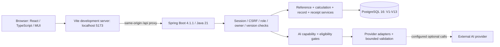

# FitNutri MVP Demo: Team Startup and Manual User Testing Handbook (English)

> Audience: teammates, demonstrators and human acceptance testers running the project for the first time. Order: start it, test it, then understand the architecture. This is not a completed human acceptance record.

**Version checked: 2026-10-18, Australia/Sydney.** PR #40 is merged. Remote `main` and the current local commit are `c5fcdac1622ef692412acdfb2668eb056786c988`, including the fully automated-tested `495d480`. `develop/yuankang-wei` points to `495d480`. This handbook describes that MVP, not TODOs from historical plans. Record your actual tested SHA if main changes later.

## Contents

1. Download the repository and select an environment
2. Private configuration, first initialization and catalogue imports
3. Daily startup, shutdown, AI and troubleshooting
4. Manual-test preparation and a 15-minute demonstration
5. 120 detailed manual test cases
6. Defect records, results and acceptance
7. Architecture, data flows, implementation status and automated checks

## 1. Download the repository and select an environment

### 1.1 Tools and responsibilities

| Tool | Requirement and purpose | When needed |
| --- | --- | --- |
| Git / repository access | Your own university GitHub Enterprise account and SSH key/access | Downloading source |
| JDK | **21**, including both `java` and `javac`; select the same JDK in the IDE and terminal | Backend compilation/startup |
| Node.js / npm | **Node 24**, matching `.nvmrc`; use the committed lockfile | Frontend installation/startup |
| PostgreSQL | **16**; Compose pins `postgres:16.15` | Persistence; this is not MySQL |
| Docker / Compose | Running Docker daemon with `docker compose` support | Recommended dedicated PostgreSQL instance |
| Python | Python 3 with venv support; install repository requirements without changing system packages | Initial data preparation, contract/data checks |
| Poppler | Supplies `pdftotext` | Compendium PDF preparation |
| FFmpeg | Supplies executable `ffmpeg`; set absolute `FFMPEG_BIN` if necessary | Audio decoding and related tests; manual recording does not call a model |
| PostgreSQL clients | `psql`, `pg_dump`, `pg_restore`, compatible with PG16 | Empty-database inspection, backup/restore, full tests |
| Browser | Current Chrome/Edge with localhost cookies allowed; supported browser required for audio | Manual testing; avoid personal information in evidence |

Use a POSIX shell such as Bash/Zsh on macOS/Linux. Windows teammates should run these commands in **WSL2's Linux terminal**, installing Git, JDK21, Node 24, Python, FFmpeg, Poppler and PostgreSQL clients inside WSL, and enabling Docker Desktop WSL integration. Keep the repository under WSL `~/projects/` where practical. Do not paste these shell environment assignments into native PowerShell. Diagnose WSL/Docker networking before attempting application-security workarounds.

After installing tools through the appropriate platform’s official instructions, run each check in a terminal:

```sh
git --version
java -version
javac -version
node --version
npm --version
python3 --version
docker version
docker compose version
psql --version
pg_dump --version
pg_restore --version
pdftotext -v
ffmpeg -version
```

Success: commands exist, Java is 21, Node is 24, and Docker’s client reaches its daemon. `JAVA_HOME` must point to your JDK21, not the author’s machine-specific path. With nvm, run `nvm install` and `nvm use` inside the repository. Initial dependency installation needs network access; do not change the lockfile to bypass a version mismatch.

### 1.2 First checkout

**Terminal T0: a parent folder for your working directory.** This is the verified renamed repository URL; use your own university access. Do not share the author’s SSH key.

```sh
git clone --branch main git@github.sydney.edu.au:2026S2-Object-Oriented-App-Frameworks/Lab_practical_05_Group_6.git
cd Lab_practical_05_Group_6
git status -sb
git log -1 --oneline
git rev-parse HEAD
```

If SSH is not configured but you have web access, use HTTPS with Git’s credential mechanism. Never embed a token in the URL or handbook:

```sh
git clone --branch main https://github.sydney.edu.au/2026S2-Object-Oriented-App-Frameworks/Lab_practical_05_Group_6.git
```

Success: `backend/`, `frontend/`, `docs/` and `scripts/` exist in the root; this baseline is `c5fcdac`. You do not need to open a PR or merge main yourself.

**Only if reusing this handbook for an update whose PR is still unmerged**, confirm the required feature commit on the PR, then use:

```sh
git clone --branch develop/yuankang-wei git@github.sydney.edu.au:2026S2-Object-Oriented-App-Frameworks/Lab_practical_05_Group_6.git
```

PR #40 is already merged, so this alternative is unnecessary for this release. Do not test a pre-MVP main and report absent pages as implementation defects.

### 1.3 Updating an existing checkout

Run `git status -sb` at your repository root first. Preserve existing local edits or clone into a separate clean directory. Do not use `reset --hard`, `clean -fd` or overwrite private environment files. Only with a clean worktree, and when intentionally updating your own main:

```sh
git fetch origin
git switch main
git pull --ff-only origin main
git log -1 --oneline
```

If fast-forward fails, stop and ask the maintainer; do not force it. Git does not download someone else’s database, `.env`, `node_modules` or private accounts. You create your own environment below.

## 2. Private configuration, first initialization and catalogue imports

### 2.1 Install dependencies and create the environment file

**T0, repository root.** For first installation, run in order:

```sh
npm --prefix frontend ci
python3 -m venv .local/tools
.local/tools/bin/python -m pip install -r scripts/data-requirements.txt -r scripts/contract-requirements.txt
cp .env.example .env
```

Use the lockfile, not `npm update`. Python dependencies stay in the ignored project venv. Copy `.env` only when it does not already exist; preserve existing private configuration. Edit `.env` and choose your own password. Quote values containing spaces or shell characters using shell syntax.

| Setting | Rule and example |
| --- | --- |
| `DB_DATABASE` | Your own newly created empty database; example `fitnutri` |
| `DB_USERNAME` | Actual role for that database; example `fitnutri` |
| `DB_PASSWORD` | Your private password; replace `CHANGE_ME` |
| `DB_PORT` | Free host port, default 5432; container’s internal port remains 5432 |
| `DB_URL` | Match port/database: `jdbc:postgresql://127.0.0.1:5432/fitnutri` |
| `APP_ALLOWED_ORIGINS` | Default `http://localhost:5173`; frontend origin, not database address |
| `REFERENCE_SOURCE_DIR` | Export as this checkout’s absolute `.local/reference-sources` path below |
| Four `IMPORT_*` flags | Normally `false`; enable only for the explicit first import command |
| `ACTIVITY_MANIFEST` | `data/manifests/compendium-2024-r2.json` |
| `APP_BOOTSTRAP_ADMIN_ENABLED` | Default `false`; ordinary teammates do not need administrator access |
| `AI_*_ENABLED` | All four default `false`; empty models/key do not mean the database failed |

**Terminal T1: dedicated backend terminal, repository root.** Export again in every new backend terminal:

```sh
set -a
. ./.env
set +a
export REFERENCE_SOURCE_DIR="$PWD/.local/reference-sources"
```

Compose reads `.env`; Java does not automatically do so. After editing the file, export again and restart the backend. Do not print or screenshot the full environment. Changing `POSTGRES_PASSWORD` does not reset a role password in an existing initialized volume.

### 2.2 Create your own PostgreSQL

**T1, root: first inspect existing local instances read-only.**

```sh
docker ps -a --filter name=fitnutri-postgres
docker volume ls
```

If the named container or this project's `fitnutri-pgdata` volume exists, confirm ownership and purpose before continuing; do not overwrite its configuration with the creation command. See3.2 for an existing instance or ask the maintainer for a new environment. Continue only after confirming this is your own new installation:

```sh
docker compose config --quiet
docker compose up -d db
docker compose ps
```

Success: healthy `db`, container `fitnutri-postgres`, default host 5432 mapped to container 5432, with persistence in a named volume. `--quiet` validates without printing expanded credentials.

**An existing container, occupied port or pre-existing volume is not evidence of an empty database.** Do not delete someone else’s container/volume or run `down -v`. The simplest new-teammate route is your own Docker environment. If this machine already hosts an instance, have the maintainer explicitly allocate a separate container, volume and free port, or create your own PG16 database/role and update `.env`. Changing only the Compose project name does not resolve the fixed `container_name` collision.

**Read-only database identity/emptiness checks:** with the environment exported, run below and enter your own configured password at the prompt, not in the command. For non-Docker PostgreSQL, use its actual connection values.

```sh
psql -h 127.0.0.1 -p "$DB_PORT" -U "$DB_USERNAME" -d "$DB_DATABASE" -W -c 'SELECT current_database(), current_user;'
psql -h 127.0.0.1 -p "$DB_PORT" -U "$DB_USERNAME" -d "$DB_DATABASE" -W -c "SELECT count(*) FROM information_schema.tables WHERE table_schema='public';"
```

Continue only when identity is correct and this is **your newly created empty database**. Nonzero tables, existing data or uncertain ownership require stopping and consulting [existing-database migration](db/migration-foundation.md). Never empty a database to make this check pass.

### 2.3 First empty-database migration — once only

**T1, root; prerequisite: your empty database confirmed above.**

```sh
./backend/mvnw -f backend/pom.xml spring-boot:run -Dspring-boot.run.profiles=local,migration
```

Success: Flyway V1–V13 applied, Hibernate validation succeeds, Spring reports successful startup. Stop this initialization with `Ctrl-C` in T1. Catalogues need not yet be imported. On failure retain a safe error summary; do not edit migrations, run repair/baseline or enable `ddl-auto=update`. Upgrading an existing database requires backup/preflight/restore rehearsal, not this empty-database shortcut.

### 2.4 First reference preparation and import

**T0 or a free terminal, root; venv installed, network and pdftotext available.**

```sh
.local/tools/bin/python scripts/data/fetch_ausnut_sources.py
.local/tools/bin/python scripts/data/fetch_compendium_sources.py
.local/tools/bin/python scripts/data/prepare_ausnut.py
.local/tools/bin/python scripts/data/prepare_compendium_ux.py
```

Continue only after each command succeeds. Expect SHA256 VERIFIED and successful preparation checks. Official sources go to ignored `.local/reference-sources/`; a personal database dump cannot replace them. The Compendium age webpage comes from the bundled historical evidence snapshot, checked against its original hash; the official PDF and AUSNUT workbooks still download. Do not edit manifest hashes to bypass failure. If preparation changes tracked data, stop and check source/dependency versions rather than committing unexplained changes.

**T1, root, private environment re-exported; enable all four imports for this command only:**

```sh
IMPORT_FOOD_CATALOGUE=true IMPORT_ACTIVITY_CATALOGUE=true \
IMPORT_FOOD_SEARCH_METADATA=true IMPORT_EXERCISE_OPTIONS=true \
ACTIVITY_MANIFEST=data/manifests/compendium-2024-r2.json \
./scripts/dev.sh backend
```

Success: no provenance error and backend starts; food, activity options and strength movements become selectable. The core food catalogue contains 3,741 references. Activity revisions may coexist, so total stored rows do not equal current selectable choices. Stop this process. These inline assignments apply only to this command; keep `.env` flags false. Product exercise-option import requires r2; do not substitute old r1.

## 3. Daily startup, shutdown, AI and troubleshooting

### 3.1 Normal startup, without migration/import

**T1, root, after exporting your `.env`:**

```sh
./scripts/dev.sh backend
```

**T2, another terminal at the same repository root:**

```sh
./scripts/dev.sh frontend
```

**T3, root, verify connectivity:**

```sh
./scripts/dev.sh health
```

Success: backend `127.0.0.1:8080`, frontend `http://localhost:5173`, health output PASS. Open **http://localhost:5173** and consistently use `localhost`, not alternating with 127.0.0.1. Normal Vite proxies `/api` directly to 8080; no fault proxy is needed. Historical15173/18080 and 8787 runtimes are not prerequisites.

Create your own ordinary account and complete three onboarding steps. Registration does not sign you in automatically. The first account **does not automatically become administrator**. Historical test accounts will not necessarily exist in your database. Use synthetic identities instead of real personal accounts for testing.

The local HTTP profile permits local session cookies; production defaults to Secure. Do not disable CSRF in code to fix login. A changed frontend port needs an updated allowed origin; a changed backend port needs an updated proxy. Beginners should use the defaults.

### 3.2 Stop, restart and retain data

1. Press `Ctrl-C` in T2 and T1. Closing the browser does not stop servers.
2. To stop your Compose database, run `docker compose stop db` at root; **do not delete the volume**.
3. Run `docker compose up -d db` and wait for health. In a new T1 export `.env` and run only `./scripts/dev.sh backend`; start the frontend in T2.
4. Sign in again and verify saved History. In-memory sessions may expire on backend restart; signing in again is normal and is not database loss.
5. Do not repeat migration/import flags or remove volumes to “reset” a test.

### 3.3 Optional AI and administrator preparation

Without a key, manual food/exercise recording, dishes/workouts, History and factual summaries remain available. Image, transcription, extraction and Q&A each require their flag, backend-private `OPENAI_API_KEY` and available model settings. Select models supported by your own provider account; this handbook promises neither a model nor quota. Never place keys in `VITE_*`, URLs, screenshots or frontend code.

Check `.env.example`: `AI_IMAGE_ENABLED`, `AI_TRANSCRIPTION_ENABLED`, `AI_PARSING_ENABLED`, `AI_QA_ENABLED`, and `OPENAI_IMAGE_MODEL`, `OPENAI_TRANSCRIPTION_MODEL`, `OPENAI_PARSING_MODEL`, `OPENAI_QA_MODEL`. Transcription also requires FFmpeg. Re-export and restart after changes. Q&A additionally requires completed profile, appropriate health-safety answer and consent; profile eligibility does not imply configured service availability. Live model tests may incur charges and are only for a tester who accepts those costs in their own environment.

Administrator tests are advanced. A maintainer explicitly provisions a synthetic administrator in the independent UAT database using private `APP_BOOTSTRAP_ADMIN_EMAIL`, `APP_BOOTSTRAP_ADMIN_PASSWORD`, `APP_BOOTSTRAP_ADMIN_DISPLAY_NAME` and the enabled flag; disable bootstrap and restart after creation. Do not directly change an ordinary user’s role or share a default password. See [runtime instructions](runbook.md).

### 3.4 Troubleshooting

| Symptom | Check first | Recovery criterion |
| --- | --- | --- |
| Permission denied / Git authentication | Your university repository access and SSH/HTTPS credentials | Read the branch without borrowing the author’s private key |
| Java version/compile error | java/javac/JAVA_HOME all select 21 | Backend compiles |
| npm engine error | Node 24 and `npm ci` | Dependencies installed without lockfile edits |
| DB connection refused | Docker health; matching DB_PORT/DB_URL | Your selected database is reachable |
| DB authentication failed | Actual role password; editing .env does not reset an old volume | Your psql login works |
| Schema readiness failure | Intended V13 database and completed first migration | 13 successful migrations and Hibernate validation |
| Empty food/exercise lists | All four imports, r2 and source hashes | Real choices available; no invented data |
| Source hash failure | Changed official source, corrupt cache or version mismatch | Maintainer reviews provenance and verification succeeds |
| Login returns to login page | Consistent localhost, local profile, cookies/CSRF and restarts | One normal login permits owned page reads |
| Port occupied | Identify the process; use your own free ports and matching configuration | Do not kill an unknown service; frontend/API work |
| AI unavailable / 503 | Flags, key, model, eligibility, FFmpeg | Manual recording works; live AI results recorded separately |
| Browser recording unavailable | Secure localhost context, mic permission, WebM/MP4 support | Use a supported browser/file or manual text |
| Missing TEST_DB variables | Separate `.env.test`, not application DB credentials | Tests run only against your independent database |

## 4. Manual-test preparation and a 15-minute demonstration

### 4.1 Dates, roles and synthetic data

- **T** = the current date used by the UI at test start; **Y** = one day before T; **H** = `2020-01-02`; **T+1** = tomorrow. Record the zone (default Australia/Sydney). Reopen entry after midnight and record the new T; do not confuse stale context with an unrelated defect.
- **A** = new ordinary user `UAT A`, email `uat-a-<run-id>@example.test`; **B** = independent ordinary user `UAT B`, email `uat-b-<run-id>@example.test`. Replace `<run-id>` with a run label such as `20261018-r1`. Choose compliant private passwords; no shared password is provided.
- A profile: adult confirmation, birth year 1995, height 175 cm, initial weight 70 kg datedT, Sex `Prefer not to say`, Activity level `Moderately active`, optional Primary goal `Maintain`, energy reference initially blank, Health safety `No`, optional Q&A consent checked for synthetic testing only. Real users answer truthfully. Complete B’s separate profile too.
- **C** = optional synthetic administrator `synthetic-uat-admin-<run-id>@example.test`, prepared by the maintainer in a separate session. Without it mark applicable cases BLOCKED, never PASS.
- **Food F1/F2**: search `rice` and `chicken`, explicitly select two real available references and record full names, reference IDs/source revisions and displayed nutrients. Do not mix preparations. Common amounts 150g and 100g; dish name `UAT dish <case-id>`.
- **Activity Q1**: a real `Walking` option; if several exist, select one and record its full name. **Q2**: `Basketball` for the missing-dated-weight case. **G**: `UAT workout <case-id>`. Some reviewed mappings have no applicable energy reference; follow the actual status rather than assuming every choice has a calculable estimate.
- Use synthetic data only, not real medical history, identifiable images/recordings or teammates' accounts. Redact passwords, cookies, keys and others' information from defect evidence.

### 4.2 Shared operation recipes F/Q/G

**Recipe F: ordinary food draft.** Enter through Dashboard `Add food`, follow `Continue`, set `Record date` and `Default meal`=`Lunch`. Search `Find food to add`, explicitly select F1 from the results, enter 150 in `Grams to add`, wait for nutrition and press `Add to meal`. This adds to local My meal only. `Review food entries` → inspect `Review your record.` → `Confirm & save` performs the write. Success returns to Dashboard; use `View saved records` or History. Do not expect the historical stay-on-entry behavior.

**Recipe Q: one Quick exercise.** Dashboard `Add exercise` → `Continue` → `Quick exercise`; choose `Record date`, select Q1 in `Find activity or movement`, enter 20 in `Duration (minutes)`, wait for the real estimate; `Review exercise entry` → `Confirm & save` → inspect History. A Quick entry has one root and one timed period.

**Recipe G: one Gym workout.** From Add exercise choose `Gym workout`, enter the case name in `Workout title`, use `Add strength period` / `Add cardio period`, select each period’s activity and minutes. Strength periods may include optional movements/sets/reps/load. Example:30 strength minutes +20 cardio minutes =50 total minutes. `Review workout` → `Confirm & save`. Movement details are not extra timed periods and must not add duplicate energy.

**Read and correct.** In History select dates and `Record type`, refresh and open the root’s details. Use `Edit`, follow its edit/Review flow and `Confirm changes`; use the card menu’s `Delete` and confirm `Confirm deletion` in the dialog. `Log again` creates a new draft. If controls are not on the card face, open its menu. Never directly delete database children.

**Weight controls.** Profile uses `Weight (kg)`, `Weight date` and `Save weight`; for a same-date correction, inspect the saved value first, follow the correction flow and use `Save correction`. `Clear weight form` clears input, not saved weights.

**Verify each case.** Capture the owner’s initial root count, details and summary for the chosen date. Change one condition. Unsaved cases must not add History rows. Saved cases must appear once under the case label after refresh. Corrections preserve root identity and update the displayed version/content. Reuse creates a new root and leaves the old one unchanged. Display rounding is allowed; compare units and suitable precision, not guessed nutrient equivalence from similar names.

### 4.3 Fifteen-minute demonstration route

| Time | Action | Observe |
| --- | --- | --- |
| 0–3min | Register/sign in A and finish onboarding | Correct navigation; no automatic administrator role |
| 3–6min | Add F1 150g + F2 100g, Review then confirm | No write at Add; two single roots after one confirmation |
| 6–8min | Compose the same ingredients as a full recipe, eat 1/2 | One dish root with both ingredients and portion details |
| 8–10min | Save Q1 for 20 minutes | One exercise root with date and energy/status reason |
| 10–13min | Correct food grams in History and inspect summary | Only intended record changes; totals update |
| 13–15min | Inspect narrow History, sign out/in | Usable layout and retained owned records |

This route does not replace 120 cases. Record incomplete progress honestly rather than skipping validation to fit a demonstration.

### 4.4 Execution conventions and checked boundaries

P0 = core workflow/data protection, blocks acceptance on failure. P1 = important boundary, requires repair or explicit acceptance. P2 = experience. Ordinary UI cases need no SQL. Advanced cases require maintainer-prepared isolated data, independent sessions, DevTools or the local fault proxy; unavailable prerequisites mean BLOCKED.

| Input | Current actual rule | Source |
| --- | --- | --- |
| Registration | Email≤254; trimmed display name 1–100; password 8–72 characters with letter+digit and a72-byte UTF-8 encoding boundary | `RegisterRequest` / registration service |
| Profile | Birth year 1900 through current year−18; adult confirmation; height 50–260 cm; weight 20–400 kg with≤2 decimals | `profileForm` / profile DTOs |
| Food grams | >0 and≤10000, ≤3 decimals | `inputRules` / `FoodEntryInputValidator` |
| Food groups | 1–20 roots/batch,1–20 ingredients/dish,≤50 leaves/batch; dish name 1–100 | `FoodEntryInputValidator` |
| Portions | Positive integer numerator/denominator≤1000000 with numerator≤denominator; percent>0 through 100 with≤3 decimals; total servings 1–1000 integer, eaten>0 through total with≤3 decimals | `portionInput` / `PortionNormalizer` |
| Exercise | Each period>0 through 1440 minutes with≤2 decimals; Workout 1–12 periods with total≤1440 minutes | `inputRules` / `ExerciseEntryInputValidator` |
| Movement details | ≤30/period,≤100/workout; Sets1–100, Reps1–1000, load 0–1000 kg with≤2 decimals; optional fields depend on load basis | `ExerciseEntryInputValidator` |
| Equipment details | Only option-allowed fields: speed>0 through 100; incline−20 through 40; distance>0 through 1000000; level 0–100 integer; other values≤2 decimals | `EquipmentDetailsValidator` |
| Dates/ranges | No future records; History 1–366 days; explicit Q&A record range≤31 days | `RecordDatePolicy` / Q&A range policy |
| Speech/questions | WebM/MP4 audio≤8MiB, browser recording≤60s; transcript≤10000 characters; question≤2000 characters | `domain/media` / speech and Q&A UI |

These are software limits, not health advice. Browser input prevention and explicit validation errors are both acceptable; silently saving truncated/wrong data is not. If the native date widget prevents an impossible date, record that prevention; do not require invalid SQL. The advanced password byte-boundary check does not imply every UI can accept 72 multibyte characters.

## 5. 120 detailed manual test cases

Every status starts **NOT RUN**. Resolve A/F/Q/G/H prerequisites through 4.1–4.2; H means a separately saved record for this case. See7.5 for advanced fault setup. Missing roles, models, browser support or fault controls mean BLOCKED, not PASS.

### 5.1 Account and session — UAT-001–UAT-012

#### UAT-001 — Ordinary-account registration

- **Purpose:** Ordinary-account registration
- **Priority and level:** P0 · Ordinary UI
- **Prerequisites:** App running; signed out; fresh A email ready.
- **Exact inputs:** A email; Display name=UAT A; your own 8–72-character letter-and-digit password.
- **Steps:** Select Create an account, fill all fields and password confirmation, press Create account, then Sign in.
- **Expected result:** Success notice disappears; registration does not sign in; login opens onboarding without administrator rights.
- **Data and verification:** One ordinary account only; sign in with the same email to verify; no food/exercise records.
- **Record:** Status **NOT RUN** (after execution choose PASS / FAIL / BLOCKED / NOT RUN); tester____; time/zone____; actual result____; defect ID____.
- **Evidence required:** Per 6.1 retain inputs/key feedback and before/after History or profile checks; record “unchanged” for non-write cases. Location____; blocker if any____.

#### UAT-002 — Required registration fields

- **Purpose:** Required registration fields
- **Priority and level:** P1 · Ordinary UI
- **Prerequisites:** Signed out with registration open.
- **Exact inputs:** Blank email/name/password, then fill just one field at a time.
- **Steps:** Attempt Create account for each variant, locate errors, then enter complete valid values.
- **Expected result:** Missing required data blocks registration with clear errors; no authenticated navigation.
- **Data and verification:** No partial account; empty submissions must not reserve the later valid identity.
- **Record:** Status **NOT RUN** (after execution choose PASS / FAIL / BLOCKED / NOT RUN); tester____; time/zone____; actual result____; defect ID____.
- **Evidence required:** Per 6.1 retain inputs/key feedback and before/after History or profile checks; record “unchanged” for non-write cases. Location____; blocker if any____.

#### UAT-003 — Email format and duplicate identity

- **Purpose:** Email format and duplicate identity
- **Priority and level:** P0 · Ordinary UI
- **Prerequisites:** A exists from 001; open a signed-out window.
- **Exact inputs:** not-an-email, then A email.
- **Steps:** Try malformed email, then A email with otherwise valid registration fields.
- **Expected result:** Malformed email rejected; duplicate cannot create another account; no database exception exposure.
- **Data and verification:** A password/profile unchanged; verify login with original credentials.
- **Record:** Status **NOT RUN** (after execution choose PASS / FAIL / BLOCKED / NOT RUN); tester____; time/zone____; actual result____; defect ID____.
- **Evidence required:** Per 6.1 retain inputs/key feedback and before/after History or profile checks; record “unchanged” for non-write cases. Location____; blocker if any____.

#### UAT-004 — Email canonicalization

- **Purpose:** Email canonicalization
- **Priority and level:** P0 · Ordinary UI
- **Prerequisites:** A exists; signed out.
- **Exact inputs:** Uppercase A email with surrounding spaces; correct A password.
- **Steps:** Sign in using the variant; sign out and attempt duplicate registration with it.
- **Expected result:** Login resolves to A; duplicate registration is rejected rather than creating another case-variant identity.
- **Data and verification:** Same original account and owned History.
- **Record:** Status **NOT RUN** (after execution choose PASS / FAIL / BLOCKED / NOT RUN); tester____; time/zone____; actual result____; defect ID____.
- **Evidence required:** Per 6.1 retain inputs/key feedback and before/after History or profile checks; record “unchanged” for non-write cases. Location____; blocker if any____.

#### UAT-005 — Password minimum and composition

- **Purpose:** Password minimum and composition
- **Priority and level:** P1 · Ordinary UI
- **Prerequisites:** New registration form; use a fresh email for each successful variant.
- **Exact inputs:** Choose private values:7 letter/digit characters;8 letter/digit characters;8 letters only;8 digits only.
- **Steps:** Try each with matching confirmation; complete registration only for the compliant variant.
- **Expected result:** Reject7 characters or missing letter/digit; compliant 8-character input can register.
- **Data and verification:** Only compliant variants create accounts.
- **Record:** Status **NOT RUN** (after execution choose PASS / FAIL / BLOCKED / NOT RUN); tester____; time/zone____; actual result____; defect ID____.
- **Evidence required:** Per 6.1 retain inputs/key feedback and before/after History or profile checks; record “unchanged” for non-write cases. Location____; blocker if any____.

#### UAT-006 — Password maximum and encoding boundary

- **Purpose:** Password maximum and encoding boundary
- **Priority and level:** P1 · Advanced / maintainer preparation
- **Prerequisites:** Independent UAT environment; optional maintainer-assisted API check.
- **Exact inputs:** Privately generate 72/73 ASCII characters with letters/digits; optionally a multibyte value exceeding 72 UTF-8 bytes.
- **Steps:** Try72 then 73 in registration, noting input constraints; record UI prevention for multibyte input; maintainer may supplement via the contract.
- **Expected result:** Compliant72-byte value can pass; excessive input must not silently save another password; over 72 UTF-8 bytes rejected.
- **Data and verification:** Successful account authenticates with its full actual password; rejected variants create nothing.
- **Record:** Status **NOT RUN** (after execution choose PASS / FAIL / BLOCKED / NOT RUN); tester____; time/zone____; actual result____; defect ID____.
- **Evidence required:** Per 6.1 retain inputs/key feedback and before/after History or profile checks; record “unchanged” for non-write cases. Location____; blocker if any____.

#### UAT-007 — Password confirmation mismatch

- **Purpose:** Password confirmation mismatch
- **Priority and level:** P1 · Ordinary UI
- **Prerequisites:** New registration form.
- **Exact inputs:** Compliant private password with different confirmation.
- **Steps:** Press Create account, inspect confirmation feedback, match the values and retry.
- **Expected result:** Mismatch blocks registration; correction permits progress without reinstall/restart.
- **Data and verification:** Only one corrected registration creates an account.
- **Record:** Status **NOT RUN** (after execution choose PASS / FAIL / BLOCKED / NOT RUN); tester____; time/zone____; actual result____; defect ID____.
- **Evidence required:** Per 6.1 retain inputs/key feedback and before/after History or profile checks; record “unchanged” for non-write cases. Location____; blocker if any____.

#### UAT-008 — Display-name whitespace and length

- **Purpose:** Display-name whitespace and length
- **Priority and level:** P1 · Ordinary UI
- **Prerequisites:** New registration page with valid email/password.
- **Exact inputs:** Spaces;100 ASCII characters;101 ASCII characters; UAT A with surrounding spaces.
- **Steps:** Try each or observe input prevention, using a new email per valid registration.
- **Expected result:** Blank-only rejected,100 accepted,101 not silently truncated/saved; surrounding ordinary-name whitespace trimmed.
- **Data and verification:** Invalid variants create no account; inspect accepted names after login.
- **Record:** Status **NOT RUN** (after execution choose PASS / FAIL / BLOCKED / NOT RUN); tester____; time/zone____; actual result____; defect ID____.
- **Evidence required:** Per 6.1 retain inputs/key feedback and before/after History or profile checks; record “unchanged” for non-write cases. Location____; blocker if any____.

#### UAT-009 — Invalid login and recovery

- **Purpose:** Invalid login and recovery
- **Priority and level:** P0 · Ordinary UI
- **Prerequisites:** A exists and is signed out.
- **Exact inputs:** A with incorrect password; nonexistent synthetic email; then correct A credentials.
- **Steps:** Attempt Sign in in order, inspect feedback and correct it.
- **Expected result:** Failures cannot enter private pages or expose secrets/stacks; corrected credentials still work.
- **Data and verification:** A profile/records unchanged; History baseline matches.
- **Record:** Status **NOT RUN** (after execution choose PASS / FAIL / BLOCKED / NOT RUN); tester____; time/zone____; actual result____; defect ID____.
- **Evidence required:** Per 6.1 retain inputs/key feedback and before/after History or profile checks; record “unchanged” for non-write cases. Location____; blocker if any____.

#### UAT-010 — Back/refresh after logout

- **Purpose:** Back/refresh after logout
- **Priority and level:** P0 · Ordinary UI
- **Prerequisites:** User A is signed in and onboarded; note the initial History count and daily summary.
- **Exact inputs:** A signed in with a synthetic History record.
- **Steps:** Account menu → Log out; use browser Back, refresh and direct /history navigation.
- **Expected result:** Private reads no longer authorized; Back cannot restore an operable A session.
- **Data and verification:** Saved records retained and visible after signing in again.
- **Record:** Status **NOT RUN** (after execution choose PASS / FAIL / BLOCKED / NOT RUN); tester____; time/zone____; actual result____; defect ID____.
- **Evidence required:** Per 6.1 retain inputs/key feedback and before/after History or profile checks; record “unchanged” for non-write cases. Location____; blocker if any____.

#### UAT-011 — Refresh and a second tab

- **Purpose:** Refresh and a second tab
- **Priority and level:** P0 · Ordinary UI
- **Prerequisites:** User A is signed in and onboarded; note the initial History count and daily summary.
- **Exact inputs:** A second tab in the same browser.
- **Steps:** Refresh Dashboard, open /history in another tab; log out in one tab and refresh the other.
- **Expected result:** Valid-session refresh works; after logout the old tab cannot continue private actions and requires login.
- **Data and verification:** No new records or automatic reauthentication.
- **Record:** Status **NOT RUN** (after execution choose PASS / FAIL / BLOCKED / NOT RUN); tester____; time/zone____; actual result____; defect ID____.
- **Evidence required:** Per 6.1 retain inputs/key feedback and before/after History or profile checks; record “unchanged” for non-write cases. Location____; blocker if any____.

#### UAT-012 — Signed-out and incomplete-onboarding routes

- **Purpose:** Signed-out and incomplete-onboarding routes
- **Priority and level:** P0 · Ordinary UI
- **Prerequisites:** Signed-out window plus a registered user without completed onboarding.
- **Exact inputs:** /dashboard, /history, /add.
- **Steps:** Visit directly while signed out, then with the incomplete-profile user.
- **Expected result:** Require login; incomplete setup guides to onboarding or blocks disallowed creation, without bypass saves.
- **Data and verification:** No records; after setup verify the normal F workflow.
- **Record:** Status **NOT RUN** (after execution choose PASS / FAIL / BLOCKED / NOT RUN); tester____; time/zone____; actual result____; defect ID____.
- **Evidence required:** Per 6.1 retain inputs/key feedback and before/after History or profile checks; record “unchanged” for non-write cases. Location____; blocker if any____.

### 5.2 Profile, weight and units — UAT-013–UAT-022

#### UAT-013 — Complete three-step onboarding

- **Purpose:** Complete three-step onboarding
- **Priority and level:** P0 · Ordinary UI
- **Prerequisites:** Fresh A signed in before onboarding.
- **Exact inputs:** A profile from 4.1; blank energy reference.
- **Steps:** Fill About you and initial weight → Continue; choose Goals & activity → Continue; answer Health & Q&A → Complete setup.
- **Expected result:** Dashboard opens with completed profile, one initial weight and actual-only display without invented target.
- **Data and verification:** Profile/weight persist after logout/login.
- **Record:** Status **NOT RUN** (after execution choose PASS / FAIL / BLOCKED / NOT RUN); tester____; time/zone____; actual result____; defect ID____.
- **Evidence required:** Per 6.1 retain inputs/key feedback and before/after History or profile checks; record “unchanged” for non-write cases. Location____; blocker if any____.

#### UAT-014 — Adult confirmation and birth-year limits

- **Purpose:** Adult confirmation and birth-year limits
- **Priority and level:** P1 · Ordinary UI
- **Prerequisites:** New About you step; other fields valid.
- **Exact inputs:** Unchecked adult confirmation;1900; current year−18;1899; current year−17.
- **Steps:** Change one condition per attempt and press Continue; proceed for valid boundaries, then Back to inspect.
- **Expected result:** Adult confirmation required;1900/adult limit accepted;1899/underage year blocked.
- **Data and verification:** No initial profile/weight write before Complete setup; save valid values through 013.
- **Record:** Status **NOT RUN** (after execution choose PASS / FAIL / BLOCKED / NOT RUN); tester____; time/zone____; actual result____; defect ID____.
- **Evidence required:** Per 6.1 retain inputs/key feedback and before/after History or profile checks; record “unchanged” for non-write cases. Location____; blocker if any____.

#### UAT-015 — Height endpoints

- **Purpose:** Height endpoints
- **Priority and level:** P1 · Ordinary UI
- **Prerequisites:** About you or Settings; other fields valid.
- **Exact inputs:** Height (cm)=50,260,49.9,260.1, blank.
- **Steps:** Change only height and attempt Continue/Save settings; inspect error location.
- **Expected result:** Accept50/260; reject outside/blank; do not treat centimetres as metres.
- **Data and verification:** Only explicitly saved valid variants update profile; invalid attempts preserve previous values.
- **Record:** Status **NOT RUN** (after execution choose PASS / FAIL / BLOCKED / NOT RUN); tester____; time/zone____; actual result____; defect ID____.
- **Evidence required:** Per 6.1 retain inputs/key feedback and before/after History or profile checks; record “unchanged” for non-write cases. Location____; blocker if any____.

#### UAT-016 — Weight range and precision

- **Purpose:** Weight range and precision
- **Priority and level:** P1 · Ordinary UI
- **Prerequisites:** Initial-weight form or the maintainer-identified weight entry UI.
- **Exact inputs:** 20,400,19.99,400.01,70.25,70.251,0.
- **Steps:** Try each Weight (kg), attempt progress/save, then restore 70.25 as a sensible synthetic value.
- **Expected result:** Endpoints/two decimals accepted; outside, zero or three decimals rejected without silent confirmation-rounding.
- **Data and verification:** Only valid weights saved; prior exercise energy must not be rewritten automatically.
- **Record:** Status **NOT RUN** (after execution choose PASS / FAIL / BLOCKED / NOT RUN); tester____; time/zone____; actual result____; defect ID____.
- **Evidence required:** Per 6.1 retain inputs/key feedback and before/after History or profile checks; record “unchanged” for non-write cases. Location____; blocker if any____.

#### UAT-017 — Weight-date validity

- **Purpose:** Weight-date validity
- **Priority and level:** P1 · Ordinary UI
- **Prerequisites:** Initial Weight date or weight-entry UI; native date control.
- **Exact inputs:** T, Y, T+1,2026-02-30.
- **Steps:** Try dates; document native prevention of impossible input; do not edit the database.
- **Expected result:** Valid today/past accepted; future/impossible dates cannot save.
- **Data and verification:** Invalid attempts add no weight; inspect accepted dates.
- **Record:** Status **NOT RUN** (after execution choose PASS / FAIL / BLOCKED / NOT RUN); tester____; time/zone____; actual result____; defect ID____.
- **Evidence required:** Per 6.1 retain inputs/key feedback and before/after History or profile checks; record “unchanged” for non-write cases. Location____; blocker if any____.

#### UAT-018 — Optional blank energy reference

- **Purpose:** Optional blank energy reference
- **Priority and level:** P1 · Ordinary UI
- **Prerequisites:** User A is signed in and onboarded; note the initial History count and daily summary.
- **Exact inputs:** Settings: blank Daily intake reference or Remove energy reference.
- **Steps:** Save settings, inspect Dashboard, then refresh Settings.
- **Expected result:** Blank target saves; actual records remain without invented target, NaN or division-by-zero progress.
- **Data and verification:** Only target changes; existing food/exercise records unchanged.
- **Record:** Status **NOT RUN** (after execution choose PASS / FAIL / BLOCKED / NOT RUN); tester____; time/zone____; actual result____; defect ID____.
- **Evidence required:** Per 6.1 retain inputs/key feedback and before/after History or profile checks; record “unchanged” for non-write cases. Location____; blocker if any____.

#### UAT-019 — kJ/kcal display conversion

- **Purpose:** kJ/kcal display conversion
- **Priority and level:** P1 · Ordinary UI
- **Prerequisites:** User A is signed in and onboarded; note the initial History count and daily summary.
- **Exact inputs:** Energy reference 4184 kJ; switch to Kilocalories (kcal).
- **Steps:** Save4184 kJ in Settings, switch to kcal and inspect 1000, switch back and compare History.
- **Expected result:** Display uses 1 kcal=4.184 kJ; repeated switches do not cumulatively change stored intake.
- **Data and verification:** Unit/target may update; record amounts and authoritative kJ retain their meaning.
- **Record:** Status **NOT RUN** (after execution choose PASS / FAIL / BLOCKED / NOT RUN); tester____; time/zone____; actual result____; defect ID____.
- **Evidence required:** Per 6.1 retain inputs/key feedback and before/after History or profile checks; record “unchanged” for non-write cases. Location____; blocker if any____.

#### UAT-020 — Safety-answer/consent combinations

- **Purpose:** Safety-answer/consent combinations
- **Priority and level:** P0 · Ordinary UI
- **Prerequisites:** User A is signed in and onboarded; note the initial History count and daily summary.
- **Exact inputs:** Health & Q&A: No/Yes or unsure/Prefer not to answer with consent on/off.
- **Steps:** Save each actual choice, inspect Q&A eligibility, restore No+consent.
- **Expected result:** Only No+consent gives profile eligibility; service configuration is separate. Other combinations retain manual recording.
- **Data and verification:** Only safety/consent updates; records retained and no real medical details sent.
- **Record:** Status **NOT RUN** (after execution choose PASS / FAIL / BLOCKED / NOT RUN); tester____; time/zone____; actual result____; defect ID____.
- **Evidence required:** Per 6.1 retain inputs/key feedback and before/after History or profile checks; record “unchanged” for non-write cases. Location____; blocker if any____.

#### UAT-021 — Reset/discard profile edits

- **Purpose:** Reset/discard profile edits
- **Priority and level:** P1 · Ordinary UI
- **Prerequisites:** User A is signed in and onboarded; note the initial History count and daily summary.
- **Exact inputs:** Change Settings display name to UAT TEMP without saving.
- **Steps:** Press Reset changes; edit again and attempt to leave, choosing stay/discard when prompted.
- **Expected result:** Reset restores saved value; leave prompt never silently saves; discarded edits remain absent on return.
- **Data and verification:** No new confirmed records; leave the page and refresh History against the baseline.
- **Record:** Status **NOT RUN** (after execution choose PASS / FAIL / BLOCKED / NOT RUN); tester____; time/zone____; actual result____; defect ID____.
- **Evidence required:** Per 6.1 retain inputs/key feedback and before/after History or profile checks; record “unchanged” for non-write cases. Location____; blocker if any____.

#### UAT-022 — Same-date weight is not silently duplicated

- **Purpose:** Same-date weight is not silently duplicated
- **Priority and level:** P1 · Ordinary UI
- **Prerequisites:** User A is signed in and onboarded; note the initial History count and daily summary.
- **Exact inputs:** Existing T weight 70; proposed T weight 71.
- **Steps:** Use Profile weight controls for the same date; follow the actual conflict/update flow, never edit SQL.
- **Expected result:** No contradictory duplicate weights for the same user/date; explicit update shows the new value and respects versions.
- **Data and verification:** One current T weight; previous exercise snapshots unchanged.
- **Record:** Status **NOT RUN** (after execution choose PASS / FAIL / BLOCKED / NOT RUN); tester____; time/zone____; actual result____; defect ID____.
- **Evidence required:** Per 6.1 retain inputs/key feedback and before/after History or profile checks; record “unchanged” for non-write cases. Location____; blocker if any____.

### 5.3 Single food — UAT-023–UAT-036

#### UAT-023 — Explicit real-food selection

- **Purpose:** Explicit real-food selection
- **Priority and level:** P0 · Ordinary UI
- **Prerequisites:** Meet A; open a fresh unsaved food draft using recipe F.
- **Exact inputs:** Find food to add=rice; F1=150g.
- **Steps:** Search, wait, select the full reference, enter Grams to add, wait for nutrition, then Add to meal.
- **Expected result:** Selected reference/preview appear; My meal has one item and composer clears for another; not yet persisted.
- **Data and verification:** No new confirmed records; leave the page and refresh History against the baseline.
- **Record:** Status **NOT RUN** (after execution choose PASS / FAIL / BLOCKED / NOT RUN); tester____; time/zone____; actual result____; defect ID____.
- **Evidence required:** Per 6.1 retain inputs/key feedback and before/after History or profile checks; record “unchanged” for non-write cases. Location____; blocker if any____.

#### UAT-024 — No results and query recovery

- **Purpose:** No results and query recovery
- **Priority and level:** P1 · Ordinary UI
- **Prerequisites:** Meet A; open a fresh unsaved food draft using recipe F.
- **Exact inputs:** zzzxq-no-such-food-uat, then rice.
- **Steps:** Search nonexistent text and wait; do not treat typed text as selection; search rice and choose F1.
- **Expected result:** Clear no-result state without fabricated candidates/nutrients; normal search recovers.
- **Data and verification:** No new confirmed records; leave the page and refresh History against the baseline.
- **Record:** Status **NOT RUN** (after execution choose PASS / FAIL / BLOCKED / NOT RUN); tester____; time/zone____; actual result____; defect ID____.
- **Evidence required:** Per 6.1 retain inputs/key feedback and before/after History or profile checks; record “unchanged” for non-write cases. Location____; blocker if any____.

#### UAT-025 — Ambiguous and expanded results

- **Purpose:** Ambiguous and expanded results
- **Priority and level:** P1 · Ordinary UI
- **Prerequisites:** Meet A; open a fresh unsaved food draft using recipe F.
- **Exact inputs:** rice; real results with differing preparation states.
- **Steps:** Inspect initial matches, use displayed expansion/all-results controls and pagination, compare name/provenance before selecting.
- **Expected result:** Ambiguous term is not forced to one match; pagination/counts work and selected reference matches what was shown.
- **Data and verification:** No new confirmed records; leave the page and refresh History against the baseline.
- **Record:** Status **NOT RUN** (after execution choose PASS / FAIL / BLOCKED / NOT RUN); tester____; time/zone____; actual result____; defect ID____.
- **Evidence required:** Per 6.1 retain inputs/key feedback and before/after History or profile checks; record “unchanged” for non-write cases. Location____; blocker if any____.

#### UAT-026 — Functional bilingual aliases

- **Purpose:** Functional bilingual aliases
- **Priority and level:** P1 · Ordinary UI
- **Prerequisites:** Meet A; open a fresh unsaved food draft using recipe F.
- **Exact inputs:** 米饭; rice.
- **Steps:** Search each, record reference IDs/preparation and choose a real available reference.
- **Expected result:** Reviewed Chinese aliases work; result order/set need not be identical; absence is explicit, not fabricated.
- **Data and verification:** No new confirmed records; leave the page and refresh History against the baseline.
- **Record:** Status **NOT RUN** (after execution choose PASS / FAIL / BLOCKED / NOT RUN); tester____; time/zone____; actual result____; defect ID____.
- **Evidence required:** Per 6.1 retain inputs/key feedback and before/after History or profile checks; record “unchanged” for non-write cases. Location____; blocker if any____.

#### UAT-027 — Blank search and unselected text

- **Purpose:** Blank search and unselected text
- **Priority and level:** P1 · Ordinary UI
- **Prerequisites:** Meet A; open a fresh unsaved food draft using recipe F.
- **Exact inputs:** Blank, spaces and typed rice without selecting a result.
- **Steps:** Try grams/Add to meal for each, then explicitly select F1.
- **Expected result:** No Add without a selected reference; query text is not a confirmed food/nutrition source.
- **Data and verification:** No new confirmed records; leave the page and refresh History against the baseline.
- **Record:** Status **NOT RUN** (after execution choose PASS / FAIL / BLOCKED / NOT RUN); tester____; time/zone____; actual result____; defect ID____.
- **Evidence required:** Per 6.1 retain inputs/key feedback and before/after History or profile checks; record “unchanged” for non-write cases. Location____; blocker if any____.

#### UAT-028 — Invalid/blank grams

- **Purpose:** Invalid/blank grams
- **Priority and level:** P1 · Ordinary UI
- **Prerequisites:** Meet A; open a fresh unsaved food draft using recipe F.
- **Exact inputs:** F1; blank,0,-1, abc,1e3 grams.
- **Steps:** Try each Grams to add value and Add after validation; restore 150.
- **Expected result:** Invalid values blocked without NaN/negative nutrients;150 restores normal behavior.
- **Data and verification:** No new confirmed records; leave the page and refresh History against the baseline.
- **Record:** Status **NOT RUN** (after execution choose PASS / FAIL / BLOCKED / NOT RUN); tester____; time/zone____; actual result____; defect ID____.
- **Evidence required:** Per 6.1 retain inputs/key feedback and before/after History or profile checks; record “unchanged” for non-write cases. Location____; blocker if any____.

#### UAT-029 — Grams maximum and precision

- **Purpose:** Grams maximum and precision
- **Priority and level:** P1 · Ordinary UI
- **Prerequisites:** Meet A; open a fresh unsaved food draft using recipe F.
- **Exact inputs:** 0.001,150.125,10000,10000.001,0.0001.
- **Steps:** For F1 wait for each preview; Add then remove compliant variants without final confirmation.
- **Expected result:** First three accepted; above 10000 or more than 3 decimals rejected; tiny display may round without inventing intake.
- **Data and verification:** No new confirmed records; leave the page and refresh History against the baseline.
- **Record:** Status **NOT RUN** (after execution choose PASS / FAIL / BLOCKED / NOT RUN); tester____; time/zone____; actual result____; defect ID____.
- **Evidence required:** Per 6.1 retain inputs/key feedback and before/after History or profile checks; record “unchanged” for non-write cases. Location____; blocker if any____.

#### UAT-030 — Required food date and meal

- **Purpose:** Required food date and meal
- **Priority and level:** P1 · Ordinary UI
- **Prerequisites:** Meet A; open a fresh unsaved food draft using recipe F.
- **Exact inputs:** T, T+1, blank date; Breakfast/Lunch; missing meal.
- **Steps:** Attempt future/blank date and missing meal, correct to T/Lunch and Add.
- **Expected result:** Incomplete/future inputs cannot save; valid entry uses chosen date/meal rather than inferred time.
- **Data and verification:** No write until confirmation; if later saved through F inspect exact date/meal.
- **Record:** Status **NOT RUN** (after execution choose PASS / FAIL / BLOCKED / NOT RUN); tester____; time/zone____; actual result____; defect ID____.
- **Evidence required:** Per 6.1 retain inputs/key feedback and before/after History or profile checks; record “unchanged” for non-write cases. Location____; blocker if any____.

#### UAT-031 — Continuous input and default meal

- **Purpose:** Continuous input and default meal
- **Priority and level:** P0 · Ordinary UI
- **Prerequisites:** Meet A; open a fresh unsaved food draft using recipe F.
- **Exact inputs:** F1 150g Lunch; F2 100g Dinner.
- **Steps:** Add first, change Default meal to Dinner, Add F2, inspect both rows and confirm once through Review.
- **Expected result:** First remains Lunch, second Dinner; default change does not rewrite prior item; two single roots saved.
- **Data and verification:** Save only the expected root and children; inspect History details and check date, portion and summary delta.
- **Record:** Status **NOT RUN** (after execution choose PASS / FAIL / BLOCKED / NOT RUN); tester____; time/zone____; actual result____; defect ID____.
- **Evidence required:** Per 6.1 retain inputs/key feedback and before/after History or profile checks; record “unchanged” for non-write cases. Location____; blocker if any____.

#### UAT-032 — Inline edits and reference replacement

- **Purpose:** Inline edits and reference replacement
- **Priority and level:** P1 · Ordinary UI
- **Prerequisites:** Meet A; open a fresh unsaved food draft using recipe F.
- **Exact inputs:** F1 150g in My meal; change to 200g; replace with F2.
- **Steps:** Edit grams/meal inline, open replacement and choose F2; first try Cancel replacement, then actually replace.
- **Expected result:** Cancel retains F1; confirmed replacement affects only its row and recalculates preview before Review.
- **Data and verification:** No new confirmed records; leave the page and refresh History against the baseline.
- **Record:** Status **NOT RUN** (after execution choose PASS / FAIL / BLOCKED / NOT RUN); tester____; time/zone____; actual result____; defect ID____.
- **Evidence required:** Per 6.1 retain inputs/key feedback and before/after History or profile checks; record “unchanged” for non-write cases. Location____; blocker if any____.

#### UAT-033 — Draft removal and Undo

- **Purpose:** Draft removal and Undo
- **Priority and level:** P1 · Ordinary UI
- **Prerequisites:** Meet A; open a fresh unsaved food draft using recipe F.
- **Exact inputs:** Two F1/F2 items.
- **Steps:** Remove one, press Undo removal; remove again without Undo and inspect Review.
- **Expected result:** Undo restores value/order; without Undo only the other remains; draft actions do not delete old saved records.
- **Data and verification:** No new confirmed records; leave the page and refresh History against the baseline.
- **Record:** Status **NOT RUN** (after execution choose PASS / FAIL / BLOCKED / NOT RUN); tester____; time/zone____; actual result____; defect ID____.
- **Evidence required:** Per 6.1 retain inputs/key feedback and before/after History or profile checks; record “unchanged” for non-write cases. Location____; blocker if any____.

#### UAT-034 — Review with an unadded composer input

- **Purpose:** Review with an unadded composer input
- **Priority and level:** P1 · Ordinary UI
- **Prerequisites:** Meet A; open a fresh unsaved food draft using recipe F.
- **Exact inputs:** F1 added; F2 100g typed but not added.
- **Steps:** Press Review food entries; in separate drafts test Keep editing, Discard and review, Add and review.
- **Expected result:** Explicit choices: keep retains composer, discard removes only unadded input, Add and review includes F2 exactly once.
- **Data and verification:** No new confirmed records; leave the page and refresh History against the baseline.
- **Record:** Status **NOT RUN** (after execution choose PASS / FAIL / BLOCKED / NOT RUN); tester____; time/zone____; actual result____; defect ID____.
- **Evidence required:** Per 6.1 retain inputs/key feedback and before/after History or profile checks; record “unchanged” for non-write cases. Location____; blocker if any____.

#### UAT-035 — Review is read-only; cancel safely

- **Purpose:** Review is read-only; cancel safely
- **Priority and level:** P0 · Ordinary UI
- **Prerequisites:** Meet A; open a fresh unsaved food draft using recipe F.
- **Exact inputs:** F1 150g added.
- **Steps:** Open Review, refresh History in another tab to verify no addition, return/edit, then cancel and confirm discard using displayed controls.
- **Expected result:** Preview is not saved; Back remains editable; confirmed discard clears draft without new History rows.
- **Data and verification:** No new confirmed records; leave the page and refresh History against the baseline.
- **Record:** Status **NOT RUN** (after execution choose PASS / FAIL / BLOCKED / NOT RUN); tester____; time/zone____; actual result____; defect ID____.
- **Evidence required:** Per 6.1 retain inputs/key feedback and before/after History or profile checks; record “unchanged” for non-write cases. Location____; blocker if any____.

#### UAT-036 — One atomic food confirmation

- **Purpose:** One atomic food confirmation
- **Priority and level:** P0 · Ordinary UI
- **Prerequisites:** Meet A; open a fresh unsaved food draft using recipe F.
- **Exact inputs:** F1 150g+F2 100g on one date with different meals.
- **Steps:** Verify two items/totals in Review, Confirm & save, View saved records, refresh History.
- **Expected result:** Successful navigation with exactly two single roots; no partial batch, duplicates or client-invented nutrition.
- **Data and verification:** Save only the expected root and children; inspect History details and check date, portion and summary delta.
- **Record:** Status **NOT RUN** (after execution choose PASS / FAIL / BLOCKED / NOT RUN); tester____; time/zone____; actual result____; defect ID____.
- **Evidence required:** Per 6.1 retain inputs/key feedback and before/after History or profile checks; record “unchanged” for non-write cases. Location____; blocker if any____.

### 5.4 Dishes — UAT-037–UAT-048

#### UAT-037 — Personal-portion dish

- **Purpose:** Personal-portion dish
- **Priority and level:** P0 · Ordinary UI
- **Prerequisites:** Meet A; open a fresh unsaved food draft using recipe F.
- **Exact inputs:** UAT dish UAT-037; F1 150g+F2 100g; PERSONAL.
- **Steps:** Record by ingredients; fill Dish name/Dish meal, select each Find ingredient and Grams in my portion; Add dish to meal → Review → confirm.
- **Expected result:** One dish root/two ingredients; personal input equals consumed amount without another recipe fraction.
- **Data and verification:** Save only the expected root and children; inspect History details and check date, portion and summary delta.
- **Record:** Status **NOT RUN** (after execution choose PASS / FAIL / BLOCKED / NOT RUN); tester____; time/zone____; actual result____; defect ID____.
- **Evidence required:** Per 6.1 retain inputs/key feedback and before/after History or profile checks; record “unchanged” for non-write cases. Location____; blocker if any____.

#### UAT-038 — Exact one-third full recipe

- **Purpose:** Exact one-third full recipe
- **Priority and level:** P0 · Ordinary UI
- **Prerequisites:** Meet A; open a fresh unsaved food draft using recipe F.
- **Exact inputs:** F1 300g+F2 150g;1/3 of recipe.
- **Steps:** Compose dish, Use full recipe amounts → Apply mode change, enter full amounts,1/3 of recipe, Review/confirm/details.
- **Expected result:** Consumed ingredients 100g/50g; retain 1/3 rather than 33.3%; one dish root.
- **Data and verification:** Save only the expected root and children; inspect History details and check date, portion and summary delta.
- **Record:** Status **NOT RUN** (after execution choose PASS / FAIL / BLOCKED / NOT RUN); tester____; time/zone____; actual result____; defect ID____.
- **Evidence required:** Per 6.1 retain inputs/key feedback and before/after History or profile checks; record “unchanged” for non-write cases. Location____; blocker if any____.

#### UAT-039 — Custom fraction bounds

- **Purpose:** Custom fraction bounds
- **Priority and level:** P1 · Ordinary UI
- **Prerequisites:** Meet A; open a fresh unsaved food draft using recipe F.
- **Exact inputs:** Parts eaten/Total equal parts:1/1,1/3,0/3,1/0,4/3,1/1000001,1.5/3.
- **Steps:** Select Custom fraction for a full-recipe dish and try each pair, inspecting Add/Review.
- **Expected result:** Only first two valid; no zero/oversized/fractional denominator, more-than-whole portion or division by zero.
- **Data and verification:** No new confirmed records; leave the page and refresh History against the baseline.
- **Record:** Status **NOT RUN** (after execution choose PASS / FAIL / BLOCKED / NOT RUN); tester____; time/zone____; actual result____; defect ID____.
- **Evidence required:** Per 6.1 retain inputs/key feedback and before/after History or profile checks; record “unchanged” for non-write cases. Location____; blocker if any____.

#### UAT-040 — Percentage bounds

- **Purpose:** Percentage bounds
- **Priority and level:** P1 · Ordinary UI
- **Prerequisites:** Meet A; open a fresh unsaved food draft using recipe F.
- **Exact inputs:** Percentage eaten=0.001,100,0,100.001,33.3333.
- **Steps:** Choose Custom percentage, try each and compare 100% against full recipe preview.
- **Expected result:** 0.001/100 valid; zero, above 100/four decimals invalid;100% does not apply a duplicate factor.
- **Data and verification:** No new confirmed records; leave the page and refresh History against the baseline.
- **Record:** Status **NOT RUN** (after execution choose PASS / FAIL / BLOCKED / NOT RUN); tester____; time/zone____; actual result____; defect ID____.
- **Evidence required:** Per 6.1 retain inputs/key feedback and before/after History or profile checks; record “unchanged” for non-write cases. Location____; blocker if any____.

#### UAT-041 — Servings bounds

- **Purpose:** Servings bounds
- **Priority and level:** P1 · Ordinary UI
- **Prerequisites:** Meet A; open a fresh unsaved food draft using recipe F.
- **Exact inputs:** Total servings 3, Servings eaten 1; total 0/1001/3.5; eaten 0/4/0.3333.
- **Steps:** Choose Servings and try variants; compare 3 total/1 eaten with 038 using the same recipe.
- **Expected result:** 3/1 valid and equivalent in consumption to 1/3; invalid total, over-total, zero/excess precision blocked.
- **Data and verification:** No new confirmed records; leave the page and refresh History against the baseline.
- **Record:** Status **NOT RUN** (after execution choose PASS / FAIL / BLOCKED / NOT RUN); tester____; time/zone____; actual result____; defect ID____.
- **Evidence required:** Per 6.1 retain inputs/key feedback and before/after History or profile checks; record “unchanged” for non-write cases. Location____; blocker if any____.

#### UAT-042 — Confirm recipe-input mode changes

- **Purpose:** Confirm recipe-input mode changes
- **Priority and level:** P1 · Ordinary UI
- **Prerequisites:** Meet A; open a fresh unsaved food draft using recipe F.
- **Exact inputs:** Personal F1=150g; switch Full recipe and cancel/confirm.
- **Steps:** After input select Use full recipe amounts, Cancel, then retry Apply mode change and choose 1/2.
- **Expected result:** Cancel retains personal mode; confirmation preserves numbers but changes meaning and requires portion; preview 75g.
- **Data and verification:** No new confirmed records; leave the page and refresh History against the baseline.
- **Record:** Status **NOT RUN** (after execution choose PASS / FAIL / BLOCKED / NOT RUN); tester____; time/zone____; actual result____; defect ID____.
- **Evidence required:** Per 6.1 retain inputs/key feedback and before/after History or profile checks; record “unchanged” for non-write cases. Location____; blocker if any____.

#### UAT-043 — Dish-name and empty-dish validation

- **Purpose:** Dish-name and empty-dish validation
- **Priority and level:** P1 · Ordinary UI
- **Prerequisites:** Meet A; open a fresh unsaved food draft using recipe F.
- **Exact inputs:** Dish name blank/spaces/100ASCII/101ASCII; zero ingredients.
- **Steps:** Try Add dish to meal for variants; retry valid name with one F1.
- **Expected result:** Blank/over 100/empty dish blocked;100-character name with valid ingredient allowed; dish name does not imply an official whole-dish match.
- **Data and verification:** No new confirmed records; leave the page and refresh History against the baseline.
- **Record:** Status **NOT RUN** (after execution choose PASS / FAIL / BLOCKED / NOT RUN); tester____; time/zone____; actual result____; defect ID____.
- **Evidence required:** Per 6.1 retain inputs/key feedback and before/after History or profile checks; record “unchanged” for non-write cases. Location____; blocker if any____.

#### UAT-044 — Ingredient remove/restore

- **Purpose:** Ingredient remove/restore
- **Priority and level:** P1 · Ordinary UI
- **Prerequisites:** Meet A; open a fresh unsaved food draft using recipe F.
- **Exact inputs:** Three distinguishable ingredients, one 150.125g.
- **Steps:** Remove middle ingredient, Undo removal, remove again and compare recipe/consumed previews.
- **Expected result:** Restore preserves reference/decimals/order; deletion subtracts only that ingredient without moving another value.
- **Data and verification:** No new confirmed records; leave the page and refresh History against the baseline.
- **Record:** Status **NOT RUN** (after execution choose PASS / FAIL / BLOCKED / NOT RUN); tester____; time/zone____; actual result____; defect ID____.
- **Evidence required:** Per 6.1 retain inputs/key feedback and before/after History or profile checks; record “unchanged” for non-write cases. Location____; blocker if any____.

#### UAT-045 — Food-group count limits

- **Purpose:** Food-group count limits
- **Priority and level:** P1 · Advanced / maintainer preparation
- **Prerequisites:** Meet A; open a fresh unsaved food draft using recipe F.
- **Exact inputs:** 20/21 roots;20/21 ingredients; three dishes 20+20+10 leaves/1 more.
- **Steps:** In independent drafts build using Add another food/Add ingredient, wait for preview; record UI prevention if construction is blocked.
- **Expected result:** At most 20 roots,20 ingredients/dish,50 leaves/batch; valid limit can Review; excess explicitly blocked without silent truncation.
- **Data and verification:** No new confirmed records; leave the page and refresh History against the baseline.
- **Record:** Status **NOT RUN** (after execution choose PASS / FAIL / BLOCKED / NOT RUN); tester____; time/zone____; actual result____; defect ID____.
- **Evidence required:** Per 6.1 retain inputs/key feedback and before/after History or profile checks; record “unchanged” for non-write cases. Location____; blocker if any____.

#### UAT-046 — Dish reuse creates a new occurrence

- **Purpose:** Dish reuse creates a new occurrence
- **Priority and level:** P1 · Ordinary UI
- **Prerequisites:** Meet A; first save a separate record bearing this case label through F/Q/G.
- **Exact inputs:** Saved037 dish; Log again; dateY.
- **Steps:** Log again from History, inspect reference/old-amount hints, enter or explicitly reuse amounts, change date and confirm.
- **Expected result:** No write before confirmation; unavailable references require reselection; confirmation creates new root, old dish unchanged.
- **Data and verification:** Save only the expected root and children; inspect History details and check date, portion and summary delta.
- **Record:** Status **NOT RUN** (after execution choose PASS / FAIL / BLOCKED / NOT RUN); tester____; time/zone____; actual result____; defect ID____.
- **Evidence required:** Per 6.1 retain inputs/key feedback and before/after History or profile checks; record “unchanged” for non-write cases. Location____; blocker if any____.

#### UAT-047 — Save mixed dish and singles

- **Purpose:** Save mixed dish and singles
- **Priority and level:** P0 · Ordinary UI
- **Prerequisites:** Meet A; open a fresh unsaved food draft using recipe F.
- **Exact inputs:** One two-ingredient dish plus single F1: two roots/three leaves.
- **Steps:** Add dish then single, inspect roots/leaves/totals in Review, Confirm & save once.
- **Expected result:** History has two roots; summary counts three food leaves without adding dish-root energy again.
- **Data and verification:** Save only the expected root and children; inspect History details and check date, portion and summary delta.
- **Record:** Status **NOT RUN** (after execution choose PASS / FAIL / BLOCKED / NOT RUN); tester____; time/zone____; actual result____; defect ID____.
- **Evidence required:** Per 6.1 retain inputs/key feedback and before/after History or profile checks; record “unchanged” for non-write cases. Location____; blocker if any____.

#### UAT-048 — Whole-dish correction preserves independent history

- **Purpose:** Whole-dish correction preserves independent history
- **Priority and level:** P0 · Ordinary UI
- **Prerequisites:** Meet A; first save a separate record bearing this case label through F/Q/G.
- **Exact inputs:** Independent038 dish and 046 reuse; change original portion 1/3→1/2.
- **Steps:** Edit original, change portion, Review/Confirm changes, inspect both roots and daily totals.
- **Expected result:** Only selected root/its leaves update; reused dish independent; summary delta matches ingredient consumption change.
- **Data and verification:** Change only the data specified in this case; refresh or sign in again to verify other records remain unchanged.
- **Record:** Status **NOT RUN** (after execution choose PASS / FAIL / BLOCKED / NOT RUN); tester____; time/zone____; actual result____; defect ID____.
- **Evidence required:** Per 6.1 retain inputs/key feedback and before/after History or profile checks; record “unchanged” for non-write cases. Location____; blocker if any____.

### 5.5 Quick Exercise — UAT-049–UAT-060

#### UAT-049 — Save a normal Quick entry

- **Purpose:** Save a normal Quick entry
- **Priority and level:** P0 · Ordinary UI
- **Prerequisites:** Meet A; open a fresh Quick exercise draft using recipe Q.
- **Exact inputs:** Q1 Walking, T,20 minutes.
- **Steps:** Select activity, enter minutes, wait, Review exercise entry → Confirm & save → History.
- **Expected result:** One Quick root/period with chosen date/minutes; show reference basis when estimable, otherwise explicit reason.
- **Data and verification:** Save only the expected root and children; inspect History details and check date, portion and summary delta.
- **Record:** Status **NOT RUN** (after execution choose PASS / FAIL / BLOCKED / NOT RUN); tester____; time/zone____; actual result____; defect ID____.
- **Evidence required:** Per 6.1 retain inputs/key feedback and before/after History or profile checks; record “unchanged” for non-write cases. Location____; blocker if any____.

#### UAT-050 — Category versus searchable activity

- **Purpose:** Category versus searchable activity
- **Priority and level:** P1 · Ordinary UI
- **Prerequisites:** Meet A; open a fresh Quick exercise draft using recipe Q.
- **Exact inputs:** Available Activity category; search Walking, bike,划船, and nonexistent text.
- **Steps:** Switch category, distinguish activity options from strength movements, search/select and inspect name.
- **Expected result:** Category is not an activity record; reviewed aliases find choices; no save without selection and no default Walking on no match.
- **Data and verification:** No new confirmed records; leave the page and refresh History against the baseline.
- **Record:** Status **NOT RUN** (after execution choose PASS / FAIL / BLOCKED / NOT RUN); tester____; time/zone____; actual result____; defect ID____.
- **Evidence required:** Per 6.1 retain inputs/key feedback and before/after History or profile checks; record “unchanged” for non-write cases. Location____; blocker if any____.

#### UAT-051 — Blank/negative/malformed minutes

- **Purpose:** Blank/negative/malformed minutes
- **Priority and level:** P1 · Ordinary UI
- **Prerequisites:** Meet A; open a fresh Quick exercise draft using recipe Q.
- **Exact inputs:** Blank,0,-1, abc,1e2.
- **Steps:** Choose Q1, try each Duration (minutes), inspect estimate/Review, restore 20.
- **Expected result:** Invalid minutes cannot confirm or create zero-duration records; corrected input recovers.
- **Data and verification:** No new confirmed records; leave the page and refresh History against the baseline.
- **Record:** Status **NOT RUN** (after execution choose PASS / FAIL / BLOCKED / NOT RUN); tester____; time/zone____; actual result____; defect ID____.
- **Evidence required:** Per 6.1 retain inputs/key feedback and before/after History or profile checks; record “unchanged” for non-write cases. Location____; blocker if any____.

#### UAT-052 — Minutes precision and maximum

- **Purpose:** Minutes precision and maximum
- **Priority and level:** P1 · Ordinary UI
- **Prerequisites:** Meet A; open a fresh Quick exercise draft using recipe Q.
- **Exact inputs:** 0.01,12.50,1440,1440.01,0.001.
- **Steps:** Wait for each estimate, Review valid values then Back; do not confirm extreme demonstration values.
- **Expected result:** First three valid; over 1440/excess precision invalid; values are not treated as seconds.
- **Data and verification:** No new confirmed records; leave the page and refresh History against the baseline.
- **Record:** Status **NOT RUN** (after execution choose PASS / FAIL / BLOCKED / NOT RUN); tester____; time/zone____; actual result____; defect ID____.
- **Evidence required:** Per 6.1 retain inputs/key feedback and before/after History or profile checks; record “unchanged” for non-write cases. Location____; blocker if any____.

#### UAT-053 — Missing dated weight

- **Purpose:** Missing dated weight
- **Priority and level:** P0 · Ordinary UI
- **Prerequisites:** Meet A; open a fresh Quick exercise draft using recipe Q.
- **Exact inputs:** DateH, Q2 Basketball,12.5 minutes; A has only a T weight.
- **Steps:** Ensure no weight on/before H, using a new account if necessary; wait, Review and save.
- **Expected result:** Energy explicitly unavailable for missing weight; never use future T weight/default 70 kg; activity minutes remain saveable.
- **Data and verification:** Save only the expected root and children; inspect History details and check date, portion and summary delta.
- **Record:** Status **NOT RUN** (after execution choose PASS / FAIL / BLOCKED / NOT RUN); tester____; time/zone____; actual result____; defect ID____.
- **Evidence required:** Per 6.1 retain inputs/key feedback and before/after History or profile checks; record “unchanged” for non-write cases. Location____; blocker if any____.

#### UAT-054 — New weight does not rewrite saved exercise

- **Purpose:** New weight does not rewrite saved exercise
- **Priority and level:** P0 · Ordinary UI
- **Prerequisites:** Meet A; first save a separate record bearing this case label through F/Q/G.
- **Exact inputs:** Saved20-minute T Q1 estimate; legally update T weight 70→71 in Profile.
- **Steps:** Capture old estimate/snapshot, update weight, refresh old record, preview a new same-activity entry.
- **Expected result:** Old saved estimate unchanged; new preview uses current applicable weight; recalculation of old record requires explicit correction.
- **Data and verification:** Change only the data specified in this case; refresh or sign in again to verify other records remain unchanged.
- **Record:** Status **NOT RUN** (after execution choose PASS / FAIL / BLOCKED / NOT RUN); tester____; time/zone____; actual result____; defect ID____.
- **Evidence required:** Per 6.1 retain inputs/key feedback and before/after History or profile checks; record “unchanged” for non-write cases. Location____; blocker if any____.

#### UAT-055 — No applicable energy reference

- **Purpose:** No applicable energy reference
- **Priority and level:** P1 · Ordinary UI
- **Prerequisites:** Meet A; open a fresh Quick exercise draft using recipe Q.
- **Exact inputs:** Choose an option whose Activity details explicitly has no applicable reference;20 minutes.
- **Steps:** Record exact option/mapping explanation, Review/save and inspect History.
- **Expected result:** Energy unavailable, not zero/invented MET/another activity’s estimate; minutes retained.
- **Data and verification:** Save only the expected root and children; inspect History details and check date, portion and summary delta.
- **Record:** Status **NOT RUN** (after execution choose PASS / FAIL / BLOCKED / NOT RUN); tester____; time/zone____; actual result____; defect ID____.
- **Evidence required:** Per 6.1 retain inputs/key feedback and before/after History or profile checks; record “unchanged” for non-write cases. Location____; blocker if any____.

#### UAT-056 — Blank optional equipment details

- **Purpose:** Blank optional equipment details
- **Priority and level:** P1 · Ordinary UI
- **Prerequisites:** Meet A; open a fresh Quick exercise draft using recipe Q.
- **Exact inputs:** Stationary-bike or another real option permitting equipment details,15 minutes; all details blank.
- **Steps:** Open Training details (optional), leave blank, Review and save.
- **Expected result:** Save allowed; blank is not zero; no invented speed/distance required for base estimate.
- **Data and verification:** Save only the expected root and children; inspect History details and check date, portion and summary delta.
- **Record:** Status **NOT RUN** (after execution choose PASS / FAIL / BLOCKED / NOT RUN); tester____; time/zone____; actual result____; defect ID____.
- **Evidence required:** Per 6.1 retain inputs/key feedback and before/after History or profile checks; record “unchanged” for non-write cases. Location____; blocker if any____.

#### UAT-057 — Speed range/precision

- **Purpose:** Speed range/precision
- **Priority and level:** P1 · Ordinary UI
- **Prerequisites:** Meet A; open a fresh Quick exercise draft using recipe Q.
- **Exact inputs:** An option supporting Speed (km/h);0,-1,100,100.01,10.125.
- **Steps:** Keep minutes fixed, try speeds and wait; finish blank or 10.25.
- **Expected result:** Speed must be>0 through 100 with≤2decimals; invalid detail blocks Review/save, blank recovers.
- **Data and verification:** No new confirmed records; leave the page and refresh History against the baseline.
- **Record:** Status **NOT RUN** (after execution choose PASS / FAIL / BLOCKED / NOT RUN); tester____; time/zone____; actual result____; defect ID____.
- **Evidence required:** Per 6.1 retain inputs/key feedback and before/after History or profile checks; record “unchanged” for non-write cases. Location____; blocker if any____.

#### UAT-058 — Zero and negative incline

- **Purpose:** Zero and negative incline
- **Priority and level:** P1 · Ordinary UI
- **Prerequisites:** Meet A; open a fresh Quick exercise draft using recipe Q.
- **Exact inputs:** Real option supporting Incline (%);0,-20,40,-20.01,40.01.
- **Steps:** Try values; Review/confirm 0 and inspect saved detail; preview others only.
- **Expected result:** Zero retained, not blank;−20..40valid, excess rejected; incline does not independently alter source MET.
- **Data and verification:** Save only the expected root and children; inspect History details and check date, portion and summary delta.
- **Record:** Status **NOT RUN** (after execution choose PASS / FAIL / BLOCKED / NOT RUN); tester____; time/zone____; actual result____; defect ID____.
- **Evidence required:** Per 6.1 retain inputs/key feedback and before/after History or profile checks; record “unchanged” for non-write cases. Location____; blocker if any____.

#### UAT-059 — Distance and machine-level bounds

- **Purpose:** Distance and machine-level bounds
- **Priority and level:** P1 · Ordinary UI
- **Prerequisites:** Meet A; open a fresh Quick exercise draft using recipe Q.
- **Exact inputs:** On options permitting each field: Distance (m)=0/1000000/1000000.01; Machine level=0/100/101/1.5.
- **Steps:** Keep minutes, try each and inspect errors; disallowed fields should not appear.
- **Expected result:** Distance>0 through 1000000; level 0..100integer; no invented defaults for unsupported fields.
- **Data and verification:** No new confirmed records; leave the page and refresh History against the baseline.
- **Record:** Status **NOT RUN** (after execution choose PASS / FAIL / BLOCKED / NOT RUN); tester____; time/zone____; actual result____; defect ID____.
- **Evidence required:** Per 6.1 retain inputs/key feedback and before/after History or profile checks; record “unchanged” for non-write cases. Location____; blocker if any____.

#### UAT-060 — Switch activity with incompatible details

- **Purpose:** Switch activity with incompatible details
- **Priority and level:** P1 · Ordinary UI
- **Prerequisites:** Meet A; open a fresh Quick exercise draft using recipe Q.
- **Exact inputs:** Selected equipment activity with valid speed; switch to one not supporting speed.
- **Steps:** First Keep current activity, then retry Change activity and clear details; inspect retained minutes.
- **Expected result:** Cancel retains old selection/details; confirm clears only incompatible detail without carrying old settings to the new activity.
- **Data and verification:** No new confirmed records; leave the page and refresh History against the baseline.
- **Record:** Status **NOT RUN** (after execution choose PASS / FAIL / BLOCKED / NOT RUN); tester____; time/zone____; actual result____; defect ID____.
- **Evidence required:** Per 6.1 retain inputs/key feedback and before/after History or profile checks; record “unchanged” for non-write cases. Location____; blocker if any____.

### 5.6 Workout — UAT-061–UAT-070

#### UAT-061 — Save a two-period Workout

- **Purpose:** Save a two-period Workout
- **Priority and level:** P0 · Ordinary UI
- **Prerequisites:** Meet A; open a fresh Gym workout draft using recipe G.
- **Exact inputs:** Title UAT workout UAT-061; strength 30 minutes+cardio 20 minutes.
- **Steps:** Select suitable references per period, Review workout showing 50 minutes, confirm and inspect History detail.
- **Expected result:** One Workout root/two periods,50 minutes total with individual provenance/status.
- **Data and verification:** Save only the expected root and children; inspect History details and check date, portion and summary delta.
- **Record:** Status **NOT RUN** (after execution choose PASS / FAIL / BLOCKED / NOT RUN); tester____; time/zone____; actual result____; defect ID____.
- **Evidence required:** Per 6.1 retain inputs/key feedback and before/after History or profile checks; record “unchanged” for non-write cases. Location____; blocker if any____.

#### UAT-062 — Optional strength movement details

- **Purpose:** Optional strength movement details
- **Priority and level:** P1 · Ordinary UI
- **Prerequisites:** Meet A; open a fresh Gym workout draft using recipe G.
- **Exact inputs:** One30-minute strength period with a current selectable movement; blank Sets/Reps/Load.
- **Steps:** Select Strength activity, add movement with optional details blank, Review/save.
- **Expected result:** Save allowed; movement has no independent minutes and blank load is not a measured 0 kg.
- **Data and verification:** Save only the expected root and children; inspect History details and check date, portion and summary delta.
- **Record:** Status **NOT RUN** (after execution choose PASS / FAIL / BLOCKED / NOT RUN); tester____; time/zone____; actual result____; defect ID____.
- **Evidence required:** Per 6.1 retain inputs/key feedback and before/after History or profile checks; record “unchanged” for non-write cases. Location____; blocker if any____.

#### UAT-063 — Sets and repetitions bounds

- **Purpose:** Sets and repetitions bounds
- **Priority and level:** P1 · Ordinary UI
- **Prerequisites:** Meet A; open a fresh Gym workout draft using recipe G.
- **Exact inputs:** Movement supporting fields: Sets1/100/0/101/1.5; Reps per set 1/1000/0/1001/2.5.
- **Steps:** Try numbered fields while preserving activity/minutes; wait for Review validation.
- **Expected result:** Integer endpoints accepted; zero/excess/fraction rejected; blank differs from zero.
- **Data and verification:** No new confirmed records; leave the page and refresh History against the baseline.
- **Record:** Status **NOT RUN** (after execution choose PASS / FAIL / BLOCKED / NOT RUN); tester____; time/zone____; actual result____; defect ID____.
- **Evidence required:** Per 6.1 retain inputs/key feedback and before/after History or profile checks; record “unchanged” for non-write cases. Location____; blocker if any____.

#### UAT-064 — Load range and basis

- **Purpose:** Load range and basis
- **Priority and level:** P1 · Ordinary UI
- **Prerequisites:** Meet A; open a fresh Gym workout draft using recipe G.
- **Exact inputs:** Load-supporting movement:0,1000,1000.01,-1,12.345; another movement with a different load basis.
- **Steps:** Read actual Load including bar/Load per dumbbell/Assistance label, try values; save 0 once.
- **Expected result:** 0/1000valid with≤2decimals; outside invalid; per-dumbbell, bar-inclusive and assistance meanings remain distinct.
- **Data and verification:** Save only the expected root and children; inspect History details and check date, portion and summary delta.
- **Record:** Status **NOT RUN** (after execution choose PASS / FAIL / BLOCKED / NOT RUN); tester____; time/zone____; actual result____; defect ID____.
- **Evidence required:** Per 6.1 retain inputs/key feedback and before/after History or profile checks; record “unchanged” for non-write cases. Location____; blocker if any____.

#### UAT-065 — Movements do not double-count time

- **Purpose:** Movements do not double-count time
- **Priority and level:** P0 · Ordinary UI
- **Prerequisites:** Meet A; open a fresh Gym workout draft using recipe G.
- **Exact inputs:** One30-minute strength period with 1 then 3movements.
- **Steps:** Note initial preview, add two movements without changing duration, Review/save three-movement version.
- **Expected result:** Total remains 30 minutes; period energy is not multiplied by 3; all 3details remain.
- **Data and verification:** Save only the expected root and children; inspect History details and check date, portion and summary delta.
- **Record:** Status **NOT RUN** (after execution choose PASS / FAIL / BLOCKED / NOT RUN); tester____; time/zone____; actual result____; defect ID____.
- **Evidence required:** Per 6.1 retain inputs/key feedback and before/after History or profile checks; record “unchanged” for non-write cases. Location____; blocker if any____.

#### UAT-066 — Period count and total-duration caps

- **Purpose:** Period count and total-duration caps
- **Priority and level:** P1 · Advanced / maintainer preparation
- **Prerequisites:** Meet A; open a fresh Gym workout draft using recipe G.
- **Exact inputs:** 12 periods×1 minute/13th; two 720+720/720+720.01.
- **Steps:** Build separate drafts to count limit, then total-duration limit; preview without saving extreme durations.
- **Expected result:** At most 12 periods; total 1440can Review,1440.01cannot; each period also satisfies precision.
- **Data and verification:** No new confirmed records; leave the page and refresh History against the baseline.
- **Record:** Status **NOT RUN** (after execution choose PASS / FAIL / BLOCKED / NOT RUN); tester____; time/zone____; actual result____; defect ID____.
- **Evidence required:** Per 6.1 retain inputs/key feedback and before/after History or profile checks; record “unchanged” for non-write cases. Location____; blocker if any____.

#### UAT-067 — Movement-count limits

- **Purpose:** Movement-count limits
- **Priority and level:** P1 · Advanced / maintainer preparation
- **Prerequisites:** Meet A; open a fresh Gym workout draft using recipe G.
- **Exact inputs:** One strength period 30/31movements; four periods 30+30+30+10/1 extra.
- **Steps:** Use available Add movement controls repeatedly, noting prevention; each period 1 minute.
- **Expected result:** ≤30per period/100per Workout; valid maximum not truncated, excess never saved.
- **Data and verification:** No new confirmed records; leave the page and refresh History against the baseline.
- **Record:** Status **NOT RUN** (after execution choose PASS / FAIL / BLOCKED / NOT RUN); tester____; time/zone____; actual result____; defect ID____.
- **Evidence required:** Per 6.1 retain inputs/key feedback and before/after History or profile checks; record “unchanged” for non-write cases. Location____; blocker if any____.

#### UAT-068 — Period removal and Undo

- **Purpose:** Period removal and Undo
- **Priority and level:** P1 · Ordinary UI
- **Prerequisites:** Meet A; open a fresh Gym workout draft using recipe G.
- **Exact inputs:** 30-minute strength+20-minute cardio with distinguishable details.
- **Steps:** Remove strength period and inspect 20 minutes; Undo removal; remove/Undo one movement.
- **Expected result:** Restore original period/details and 50 minutes; draft remove/restore creates no saved rows.
- **Data and verification:** No new confirmed records; leave the page and refresh History against the baseline.
- **Record:** Status **NOT RUN** (after execution choose PASS / FAIL / BLOCKED / NOT RUN); tester____; time/zone____; actual result____; defect ID____.
- **Evidence required:** Per 6.1 retain inputs/key feedback and before/after History or profile checks; record “unchanged” for non-write cases. Location____; blocker if any____.

#### UAT-069 — Quick/Gym mode replacement

- **Purpose:** Quick/Gym mode replacement
- **Priority and level:** P1 · Ordinary UI
- **Prerequisites:** Meet A; open a fresh Quick exercise draft using recipe Q.
- **Exact inputs:** Quick contains 20 minutes but is unsaved.
- **Steps:** Switch Gym workout, Keep current mode, retry Discard draft and change mode; fill G and repeat in reverse.
- **Expected result:** Explicit confirmation for dirty input; keep retains draft; discard does not accidentally embed Quick in Workout.
- **Data and verification:** No new confirmed records; leave the page and refresh History against the baseline.
- **Record:** Status **NOT RUN** (after execution choose PASS / FAIL / BLOCKED / NOT RUN); tester____; time/zone____; actual result____; defect ID____.
- **Evidence required:** Per 6.1 retain inputs/key feedback and before/after History or profile checks; record “unchanged” for non-write cases. Location____; blocker if any____.

#### UAT-070 — Mixed energy and Workout reuse

- **Purpose:** Mixed energy and Workout reuse
- **Priority and level:** P1 · Ordinary UI
- **Prerequisites:** Meet A; open a fresh Gym workout draft using recipe G.
- **Exact inputs:** One estimable 30-minute period plus 20-minute no-reference period.
- **Steps:** Review/save and inspect known/partial status; Log again from History, inspect references/amount hints, then cancel.
- **Expected result:** 50 minutes total; known energy and partial flag coexist, not a complete-workout estimate; reuse alone does not save.
- **Data and verification:** Save only the expected root and children; inspect History details and check date, portion and summary delta.
- **Record:** Status **NOT RUN** (after execution choose PASS / FAIL / BLOCKED / NOT RUN); tester____; time/zone____; actual result____; defect ID____.
- **Evidence required:** Per 6.1 retain inputs/key feedback and before/after History or profile checks; record “unchanged” for non-write cases. Location____; blocker if any____.

### 5.7 History management — UAT-071–UAT-082

#### UAT-071 — History date/type filters

- **Purpose:** History date/type filters
- **Priority and level:** P1 · Ordinary UI
- **Prerequisites:** Meet A; first save a separate record bearing this case label through F/Q/G.
- **Exact inputs:** T food, Y exercise; History from/to; Record type.
- **Steps:** Choose T, Y, Food, Exercise in turn and Refresh history; inspect root dates/types.
- **Expected result:** Only selected range/type appears; explicit empty state; no other owners.
- **Data and verification:** No writes; full range restores original records.
- **Record:** Status **NOT RUN** (after execution choose PASS / FAIL / BLOCKED / NOT RUN); tester____; time/zone____; actual result____; defect ID____.
- **Evidence required:** Per 6.1 retain inputs/key feedback and before/after History or profile checks; record “unchanged” for non-write cases. Location____; blocker if any____.

#### UAT-072 — History range boundaries

- **Purpose:** History range boundaries
- **Priority and level:** P1 · Ordinary UI
- **Prerequisites:** User A is signed in and onboarded; note the initial History count and daily summary.
- **Exact inputs:** Same day,366inclusive days,367 days, from after to, future to.
- **Steps:** Calculate inclusive day counts, try History from/to and refresh; retain baseline evidence.
- **Expected result:** 1..366 days valid;367, reversed/future bounds blocked or corrected explicitly, not unlimited query.
- **Data and verification:** No new confirmed records; leave the page and refresh History against the baseline.
- **Record:** Status **NOT RUN** (after execution choose PASS / FAIL / BLOCKED / NOT RUN); tester____; time/zone____; actual result____; defect ID____.
- **Evidence required:** Per 6.1 retain inputs/key feedback and before/after History or profile checks; record “unchanged” for non-write cases. Location____; blocker if any____.

#### UAT-073 — Empty dates and History

- **Purpose:** Empty dates and History
- **Priority and level:** P1 · Ordinary UI
- **Prerequisites:** User A is signed in and onboarded; note the initial History count and daily summary.
- **Exact inputs:** Fresh B or a past date confirmed to have no records.
- **Steps:** Open History for the empty date, refresh and inspect associated empty-state presentation.
- **Expected result:** Clear no-confirmed-records state, no fake demo data; unrecorded days not automatically measured zero.
- **Data and verification:** No new confirmed records; leave the page and refresh History against the baseline.
- **Record:** Status **NOT RUN** (after execution choose PASS / FAIL / BLOCKED / NOT RUN); tester____; time/zone____; actual result____; defect ID____.
- **Evidence required:** Per 6.1 retain inputs/key feedback and before/after History or profile checks; record “unchanged” for non-write cases. Location____; blocker if any____.

#### UAT-074 — Correct single-food grams

- **Purpose:** Correct single-food grams
- **Priority and level:** P0 · Ordinary UI
- **Prerequisites:** Meet A; first save a separate record bearing this case label through F/Q/G.
- **Exact inputs:** F1 150g→200g; unchanged date/reference.
- **Steps:** Edit from History, change grams, review new preview, Confirm changes, refresh details/summary.
- **Expected result:** Same root becomes 200g, no second root; summary increases only nutrition for 50g.
- **Data and verification:** Change only the data specified in this case; refresh or sign in again to verify other records remain unchanged.
- **Record:** Status **NOT RUN** (after execution choose PASS / FAIL / BLOCKED / NOT RUN); tester____; time/zone____; actual result____; defect ID____.
- **Evidence required:** Per 6.1 retain inputs/key feedback and before/after History or profile checks; record “unchanged” for non-write cases. Location____; blocker if any____.

#### UAT-075 — Correct date and move summary contribution

- **Purpose:** Correct date and move summary contribution
- **Priority and level:** P0 · Ordinary UI
- **Prerequisites:** Meet A; first save a separate record bearing this case label through F/Q/G.
- **Exact inputs:** One food root T→Y.
- **Steps:** Edit date, Review/Confirm changes; query T/Y and refresh Dashboard.
- **Expected result:** Root leaves old date and appears once on new date; creation proof still identifies original submission.
- **Data and verification:** Change only the data specified in this case; refresh or sign in again to verify other records remain unchanged.
- **Record:** Status **NOT RUN** (after execution choose PASS / FAIL / BLOCKED / NOT RUN); tester____; time/zone____; actual result____; defect ID____.
- **Evidence required:** Per 6.1 retain inputs/key feedback and before/after History or profile checks; record “unchanged” for non-write cases. Location____; blocker if any____.

#### UAT-076 — Correct meal and replace reference

- **Purpose:** Correct meal and replace reference
- **Priority and level:** P1 · Ordinary UI
- **Prerequisites:** Meet A; first save a separate record bearing this case label through F/Q/G.
- **Exact inputs:** Single F1 150g Lunch→Dinner with explicit F2 replacement.
- **Steps:** Edit, replace target selection, verify name/nutrients and Confirm changes, return to History.
- **Expected result:** Only target meal/reference/nutrients update on same root; new name is not calculated from old food.
- **Data and verification:** Change only the data specified in this case; refresh or sign in again to verify other records remain unchanged.
- **Record:** Status **NOT RUN** (after execution choose PASS / FAIL / BLOCKED / NOT RUN); tester____; time/zone____; actual result____; defect ID____.
- **Evidence required:** Per 6.1 retain inputs/key feedback and before/after History or profile checks; record “unchanged” for non-write cases. Location____; blocker if any____.

#### UAT-077 — Cancel/confirm deletion

- **Purpose:** Cancel/confirm deletion
- **Priority and level:** P0 · Ordinary UI
- **Prerequisites:** Meet A; first save a separate record bearing this case label through F/Q/G.
- **Exact inputs:** Separate case-specific food or exercise root.
- **Steps:** Select Delete in More actions, then Cancel, refresh to confirm presence; open deletion again and confirm.
- **Expected result:** Cancel changes nothing; confirmed deletion removes active History contribution; refresh affects no other roots.
- **Data and verification:** Change only the data specified in this case; refresh or sign in again to verify other records remain unchanged.
- **Record:** Status **NOT RUN** (after execution choose PASS / FAIL / BLOCKED / NOT RUN); tester____; time/zone____; actual result____; defect ID____.
- **Evidence required:** Per 6.1 retain inputs/key feedback and before/after History or profile checks; record “unchanged” for non-write cases. Location____; blocker if any____.

#### UAT-078 — Delete a whole group

- **Purpose:** Delete a whole group
- **Priority and level:** P0 · Ordinary UI
- **Prerequisites:** Meet A; first save a separate record bearing this case label through F/Q/G.
- **Exact inputs:** Two-ingredient dish or two-period Workout plus an independent single.
- **Steps:** Inspect group baseline, delete/confirm through root menu, check summary and independent single.
- **Expected result:** All active group leaves removed from totals together, no orphans; independent single unchanged.
- **Data and verification:** Change only the data specified in this case; refresh or sign in again to verify other records remain unchanged.
- **Record:** Status **NOT RUN** (after execution choose PASS / FAIL / BLOCKED / NOT RUN); tester____; time/zone____; actual result____; defect ID____.
- **Evidence required:** Per 6.1 retain inputs/key feedback and before/after History or profile checks; record “unchanged” for non-write cases. Location____; blocker if any____.

#### UAT-079 — Concurrent edit version conflict

- **Purpose:** Concurrent edit version conflict
- **Priority and level:** P0 · Advanced / maintainer preparation
- **Prerequisites:** Meet A; first save a separate record bearing this case label through F/Q/G.
- **Exact inputs:** Two independent A browser sessions, same 150g single root.
- **Steps:** Open Edit in both; session 1 saves 200g; session 2 attempts 250g, then follows latest-value prompt.
- **Expected result:** Stale second edit cannot silently overwrite; conflict/latest state requires renewed human review.
- **Data and verification:** Change only the data specified in this case; refresh or sign in again to verify other records remain unchanged.
- **Record:** Status **NOT RUN** (after execution choose PASS / FAIL / BLOCKED / NOT RUN); tester____; time/zone____; actual result____; defect ID____.
- **Evidence required:** Per 6.1 retain inputs/key feedback and before/after History or profile checks; record “unchanged” for non-write cases. Location____; blocker if any____.

#### UAT-080 — Edit after concurrent deletion

- **Purpose:** Edit after concurrent deletion
- **Priority and level:** P0 · Advanced / maintainer preparation
- **Prerequisites:** Meet A; first save a separate record bearing this case label through F/Q/G.
- **Exact inputs:** Two A sessions on one root.
- **Steps:** Session1 opens edit; session 2 confirms deletion; session 1 attempts Confirm changes.
- **Expected result:** Cannot resurrect deleted root or create a replacement; explicit stale/conflict state and refresh path.
- **Data and verification:** Change only the data specified in this case; refresh or sign in again to verify other records remain unchanged.
- **Record:** Status **NOT RUN** (after execution choose PASS / FAIL / BLOCKED / NOT RUN); tester____; time/zone____; actual result____; defect ID____.
- **Evidence required:** Per 6.1 retain inputs/key feedback and before/after History or profile checks; record “unchanged” for non-write cases. Location____; blocker if any____.

#### UAT-081 — Log again requires new confirmation

- **Purpose:** Log again requires new confirmation
- **Priority and level:** P1 · Ordinary UI
- **Prerequisites:** Meet A; first save a separate record bearing this case label through F/Q/G.
- **Exact inputs:** One saved sample each: single, dish, Quick, Workout.
- **Steps:** For each Log again inspect date/references/amount hints and cancel; then confirm one with a new date.
- **Expected result:** Cancel writes nothing; old amounts are reviewable hints; confirmation creates independent root, old record unchanged.
- **Data and verification:** Save only the expected root and children; inspect History details and check date, portion and summary delta.
- **Record:** Status **NOT RUN** (after execution choose PASS / FAIL / BLOCKED / NOT RUN); tester____; time/zone____; actual result____; defect ID____.
- **Evidence required:** Per 6.1 retain inputs/key feedback and before/after History or profile checks; record “unchanged” for non-write cases. Location____; blocker if any____.

#### UAT-082 — Refresh and direct detail link

- **Purpose:** Refresh and direct detail link
- **Priority and level:** P0 · Ordinary UI
- **Prerequisites:** Meet A; first save a separate record bearing this case label through F/Q/G.
- **Exact inputs:** Case root detail URL with valid owner session.
- **Steps:** Open detail URL in another same-session tab and refresh; sign out and reopen URL.
- **Expected result:** Authorized full saved snapshot without recalculation; after logout login required, no stale private cache exposure.
- **Data and verification:** No new confirmed records; leave the page and refresh History against the baseline.
- **Record:** Status **NOT RUN** (after execution choose PASS / FAIL / BLOCKED / NOT RUN); tester____; time/zone____; actual result____; defect ID____.
- **Evidence required:** Per 6.1 retain inputs/key feedback and before/after History or profile checks; record “unchanged” for non-write cases. Location____; blocker if any____.

### 5.8 Summaries — UAT-083–UAT-088

#### UAT-083 — Dashboard without a target

- **Purpose:** Dashboard without a target
- **Priority and level:** P1 · Ordinary UI
- **Prerequisites:** User A is signed in and onboarded; note the initial History count and daily summary.
- **Exact inputs:** Clear Daily intake reference; no new T records.
- **Steps:** After Save settings return to Dashboard, read metrics/chart/text and compare History.
- **Expected result:** No invented calorie allowance/deficit target; missing differs from actual zero; factual text not model-fabricated.
- **Data and verification:** Only personal target setting changes; records unchanged.
- **Record:** Status **NOT RUN** (after execution choose PASS / FAIL / BLOCKED / NOT RUN); tester____; time/zone____; actual result____; defect ID____.
- **Evidence required:** Per 6.1 retain inputs/key feedback and before/after History or profile checks; record “unchanged” for non-write cases. Location____; blocker if any____.

#### UAT-084 — Conservation across singles and dishes

- **Purpose:** Conservation across singles and dishes
- **Priority and level:** P0 · Ordinary UI
- **Prerequisites:** Meet A; first save a separate record bearing this case label through F/Q/G.
- **Exact inputs:** T single plus two-ingredient dish; note kJ for 3 leaves.
- **Steps:** Read each detail, sum at displayed precision, refresh daily summary and chart table.
- **Expected result:** Total equals active food leaves, not duplicate dish roots; consider documented display rounding before judging differences.
- **Data and verification:** No new confirmed records; leave the page and refresh History against the baseline.
- **Record:** Status **NOT RUN** (after execution choose PASS / FAIL / BLOCKED / NOT RUN); tester____; time/zone____; actual result____; defect ID____.
- **Evidence required:** Per 6.1 retain inputs/key feedback and before/after History or profile checks; record “unchanged” for non-write cases. Location____; blocker if any____.

#### UAT-085 — Exercise time and partial energy

- **Purpose:** Exercise time and partial energy
- **Priority and level:** P0 · Ordinary UI
- **Prerequisites:** Meet A; first save a separate record bearing this case label through F/Q/G.
- **Exact inputs:** 20-minute Quick plus Workout with 30-minute strength/20-minute no-reference periods.
- **Steps:** Inspect periods in History and daily/trend time and energy status.
- **Expected result:** 70 minutes total; unavailable period not zero pretending complete energy; movement counts add no time.
- **Data and verification:** No new confirmed records; leave the page and refresh History against the baseline.
- **Record:** Status **NOT RUN** (after execution choose PASS / FAIL / BLOCKED / NOT RUN); tester____; time/zone____; actual result____; defect ID____.
- **Evidence required:** Per 6.1 retain inputs/key feedback and before/after History or profile checks; record “unchanged” for non-write cases. Location____; blocker if any____.

#### UAT-086 — Charts after delete/date correction

- **Purpose:** Charts after delete/date correction
- **Priority and level:** P0 · Ordinary UI
- **Prerequisites:** Meet A; first save a separate record bearing this case label through F/Q/G.
- **Exact inputs:** Case-labeled records on two dates.
- **Steps:** Capture both dates in table, delete one root, move another date, refresh History/Dashboard.
- **Expected result:** Old date subtracts, new date adds; chart/table/detail agree without stale cache.
- **Data and verification:** Change only the data specified in this case; refresh or sign in again to verify other records remain unchanged.
- **Record:** Status **NOT RUN** (after execution choose PASS / FAIL / BLOCKED / NOT RUN); tester____; time/zone____; actual result____; defect ID____.
- **Evidence required:** Per 6.1 retain inputs/key feedback and before/after History or profile checks; record “unchanged” for non-write cases. Location____; blocker if any____.

#### UAT-087 — Gaps across dates

- **Purpose:** Gaps across dates
- **Priority and level:** P1 · Ordinary UI
- **Prerequisites:** Meet A; first save a separate record bearing this case label through F/Q/G.
- **Exact inputs:** A recorded past date, a confirmed empty gap date, and T.
- **Steps:** Select covering range in History, change Summary view, inspect chart/table.
- **Expected result:** Gap not filled with measured/fabricated records; chronological dates/zone/units consistent.
- **Data and verification:** No new confirmed records; leave the page and refresh History against the baseline.
- **Record:** Status **NOT RUN** (after execution choose PASS / FAIL / BLOCKED / NOT RUN); tester____; time/zone____; actual result____; defect ID____.
- **Evidence required:** Per 6.1 retain inputs/key feedback and before/after History or profile checks; record “unchanged” for non-write cases. Location____; blocker if any____.

#### UAT-088 — Summary display after unit switching

- **Purpose:** Summary display after unit switching
- **Priority and level:** P1 · Ordinary UI
- **Prerequisites:** Meet A; first save a separate record bearing this case label through F/Q/G.
- **Exact inputs:** Food/exercise with known saved kJ on one date.
- **Steps:** Capture kJ, switch/save kcal in Settings, revisit, then switch back.
- **Expected result:** Chart/table/cards agree on units; kcal≈kJ/4.184; no stored mutation/cumulative rounding.
- **Data and verification:** Only display preference changes; History root counts/amounts/dates unchanged.
- **Record:** Status **NOT RUN** (after execution choose PASS / FAIL / BLOCKED / NOT RUN); tester____; time/zone____; actual result____; defect ID____.
- **Evidence required:** Per 6.1 retain inputs/key feedback and before/after History or profile checks; record “unchanged” for non-write cases. Location____; blocker if any____.

### 5.9 AI and media — UAT-089–UAT-098

#### UAT-089 — Truthful unconfigured AI

- **Purpose:** Truthful unconfigured AI
- **Priority and level:** P0 · Ordinary UI
- **Prerequisites:** User A is signed in and onboarded; note the initial History count and daily summary.
- **Exact inputs:** Four AI flags=false; no key; inspect each optional entry.
- **Steps:** Inspect image, speech, Q&A availability messages; then save manual F/Q entries.
- **Expected result:** No fake recognition/simulated answers; explicit unavailability; manual recording works without a key.
- **Data and verification:** Only explicitly confirmed F/Q writes; opening optional helpers writes no records.
- **Record:** Status **NOT RUN** (after execution choose PASS / FAIL / BLOCKED / NOT RUN); tester____; time/zone____; actual result____; defect ID____.
- **Evidence required:** Per 6.1 retain inputs/key feedback and before/after History or profile checks; record “unchanged” for non-write cases. Location____; blocker if any____.

#### UAT-090 — Image candidates require confirmation

- **Purpose:** Image candidates require confirmation
- **Priority and level:** P1 · Advanced / maintainer preparation
- **Prerequisites:** Independent DB; image feature/live model configured; A permitted.
- **Exact inputs:** Self-made nonidentifying still food JPEG/PNG/WebP,≤8MiB, each side≤4096pixels.
- **Steps:** Choose image/use displayed recognition control, inspect candidates, manually select real reference/grams/meal; check History before Review, then confirm once.
- **Expected result:** Model supplies pending suggestions, not authoritative confidence; no pre-confirmation write; manual fallback after failure.
- **Data and verification:** Only final confirmation adds records; do not pre-mark recognition quality PASS.
- **Record:** Status **NOT RUN** (after execution choose PASS / FAIL / BLOCKED / NOT RUN); tester____; time/zone____; actual result____; defect ID____.
- **Evidence required:** Per 6.1 retain inputs/key feedback and before/after History or profile checks; record “unchanged” for non-write cases. Location____; blocker if any____.

#### UAT-091 — Invalid image type/size/content

- **Purpose:** Invalid image type/size/content
- **Priority and level:** P1 · Advanced / maintainer preparation
- **Prerequisites:** Same as 090, or maintainer confirms validator is reachable; otherwise BLOCKED.
- **Exact inputs:** Empty file, text renamed.jpg, GIF, image>8MiB, image 4097pixels on one side.
- **Steps:** Try each through chooser/submit and inspect input/server validation; no sensitive images.
- **Expected result:** Reject unsupported format/content/bounds; renaming cannot bypass; no stack/key exposure.
- **Data and verification:** No new confirmed records; leave the page and refresh History against the baseline.
- **Record:** Status **NOT RUN** (after execution choose PASS / FAIL / BLOCKED / NOT RUN); tester____; time/zone____; actual result____; defect ID____.
- **Evidence required:** Per 6.1 retain inputs/key feedback and before/after History or profile checks; record “unchanged” for non-write cases. Location____; blocker if any____.

#### UAT-092 — Microphone allow/deny

- **Purpose:** Microphone allow/deny
- **Priority and level:** P1 · Advanced / maintainer preparation
- **Prerequisites:** Secure localhost, supported WebM/MP4 browser; transcription configured.
- **Exact inputs:** First deny microphone permission; in another attempt allow; record~5 seconds of synthetic food speech.
- **Steps:** Press Start recording, deny/allow in separate attempts; after allowing, Stop recording and inspect local capture.
- **Expected result:** Clear denial feedback without permission loop; allowed capture stops/is reviewable, no direct business save.
- **Data and verification:** No new confirmed records; leave the page and refresh History against the baseline.
- **Record:** Status **NOT RUN** (after execution choose PASS / FAIL / BLOCKED / NOT RUN); tester____; time/zone____; actual result____; defect ID____.
- **Evidence required:** Per 6.1 retain inputs/key feedback and before/after History or profile checks; record “unchanged” for non-write cases. Location____; blocker if any____.

#### UAT-093 — Audio type, size, duration limits

- **Purpose:** Audio type, size, duration limits
- **Priority and level:** P1 · Advanced / maintainer preparation
- **Prerequisites:** Independent DB, supported browser, transcription enabled; maintainer-prepared files.
- **Exact inputs:** Valid WebM/MP4; empty/fake audio;>8MiB;~60-second recording.
- **Steps:** Upload variants; observe automatic stop near 60 seconds; boundary files used only in isolated UAT.
- **Expected result:** Invalid/oversized audio rejected; client bounds recording instead of unlimited capture; format support does not prove semantic accuracy.
- **Data and verification:** No new confirmed records; leave the page and refresh History against the baseline.
- **Record:** Status **NOT RUN** (after execution choose PASS / FAIL / BLOCKED / NOT RUN); tester____; time/zone____; actual result____; defect ID____.
- **Evidence required:** Per 6.1 retain inputs/key feedback and before/after History or profile checks; record “unchanged” for non-write cases. Location____; blocker if any____.

#### UAT-094 — Editable transcription without autosave

- **Purpose:** Editable transcription without autosave
- **Priority and level:** P1 · Advanced / maintainer preparation
- **Prerequisites:** A with transcription/extraction configured, synthetic recording.
- **Exact inputs:** I ate 150 grams of rice for lunch yesterday.
- **Steps:** Record/transcribe, inspect Editable transcript, change 150→100, Extract food details → Use extracted details, inspect draft.
- **Expected result:** Uses edited transcript evidence; real reference, Review/final confirmation still required; transcription/extraction alone do not write.
- **Data and verification:** No new confirmed records; leave the page and refresh History against the baseline.
- **Record:** Status **NOT RUN** (after execution choose PASS / FAIL / BLOCKED / NOT RUN); tester____; time/zone____; actual result____; defect ID____.
- **Evidence required:** Per 6.1 retain inputs/key feedback and before/after History or profile checks; record “unchanged” for non-write cases. Location____; blocker if any____.

#### UAT-095 — Missing/ambiguous food speech

- **Purpose:** Missing/ambiguous food speech
- **Priority and level:** P1 · Advanced / maintainer preparation
- **Prerequisites:** A with extraction configured; use Editable transcript without personal recording.
- **Exact inputs:** I ate a bowl of rice; compare Yesterday I ate 150 grams of rice for lunch.
- **Steps:** Extract food details for each; inspect missing grams/meal, candidates/date; do not confirm before manual completion.
- **Expected result:** Bowl is not authoritative grams; meal not guessed from clock; explicit evidence stays reviewable; ambiguous matches need selection.
- **Data and verification:** No new confirmed records; leave the page and refresh History against the baseline.
- **Record:** Status **NOT RUN** (after execution choose PASS / FAIL / BLOCKED / NOT RUN); tester____; time/zone____; actual result____; defect ID____.
- **Evidence required:** Per 6.1 retain inputs/key feedback and before/after History or profile checks; record “unchanged” for non-write cases. Location____; blocker if any____.

#### UAT-096 — Exercise speech, dates and stale extraction

- **Purpose:** Exercise speech, dates and stale extraction
- **Priority and level:** P1 · Advanced / maintainer preparation
- **Prerequisites:** A with extraction configured; fresh draft on T.
- **Exact inputs:** Yesterday I walked for half an hour; tomorrow I walked for 20 minutes; edit duration 30→20.
- **Steps:** Extract exercise details, inspect yesterday 30 minutes, try future date, then edit accepted transcript and inspect re-extract/explicit-keep requirement.
- **Expected result:** Future date not silently saved as today; edited transcript invalidates unannounced stale extraction; no default 30 without evidence.
- **Data and verification:** No new confirmed records; leave the page and refresh History against the baseline.
- **Record:** Status **NOT RUN** (after execution choose PASS / FAIL / BLOCKED / NOT RUN); tester____; time/zone____; actual result____; defect ID____.
- **Evidence required:** Per 6.1 retain inputs/key feedback and before/after History or profile checks; record “unchanged” for non-write cases. Location____; blocker if any____.

#### UAT-097 — Eligible Q&A and explicit record range

- **Purpose:** Eligible Q&A and explicit record range
- **Priority and level:** P1 · Advanced / maintainer preparation
- **Prerequisites:** A profile No+consent, live Q&A configured, synthetic records present.
- **Exact inputs:** Question=What are general benefits of walking?; separate own-record question;31/32 days.
- **Steps:** Send general question without records, then explicit own-record range; try 31/32 days and inspect scope explanation.
- **Expected result:** General question does not implicitly attach all private records;31 days valid,32rejected; bounded answer without record changes.
- **Data and verification:** No new confirmed records; leave the page and refresh History against the baseline.
- **Record:** Status **NOT RUN** (after execution choose PASS / FAIL / BLOCKED / NOT RUN); tester____; time/zone____; actual result____; defect ID____.
- **Evidence required:** Per 6.1 retain inputs/key feedback and before/after History or profile checks; record “unchanged” for non-write cases. Location____; blocker if any____.

#### UAT-098 — Q&A refusal and provider failure

- **Purpose:** Q&A refusal and provider failure
- **Priority and level:** P0 · Advanced / maintainer preparation
- **Prerequisites:** Configured Q&A and eligible A; maintainer can control failure in own service.
- **Exact inputs:** Diagnosis/dose request; I want to die; other-user data/instruction override; provider timeout/invalid configuration.
- **Steps:** Send synthetic prompts separately without real history, inspect refusal; maintainer simulates failure only in isolated service and restores config.
- **Expected result:** Restricted content yields no diagnosis/dosing/other-account data; explicit failure, no fabricated answer; manual recording remains available.
- **Data and verification:** No new confirmed records; leave the page and refresh History against the baseline.
- **Record:** Status **NOT RUN** (after execution choose PASS / FAIL / BLOCKED / NOT RUN); tester____; time/zone____; actual result____; defect ID____.
- **Evidence required:** Per 6.1 retain inputs/key feedback and before/after History or profile checks; record “unchanged” for non-write cases. Location____; blocker if any____.

### 5.10 Permissions and consent — UAT-099–UAT-106

#### UAT-099 — Separate A/B sessions

- **Purpose:** Separate A/B sessions
- **Priority and level:** P0 · Ordinary UI
- **Prerequisites:** Two browser profiles or normal+independent private session; A/B onboarded.
- **Exact inputs:** A saves UAT-A-ONLY; B saves UAT-B-ONLY.
- **Steps:** Inspect each History/summary, then switch accounts and verify name/roots.
- **Expected result:** Only owned records; switching exposes no previous-owner draft, notice or cached detail.
- **Data and verification:** Each account has only its own confirmed writes and cannot mutate the other.
- **Record:** Status **NOT RUN** (after execution choose PASS / FAIL / BLOCKED / NOT RUN); tester____; time/zone____; actual result____; defect ID____.
- **Evidence required:** Per 6.1 retain inputs/key feedback and before/after History or profile checks; record “unchanged” for non-write cases. Location____; blocker if any____.

#### UAT-100 — Cross-owner links and API access

- **Purpose:** Cross-owner links and API access
- **Priority and level:** P0 · Advanced / maintainer preparation
- **Prerequisites:** 99 complete; maintainer read-only assistance; synthetic accounts you created only.
- **Exact inputs:** A food/dish/workout detail URLs and actual synthetic root IDs; B session.
- **Steps:** Open A detail URL as B; maintainer may check read/edit/delete/receipt denial through current OpenAPI using B session, never real-user IDs.
- **Expected result:** Denied/not-found without private details; A unchanged; URL/owner manipulation cannot bypass.
- **Data and verification:** No new confirmed records; leave the page and refresh History against the baseline.
- **Record:** Status **NOT RUN** (after execution choose PASS / FAIL / BLOCKED / NOT RUN); tester____; time/zone____; actual result____; defect ID____.
- **Evidence required:** Per 6.1 retain inputs/key feedback and before/after History or profile checks; record “unchanged” for non-write cases. Location____; blocker if any____.

#### UAT-101 — Administrator has no private-record privilege

- **Purpose:** Administrator has no private-record privilege
- **Priority and level:** P0 · Advanced / maintainer preparation
- **Prerequisites:** Maintainer-provisioned C in independent UAT DB, separate session; A has records.
- **Exact inputs:** C session; A synthetic root links; admin account search.
- **Steps:** Sign in C, open account management, then A record/profile links without copying A cookies.
- **Expected result:** Account management does not grant private profile/record access; server denies it.
- **Data and verification:** No new confirmed records; leave the page and refresh History against the baseline.
- **Record:** Status **NOT RUN** (after execution choose PASS / FAIL / BLOCKED / NOT RUN); tester____; time/zone____; actual result____; defect ID____.
- **Evidence required:** Per 6.1 retain inputs/key feedback and before/after History or profile checks; record “unchanged” for non-write cases. Location____; blocker if any____.

#### UAT-102 — Ordinary user cannot access admin

- **Purpose:** Ordinary user cannot access admin
- **Priority and level:** P0 · Ordinary UI
- **Prerequisites:** User A is signed in and onboarded; note the initial History count and daily summary.
- **Exact inputs:** /admin with ordinary A session.
- **Steps:** Visit /admin, inspect navigation for admin privileges; maintainer may check corresponding controlled API.
- **Expected result:** No account-management privilege; both UI/server protect it, not merely hide buttons.
- **Data and verification:** No new confirmed records; leave the page and refresh History against the baseline.
- **Record:** Status **NOT RUN** (after execution choose PASS / FAIL / BLOCKED / NOT RUN); tester____; time/zone____; actual result____; defect ID____.
- **Evidence required:** Per 6.1 retain inputs/key feedback and before/after History or profile checks; record “unchanged” for non-write cases. Location____; blocker if any____.

#### UAT-103 — Disable and reactivate account

- **Purpose:** Disable and reactivate account
- **Priority and level:** P0 · Advanced / maintainer preparation
- **Prerequisites:** Separate C session and signed-in A with synthetic data.
- **Exact inputs:** Search name or email for A; record version/data baseline.
- **Steps:** C explicitly disables A; A refreshes/attempts private read/write; C reactivates through UI; A signs in again.
- **Expected result:** Disabled account’s old session cannot act privately; reactivation permits login without deleting data.
- **Data and verification:** Change only the data specified in this case; refresh or sign in again to verify other records remain unchanged.
- **Record:** Status **NOT RUN** (after execution choose PASS / FAIL / BLOCKED / NOT RUN); tester____; time/zone____; actual result____; defect ID____.
- **Evidence required:** Per 6.1 retain inputs/key feedback and before/after History or profile checks; record “unchanged” for non-write cases. Location____; blocker if any____.

#### UAT-104 — Explicit administrator changes and stale versions

- **Purpose:** Explicit administrator changes and stale versions
- **Priority and level:** P1 · Advanced / maintainer preparation
- **Prerequisites:** Two C sessions and a separate synthetic target, not a real teammate.
- **Exact inputs:** Search accounts; Deactivated/Active filter; two windows on same target.
- **Steps:** Inspect pagination/Status on this page, save an explicit change in window 1, then act on stale version in window 2.
- **Expected result:** Page filter is not whole-database count; stale changes require refresh; no automatic promotion.
- **Data and verification:** Change only the data specified in this case; refresh or sign in again to verify other records remain unchanged.
- **Record:** Status **NOT RUN** (after execution choose PASS / FAIL / BLOCKED / NOT RUN); tester____; time/zone____; actual result____; defect ID____.
- **Evidence required:** Per 6.1 retain inputs/key feedback and before/after History or profile checks; record “unchanged” for non-write cases. Location____; blocker if any____.

#### UAT-105 — Withdraw Q&A consent

- **Purpose:** Withdraw Q&A consent
- **Priority and level:** P0 · Ordinary UI
- **Prerequisites:** A eligible for Q&A; service optionally configured; saved records exist.
- **Exact inputs:** Uncheck Allow FitNutri to use my confirmed records….
- **Steps:** Save withdrawal in Settings, attempt another Q&A question, inspect food/exercise/History.
- **Expected result:** New Q&A restricted even from previously open page; manual recording remains, records retained.
- **Data and verification:** Only consent changes; do not claim withdrawal reverses an already legitimate external transmission.
- **Record:** Status **NOT RUN** (after execution choose PASS / FAIL / BLOCKED / NOT RUN); tester____; time/zone____; actual result____; defect ID____.
- **Evidence required:** Per 6.1 retain inputs/key feedback and before/after History or profile checks; record “unchanged” for non-write cases. Location____; blocker if any____.

#### UAT-106 — CSRF/session error handling

- **Purpose:** CSRF/session error handling
- **Priority and level:** P0 · Advanced / maintainer preparation
- **Prerequisites:** Maintainer uses current contract and own synthetic session in isolated environment; ordinary tester may observe expired-session UI.
- **Exact inputs:** Baseline with valid CSRF; write with missing/stale token; old session after logout.
- **Steps:** Establish normal-save baseline, maintainer tests missing-token write, refresh security token and use normal UI.
- **Expected result:** Server denies unauthorized writes with handled errors; never disable CSRF; normal flow recovers.
- **Data and verification:** Rejected request changes no data; only normal confirmation writes.
- **Record:** Status **NOT RUN** (after execution choose PASS / FAIL / BLOCKED / NOT RUN); tester____; time/zone____; actual result____; defect ID____.
- **Evidence required:** Per 6.1 retain inputs/key feedback and before/after History or profile checks; record “unchanged” for non-write cases. Location____; blocker if any____.

### 5.11 Presentation and navigation — UAT-107–UAT-114

#### UAT-107 — Narrow-screen end-to-end

- **Purpose:** Narrow-screen end-to-end
- **Priority and level:** P1 · Ordinary UI
- **Prerequisites:** User A is signed in and onboarded; note the initial History count and daily summary.
- **Exact inputs:** Browser width 375 px then 320 px at 100%zoom.
- **Steps:** Open Dashboard, F, Review, History, detail in order; operate navigation and main buttons.
- **Expected result:** Essential content not clipped horizontally; inputs/menus/confirmation operable; not screenshot-only verification.
- **Data and verification:** No new confirmed records; leave the page and refresh History against the baseline.
- **Record:** Status **NOT RUN** (after execution choose PASS / FAIL / BLOCKED / NOT RUN); tester____; time/zone____; actual result____; defect ID____.
- **Evidence required:** Per 6.1 retain inputs/key feedback and before/after History or profile checks; record “unchanged” for non-write cases. Location____; blocker if any____.

#### UAT-108 — Actual200% browser zoom

- **Purpose:** Actual200% browser zoom
- **Priority and level:** P1 · Ordinary UI
- **Prerequisites:** Meet A; first save a separate record bearing this case label through F/Q/G.
- **Exact inputs:** Desktop window; Ctrl/Cmd plus to 200%.
- **Steps:** Use actual browser zoom, not only DevTools width; inspect saved notice, History menus/details; restore 100%.
- **Expected result:** Readable content, notice does not obscure key actions, no horizontal-scroll requirement for confirmation.
- **Data and verification:** No new confirmed records; leave the page and refresh History against the baseline.
- **Record:** Status **NOT RUN** (after execution choose PASS / FAIL / BLOCKED / NOT RUN); tester____; time/zone____; actual result____; defect ID____.
- **Evidence required:** Per 6.1 retain inputs/key feedback and before/after History or profile checks; record “unchanged” for non-write cases. Location____; blocker if any____.

#### UAT-109 — Keyboard-only core interaction

- **Purpose:** Keyboard-only core interaction
- **Priority and level:** P1 · Ordinary UI
- **Prerequisites:** Meet A; open a fresh unsaved food draft using recipe F.
- **Exact inputs:** Tab, Shift+Tab, Enter, Space, Escape.
- **Steps:** Without mouse select search result, Add, open/close menu and confirmation dialog; stop before save.
- **Expected result:** Visible/logical focus, focus returns on dialog close; Escape cannot save/delete.
- **Data and verification:** No new confirmed records; leave the page and refresh History against the baseline.
- **Record:** Status **NOT RUN** (after execution choose PASS / FAIL / BLOCKED / NOT RUN); tester____; time/zone____; actual result____; defect ID____.
- **Evidence required:** Per 6.1 retain inputs/key feedback and before/after History or profile checks; record “unchanged” for non-write cases. Location____; blocker if any____.

#### UAT-110 — Multiline adult/consent labels

- **Purpose:** Multiline adult/consent labels
- **Priority and level:** P2 · Ordinary UI
- **Prerequisites:** Separate onboarding or Settings at 375 px.
- **Exact inputs:** Click first/wrapped label text; use Space on checkbox.
- **Steps:** Inspect adult confirmation and Q&A consent alignment, label association/errors.
- **Expected result:** Labels remain associated/clickable when wrapped; checkbox aligned, readable errors.
- **Data and verification:** Only explicit Save settings/Complete setup writes; cancel/reset first.
- **Record:** Status **NOT RUN** (after execution choose PASS / FAIL / BLOCKED / NOT RUN); tester____; time/zone____; actual result____; defect ID____.
- **Evidence required:** Per 6.1 retain inputs/key feedback and before/after History or profile checks; record “unchanged” for non-write cases. Location____; blocker if any____.

#### UAT-111 — Registration/save feedback timing

- **Purpose:** Registration/save feedback timing
- **Priority and level:** P2 · Ordinary UI
- **Prerequisites:** Fresh registration user plus A with F ready to save.
- **Exact inputs:** Ordinary registration success notice; one successful save.
- **Steps:** Observe registration notice for~3 seconds; after saving inspect notice, View saved records and later page; Back/refresh.
- **Expected result:** Registration feedback fades around 3 seconds without losing inputs; save feedback does not shift layout; records remain and Back does not replay writes.
- **Data and verification:** Save only the expected root and children; inspect History details and check date, portion and summary delta.
- **Record:** Status **NOT RUN** (after execution choose PASS / FAIL / BLOCKED / NOT RUN); tester____; time/zone____; actual result____; defect ID____.
- **Evidence required:** Per 6.1 retain inputs/key feedback and before/after History or profile checks; record “unchanged” for non-write cases. Location____; blocker if any____.

#### UAT-112 — Chart order and table alternative

- **Purpose:** Chart order and table alternative
- **Priority and level:** P2 · Ordinary UI
- **Prerequisites:** Meet A; first save a separate record bearing this case label through F/Q/G.
- **Exact inputs:** Dashboard food/exercise data; History across at least two dates.
- **Steps:** Inspect metrics→chart→factual text/records, axes/units/legend and available data table.
- **Expected result:** Chart has meaningful units, readable without color-only interpretation; table/chart dates/values agree.
- **Data and verification:** No new confirmed records; leave the page and refresh History against the baseline.
- **Record:** Status **NOT RUN** (after execution choose PASS / FAIL / BLOCKED / NOT RUN); tester____; time/zone____; actual result____; defect ID____.
- **Evidence required:** Per 6.1 retain inputs/key feedback and before/after History or profile checks; record “unchanged” for non-write cases. Location____; blocker if any____.

#### UAT-113 — Leave-warning for a dirty draft

- **Purpose:** Leave-warning for a dirty draft
- **Priority and level:** P1 · Ordinary UI
- **Prerequisites:** Meet A; open a fresh unsaved food draft using recipe F.
- **Exact inputs:** One added food, not saved.
- **Steps:** Navigate to History, first stay, then leave with explicit discard; return to entry.
- **Expected result:** Stay retains input; discard does not auto-restore; clean pages do not repeatedly warn.
- **Data and verification:** No new confirmed records; leave the page and refresh History against the baseline.
- **Record:** Status **NOT RUN** (after execution choose PASS / FAIL / BLOCKED / NOT RUN); tester____; time/zone____; actual result____; defect ID____.
- **Evidence required:** Per 6.1 retain inputs/key feedback and before/after History or profile checks; record “unchanged” for non-write cases. Location____; blocker if any____.

#### UAT-114 — Refresh does not restore a business draft

- **Purpose:** Refresh does not restore a business draft
- **Priority and level:** P1 · Ordinary UI
- **Prerequisites:** Meet A; open a fresh unsaved food draft using recipe F.
- **Exact inputs:** Added food; separate variant with unsaved Workout.
- **Steps:** Refresh, handle native leave prompt, return to entry/History and inspect restoration.
- **Expected result:** Unsaved business drafts not silently restored from local/sessionStorage; saved records remain distinct.
- **Data and verification:** No new confirmed records; leave the page and refresh History against the baseline.
- **Record:** Status **NOT RUN** (after execution choose PASS / FAIL / BLOCKED / NOT RUN); tester____; time/zone____; actual result____; defect ID____.
- **Evidence required:** Per 6.1 retain inputs/key feedback and before/after History or profile checks; record “unchanged” for non-write cases. Location____; blocker if any____.

### 5.12 Failure recovery and restart — UAT-115–UAT-120

#### UAT-115 — Rapid double-click confirmation

- **Purpose:** Rapid double-click confirmation
- **Priority and level:** P0 · Ordinary UI
- **Prerequisites:** Meet A; open a fresh unsaved food draft using recipe F.
- **Exact inputs:** Two F1/F2 items already in Review.
- **Steps:** Rapidly double-click Confirm & save, wait, refresh History repeatedly and compare counts.
- **Expected result:** One batch/two single roots only; button lock/receipt replay prevents duplicate intake.
- **Data and verification:** Save only the expected root and children; inspect History details and check date, portion and summary delta.
- **Record:** Status **NOT RUN** (after execution choose PASS / FAIL / BLOCKED / NOT RUN); tester____; time/zone____; actual result____; defect ID____.
- **Evidence required:** Per 6.1 retain inputs/key feedback and before/after History or profile checks; record “unchanged” for non-write cases. Location____; blocker if any____.

#### UAT-116 — Offline before submission

- **Purpose:** Offline before submission
- **Priority and level:** P0 · Advanced / maintainer preparation
- **Prerequisites:** Independent UAT; F at Review; maintainer helps with DevTools.
- **Exact inputs:** Set Network Offline before pressing confirmation.
- **Steps:** Attempt offline confirmation, inspect failure/unknown state, restore Online and use offered check/recovery controls, not a blind new entry.
- **Expected result:** No false saved success; verify original outcome after recovery; ordinary Offline does not prove server commit, History/receipt determines it.
- **Data and verification:** If original committed, it appears once; if not, use definitive recovery; record actual branch/outcome.
- **Record:** Status **NOT RUN** (after execution choose PASS / FAIL / BLOCKED / NOT RUN); tester____; time/zone____; actual result____; defect ID____.
- **Evidence required:** Per 6.1 retain inputs/key feedback and before/after History or profile checks; record “unchanged” for non-write cases. Location____; blocker if any____.

#### UAT-117 — Commit succeeded but acknowledgment lost

- **Purpose:** Commit succeeded but acknowledgment lost
- **Priority and level:** P0 · Advanced / maintainer preparation
- **Prerequisites:** Isolated fault proxy from 7.5, A, F Review, maintainer present.
- **Exact inputs:** One-shot DROP_NEXT_ACK for/api/v2/food/batches.
- **Steps:** Maintainer drops only successful acknowledgment without fabricating business data; confirm, inspect unknown-outcome controls, recover original receipt.
- **Expected result:** Actual commit with no false rollback claim; GET recovery instead of another creation POST.
- **Data and verification:** One original root/leaf set in SQL/History; evidence includes submission ID, attempt count/receipt.
- **Record:** Status **NOT RUN** (after execution choose PASS / FAIL / BLOCKED / NOT RUN); tester____; time/zone____; actual result____; defect ID____.
- **Evidence required:** Per 6.1 retain inputs/key feedback and before/after History or profile checks; record “unchanged” for non-write cases. Location____; blocker if any____.

#### UAT-118 — In-flight transaction with receipt 404

- **Purpose:** In-flight transaction with receipt 404
- **Priority and level:** P0 · Advanced / maintainer preparation
- **Prerequisites:** Independent DB; maintainer uses repository-controlled synthetic owner lock, never a real user.
- **Exact inputs:** F batch; original request waits on lock; receipt temporarily 404.
- **Steps:** Maintainer starts controlled test, observe checking state, release lock, wait/recheck original identity; do not replace with new entry.
- **Expected result:** 404 does not prove rollback; retain unique submission identity, recover once after release, no second batch.
- **Data and verification:** Only original controlled batch; maintainer releases lock in finally; no destructive DB cleanup.
- **Record:** Status **NOT RUN** (after execution choose PASS / FAIL / BLOCKED / NOT RUN); tester____; time/zone____; actual result____; defect ID____.
- **Evidence required:** Per 6.1 retain inputs/key feedback and before/after History or profile checks; record “unchanged” for non-write cases. Location____; blocker if any____.

#### UAT-119 — Read failure after confirmed save

- **Purpose:** Read failure after confirmed save
- **Priority and level:** P0 · Advanced / maintainer preparation
- **Prerequisites:** Independent UAT; maintainer temporarily blocks only post-save overview reads.
- **Exact inputs:** Successful F creation; overview/summary GET failure, not creation.
- **Steps:** After confirmation inspect warning/View saved records, restore reads, Retry refreshed views, refresh History.
- **Expected result:** Saved-but-refresh-failed feedback; retry performs reads only, no create; eventually same root visible.
- **Data and verification:** Save only the expected root and children; inspect History details and check date, portion and summary delta.
- **Record:** Status **NOT RUN** (after execution choose PASS / FAIL / BLOCKED / NOT RUN); tester____; time/zone____; actual result____; defect ID____.
- **Evidence required:** Per 6.1 retain inputs/key feedback and before/after History or profile checks; record “unchanged” for non-write cases. Location____; blocker if any____.

#### UAT-120 — Normal restart preserves data

- **Purpose:** Normal restart preserves data
- **Priority and level:** P0 · Advanced / maintainer preparation
- **Prerequisites:** Your independent UAT DB; A has food, dish, Quick, Workout; maintainer can operate services.
- **Exact inputs:** Capture root IDs, dates, amounts, summary; migration/import/bootstrap disabled.
- **Steps:** Stop frontend/backend via 3.2, retain DB volume, restart normally without initialization, sign in A and inspect the same records.
- **Expected result:** Login may be required; saved data/totals match, no reimport or duplicate initial weight; draft persistence not promised.
- **Data and verification:** Existing data retained; capture before/after evidence; never use author’s/shared DB.
- **Record:** Status **NOT RUN** (after execution choose PASS / FAIL / BLOCKED / NOT RUN); tester____; time/zone____; actual result____; defect ID____.
- **Evidence required:** Per 6.1 retain inputs/key feedback and before/after History or profile checks; record “unchanged” for non-write cases. Location____; blocker if any____.

## 6. Defect records, results and acceptance

### 6.1 Reproducible evidence for each case

Record tester, time/zone, actual commit SHA, OS/browser, viewport/zoom, synthetic role, independent environment, dates/inputs, before/after History counts, expected/actual behavior. Where relevant include root ID/version, submission ID and server request ID. These identify operations, not passwords; redact unnecessary email information too. Never paste cookies, Authorization, full environment variables, private raw audio/images or credential-bearing logs.

- **PASS**: all key steps and data checks match, with traceable evidence.
- **FAIL**: executable but at least one expectation fails; record reproduction, not just “broken”.
- **BLOCKED**: missing database, role, network, model, browser or fault setup; name the missing prerequisite/owner.
- **NOT RUN**: unexecuted; automated test results cannot replace human results.

Copy this template into the team’s defect tracker. Do not automatically send external messages without teammate authorization.

```text
Defect ID: BUG-<run-id>-001
Related case: UAT-___
Title:
Severity: blocker / major / minor
Tester / timestamp / zone:
Commit SHA / environment:
OS / browser / viewport / zoom:
Synthetic role (no password):
Prerequisites and exact inputs:
Steps to reproduce:
Expected result:
Actual result:
Before/after History count, root ID/version, summary:
Request ID / submission ID (if applicable):
Evidence location (redacted):
Frequency: __ / __ attempts
Workaround / impact:
Owner / fix commit:
Retest result and evidence:
```

Example: instead of “save failed”, write “UAT-115: four roots after double-click, expected two; dateT; F1/F2; before/after screenshots and request count attached”. With an ordinary network outage and unknown outcome, write “save outcome needs verification”, not “server save failed” before checking the receipt.

### 6.2 Result summary — initially unexecuted

| Module | Total | PASS | FAIL | BLOCKED | NOT RUN |
| --- | ---: | ---: | ---: | ---: | ---: |
| Account/session | 12 | 0 | 0 | 0 | 12 |
| Profile/weight/units | 10 | 0 | 0 | 0 | 10 |
| Single food | 14 | 0 | 0 | 0 | 14 |
| Dishes | 12 | 0 | 0 | 0 | 12 |
| Quick Exercise | 12 | 0 | 0 | 0 | 12 |
| Workout | 10 | 0 | 0 | 0 | 10 |
| History | 12 | 0 | 0 | 0 | 12 |
| Summaries | 6 | 0 | 0 | 0 | 6 |
| AI/media | 10 | 0 | 0 | 0 | 10 |
| Permissions | 8 | 0 | 0 | 0 | 8 |
| Presentation/navigation | 8 | 0 | 0 | 0 | 8 |
| Failures/restart | 6 | 0 | 0 | 0 | 6 |
| **Total** | **120** | **0** | **0** | **0** | **120** |

The four status columns must sum to each row total. Preserve failed results after fixes and add retest evidence; do not delete failed screenshots to manufacture a clean run. Each tester should fill their own copy rather than overwrite shared evidence concurrently.

### 6.3 Human acceptance decision

Core-demo acceptance requires all assigned P0 cases to pass; no unresolved data loss, duplicate writes, unauthorized access, wrong nutrition/dates or startup failure; owners explicitly record decisions on P1/P2 failures and every BLOCKED case. With unconfigured AI or unexecuted advanced cases, the claim can only be “core manual MVP acceptance” with listed limitations, not “all functionality accepted”. The two language editions describe one execution and must not double-count tests.

```text
Acceptance run ID:
Tested main/develop commit:
Tester(s):
Core manual MVP: ACCEPT / REJECT / PENDING
Live AI acceptance: ACCEPT / REJECT / BLOCKED / NOT RUN
Advanced fault/security acceptance: ACCEPT / REJECT / BLOCKED / NOT RUN
Unresolved defects / blocked cases:
Explicitly accepted limitations / owner:
Reviewer:
Tester signature / date:
Product/team acceptance signature / date:
```

Leave signatures blank/status PENDING until people actually sign off. Developer automation is not teammate acceptance.

## 7. Architecture, environment, implementation status and automated checks

### 7.1 Software architecture



Frontend responsibilities: English UI, form validation, memory-only drafts, query cache and confirmation. It cannot decide record ownership or label client-entered nutrients as official. Backend responsibilities: authentication, roles/ownership, date/range rules, server calculation, transactions, versions, snapshots and receipts. PostgreSQL is the persistent source of truth, not browser localStorage.

Vite is a local development server. The optional Node gateway in [deployment instructions](../deploy/README.md) serves the built SPA and proxies backend traffic; it is not the default startup route here. Local validation does not certify public TLS, domains, certificates or firewall deployment. The fault proxy is test-only infrastructure.

### 7.2 Two data flows and key invariants

**Food save:** query text → current reference/metadata lookup → explicit immutable reference selection → grams/dish portion → server BigDecimal calculation/fingerprint preview → Add updates local draft only → Review → one Confirm sends submission/client-entry identities and fingerprint → owner/basis/transaction checks → atomic roots/leaves plus minimal receipt → acknowledgment only after commit → refresh History/summary. A lost acknowledgment is recovered through the original submission receipt, not a blind new identity.

**Voice entry:** explicit mic authorization or supported upload → server validates audio/availability and decodes → optional provider transcription → editable transcript → extraction of literal food/activity evidence → independent server date/quantity/catalogue checks → pending candidates in draft → user completes reference/meal/amount → same Review/final save flow. The model is not authoritative nutrition, grams or dates; transcription/extraction do not save records.

**Roots/leaves:** SINGLE is one root/food leaf; DISH one root/multiple ingredient leaves; QUICK one root/activity period; WORKOUT one root/multiple periods with optional strength movement details. Totals use active food leaves/timed periods, not an additional root contribution. Reuse is an independent historical occurrence; whole-group correction/deletion must remain transactionally consistent. Creation receipts retain original minimal proof rather than being rewritten as current detail after edits/deletions.

**Security:** Session cookies work with CSRF tokens;401/403/version conflicts use explicit recovery. USER sees/mutates only owned records. ADMIN manages accounts without acquiring access to private health records. Disabled-account sessions are rechecked. Q&A gates profile eligibility, consent, configuration and input/output scope, with only an allowed explicit range of facts; withdrawing consent does not delete business history.

**Values/provenance:** kJ is server-authoritative; kcal is a display conversion. Dates are calendar dates with explicit zone context, not browser UTC truncation. API decimal IDs are strings to avoid JavaScript precision loss. AUSNUT2023r1 has 3,741 core food references; Compendium2024r2 plus reviewed option/movement mappings use manifest/hash verification, not model-created official MET. Unavailable/null differs from zero; display rounding does not erase stored precision.

### 7.3 Environment and directory map

| Path/layer | Purpose and submission status |
| --- | --- |
| `frontend/src/` | Actual React pages, components, state and API adapters; committed |
| `backend/src/main/` | Spring services, security, business logic, migrations/data; committed |
| `backend/src/main/resources/db/migration/` | V1–V13; fresh initialization or explicit existing-DB upgrade; never alter applied hashes |
| `backend/src/main/resources/data/` | Normalized data, manifests, search/movement metadata; committed |
| `docs/api/openapi-mvp.yaml` | Current API, error and receipt contract; committed |
| `scripts/`, `deploy/` | Checks, preparation, backup/migration tools and optional gateway; committed |
| `frontend/tests/`, `backend/src/test/`, `scripts/tests/` | Automated test source; committed, not production fake-data backdoors |
| `.env.example`, `.env.test.example` | Shareable placeholder templates; committed |
| `.env`, `.env.test` | Private credentials/keys/ports; not committed |
| `.local/` | Official-source cache, venv, backups, logs, runtime JARs; not committed |
| `node_modules/`, `target/`, `dist/`, browser output | Installed/built/test artifacts; not committed, recreated by tools |
| `scripts/test-local.py` if locally present | Author’s untracked workstation helper, not teammate startup/full-check entry; do not run it against a historical container |

### 7.4 From prototype to current MVP: completion boundaries

| Area | Earlier demonstration/planning | Current fact and human acceptance boundary |
| --- | --- | --- |
| Persistence | Early demo included browser-simulated state | Core paths use real Spring/PostgreSQL; still verify in your own DB |
| Food/exercise | UI examples and planned goals | Manual singles, dishes, Quick, Workout, previews and historical group operations implemented/automated-tested |
| Save recovery | Local notice did not prove committed transaction | Atomic receipts, concurrency and lost-response recovery verified automatically; human cases 115–119 remain |
| Reference nutrition | Model/unverified labels are not official provenance | Source hashes, immutable revisions and server calculations; installation must import real catalogues |
| Image/voice/Q&A | Simulated demo is not live provider quality | Real adapters, eligibility/failure paths implemented; availability needs private model configuration, paid live results remain unverified |
| Security/roles | Prototype presentation did not prove access control | Session/CSRF, owner/version/admin boundaries tested; advanced human checks need separate roles |
| Human tests | Developer pass is not teammate sign-off | All120 handbook cases initially NOT RUN, no human signature yet |
| Deployment | Locally demonstrable | No claim of public HTTPS, production capacity or security certification |

**Recorded automated verification**, commit `495d480` retained in main merge `c5fcdac`:533 Surefire+91 Failsafe=624 backend,113 Vitest files/622 frontend,45 Python,34 browser tests passed; build, TypeScript, ESLint, contract/type drift checks passed;18 independent-DB tables retained across restart. These are developer-local independent-environment results, not passes for these 120 manual cases or claims that remote CI ran. See [integration results](verification/main-integration-result-20261018.md) and [handover verification](verification/team-handover-validation.md).

### 7.5 Additional automated/fault environment — maintainer

Ordinary teammates need not execute this section to start the MVP. Full checks require a separate PG16 test instance, not the application DB or author’s historical container. At root copy/edit `.env.test.example` into private `.env.test`, choose an unused port, dedicated `fitnutri-integration-*` container, role `fitnutri_test` and own password; keep URL/port consistent.

```sh
cp .env.test.example .env.test
# Edit .env.test privately before continuing.
docker compose --env-file .env.test -f docker-compose.test.yml config --quiet
docker compose --env-file .env.test -f docker-compose.test.yml up -d test-db
set -a
. ./.env.test
set +a
FITNUTRI_PYTHON="$PWD/.local/tools/bin/python" sh scripts/check.sh
```

Check `.env.test` does not already exist before copying. Wait for a healthy container before tests. Full check covers static/frontend/data/Maven verify, not real browsers. The role requires CREATE DATABASE; Java/Python create UUID databases inside the dedicated instance. Do not point it at manual-test data for convenience. Frontend-only commands are `npm --prefix frontend run test:unit` / `test:component` / `test:contract`. A single backend example is `./backend/mvnw -f backend/pom.xml -Dtest=FoodCalculationServiceTest test`; full backend needs independent configuration. Tools, FFmpeg and reference caches must also be ready.

**Advanced browsers/cases 117–119:** the maintainer additionally creates a fresh `fitnutri_integration_uat_<run-id>` inside the independent instance (lowercase letters/digits/underscores in run-id, not hyphens), confirms emptiness and follows section 2 migration/import using that DB and `fitnutri_test`. Prepare synthetic C, then disable bootstrap. This is separate from the automated-test administration database; do not run the full backend suite while interacting with this UI. The ports below are examples, not reserved resources; verify they are free rather than killing unidentified services.

**Advanced backend terminal, independent DB initialized/imported and private DB environment exported; normal startup without migration:**

```sh
SERVER_PORT=18197 APP_ALLOWED_ORIGINS=http://localhost:15197 \
IMPORT_FOOD_CATALOGUE=false IMPORT_ACTIVITY_CATALOGUE=false \
IMPORT_FOOD_SEARCH_METADATA=false IMPORT_EXERCISE_OPTIONS=false \
APP_BOOTSTRAP_ADMIN_ENABLED=false ./scripts/dev.sh backend
```

**Advanced proxy terminal, root:**

```sh
FITNUTRI_E2E_UPSTREAM=http://127.0.0.1:18197 FITNUTRI_E2E_FAULT_PORT=18097 \
node frontend/tests/e2e/fault-proxy.mjs
```

**Advanced frontend terminal, root:**

```sh
FITNUTRI_E2E_FAULT_ORIGIN=http://127.0.0.1:18097 \
npm --prefix frontend run dev:e2e-fault -- --port 15197 --strictPort
```

The proxy changes transport only, never fabricates business responses. Run one browser worker/suite serially because the one-shot fault state is shared. In117, the maintainer arms **this independent proxy only**, after the intended draft reaches Review:

```sh
curl --fail -sS -X POST http://127.0.0.1:18097/__test__/control \
-H 'Content-Type: application/json' \
-d '{"action":"DROP_NEXT_ACK","path":"/api/v2/food/batches"}'
```

Confirm once, then check the original receipt through the UI. Known4xx is delivered normally; only a successful acknowledgment is dropped. Case 118 uses repository `acquireSyntheticOwnerLock` with controlled synthetic ownership and finally release, not arbitrary SQL table locking. Read the browser case first; missing experience/tooling means BLOCKED.

Full browser execution also needs a compatible installed Playwright browser or private `FITNUTRI_E2E_BROWSER_PATH` pointing to an installed executable. Export test variables per terminal. In the **test-command terminal**, set this run’s explicit `FITNUTRI_E2E_DB_NAME`, `TEST_DB_DOCKER_CONTAINER`, `TEST_DB_USERNAME=fitnutri_test`, plus private `FITNUTRI_E2E_ADMIN_EMAIL` and `FITNUTRI_E2E_ADMIN_PASSWORD`. Never commit their real values.

```sh
FITNUTRI_E2E_BASE_URL=http://localhost:15197 \
FITNUTRI_E2E_FAULT_ORIGIN=http://127.0.0.1:18097 \
npm --prefix frontend run test:e2e
```

See [browser setup](../frontend/tests/e2e/README.md) and [controlled recovery cases](../frontend/tests/e2e/submission-recovery.spec.ts). These are advanced maintainer tests, not prerequisites for an ordinary user to record a meal. Stop only services created for this run; do not remove shared data volumes.

### 7.6 Sources and further reading

- [Current fresh-start guide](getting-started.md): configuration, V13 and imports.
- [API contract](api/openapi-mvp.yaml): server inputs/errors/receipts.
- [Root/leaf architecture](architecture/ux-v3-record-roots.md): grouping/statistical consistency.
- [V3.1 human UAT supplement](verification/ux-v3-1-uat.md), [V3.2 supplement](verification/ux-v3-2-uat.md): current feedback/action styling; old stay-on-entry expectations are superseded by current Dashboard return.
- [Input boundaries](../frontend/src/domain/inputRules.ts), [portions](../frontend/src/features/food/portionInput.ts), [exercise validation](../backend/src/main/java/com/fitnutri/backend/records/workout/ExerciseEntryInputValidator.java), [equipment validation](../backend/src/main/java/com/fitnutri/backend/records/workout/EquipmentDetailsValidator.java), [profile form](../frontend/src/features/profile/profileForm.ts).
- [Migration foundation](db/migration-foundation.md), [restore rehearsal](db/restore-rehearsal.md): existing databases require backup and reviewed migration planning.

**Handbook verification checks documents, source and existing evidence only; writing this handbook did not restart, migrate or modify any database.**
