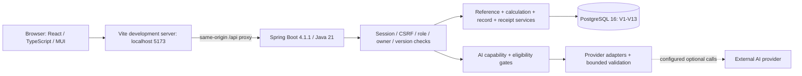

# FitNutri MVP Demo：组员启动与人工用户测试手册（中文版）

> 读者：第一次运行本项目的组员、演示者、人工验收者。顺序：先启动，再做用户测试，最后了解架构。本文不是已通过的人工验收记录。

**版本核实日期：2026-10-18，Australia/Sydney。** PR #40 已于该日合并；远程 `main` 与本地当前提交是 `c5fcdac1622ef692412acdfb2668eb056786c988`，它包含已完整自动验证的 `495d480`。`develop/yuankang-wei` 位于 `495d480`。本手册描述该 MVP，不把旧执行计划里的 TODO 当作当前事实。以后 main 更新时，请记录自己实际测试的 SHA。

## 目录

1. 从仓库下载与选择环境
2. 私有配置、首次初始化与目录导入
3. 每日启动、停止、AI 和排错
4. 人工测试准备与 15 分钟演示路线
5. 120 个详细人工测试用例
6. 缺陷记录、结果汇总与验收
7. 架构、数据流、实现状态与自动化入口

## 1. 从仓库下载与选择环境

### 1.1 工具与职责

| 工具 | 要求与用途 | 何时需要 |
| --- | --- | --- |
| Git / 仓库权限 | 能访问学校 GitHub Enterprise；本机配置自己的账号与 SSH key | 下载代码 |
| JDK | **21**，同时包含 `java`、`javac`；IDE 与终端选择同一 JDK | 编译/启动后端 |
| Node.js / npm | **Node 24**，与 `.nvmrc` 一致；使用已有 lockfile | 安装/启动前端 |
| PostgreSQL | **16**；Compose 固定镜像 `postgres:16.15` | 持久化；不是 MySQL |
| Docker / Compose | Docker 服务已启动，支持 `docker compose` | 推荐的独立 PostgreSQL 部署方式 |
| Python | Python 3，可创建 venv；按仓库 requirements 安装，不改系统包 | 初次数据准备、契约及数据检查 |
| Poppler | 提供 `pdftotext` | Compendium PDF 数据准备 |
| FFmpeg | 提供可执行 `ffmpeg`；找不到时设置绝对 `FFMPEG_BIN` | 录音解码与相关测试；纯手工记录不调用模型 |
| PostgreSQL 客户端 | `psql`、`pg_dump`、`pg_restore`，应与 PG16 兼容 | 空库检查、备份恢复、完整测试 |
| 浏览器 | 当前 Chrome/Edge；允许 localhost Cookie；高级音频需浏览器支持 | 人工测试；不要使用包含个人资料的测试截图 |

macOS/Linux 使用 Bash/Zsh 等 POSIX shell。Windows 组员使用 **WSL2 的 Linux 终端**运行本文命令，在 WSL 中安装 Git、JDK21、Node24、Python、FFmpeg、Poppler、PG 客户端，并启用 Docker Desktop 的 WSL 集成。建议仓库放在 WSL 的 `~/projects/`，不要把本文 shell 环境变量语法直接粘到原生 PowerShell。若 localhost 跨系统访问失败先核对 WSL/Docker 网络，不修改业务代码绕过权限。

按各平台官方安装方式装好工具后，在终端逐条运行：

```sh
git --version
java -version
javac -version
node --version
npm --version
python3 --version
docker version
docker compose version
psql --version
pg_dump --version
pg_restore --version
pdftotext -v
ffmpeg -version
```

成功标志：命令存在、Java 为21、Node 为24、Docker 客户端能连接 Docker 服务。`JAVA_HOME` 必须指向本机 JDK21；具体路径因机器而异，不复制作者的绝对路径。若使用 nvm，进入仓库后执行 `nvm install`、`nvm use`。第一次安装需要网络；不要通过修改 lockfile 解决版本不匹配。

### 1.2 第一次获取代码

**终端 T0：任意工作目录的父文件夹。** 下列地址是已核实的更名后仓库地址，需要组员自己的学校仓库权限；无需把作者的 SSH key 发给别人。

```sh
git clone --branch main git@github.sydney.edu.au:2026S2-Object-Oriented-App-Frameworks/Lab_practical_05_Group_6.git
cd Lab_practical_05_Group_6
git status -sb
git log -1 --oneline
git rev-parse HEAD
```

SSH 未配置但网页有访问权时，可改用对应的 HTTPS 地址，由 Git 的凭据机制认证，不能把 token 放进 URL 或文档：

```sh
git clone --branch main https://github.sydney.edu.au/2026S2-Object-Oriented-App-Frameworks/Lab_practical_05_Group_6.git
```

成功标志：根目录能看到 `backend/`、`frontend/`、`docs/`、`scripts/`；本基线是 `c5fcdac`。无需自己创建 PR 或合并 main。

**仅在未来复用本文、相应 PR 尚未合并时**，先通过 PR 页面确认包含目标功能的提交，再使用：

```sh
git clone --branch develop/yuankang-wei git@github.sydney.edu.au:2026S2-Object-Oriented-App-Frameworks/Lab_practical_05_Group_6.git
```

本次 PR #40 已合并，不需要这个替代命令。不要拿缺少 MVP 的旧 main 测试后把“页面不存在”当作功能缺陷。

### 1.3 已有仓库时更新

在自己的仓库根目录先运行 `git status -sb`。有本地改动时，先保留自己的工作或使用另一个干净目录 clone；不要 `reset --hard`、`clean -fd` 或盲目覆盖环境文件。只有工作区干净、且确定要更新自己的 main 时才执行：

```sh
git fetch origin
git switch main
git pull --ff-only origin main
git log -1 --oneline
```

若不能快进，停下请维护者处理；不要 force。下载代码不会下载别人的数据库、`.env`、`node_modules` 或私有账号，这是正常的，下面会创建你自己的环境。

## 2. 私有配置、首次初始化与目录导入

### 2.1 安装依赖并建立环境文件

**终端 T0，仓库根目录。** 初次运行依次执行：

```sh
npm --prefix frontend ci
python3 -m venv .local/tools
.local/tools/bin/python -m pip install -r scripts/data-requirements.txt -r scripts/contract-requirements.txt
cp .env.example .env
```

前端安装以 lockfile 为准；不要用 `npm update`。Python 包仅装入本项目忽略的 venv。`.env` 只在初次不存在时复制，已有私有配置不可覆盖。用编辑器打开 `.env`，选择自己的密码；含空格或 shell 字符的值要按 shell 语法加引号。

| 配置 | 填写规则与默认示例 |
| --- | --- |
| `DB_DATABASE` | 自己的新空数据库名，示例 `fitnutri` |
| `DB_USERNAME` | 该数据库实际存在的角色，示例 `fitnutri` |
| `DB_PASSWORD` | 自己设置的私有密码；必须替换 `CHANGE_ME` |
| `DB_PORT` | 宿主机空闲端口，默认5432；不是容器内部端口变更 |
| `DB_URL` | 必须匹配上述端口和库名：`jdbc:postgresql://127.0.0.1:5432/fitnutri` |
| `APP_ALLOWED_ORIGINS` | 默认 `http://localhost:5173`；是前端来源，不能填数据库地址 |
| `REFERENCE_SOURCE_DIR` | 后面导出为当前仓库的绝对 `.local/reference-sources` 路径 |
| 四个 `IMPORT_*` | 日常全为 `false`，只在指定的首次目录导入命令中临时开启 |
| `ACTIVITY_MANIFEST` | `data/manifests/compendium-2024-r2.json` |
| `APP_BOOTSTRAP_ADMIN_ENABLED` | 默认 `false`，普通组员不需要管理员 |
| `AI_*_ENABLED` | 默认四项 `false`；模型与 key 为空时不表示数据库坏了 |

**终端 T1：专门留给后端，仓库根目录。** 每次打开一个新的后端终端，都必须重新导出：

```sh
set -a
. ./.env
set +a
export REFERENCE_SOURCE_DIR="$PWD/.local/reference-sources"
```

Compose 会读 `.env`，Java 不会自动读。修改文件后也要重新导出再重启后端。禁止打印或截图整个环境。更改已有数据卷的 `POSTGRES_PASSWORD` 不会自动更改库内角色密码。

### 2.2 创建自己的 PostgreSQL

**T1，根目录：先只读检查本机已有实例。**

```sh
docker ps -a --filter name=fitnutri-postgres
docker volume ls
```

若已存在同名容器或本项目的 `fitnutri-pgdata` 数据卷，先确认归属和数据用途，不执行下面的创建命令覆盖旧配置；已有实例参照3.2或请维护者安排新环境。仅确认这是自己的新安装后继续：

```sh
docker compose config --quiet
docker compose up -d db
docker compose ps
```

检查成功：`db` 健康，容器名 `fitnutri-postgres`，默认宿主机5432映射容器5432，数据在独立 named volume。配置校验使用 `--quiet`，避免输出展开后的密码。

**碰到同名容器、端口或已有数据卷时，不要继续假定它是空库。** 不删除他人的容器/卷，不运行 `down -v`。最简单的初次组员路径是自己的 Docker 环境；若本机已有同项目实例，请维护者为新实例明确安排独立容器、卷和空闲端口，或为你创建单独的 PG16 库/角色，再更新 `.env`。仅换 Compose project name 不能解决固定 `container_name` 冲突。

**只读确认所选库身份和是否为空：** 当前环境已导出时执行下列命令；`psql` 会提示输入你自己配置的密码，不把密码写在命令中。若使用非 Docker 数据库，调整实际角色和连接值。

```sh
psql -h 127.0.0.1 -p "$DB_PORT" -U "$DB_USERNAME" -d "$DB_DATABASE" -W -c 'SELECT current_database(), current_user;'
psql -h 127.0.0.1 -p "$DB_PORT" -U "$DB_USERNAME" -d "$DB_DATABASE" -W -c "SELECT count(*) FROM information_schema.tables WHERE table_schema='public';"
```

只有身份正确且确认为**本次创建的空库**才能进行下一节。非零表数、已有数据或来源不明都先停下，参见[已有数据库迁移](db/migration-foundation.md)。不要为了通过此检查清空数据库。

### 2.3 空库首次迁移——只做一次

**T1，根目录；前提：上一节确认自己的空库。**

```sh
./backend/mvnw -f backend/pom.xml spring-boot:run -Dspring-boot.run.profiles=local,migration
```

成功标志：Flyway 完成 V1–V13，Hibernate 验证通过，日志出现 Spring 启动成功。然后在 T1 按 `Ctrl-C` 停止这次初始化。此阶段不要求目录已导入。失败时保留错误摘要，不修改迁移 SQL、不执行 repair/baseline、不启用 `ddl-auto=update`。已有库的升级必须走备份/预检/恢复演练，不套用空库命令。

### 2.4 首次参考数据准备和导入

**T0 或空闲终端，根目录；Python venv 已安装，网络和 pdftotext 可用。**

```sh
.local/tools/bin/python scripts/data/fetch_ausnut_sources.py
.local/tools/bin/python scripts/data/fetch_compendium_sources.py
.local/tools/bin/python scripts/data/prepare_ausnut.py
.local/tools/bin/python scripts/data/prepare_compendium_ux.py
```

每条依次成功再继续。期望来源 SHA256 VERIFIED、准备脚本验证成功；官方原文件放入忽略的 `.local/reference-sources/`，不能用个人数据库 dump 替代。Compendium 年龄网页来自项目捆绑的历史证据快照，并核验原始 hash；官方 PDF、AUSNUT 工作簿仍需下载。校验失败不能随手改 manifest/hash。若产生受 Git 管理的数据差异，停下核对版本和依赖，不提交不明变更。

**T1，根目录且已重新导出私有环境；只在这条命令中启用四类导入：**

```sh
IMPORT_FOOD_CATALOGUE=true IMPORT_ACTIVITY_CATALOGUE=true \
IMPORT_FOOD_SEARCH_METADATA=true IMPORT_EXERCISE_OPTIONS=true \
ACTIVITY_MANIFEST=data/manifests/compendium-2024-r2.json \
./scripts/dev.sh backend
```

成功标志：导入没有 provenance 错误，后端启动；后续页面可查食物、运动选项和力量动作。核心食品参考数为3,741；历史活动 revision 可同时留存，不能把所有活动表行数误当“当前可选项数量”。停掉这次进程。四个临时赋值只对该命令生效；`.env` 中保持 false。选择 r2 是导入产品运动选项所必需的，不用旧 r1 替代。

## 3. 日常启动、停止、AI 与排错

### 3.1 正常启动（不再迁移或导入）

**T1，根目录，导出本机 `.env` 后：**

```sh
./scripts/dev.sh backend
```

**T2，另开终端，进入同一个仓库根目录：**

```sh
./scripts/dev.sh frontend
```

**T3，根目录，检查连接：**

```sh
./scripts/dev.sh health
```

成功标志：后端默认 `127.0.0.1:8080`、前端 `http://localhost:5173`，健康检查输出 PASS。打开 **http://localhost:5173**；统一使用 `localhost`，不要在同一会话混用127.0.0.1。正常开发 Vite 直接代理 `/api` 到8080，不需要 fault proxy。历史手测15173/18080、旧8787不是组员的前置环境。

创建自己的普通账号，完成三步问卷。注册不会自动登录；第一个账号**不会自动变成管理员**。历史测试账号不能保证存在于你的数据库。测试前退出真实个人账号，使用合成身份。

后端本地 HTTP profile 允许本地会话 Cookie；生产默认 Secure。不要为了“能登录”在程序里关闭 CSRF。前端端口改变要同步 allowed origin，后端端口改变要同步代理；新手先使用默认端口。

### 3.2 停止、重启和已有数据

1. T2 与 T1 各按 `Ctrl-C`；浏览器关闭不等于服务器停止。
2. 需要停止自己 Compose 数据库时，在根目录运行 `docker compose stop db`；**不删除卷**。
3. 再次运行 `docker compose up -d db`，等待健康；新 T1 重新导出 `.env`，仅启动 `./scripts/dev.sh backend`，T2 启动前端。
4. 重新登录，在 History 验证原来保存的记录仍在。后端重启后的内存会话可失效，需要重新登录，这是正常的；不能把登录失效当成数据库丢失。
5. 不再次使用 migration profile 或四个导入开关，不通过删除数据卷“重置测试”。

### 3.3 可选 AI 与管理员准备

不设置 key 时仍可完成手工食物/运动、组合菜/Workout、历史与事实汇总。图片、转写、提取、Q&A 需要各自 feature flag、后台私有 `OPENAI_API_KEY` 和实际可用的模型配置。模型名按自己的服务账户选择，本文不承诺某个模型/额度。不要把 key 放进 `VITE_*`、URL、截图或前端代码。

启用前查 `.env.example` 的 `AI_IMAGE_ENABLED`、`AI_TRANSCRIPTION_ENABLED`、`AI_PARSING_ENABLED`、`AI_QA_ENABLED` 及 `OPENAI_IMAGE_MODEL`、`OPENAI_TRANSCRIPTION_MODEL`、`OPENAI_PARSING_MODEL`、`OPENAI_QA_MODEL`；转写还要 FFmpeg 可用。设置后重新导出并重启后端。Q&A 同时要求已完成资料、适当健康安全回答和同意；“资料允许”不等于“服务已配置”。真实模型测试可能付费，只由同意承担费用的测试者在自己的环境执行。

管理员用例标为高级：维护者在独立验收库通过私有 `APP_BOOTSTRAP_ADMIN_EMAIL`、`APP_BOOTSTRAP_ADMIN_PASSWORD`、`APP_BOOTSTRAP_ADMIN_DISPLAY_NAME` 与 enabled flag 明确创建合成管理员，成功后关闭开关再重启。不要给普通账号直接改角色或共享默认密码。详见[运行说明](runbook.md)。

### 3.4 故障对照表

| 现象 | 先检查 | 成功恢复标准 |
| --- | --- | --- |
| Permission denied / Git认证失败 | 自己的学校仓库权限、SSH或HTTPS凭据 | 能读取分支；不借用作者私钥 |
| Java版本或编译失败 | java/javac/JAVA_HOME是否同为21 | 后端正常编译 |
| npm engine报错 | Node24，使用 `npm ci` | 依赖安装成功；lockfile未被修改 |
| DB connection refused | Docker健康、DB_PORT/DB_URL一致 | 指定自己的数据库可连接 |
| DB authentication failed | 实际角色密码；旧卷不会随.env重置密码 | 用自己的psql账号可连接 |
| Schema readiness失败 | 是否自己的V13库；首次迁移是否完成 | 13个成功迁移，Hibernate验证通过 |
| 食物或运动为空 | 四类目录导入、r2及来源hash | 可选项正常；不要编造数据 |
| Source hash失败 | 是否官方文件变化、缓存损坏、版本不匹配 | 维护者确认正确来源后验证通过 |
| 登录后又回登录页 | 统一localhost、本地profile、Cookie、CSRF、是否已重启 | 一次正常登录后可读取自己的页面 |
| 页面端口占用 | 查明进程身份；用自己的空闲端口并更新配置 | 不终止未知服务；页面和API均可访问 |
| AI unavailable / 503 | flag、key、model、资格、FFmpeg | 手动记录仍可用；真实AI验证单列 |
| Browser录音不可用 | localhost安全上下文、麦克风权限、WebM/MP4支持 | 支持的浏览器可录；否则上传支持文件或手动输入 |
| 测试报TEST_DB缺失 | 单独配置 `.env.test`，不是复制应用DB连接 | 只对自己的独立测试库运行 |

## 4. 人工测试准备与15分钟演示路线

### 4.1 测试日期、角色与合成数据

- **T**＝测试开始时界面使用的当前日期；**Y**＝T前一天；**H**＝`2020-01-02`；**T+1**＝明天。记录时区（默认 Australia/Sydney）。跨午夜需重新打开录入，记录新的T，不能把旧日期上下文问题混为缺陷。
- **A**＝新普通用户，显示名 `UAT A`，邮箱 `uat-a-<run-id>@example.test`；**B**＝独立普通用户 `UAT B`、`uat-b-<run-id>@example.test`。把 `<run-id>` 换为本次编号，如 `20261018-r1`。自己选择符合规则的密码并私下保存，本文不提供共用密码。
- A资料：成年确认，出生年1995，身高175 cm，初始体重70 kg、日期T，Sex选 `Prefer not to say`，Activity level选 `Moderately active`，Primary goal可 `Maintain`，能量参考先留空；Health safety先 `No`，Q&A consent可勾选（仅合成测试，真实用户按事实）。B同样完成自己的问卷。
- **C**＝可选、单独会话的合成管理员 `synthetic-uat-admin-<run-id>@example.test`，由维护者准备。无此角色时相关用例 BLOCKED，不能冒充已通过。
- **食品 F1/F2**：从真实列表选择两条可用参考，用查询 `rice`、`chicken` 找到后记录其完整名称、reference ID/来源revision和显示营养。不同制备状态不能混选。常用克数150g与100g；组合菜名称 `UAT dish <case-id>`。
- **运动 Q1**：选择实际列表中的 `Walking`（如显示多个则选定一个并记完整名）；**Q2**：`Basketball` 用于无历史体重边界；**G**：`UAT workout <case-id>`。有些活动映射无适用能耗参考，按实际提示选择，不把所有运动都视作可计算。
- 只使用合成数据，不录入真实病史、真实健康图像、个人录音或其他组员的账号。缺陷截图遮挡密码、Cookie、key和其他人的信息。

### 4.2 共用操作流程（用例引用F/Q/G）

**流程 F：普通食物草稿。** 从 Dashboard 的 `Add food` 入口进入，按页上 `Continue`，设置 `Record date`、`Default meal`=`Lunch`，在 `Find food to add` 查询并从下拉结果**明确选中**F1，`Grams to add`填150，等营养预览，点 `Add to meal`。此时只进本地 My meal，尚未保存。点击 `Review food entries` → 检查 `Review your record.` → `Confirm & save` 后才应写库。成功返回 Dashboard，可通过成功区 `View saved records` 或 History 查看；不要预期停留在旧版录入页。

**流程 Q：一次 Quick exercise。** Dashboard `Add exercise` → `Continue` → `Quick exercise`，设置 `Record date`，在 `Find activity or movement` 选Q1，填 `Duration (minutes)`=20，等待真实估算；`Review exercise entry` → `Confirm & save`，成功后查History。一个Quick记录是一个根和一个计时段。

**流程 G：一次 Gym workout。** 从Add exercise进入 `Gym workout`，`Workout title`填本例名称；用 `Add strength period` / `Add cardio period` 建立段，每段明确选择活动、填分钟；力量段可加动作和可选组次负重。示例力量30分钟+有氧20分钟，总时长50分钟。`Review workout` → `Confirm & save`。动作不是额外计时段，不重复加总其能量。

**查看与更正。** History选择日期范围与 `Record type`，刷新，点目标根卡的详情入口查看；使用 `Edit`，按编辑页面返回Review并以 `Confirm changes` 保存；通过卡片菜单 `Delete` 并在对话框 `Confirm deletion` 确认；`Log again` 是新草稿。详细按钮若不在卡面，打开该卡的菜单。不要尝试直接删除数据库子行。

**体重入口。** Profile 的体重表单使用 `Weight (kg)`、`Weight date` 和 `Save weight`；同日更正先查看已存值，再按界面进入更正，以 `Save correction` 确认。`Clear weight form` 只清输入，不删除历史体重。

**每例复查。** 先记录该用户在该日期的根记录数、详情与汇总（基线），只改变一项条件。无保存用例：退出草稿并刷新History应不增加；保存用例：按本例标签查一次并刷新复查；更正用例：根ID应保留、版本与显示更新；复用用例：新根ID且旧根不变。数值显示可四舍五入，比较单位和合理精度，不按“名字看起来像”断定营养应相同。

### 4.3 15分钟演示检查路线

| 时间 | 操作 | 需要看到 |
| --- | --- | --- |
| 0–3分钟 | 注册A，登录，完成三步问卷 | 页面跳转正常，未自动获得管理员 |
| 3–6分钟 | F1 150g + F2 100g，先Add再Review再确认 | Add时未写库，一次确认后History显示两个普通根 |
| 6–8分钟 | 新组合菜，用同样食材的全配方并吃1/2 | 一个菜根，详情显示两食材与份量 |
| 8–10分钟 | Q1 20分钟并保存 | 一个运动根，有日期/能量或明确不可用原因 |
| 10–13分钟 | History更正一份食物克数，检查当日汇总 | 更正只影响对应记录；统计更新 |
| 13–15分钟 | 窄屏查看History，退出再登录 | 布局可用，自己的已保存记录仍在 |

这条路线不能替代120例，无法在15分钟完成的组员应如实记录进度，不为了演示跳过验证。

### 4.4 用例执行约定与已核对边界

P0＝核心流程/数据安全，失败阻止验收；P1＝重要边界，失败需修复或明确接受；P2＝体验。普通UI例不需要SQL。高级例需维护者安排独立库、两个真实会话、DevTools或本地故障代理；缺少条件标BLOCKED。

| 输入 | 当前实际规则 | 来源 |
| --- | --- | --- |
| 注册 | 邮箱最多254；display name去边空白后1–100；密码8–72字符、含字母和数字，并有72 UTF-8字节编码边界 | `RegisterRequest` / 注册服务 |
| 资料 | 出生年1900至当前年−18；成年确认；身高50–260cm；体重20–400kg最多2位小数 | `profileForm` / Profile DTO |
| 食物克数 | >0且≤10000，最多3位小数 | `inputRules` / `FoodEntryInputValidator` |
| 食物组 | 每批1–20根；每菜1–20食材；一批合计≤50叶子；菜名1–100字符 | `FoodEntryInputValidator` |
| 份量 | 分子/分母正整数≤1000000且分子≤分母；百分比>0且≤100，最多3位小数；总份数1–1000整数，吃的份数>0且≤总份数，最多3位小数 | `portionInput` / `PortionNormalizer` |
| 运动 | 每段>0且≤1440分钟，最多2位小数；Workout1–12段，合计≤1440分钟 | `inputRules` / `ExerciseEntryInputValidator` |
| 动作详情 | 每段≤30动作、全Workout≤100；Sets1–100；Reps1–1000；负重0–1000kg最多2位小数，字段可留空且依动作load basis | `ExerciseEntryInputValidator` |
| 设备详情 | 只显示该选项允许字段；speed>0至100；incline −20至40；distance>0至1000000；level0–100整数，其他数值最多2位小数 | `EquipmentDetailsValidator` |
| 日期/范围 | 记录不得未来；History1–366天；Q&A显式记录范围最多31天 | `RecordDatePolicy` / Q&A范围规则 |
| 语音/问答 | WebM/MP4音频最大8MiB，浏览器录音最长60秒；转写文字≤10000字符；问题≤2000字符 | `domain/media` / 语音与Q&A页面 |

上限是软件输入验证，不是健康建议。文字字段可能由浏览器阻止继续输入，也可能在提交时显示错误，这两种都可接受，但不能保存被静默截断的错误数据。原生日期控件若阻止输入不存在的日期，记录浏览器已拦截；不要为此要求组员构造非法SQL。密码字节边界的高级接口验证不等于所有UI都能输入72个多字节字符。

## 5. 120个详细人工测试用例

所有状态初始为 **NOT RUN**。A/F/Q/G/H等前置引用按4.1–4.2执行；H指先创建本例独立的已保存记录。高级故障用例的准备见7.5。缺少权限、模型、浏览器或故障模拟条件记BLOCKED，不把“不能执行”写PASS。

### 5.1 账号与会话 — UAT-001–UAT-012

#### UAT-001 — 普通账号注册

- **目的：** 普通账号注册
- **优先级与级别：** P0 · 普通 UI
- **前置条件：** 已启动；未登录；准备新的A邮箱。
- **具体输入：** A邮箱；Display name=UAT A；自己选择8–72位含字母数字的密码。
- **操作步骤：** 点 Create an account，填所有字段和密码确认，点 Create account；再 Sign in。
- **预期结果：** 注册成功提示消退；不自动登录；登录后进入问卷，不获得管理员身份。
- **数据与复查：** 只创建一个普通账号；用相同邮箱登录复查，不应产生食物/运动。
- **记录：** 状态 **NOT RUN**（执行后选 PASS / FAIL / BLOCKED / NOT RUN）；测试者____；时间/时区____；实际结果____；缺陷ID____。
- **证据要求：** 按6.1保留输入/关键反馈截图与前后History或资料复查；无写入例记录“未变化”。路径____；阻塞原因（如有）____。

#### UAT-002 — 必填项留空

- **目的：** 必填项留空
- **优先级与级别：** P1 · 普通 UI
- **前置条件：** 未登录，注册表打开。
- **具体输入：** 邮箱、显示名、密码均空，再分别只填一项。
- **操作步骤：** 分别尝试 Create account；定位提示，再填完整合规数据。
- **预期结果：** 未填必填项时阻止注册；提示清楚，不跳到已登录页。
- **数据与复查：** 不创建半成品账号；之后正常注册不应被空输入占用。
- **记录：** 状态 **NOT RUN**（执行后选 PASS / FAIL / BLOCKED / NOT RUN）；测试者____；时间/时区____；实际结果____；缺陷ID____。
- **证据要求：** 按6.1保留输入/关键反馈截图与前后History或资料复查；无写入例记录“未变化”。路径____；阻塞原因（如有）____。

#### UAT-003 — 邮箱格式与重复

- **目的：** 邮箱格式与重复
- **优先级与级别：** P0 · 普通 UI
- **前置条件：** 已按001创建A，另开未登录窗口。
- **具体输入：** not-an-email；随后使用A邮箱。
- **操作步骤：** 注册页先输错误格式；再用A邮箱提交其他合规字段。
- **预期结果：** 格式错误被拦截；已注册邮箱不能创建第二账号；页面不泄露数据库异常。
- **数据与复查：** A的密码和资料不被替换；用原密码登录A复查。
- **记录：** 状态 **NOT RUN**（执行后选 PASS / FAIL / BLOCKED / NOT RUN）；测试者____；时间/时区____；实际结果____；缺陷ID____。
- **证据要求：** 按6.1保留输入/关键反馈截图与前后History或资料复查；无写入例记录“未变化”。路径____；阻塞原因（如有）____。

#### UAT-004 — 邮箱大小写与空白

- **目的：** 邮箱大小写与空白
- **优先级与级别：** P0 · 普通 UI
- **前置条件：** A存在；未登录。
- **具体输入：** A邮箱改大写并在两端加空格；使用A正确密码。
- **操作步骤：** 先用该邮箱登录；退出后尝试用变体重复注册。
- **预期结果：** 登录解析为同一A；重复注册被拒，不建立大小写不同的第二身份。
- **数据与复查：** 仅原账号存在；History仍是A的数据。
- **记录：** 状态 **NOT RUN**（执行后选 PASS / FAIL / BLOCKED / NOT RUN）；测试者____；时间/时区____；实际结果____；缺陷ID____。
- **证据要求：** 按6.1保留输入/关键反馈截图与前后History或资料复查；无写入例记录“未变化”。路径____；阻塞原因（如有）____。

#### UAT-005 — 密码最小长度与组成

- **目的：** 密码最小长度与组成
- **优先级与级别：** P1 · 普通 UI
- **前置条件：** 新注册页面；每个成功变体用新邮箱。
- **具体输入：** 7位含字母数字；8位含字母数字；8位全字母；8位全数字，密码由自己选。
- **操作步骤：** 逐项尝试提交，保证确认密码一致；只对合规项完成注册。
- **预期结果：** 7位、缺字母或缺数字被拒；8位合规值可注册。
- **数据与复查：** 只有合规变体创建账号；失败变体不创建。
- **记录：** 状态 **NOT RUN**（执行后选 PASS / FAIL / BLOCKED / NOT RUN）；测试者____；时间/时区____；实际结果____；缺陷ID____。
- **证据要求：** 按6.1保留输入/关键反馈截图与前后History或资料复查；无写入例记录“未变化”。路径____；阻塞原因（如有）____。

#### UAT-006 — 密码最大长度与编码边界

- **目的：** 密码最大长度与编码边界
- **优先级与级别：** P1 · 高级 / 需维护者准备
- **前置条件：** 使用独立验收环境；维护者协助可选接口复核。
- **具体输入：** 自己生成72与73个ASCII字符，均含字母数字；可选多字节密码超过72 UTF-8字节。
- **操作步骤：** 注册表尝试72再73，观察字段是否限制；多字节输入若UI已阻止则记录；接口补测由维护者按契约进行。
- **预期结果：** 72字节合规值可通过；超长不应静默保存另一密码；超72 UTF-8字节被拒。
- **数据与复查：** 成功账号只用实际完整密码登录；拒绝项不创建账号。
- **记录：** 状态 **NOT RUN**（执行后选 PASS / FAIL / BLOCKED / NOT RUN）；测试者____；时间/时区____；实际结果____；缺陷ID____。
- **证据要求：** 按6.1保留输入/关键反馈截图与前后History或资料复查；无写入例记录“未变化”。路径____；阻塞原因（如有）____。

#### UAT-007 — 密码确认不一致

- **目的：** 密码确认不一致
- **优先级与级别：** P1 · 普通 UI
- **前置条件：** 新注册页。
- **具体输入：** 合规私有密码；确认框填不同值。
- **操作步骤：** 点 Create account，检查确认框提示；改为一致后重试。
- **预期结果：** 不一致时不注册；修正后可正常继续，不要求重新安装或重启。
- **数据与复查：** 只允许修正后的单次账号创建。
- **记录：** 状态 **NOT RUN**（执行后选 PASS / FAIL / BLOCKED / NOT RUN）；测试者____；时间/时区____；实际结果____；缺陷ID____。
- **证据要求：** 按6.1保留输入/关键反馈截图与前后History或资料复查；无写入例记录“未变化”。路径____；阻塞原因（如有）____。

#### UAT-008 — 显示名空白与长度

- **目的：** 显示名空白与长度
- **优先级与级别：** P1 · 普通 UI
- **前置条件：** 新注册页；合规邮箱与密码。
- **具体输入：** 空格；100个ASCII字符；101个ASCII字符；两端空白的UAT A。
- **操作步骤：** 逐项提交或观察输入限制，每个有效注册使用新邮箱。
- **预期结果：** 纯空白无效，100可接受，101不可静默截断保存；普通名称两端空白被清理。
- **数据与复查：** 不合规项不建账号；合规项登录后检查显示名。
- **记录：** 状态 **NOT RUN**（执行后选 PASS / FAIL / BLOCKED / NOT RUN）；测试者____；时间/时区____；实际结果____；缺陷ID____。
- **证据要求：** 按6.1保留输入/关键反馈截图与前后History或资料复查；无写入例记录“未变化”。路径____；阻塞原因（如有）____。

#### UAT-009 — 错误登录与恢复

- **目的：** 错误登录与恢复
- **优先级与级别：** P0 · 普通 UI
- **前置条件：** A存在且已退出。
- **具体输入：** A邮箱+错误密码；不存在的合成邮箱；最后A正确凭据。
- **操作步骤：** 依次 Sign in；检查提示，再修正。
- **预期结果：** 失败不进入私有页面，不泄露密码/堆栈；正确凭据仍能登录。
- **数据与复查：** 不更改A资料或记录；History基线一致。
- **记录：** 状态 **NOT RUN**（执行后选 PASS / FAIL / BLOCKED / NOT RUN）；测试者____；时间/时区____；实际结果____；缺陷ID____。
- **证据要求：** 按6.1保留输入/关键反馈截图与前后History或资料复查；无写入例记录“未变化”。路径____；阻塞原因（如有）____。

#### UAT-010 — 退出后的返回与刷新

- **目的：** 退出后的返回与刷新
- **优先级与级别：** P0 · 普通 UI
- **前置条件：** 用户 A 已登录并完成问卷；记录测试前的 History 条数与当日汇总。
- **具体输入：** 已登录A，History有一条合成记录。
- **操作步骤：** 通过 Account menu → Log out；浏览器返回、刷新、直接打开/history。
- **预期结果：** 服务端不再允许私有读取；不能靠返回键恢复可操作的A会话。
- **数据与复查：** 已保存记录未删除；重新登录A后可见。
- **记录：** 状态 **NOT RUN**（执行后选 PASS / FAIL / BLOCKED / NOT RUN）；测试者____；时间/时区____；实际结果____；缺陷ID____。
- **证据要求：** 按6.1保留输入/关键反馈截图与前后History或资料复查；无写入例记录“未变化”。路径____；阻塞原因（如有）____。

#### UAT-011 — 登录状态刷新与新标签

- **目的：** 登录状态刷新与新标签
- **优先级与级别：** P0 · 普通 UI
- **前置条件：** 用户 A 已登录并完成问卷；记录测试前的 History 条数与当日汇总。
- **具体输入：** 同一浏览器的第二标签页。
- **操作步骤：** 刷新Dashboard，在新标签打开/history；另一标签退出，再刷新前一标签。
- **预期结果：** 正常会话刷新可继续；退出后旧标签不能继续私有操作，应要求重新登录。
- **数据与复查：** 不新增记录，不自动替用户重新登录。
- **记录：** 状态 **NOT RUN**（执行后选 PASS / FAIL / BLOCKED / NOT RUN）；测试者____；时间/时区____；实际结果____；缺陷ID____。
- **证据要求：** 按6.1保留输入/关键反馈截图与前后History或资料复查；无写入例记录“未变化”。路径____；阻塞原因（如有）____。

#### UAT-012 — 未登录与未完成问卷的路由

- **目的：** 未登录与未完成问卷的路由
- **优先级与级别：** P0 · 普通 UI
- **前置条件：** 独立窗口未登录；另准备已注册但未完成资料的用户。
- **具体输入：** /dashboard、/history、/add。
- **操作步骤：** 先未登录直接访问；再用未完成问卷用户访问这些路由。
- **预期结果：** 未登录需登录；未完成资料应引导问卷或阻止不允许的创建，不能绕过设置保存记录。
- **数据与复查：** 不应生成记录；完成资料后再按F验证正常入口。
- **记录：** 状态 **NOT RUN**（执行后选 PASS / FAIL / BLOCKED / NOT RUN）；测试者____；时间/时区____；实际结果____；缺陷ID____。
- **证据要求：** 按6.1保留输入/关键反馈截图与前后History或资料复查；无写入例记录“未变化”。路径____；阻塞原因（如有）____。

### 5.2 问卷、体重与单位 — UAT-013–UAT-022

#### UAT-013 — 三步问卷正常完成

- **目的：** 三步问卷正常完成
- **优先级与级别：** P0 · 普通 UI
- **前置条件：** 新的A已登录但尚未完成问卷。
- **具体输入：** 4.1的A资料；能量参考空。
- **操作步骤：** About you填基础及初始体重 → Continue；Goals & activity选择活动 → Continue；Health & Q&A选择并 Complete setup。
- **预期结果：** 进入Dashboard，资料完整；初始体重只保存一次；空目标显示实际值而非虚构目标。
- **数据与复查：** Profile/体重持久保存；退出重登检查。
- **记录：** 状态 **NOT RUN**（执行后选 PASS / FAIL / BLOCKED / NOT RUN）；测试者____；时间/时区____；实际结果____；缺陷ID____。
- **证据要求：** 按6.1保留输入/关键反馈截图与前后History或资料复查；无写入例记录“未变化”。路径____；阻塞原因（如有）____。

#### UAT-014 — 成年与出生年边界

- **目的：** 成年与出生年边界
- **优先级与级别：** P1 · 普通 UI
- **前置条件：** 新问卷About you；其余字段有效。
- **具体输入：** 未勾成年；1900；当前年−18；1899；当前年−17。
- **操作步骤：** 分别修改一项，点 Continue；有效边界继续，随后Back检查值。
- **预期结果：** 须成年确认；1900与成年边界可接受；1899和未成年年份不可继续。
- **数据与复查：** 未 Complete setup不保存初始档案/体重；有效值最终按013保存。
- **记录：** 状态 **NOT RUN**（执行后选 PASS / FAIL / BLOCKED / NOT RUN）；测试者____；时间/时区____；实际结果____；缺陷ID____。
- **证据要求：** 按6.1保留输入/关键反馈截图与前后History或资料复查；无写入例记录“未变化”。路径____；阻塞原因（如有）____。

#### UAT-015 — 身高上下限

- **目的：** 身高上下限
- **优先级与级别：** P1 · 普通 UI
- **前置条件：** About you或Settings；其余字段有效。
- **具体输入：** Height (cm)=50、260、49.9、260.1、空。
- **操作步骤：** 每次只改身高，尝试Continue或Save settings；检查错误定位。
- **预期结果：** 50和260可接受，范围外与空值被拒；不能把厘米当米。
- **数据与复查：** 只显式保存的有效变体可更新资料，失败不改原值。
- **记录：** 状态 **NOT RUN**（执行后选 PASS / FAIL / BLOCKED / NOT RUN）；测试者____；时间/时区____；实际结果____；缺陷ID____。
- **证据要求：** 按6.1保留输入/关键反馈截图与前后History或资料复查；无写入例记录“未变化”。路径____；阻塞原因（如有）____。

#### UAT-016 — 体重范围与精度

- **目的：** 体重范围与精度
- **优先级与级别：** P1 · 普通 UI
- **前置条件：** 新用户初始体重页，或维护者指定的体重入口。
- **具体输入：** 20、400、19.99、400.01、70.25、70.251、0。
- **操作步骤：** 逐项输入Weight (kg)，尝试继续/保存；用70.25恢复合理合成值。
- **预期结果：** 20/400和两位小数可接受；范围外、0和三位小数被拒，不隐式四舍五入为已确认体重。
- **数据与复查：** 只保存有效体重；历史已保存运动能耗不能随更改资料自动重写。
- **记录：** 状态 **NOT RUN**（执行后选 PASS / FAIL / BLOCKED / NOT RUN）；测试者____；时间/时区____；实际结果____；缺陷ID____。
- **证据要求：** 按6.1保留输入/关键反馈截图与前后History或资料复查；无写入例记录“未变化”。路径____；阻塞原因（如有）____。

#### UAT-017 — 体重日期有效性

- **目的：** 体重日期有效性
- **优先级与级别：** P1 · 普通 UI
- **前置条件：** 初始Weight date或独立体重界面；浏览器原生日期控件。
- **具体输入：** T、Y、T+1、2026-02-30。
- **操作步骤：** 逐项尝试日期；控件若阻止非法日期记录为前端拦截；不修改数据库。
- **预期结果：** 今天/过去合法日期可接受；未来/不存在日期不得保存。
- **数据与复查：** 无效尝试不增加体重；检查已保存条目的日期。
- **记录：** 状态 **NOT RUN**（执行后选 PASS / FAIL / BLOCKED / NOT RUN）；测试者____；时间/时区____；实际结果____；缺陷ID____。
- **证据要求：** 按6.1保留输入/关键反馈截图与前后History或资料复查；无写入例记录“未变化”。路径____；阻塞原因（如有）____。

#### UAT-018 — 可选能量目标空值

- **目的：** 可选能量目标空值
- **优先级与级别：** P1 · 普通 UI
- **前置条件：** 用户 A 已登录并完成问卷；记录测试前的 History 条数与当日汇总。
- **具体输入：** Settings：Daily intake reference留空或Remove energy reference。
- **操作步骤：** Save settings；回Dashboard看统计，再刷新Settings。
- **预期结果：** 空目标可保存；只显示实际记录，不出现伪造目标、NaN或除零进度。
- **数据与复查：** 只更改目标；已有营养和运动记录不改。
- **记录：** 状态 **NOT RUN**（执行后选 PASS / FAIL / BLOCKED / NOT RUN）；测试者____；时间/时区____；实际结果____；缺陷ID____。
- **证据要求：** 按6.1保留输入/关键反馈截图与前后History或资料复查；无写入例记录“未变化”。路径____；阻塞原因（如有）____。

#### UAT-019 — kJ与kcal显示换算

- **目的：** kJ与kcal显示换算
- **优先级与级别：** P1 · 普通 UI
- **前置条件：** 用户 A 已登录并完成问卷；记录测试前的 History 条数与当日汇总。
- **具体输入：** 能量参考4184 kJ；切换Kilocalories (kcal)。
- **操作步骤：** Settings填4184kJ，保存；切kcal查看1000；再切回kJ，比较History。
- **预期结果：** 按1kcal=4.184kJ显示换算；多次切换不累计改变原始摄入记录。
- **数据与复查：** 单位/个人目标可更新；记录份量和服务端kJ保持原义。
- **记录：** 状态 **NOT RUN**（执行后选 PASS / FAIL / BLOCKED / NOT RUN）；测试者____；时间/时区____；实际结果____；缺陷ID____。
- **证据要求：** 按6.1保留输入/关键反馈截图与前后History或资料复查；无写入例记录“未变化”。路径____；阻塞原因（如有）____。

#### UAT-020 — 安全回答与同意组合

- **目的：** 安全回答与同意组合
- **优先级与级别：** P0 · 普通 UI
- **前置条件：** 用户 A 已登录并完成问卷；记录测试前的 History 条数与当日汇总。
- **具体输入：** Health & Q&A：No/Yes or unsure/Prefer not to answer与consent开/关。
- **操作步骤：** 逐个实际选项保存，进入Q&A看资格提示；最后恢复No+同意。
- **预期结果：** 只有No且同意才具备资料资格；服务配置另算。其他组合仍可手动记录。
- **数据与复查：** 只更新安全回答/同意；不删除记录，不发送真实病史。
- **记录：** 状态 **NOT RUN**（执行后选 PASS / FAIL / BLOCKED / NOT RUN）；测试者____；时间/时区____；实际结果____；缺陷ID____。
- **证据要求：** 按6.1保留输入/关键反馈截图与前后History或资料复查；无写入例记录“未变化”。路径____；阻塞原因（如有）____。

#### UAT-021 — 取消与重置资料编辑

- **目的：** 取消与重置资料编辑
- **优先级与级别：** P1 · 普通 UI
- **前置条件：** 用户 A 已登录并完成问卷；记录测试前的 History 条数与当日汇总。
- **具体输入：** Settings显示名改为UAT TEMP，不保存。
- **操作步骤：** 点 Reset changes；再改一次后尝试离开，在出现的提醒中选择留在页面或丢弃。
- **预期结果：** Reset恢复服务器保存值；离开提醒不应在未确认时自动保存；丢弃后重进仍旧值。
- **数据与复查：** 不应产生新的确认记录；离开后在 History 刷新对照基线。
- **记录：** 状态 **NOT RUN**（执行后选 PASS / FAIL / BLOCKED / NOT RUN）；测试者____；时间/时区____；实际结果____；缺陷ID____。
- **证据要求：** 按6.1保留输入/关键反馈截图与前后History或资料复查；无写入例记录“未变化”。路径____；阻塞原因（如有）____。

#### UAT-022 — 同日期体重不能静默重复

- **目的：** 同日期体重不能静默重复
- **优先级与级别：** P1 · 普通 UI
- **前置条件：** 用户 A 已登录并完成问卷；记录测试前的 History 条数与当日汇总。
- **具体输入：** 已存在日期T体重70；拟输入T体重71。
- **操作步骤：** 使用Profile的体重入口尝试同日再次记录，按实际冲突/更新提示处理，不直接改库。
- **预期结果：** 不能产生两个相同用户同日期的互相矛盾体重；若明确更新需展示新值并保护版本。
- **数据与复查：** 检查T只有一个当前体重；不自动改写已有运动快照。
- **记录：** 状态 **NOT RUN**（执行后选 PASS / FAIL / BLOCKED / NOT RUN）；测试者____；时间/时区____；实际结果____；缺陷ID____。
- **证据要求：** 按6.1保留输入/关键反馈截图与前后History或资料复查；无写入例记录“未变化”。路径____；阻塞原因（如有）____。

### 5.3 普通食物 — UAT-023–UAT-036

#### UAT-023 — 明确选择真实食品

- **目的：** 明确选择真实食品
- **优先级与级别：** P0 · 普通 UI
- **前置条件：** 满足 A；按流程 F 打开新的食物草稿，尚未保存。
- **具体输入：** Find food to add=rice；F1=150g。
- **操作步骤：** 输入查询，等结果，选完整名称，填Grams to add，等营养，再Add to meal。
- **预期结果：** 显示选中来源及预览；My meal有一项，输入清空可继续；尚未持久保存。
- **数据与复查：** 不应产生新的确认记录；离开后在 History 刷新对照基线。
- **记录：** 状态 **NOT RUN**（执行后选 PASS / FAIL / BLOCKED / NOT RUN）；测试者____；时间/时区____；实际结果____；缺陷ID____。
- **证据要求：** 按6.1保留输入/关键反馈截图与前后History或资料复查；无写入例记录“未变化”。路径____；阻塞原因（如有）____。

#### UAT-024 — 无结果与恢复查询

- **目的：** 无结果与恢复查询
- **优先级与级别：** P1 · 普通 UI
- **前置条件：** 满足 A；按流程 F 打开新的食物草稿，尚未保存。
- **具体输入：** zzzxq-no-such-food-uat；随后rice。
- **操作步骤：** 输入不存在词，等待；不要把文字当选择；改rice并明确选择F1。
- **预期结果：** 无结果有明确反馈，不造假候选/营养；正常查询恢复。
- **数据与复查：** 不应产生新的确认记录；离开后在 History 刷新对照基线。
- **记录：** 状态 **NOT RUN**（执行后选 PASS / FAIL / BLOCKED / NOT RUN）；测试者____；时间/时区____；实际结果____；缺陷ID____。
- **证据要求：** 按6.1保留输入/关键反馈截图与前后History或资料复查；无写入例记录“未变化”。路径____；阻塞原因（如有）____。

#### UAT-025 — 多个结果与更多结果

- **目的：** 多个结果与更多结果
- **优先级与级别：** P1 · 普通 UI
- **前置条件：** 满足 A；按流程 F 打开新的食物草稿，尚未保存。
- **具体输入：** rice；准备状态不同的真实结果。
- **操作步骤：** 观察默认候选，使用显示的更多/全部结果控件与分页；逐个比较名称和来源后选择。
- **预期结果：** 不强制把模糊词当唯一匹配；页码/数量合理，选择的是看到的具体参考。
- **数据与复查：** 不应产生新的确认记录；离开后在 History 刷新对照基线。
- **记录：** 状态 **NOT RUN**（执行后选 PASS / FAIL / BLOCKED / NOT RUN）；测试者____；时间/时区____；实际结果____；缺陷ID____。
- **证据要求：** 按6.1保留输入/关键反馈截图与前后History或资料复查；无写入例记录“未变化”。路径____；阻塞原因（如有）____。

#### UAT-026 — 中英文功能别名

- **目的：** 中英文功能别名
- **优先级与级别：** P1 · 普通 UI
- **前置条件：** 满足 A；按流程 F 打开新的食物草稿，尚未保存。
- **具体输入：** 米饭；rice。
- **操作步骤：** 分别查询，记录两次结果的reference ID及制备信息，选择一条真实可用参考。
- **预期结果：** 支持已审核中文别名；不要求两种查询结果顺序/集合完全相同；无候选时明确反馈。
- **数据与复查：** 不应产生新的确认记录；离开后在 History 刷新对照基线。
- **记录：** 状态 **NOT RUN**（执行后选 PASS / FAIL / BLOCKED / NOT RUN）；测试者____；时间/时区____；实际结果____；缺陷ID____。
- **证据要求：** 按6.1保留输入/关键反馈截图与前后History或资料复查；无写入例记录“未变化”。路径____；阻塞原因（如有）____。

#### UAT-027 — 空白搜索与未选择

- **目的：** 空白搜索与未选择
- **优先级与级别：** P1 · 普通 UI
- **前置条件：** 满足 A；按流程 F 打开新的食物草稿，尚未保存。
- **具体输入：** 空、空格、只打rice未点候选。
- **操作步骤：** 尝试输入克数和Add to meal；再选真实F1。
- **预期结果：** 没有明确参考不能Add；不得把查询字符串作为已确认食品或营养来源。
- **数据与复查：** 不应产生新的确认记录；离开后在 History 刷新对照基线。
- **记录：** 状态 **NOT RUN**（执行后选 PASS / FAIL / BLOCKED / NOT RUN）；测试者____；时间/时区____；实际结果____；缺陷ID____。
- **证据要求：** 按6.1保留输入/关键反馈截图与前后History或资料复查；无写入例记录“未变化”。路径____；阻塞原因（如有）____。

#### UAT-028 — 克数非法与空值

- **目的：** 克数非法与空值
- **优先级与级别：** P1 · 普通 UI
- **前置条件：** 满足 A；按流程 F 打开新的食物草稿，尚未保存。
- **具体输入：** F1；克数空、0、-1、abc、1e3。
- **操作步骤：** 分别填Grams to add，等校验并尝试Add；最后改150。
- **预期结果：** 无效值被拦，不产生NaN/负营养；150后恢复正常。
- **数据与复查：** 不应产生新的确认记录；离开后在 History 刷新对照基线。
- **记录：** 状态 **NOT RUN**（执行后选 PASS / FAIL / BLOCKED / NOT RUN）；测试者____；时间/时区____；实际结果____；缺陷ID____。
- **证据要求：** 按6.1保留输入/关键反馈截图与前后History或资料复查；无写入例记录“未变化”。路径____；阻塞原因（如有）____。

#### UAT-029 — 克数最大与精度

- **目的：** 克数最大与精度
- **优先级与级别：** P1 · 普通 UI
- **前置条件：** 满足 A；按流程 F 打开新的食物草稿，尚未保存。
- **具体输入：** 0.001、150.125、10000、10000.001、0.0001。
- **操作步骤：** 同一F1逐项等预览，合规项可Add后移除，不做最终保存。
- **预期结果：** 前三项可接受；超10000或超过3位小数被拒；极小显示可舍入但不能伪造额外摄入。
- **数据与复查：** 不应产生新的确认记录；离开后在 History 刷新对照基线。
- **记录：** 状态 **NOT RUN**（执行后选 PASS / FAIL / BLOCKED / NOT RUN）；测试者____；时间/时区____；实际结果____；缺陷ID____。
- **证据要求：** 按6.1保留输入/关键反馈截图与前后History或资料复查；无写入例记录“未变化”。路径____；阻塞原因（如有）____。

#### UAT-030 — 日期与餐次必需

- **目的：** 日期与餐次必需
- **优先级与级别：** P1 · 普通 UI
- **前置条件：** 满足 A；按流程 F 打开新的食物草稿，尚未保存。
- **具体输入：** T、T+1、空日期；Breakfast/Lunch；未选择餐次。
- **操作步骤：** 尝试未来/空日期及未选餐次；修正为T和Lunch，再Add。
- **预期结果：** 不完整/未来输入不能保存；有效条目携带所选日期餐次而不是根据时间猜测。
- **数据与复查：** 未确认不写库；最终另按F确认时检查准确日期餐次。
- **记录：** 状态 **NOT RUN**（执行后选 PASS / FAIL / BLOCKED / NOT RUN）；测试者____；时间/时区____；实际结果____；缺陷ID____。
- **证据要求：** 按6.1保留输入/关键反馈截图与前后History或资料复查；无写入例记录“未变化”。路径____；阻塞原因（如有）____。

#### UAT-031 — 连续录入和默认餐次

- **目的：** 连续录入和默认餐次
- **优先级与级别：** P0 · 普通 UI
- **前置条件：** 满足 A；按流程 F 打开新的食物草稿，尚未保存。
- **具体输入：** F1 150g Lunch；F2 100g Dinner。
- **操作步骤：** 先Add第一项；改Default meal为Dinner，选F2并Add；检查两行，再Review确认一次。
- **预期结果：** 第一项仍Lunch、第二项Dinner；不会因改默认值重写前一项；保存两个普通根。
- **数据与复查：** 只保存预期根记录及其子项；在 History 查看详情，并核对日期、份量和汇总增量。
- **记录：** 状态 **NOT RUN**（执行后选 PASS / FAIL / BLOCKED / NOT RUN）；测试者____；时间/时区____；实际结果____；缺陷ID____。
- **证据要求：** 按6.1保留输入/关键反馈截图与前后History或资料复查；无写入例记录“未变化”。路径____；阻塞原因（如有）____。

#### UAT-032 — 行内修改和替换参考

- **目的：** 行内修改和替换参考
- **优先级与级别：** P1 · 普通 UI
- **前置条件：** 满足 A；按流程 F 打开新的食物草稿，尚未保存。
- **具体输入：** My meal中F1 150g；改200g；替换为F2。
- **操作步骤：** 通过行内编辑更改克数/餐次；打开替换参考选择F2；先测试Cancel replacement，再真正替换。
- **预期结果：** 取消保留F1；确认替换只影响目标行，预览重算且等待结束才可Review。
- **数据与复查：** 不应产生新的确认记录；离开后在 History 刷新对照基线。
- **记录：** 状态 **NOT RUN**（执行后选 PASS / FAIL / BLOCKED / NOT RUN）；测试者____；时间/时区____；实际结果____；缺陷ID____。
- **证据要求：** 按6.1保留输入/关键反馈截图与前后History或资料复查；无写入例记录“未变化”。路径____；阻塞原因（如有）____。

#### UAT-033 — 草稿删除与Undo

- **目的：** 草稿删除与Undo
- **优先级与级别：** P1 · 普通 UI
- **前置条件：** 满足 A；按流程 F 打开新的食物草稿，尚未保存。
- **具体输入：** 两项F1/F2。
- **操作步骤：** 移除其中一项，点 Undo removal；再次移除且不Undo，检查Review。
- **预期结果：** Undo恢复原值与位置；不Undo时只剩另一项；草稿操作不删除服务器旧记录。
- **数据与复查：** 不应产生新的确认记录；离开后在 History 刷新对照基线。
- **记录：** 状态 **NOT RUN**（执行后选 PASS / FAIL / BLOCKED / NOT RUN）；测试者____；时间/时区____；实际结果____；缺陷ID____。
- **证据要求：** 按6.1保留输入/关键反馈截图与前后History或资料复查；无写入例记录“未变化”。路径____；阻塞原因（如有）____。

#### UAT-034 — 未Add输入进入Review

- **目的：** 未Add输入进入Review
- **优先级与级别：** P1 · 普通 UI
- **前置条件：** 满足 A；按流程 F 打开新的食物草稿，尚未保存。
- **具体输入：** 已有F1；输入F2 100g但未Add。
- **操作步骤：** 点击Review food entries；依次在独立草稿测试 Keep editing、Discard and review、Add and review。
- **预期结果：** 选择明确：留编辑不丢输入；丢弃只移除未Add部分；Add and review纳入F2且不重复。
- **数据与复查：** 不应产生新的确认记录；离开后在 History 刷新对照基线。
- **记录：** 状态 **NOT RUN**（执行后选 PASS / FAIL / BLOCKED / NOT RUN）；测试者____；时间/时区____；实际结果____；缺陷ID____。
- **证据要求：** 按6.1保留输入/关键反馈截图与前后History或资料复查；无写入例记录“未变化”。路径____；阻塞原因（如有）____。

#### UAT-035 — Review不写库与取消

- **目的：** Review不写库与取消
- **优先级与级别：** P0 · 普通 UI
- **前置条件：** 满足 A；按流程 F 打开新的食物草稿，尚未保存。
- **具体输入：** F1 150g已Add。
- **操作步骤：** 进Review，另一标签刷新History确认无新增；返回修改；使用Cancel entry/Discard entry完成丢弃。
- **预期结果：** 预览不是已保存；返回可编辑；明确丢弃后草稿消失、History无新记录。
- **数据与复查：** 不应产生新的确认记录；离开后在 History 刷新对照基线。
- **记录：** 状态 **NOT RUN**（执行后选 PASS / FAIL / BLOCKED / NOT RUN）；测试者____；时间/时区____；实际结果____；缺陷ID____。
- **证据要求：** 按6.1保留输入/关键反馈截图与前后History或资料复查；无写入例记录“未变化”。路径____；阻塞原因（如有）____。

#### UAT-036 — 一次原子确认

- **目的：** 一次原子确认
- **优先级与级别：** P0 · 普通 UI
- **前置条件：** 满足 A；按流程 F 打开新的食物草稿，尚未保存。
- **具体输入：** F1 150g+F2 100g；同日期不同餐次。
- **操作步骤：** Review核对两项及总量，Confirm & save；View saved records；刷新History。
- **预期结果：** 成功跳转且仅两条普通根，无半批保存、额外重复或客户端自造营养。
- **数据与复查：** 只保存预期根记录及其子项；在 History 查看详情，并核对日期、份量和汇总增量。
- **记录：** 状态 **NOT RUN**（执行后选 PASS / FAIL / BLOCKED / NOT RUN）；测试者____；时间/时区____；实际结果____；缺陷ID____。
- **证据要求：** 按6.1保留输入/关键反馈截图与前后History或资料复查；无写入例记录“未变化”。路径____；阻塞原因（如有）____。

### 5.4 组合菜 — UAT-037–UAT-048

#### UAT-037 — 组合菜个人份量

- **目的：** 组合菜个人份量
- **优先级与级别：** P0 · 普通 UI
- **前置条件：** 满足 A；按流程 F 打开新的食物草稿，尚未保存。
- **具体输入：** UAT dish UAT-037；F1 150g+F2 100g；PERSONAL。
- **操作步骤：** Record by ingredients；填Dish name/Dish meal，逐个Find ingredient选参考，填Grams in my portion；Add dish to meal→Review→确认。
- **预期结果：** 一个菜根、两食材；个人输入就是实际摄入，不能再乘全菜份量系数。
- **数据与复查：** 只保存预期根记录及其子项；在 History 查看详情，并核对日期、份量和汇总增量。
- **记录：** 状态 **NOT RUN**（执行后选 PASS / FAIL / BLOCKED / NOT RUN）；测试者____；时间/时区____；实际结果____；缺陷ID____。
- **证据要求：** 按6.1保留输入/关键反馈截图与前后History或资料复查；无写入例记录“未变化”。路径____；阻塞原因（如有）____。

#### UAT-038 — 全配方精确三分之一

- **目的：** 全配方精确三分之一
- **优先级与级别：** P0 · 普通 UI
- **前置条件：** 满足 A；按流程 F 打开新的食物草稿，尚未保存。
- **具体输入：** F1 300g+F2 150g；1/3 of recipe。
- **操作步骤：** 建菜；Use full recipe amounts→Apply mode change；填全配方量；1/3 of recipe；Review确认并看详情。
- **预期结果：** 实际食材分别100g与50g；保留1/3意义而非33.3%近似；仅一个菜根。
- **数据与复查：** 只保存预期根记录及其子项；在 History 查看详情，并核对日期、份量和汇总增量。
- **记录：** 状态 **NOT RUN**（执行后选 PASS / FAIL / BLOCKED / NOT RUN）；测试者____；时间/时区____；实际结果____；缺陷ID____。
- **证据要求：** 按6.1保留输入/关键反馈截图与前后History或资料复查；无写入例记录“未变化”。路径____；阻塞原因（如有）____。

#### UAT-039 — 自定义分数边界

- **目的：** 自定义分数边界
- **优先级与级别：** P1 · 普通 UI
- **前置条件：** 满足 A；按流程 F 打开新的食物草稿，尚未保存。
- **具体输入：** Parts eaten/Total equal parts：1/1、1/3、0/3、1/0、4/3、1/1000001、1.5/3。
- **操作步骤：** 全配方菜选Custom fraction，逐个填并观察Add/Review是否可用。
- **预期结果：** 仅前两项有效；分母不能0、超过上限或小数；不能吃超过全菜；无除零。
- **数据与复查：** 不应产生新的确认记录；离开后在 History 刷新对照基线。
- **记录：** 状态 **NOT RUN**（执行后选 PASS / FAIL / BLOCKED / NOT RUN）；测试者____；时间/时区____；实际结果____；缺陷ID____。
- **证据要求：** 按6.1保留输入/关键反馈截图与前后History或资料复查；无写入例记录“未变化”。路径____；阻塞原因（如有）____。

#### UAT-040 — 百分比边界

- **目的：** 百分比边界
- **优先级与级别：** P1 · 普通 UI
- **前置条件：** 满足 A；按流程 F 打开新的食物草稿，尚未保存。
- **具体输入：** Percentage eaten=0.001、100、0、100.001、33.3333。
- **操作步骤：** 全配方菜选Custom percentage，逐项输入，100%时对照全配方预览。
- **预期结果：** 0.001与100有效；0、超100或4位小数无效；100%不重复乘比例。
- **数据与复查：** 不应产生新的确认记录；离开后在 History 刷新对照基线。
- **记录：** 状态 **NOT RUN**（执行后选 PASS / FAIL / BLOCKED / NOT RUN）；测试者____；时间/时区____；实际结果____；缺陷ID____。
- **证据要求：** 按6.1保留输入/关键反馈截图与前后History或资料复查；无写入例记录“未变化”。路径____；阻塞原因（如有）____。

#### UAT-041 — 份数模式边界

- **目的：** 份数模式边界
- **优先级与级别：** P1 · 普通 UI
- **前置条件：** 满足 A；按流程 F 打开新的食物草稿，尚未保存。
- **具体输入：** Total servings=3，Servings eaten=1；总份0/1001/3.5；吃的份数0/4/0.3333。
- **操作步骤：** 选Servings并测试各组；3份吃1份与038同配方作预览比较。
- **预期结果：** 3/1有效且约等于1/3摄入；非法总份、超总份、0与超3位小数均阻止。
- **数据与复查：** 不应产生新的确认记录；离开后在 History 刷新对照基线。
- **记录：** 状态 **NOT RUN**（执行后选 PASS / FAIL / BLOCKED / NOT RUN）；测试者____；时间/时区____；实际结果____；缺陷ID____。
- **证据要求：** 按6.1保留输入/关键反馈截图与前后History或资料复查；无写入例记录“未变化”。路径____；阻塞原因（如有）____。

#### UAT-042 — 切换配方含义需确认

- **目的：** 切换配方含义需确认
- **优先级与级别：** P1 · 普通 UI
- **前置条件：** 满足 A；按流程 F 打开新的食物草稿，尚未保存。
- **具体输入：** 个人输入F1=150g；切Full recipe再取消或确认。
- **操作步骤：** 输入后点Use full recipe amounts；先Cancel，再重试Apply mode change；选择1/2。
- **预期结果：** 取消保留个人模式；确认后数字不擅自转换，但意义改变且需重新选份量；预览应75g。
- **数据与复查：** 不应产生新的确认记录；离开后在 History 刷新对照基线。
- **记录：** 状态 **NOT RUN**（执行后选 PASS / FAIL / BLOCKED / NOT RUN）；测试者____；时间/时区____；实际结果____；缺陷ID____。
- **证据要求：** 按6.1保留输入/关键反馈截图与前后History或资料复查；无写入例记录“未变化”。路径____；阻塞原因（如有）____。

#### UAT-043 — 菜名与空菜

- **目的：** 菜名与空菜
- **优先级与级别：** P1 · 普通 UI
- **前置条件：** 满足 A；按流程 F 打开新的食物草稿，尚未保存。
- **具体输入：** Dish name空/空格/100个ASCII/101个ASCII；零食材。
- **操作步骤：** 分别尝试Add dish to meal；有效名加一个F1后再试。
- **预期结果：** 空名、超100、空菜不得Add；100字符+合法食材允许；不是整菜名自动匹配官方营养。
- **数据与复查：** 不应产生新的确认记录；离开后在 History 刷新对照基线。
- **记录：** 状态 **NOT RUN**（执行后选 PASS / FAIL / BLOCKED / NOT RUN）；测试者____；时间/时区____；实际结果____；缺陷ID____。
- **证据要求：** 按6.1保留输入/关键反馈截图与前后History或资料复查；无写入例记录“未变化”。路径____；阻塞原因（如有）____。

#### UAT-044 — 食材删除与恢复

- **目的：** 食材删除与恢复
- **优先级与级别：** P1 · 普通 UI
- **前置条件：** 满足 A；按流程 F 打开新的食物草稿，尚未保存。
- **具体输入：** 三个不同标识食材，其中一项克数150.125。
- **操作步骤：** 删中间项；Undo removal；再次删；观察全菜与摄入预览。
- **预期结果：** 恢复保留参考/小数/顺序；删除后只减该食材，无其他份量串行。
- **数据与复查：** 不应产生新的确认记录；离开后在 History 刷新对照基线。
- **记录：** 状态 **NOT RUN**（执行后选 PASS / FAIL / BLOCKED / NOT RUN）；测试者____；时间/时区____；实际结果____；缺陷ID____。
- **证据要求：** 按6.1保留输入/关键反馈截图与前后History或资料复查；无写入例记录“未变化”。路径____；阻塞原因（如有）____。

#### UAT-045 — 组数量上限

- **目的：** 组数量上限
- **优先级与级别：** P1 · 高级 / 需维护者准备
- **前置条件：** 满足 A；按流程 F 打开新的食物草稿，尚未保存。
- **具体输入：** 20根/第21根；20食材/第21食材；三菜20+20+10/再加1。
- **操作步骤：** 在独立草稿逐项用Add another food或Add ingredient构造；等待预览。若UI不允许构造，记录阻止点。
- **预期结果：** 不超20根、每菜20食材、每批50叶子；到上限仍能Review；超限有反馈，无截断后偷存。
- **数据与复查：** 不应产生新的确认记录；离开后在 History 刷新对照基线。
- **记录：** 状态 **NOT RUN**（执行后选 PASS / FAIL / BLOCKED / NOT RUN）；测试者____；时间/时区____；实际结果____；缺陷ID____。
- **证据要求：** 按6.1保留输入/关键反馈截图与前后History或资料复查；无写入例记录“未变化”。路径____；阻塞原因（如有）____。

#### UAT-046 — 复用菜不是重复旧记录

- **目的：** 复用菜不是重复旧记录
- **优先级与级别：** P1 · 普通 UI
- **前置条件：** 满足 A；先按流程 F/Q/G 保存带有本用例标签的独立记录。
- **具体输入：** 已存037菜；Log again；新日期Y。
- **操作步骤：** 在History选Log again；核对参考和旧用量提示，自己填写或明确使用上次量，改日期，Review确认。
- **预期结果：** 无确认不写；参考不可用需重新选择；确认生成新根，原菜日期份量不变。
- **数据与复查：** 只保存预期根记录及其子项；在 History 查看详情，并核对日期、份量和汇总增量。
- **记录：** 状态 **NOT RUN**（执行后选 PASS / FAIL / BLOCKED / NOT RUN）；测试者____；时间/时区____；实际结果____；缺陷ID____。
- **证据要求：** 按6.1保留输入/关键反馈截图与前后History或资料复查；无写入例记录“未变化”。路径____；阻塞原因（如有）____。

#### UAT-047 — 菜与普通项混合保存

- **目的：** 菜与普通项混合保存
- **优先级与级别：** P0 · 普通 UI
- **前置条件：** 满足 A；按流程 F 打开新的食物草稿，尚未保存。
- **具体输入：** 一个两食材菜+普通F1；共两个根三个叶子。
- **操作步骤：** 先Add菜再Add普通项，Review核对根、叶及总营养；一次Confirm & save。
- **预期结果：** History显示两根，汇总按三食材叶计算，不再加一次菜根能量。
- **数据与复查：** 只保存预期根记录及其子项；在 History 查看详情，并核对日期、份量和汇总增量。
- **记录：** 状态 **NOT RUN**（执行后选 PASS / FAIL / BLOCKED / NOT RUN）；测试者____；时间/时区____；实际结果____；缺陷ID____。
- **证据要求：** 按6.1保留输入/关键反馈截图与前后History或资料复查；无写入例记录“未变化”。路径____；阻塞原因（如有）____。

#### UAT-048 — 更正整菜保持历史独立

- **目的：** 更正整菜保持历史独立
- **优先级与级别：** P0 · 普通 UI
- **前置条件：** 满足 A；先按流程 F/Q/G 保存带有本用例标签的独立记录。
- **具体输入：** 独立保存038菜及其046复用菜；原菜份量1/3改1/2。
- **操作步骤：** 原菜Edit，改份量，Review/Confirm changes；查看两个根与同日汇总。
- **预期结果：** 只更新被选根及全部对应叶；复用菜不跟随变化；统计差值对应食材增量。
- **数据与复查：** 只改变本例指定的数据；刷新或重新登录复查，其他测试记录应保持不变。
- **记录：** 状态 **NOT RUN**（执行后选 PASS / FAIL / BLOCKED / NOT RUN）；测试者____；时间/时区____；实际结果____；缺陷ID____。
- **证据要求：** 按6.1保留输入/关键反馈截图与前后History或资料复查；无写入例记录“未变化”。路径____；阻塞原因（如有）____。

### 5.5 Quick Exercise — UAT-049–UAT-060

#### UAT-049 — Quick正常保存

- **目的：** Quick正常保存
- **优先级与级别：** P0 · 普通 UI
- **前置条件：** 满足 A；按流程 Q 打开新的 Quick exercise 草稿。
- **具体输入：** Q1 Walking、T、20分钟。
- **操作步骤：** 明确选择活动，填分钟等预览，Review exercise entry→Confirm & save→History。
- **预期结果：** 一个Quick根一个时段；记录所选日期/分钟；可估算时显示来源依据，否则明确原因。
- **数据与复查：** 只保存预期根记录及其子项；在 History 查看详情，并核对日期、份量和汇总增量。
- **记录：** 状态 **NOT RUN**（执行后选 PASS / FAIL / BLOCKED / NOT RUN）；测试者____；时间/时区____；实际结果____；缺陷ID____。
- **证据要求：** 按6.1保留输入/关键反馈截图与前后History或资料复查；无写入例记录“未变化”。路径____；阻塞原因（如有）____。

#### UAT-050 — 活动分类与搜索不是同一概念

- **目的：** 活动分类与搜索不是同一概念
- **优先级与级别：** P1 · 普通 UI
- **前置条件：** 满足 A；按流程 Q 打开新的 Quick exercise 草稿。
- **具体输入：** Activity category选可用分类；搜索Walking、bike、划船及不存在词。
- **操作步骤：** 切分类，观察产品选项与具体力量动作区分；搜索并选择后检查名称。
- **预期结果：** 分类不被存为活动；审核别名可查具体项；未选结果不能保存，无结果不默认Walking。
- **数据与复查：** 不应产生新的确认记录；离开后在 History 刷新对照基线。
- **记录：** 状态 **NOT RUN**（执行后选 PASS / FAIL / BLOCKED / NOT RUN）；测试者____；时间/时区____；实际结果____；缺陷ID____。
- **证据要求：** 按6.1保留输入/关键反馈截图与前后History或资料复查；无写入例记录“未变化”。路径____；阻塞原因（如有）____。

#### UAT-051 — 运动分钟空负值与格式

- **目的：** 运动分钟空负值与格式
- **优先级与级别：** P1 · 普通 UI
- **前置条件：** 满足 A；按流程 Q 打开新的 Quick exercise 草稿。
- **具体输入：** 空、0、-1、abc、1e2。
- **操作步骤：** 选Q1，逐项填Duration (minutes)，观察估算与Review；再填20恢复。
- **预期结果：** 无效分钟不能确认，无零时长伪记录；改正后能继续。
- **数据与复查：** 不应产生新的确认记录；离开后在 History 刷新对照基线。
- **记录：** 状态 **NOT RUN**（执行后选 PASS / FAIL / BLOCKED / NOT RUN）；测试者____；时间/时区____；实际结果____；缺陷ID____。
- **证据要求：** 按6.1保留输入/关键反馈截图与前后History或资料复查；无写入例记录“未变化”。路径____；阻塞原因（如有）____。

#### UAT-052 — 分钟精度与最大值

- **目的：** 分钟精度与最大值
- **优先级与级别：** P1 · 普通 UI
- **前置条件：** 满足 A；按流程 Q 打开新的 Quick exercise 草稿。
- **具体输入：** 0.01、12.50、1440、1440.01、0.001。
- **操作步骤：** 逐项等估算，合规值进Review后返回，不确认超大演示值。
- **预期结果：** 前三有效；超1440或多于2位小数无效；值不被错误当成秒。
- **数据与复查：** 不应产生新的确认记录；离开后在 History 刷新对照基线。
- **记录：** 状态 **NOT RUN**（执行后选 PASS / FAIL / BLOCKED / NOT RUN）；测试者____；时间/时区____；实际结果____；缺陷ID____。
- **证据要求：** 按6.1保留输入/关键反馈截图与前后History或资料复查；无写入例记录“未变化”。路径____；阻塞原因（如有）____。

#### UAT-053 — 没有记录日体重

- **目的：** 没有记录日体重
- **优先级与级别：** P0 · 普通 UI
- **前置条件：** 满足 A；按流程 Q 打开新的 Quick exercise 草稿。
- **具体输入：** 日期H；Q2 Basketball，12.5分钟；A仅有T体重。
- **操作步骤：** 确保H前没有体重，用新账号必要时重建前置；等估算，Review并保存。
- **预期结果：** 能量不可用有体重缺失原因，不使用未来T体重或默认70kg；仍可按流程保存活动分钟。
- **数据与复查：** 只保存预期根记录及其子项；在 History 查看详情，并核对日期、份量和汇总增量。
- **记录：** 状态 **NOT RUN**（执行后选 PASS / FAIL / BLOCKED / NOT RUN）；测试者____；时间/时区____；实际结果____；缺陷ID____。
- **证据要求：** 按6.1保留输入/关键反馈截图与前后History或资料复查；无写入例记录“未变化”。路径____；阻塞原因（如有）____。

#### UAT-054 — 更改体重不重写运动

- **目的：** 更改体重不重写运动
- **优先级与级别：** P0 · 普通 UI
- **前置条件：** 满足 A；先按流程 F/Q/G 保存带有本用例标签的独立记录。
- **具体输入：** 已有T的20分钟Q1估算；Profile按合法流程把T体重70改71。
- **操作步骤：** 先截图旧估算/快照，更新体重后刷新旧记录；新建同活动预览。
- **预期结果：** 旧保存值不自动重算；新预览按当前适用体重重新计算；明确更正另走Review。
- **数据与复查：** 只改变本例指定的数据；刷新或重新登录复查，其他测试记录应保持不变。
- **记录：** 状态 **NOT RUN**（执行后选 PASS / FAIL / BLOCKED / NOT RUN）；测试者____；时间/时区____；实际结果____；缺陷ID____。
- **证据要求：** 按6.1保留输入/关键反馈截图与前后History或资料复查；无写入例记录“未变化”。路径____；阻塞原因（如有）____。

#### UAT-055 — 没有适用参考的运动

- **目的：** 没有适用参考的运动
- **优先级与级别：** P1 · 普通 UI
- **前置条件：** 满足 A；按流程 Q 打开新的 Quick exercise 草稿。
- **具体输入：** 选择Activity details明确说明无适用参考的选项，20分钟。
- **操作步骤：** 记录选项完整名及mapping说明，Review保存并看History详情。
- **预期结果：** 能量显示不可用而不是0、虚构MET或借用其他运动；分钟保留。
- **数据与复查：** 只保存预期根记录及其子项；在 History 查看详情，并核对日期、份量和汇总增量。
- **记录：** 状态 **NOT RUN**（执行后选 PASS / FAIL / BLOCKED / NOT RUN）；测试者____；时间/时区____；实际结果____；缺陷ID____。
- **证据要求：** 按6.1保留输入/关键反馈截图与前后History或资料复查；无写入例记录“未变化”。路径____；阻塞原因（如有）____。

#### UAT-056 — 设备详情全部留空

- **目的：** 设备详情全部留空
- **优先级与级别：** P1 · 普通 UI
- **前置条件：** 满足 A；按流程 Q 打开新的 Quick exercise 草稿。
- **具体输入：** 固定自行车或另一允许设备详情的真实选项，15分钟；详情全部空。
- **操作步骤：** 打开Training details (optional)，不填，Review并保存。
- **预期结果：** 允许保存，空值不是0；基础估算不要求编造速度或距离。
- **数据与复查：** 只保存预期根记录及其子项；在 History 查看详情，并核对日期、份量和汇总增量。
- **记录：** 状态 **NOT RUN**（执行后选 PASS / FAIL / BLOCKED / NOT RUN）；测试者____；时间/时区____；实际结果____；缺陷ID____。
- **证据要求：** 按6.1保留输入/关键反馈截图与前后History或资料复查；无写入例记录“未变化”。路径____；阻塞原因（如有）____。

#### UAT-057 — 速度上下限与小数

- **目的：** 速度上下限与小数
- **优先级与级别：** P1 · 普通 UI
- **前置条件：** 满足 A；按流程 Q 打开新的 Quick exercise 草稿。
- **具体输入：** 支持Speed (km/h)的选项；0、-1、100、100.01、10.125。
- **操作步骤：** 固定分钟，逐项填速度；等校验，最后清空或填10.25。
- **预期结果：** 速度必须>0且≤100、最多2位小数；无效详情阻止Review/保存，清空恢复。
- **数据与复查：** 不应产生新的确认记录；离开后在 History 刷新对照基线。
- **记录：** 状态 **NOT RUN**（执行后选 PASS / FAIL / BLOCKED / NOT RUN）；测试者____；时间/时区____；实际结果____；缺陷ID____。
- **证据要求：** 按6.1保留输入/关键反馈截图与前后History或资料复查；无写入例记录“未变化”。路径____；阻塞原因（如有）____。

#### UAT-058 — 坡度零值与负坡度

- **目的：** 坡度零值与负坡度
- **优先级与级别：** P1 · 普通 UI
- **前置条件：** 满足 A；按流程 Q 打开新的 Quick exercise 草稿。
- **具体输入：** 支持Incline (%)的真实选项；0、-20、40、-20.01、40.01。
- **操作步骤：** 逐项输入；用0做一次Review确认保存，详情查看；其余只预览。
- **预期结果：** 0不是空；-20至40有效，越界被拒；改变坡度不会自行变更选中来源MET估算。
- **数据与复查：** 只保存预期根记录及其子项；在 History 查看详情，并核对日期、份量和汇总增量。
- **记录：** 状态 **NOT RUN**（执行后选 PASS / FAIL / BLOCKED / NOT RUN）；测试者____；时间/时区____；实际结果____；缺陷ID____。
- **证据要求：** 按6.1保留输入/关键反馈截图与前后History或资料复查；无写入例记录“未变化”。路径____；阻塞原因（如有）____。

#### UAT-059 — 距离与档位边界

- **目的：** 距离与档位边界
- **优先级与级别：** P1 · 普通 UI
- **前置条件：** 满足 A；按流程 Q 打开新的 Quick exercise 草稿。
- **具体输入：** 在各自允许的选项上测Distance (m)=0/1000000/1000000.01；Machine level=0/100/101/1.5。
- **操作步骤：** 保持分钟，逐项设置并观察错误；不允许该字段的选项不应显示它。
- **预期结果：** 距离>0至1000000；档位0至100整数；不对不支持字段虚构默认值。
- **数据与复查：** 不应产生新的确认记录；离开后在 History 刷新对照基线。
- **记录：** 状态 **NOT RUN**（执行后选 PASS / FAIL / BLOCKED / NOT RUN）；测试者____；时间/时区____；实际结果____；缺陷ID____。
- **证据要求：** 按6.1保留输入/关键反馈截图与前后History或资料复查；无写入例记录“未变化”。路径____；阻塞原因（如有）____。

#### UAT-060 — 切换活动清理不兼容详情

- **目的：** 切换活动清理不兼容详情
- **优先级与级别：** P1 · 普通 UI
- **前置条件：** 满足 A；按流程 Q 打开新的 Quick exercise 草稿。
- **具体输入：** 已选带设备详情的活动，填合法速度；切另一不支持速度的活动。
- **操作步骤：** 先选择Keep current activity，再重试Change activity and clear details；核对保留分钟。
- **预期结果：** 取消保留旧选择/详情；确认只清不兼容详情，不能把旧设备设置串给新活动。
- **数据与复查：** 不应产生新的确认记录；离开后在 History 刷新对照基线。
- **记录：** 状态 **NOT RUN**（执行后选 PASS / FAIL / BLOCKED / NOT RUN）；测试者____；时间/时区____；实际结果____；缺陷ID____。
- **证据要求：** 按6.1保留输入/关键反馈截图与前后History或资料复查；无写入例记录“未变化”。路径____；阻塞原因（如有）____。

### 5.6 Workout — UAT-061–UAT-070

#### UAT-061 — Workout两段保存

- **目的：** Workout两段保存
- **优先级与级别：** P0 · 普通 UI
- **前置条件：** 满足 A；按流程 G 打开新的 Gym workout 草稿。
- **具体输入：** 标题UAT workout UAT-061；力量30分钟+有氧20分钟。
- **操作步骤：** 每段选适当参考，Review workout核对总50分钟，Confirm & save后展开History详情。
- **预期结果：** 一Workout根两时段；总50分钟；每段来源/能量状态可查。
- **数据与复查：** 只保存预期根记录及其子项；在 History 查看详情，并核对日期、份量和汇总增量。
- **记录：** 状态 **NOT RUN**（执行后选 PASS / FAIL / BLOCKED / NOT RUN）；测试者____；时间/时区____；实际结果____；缺陷ID____。
- **证据要求：** 按6.1保留输入/关键反馈截图与前后History或资料复查；无写入例记录“未变化”。路径____；阻塞原因（如有）____。

#### UAT-062 — 力量动作详情可空

- **目的：** 力量动作详情可空
- **优先级与级别：** P1 · 普通 UI
- **前置条件：** 满足 A；按流程 G 打开新的 Gym workout 草稿。
- **具体输入：** 一个力量时段30分钟；选一个当前可用动作，Sets/Reps/Load均空。
- **操作步骤：** 选Strength activity，加入动作但留可选详情空；Review并保存。
- **预期结果：** 允许保存；动作没有独立分钟；不会因为未填重量生成0kg测量。
- **数据与复查：** 只保存预期根记录及其子项；在 History 查看详情，并核对日期、份量和汇总增量。
- **记录：** 状态 **NOT RUN**（执行后选 PASS / FAIL / BLOCKED / NOT RUN）；测试者____；时间/时区____；实际结果____；缺陷ID____。
- **证据要求：** 按6.1保留输入/关键反馈截图与前后History或资料复查；无写入例记录“未变化”。路径____；阻塞原因（如有）____。

#### UAT-063 — 组数次数上下限

- **目的：** 组数次数上下限
- **优先级与级别：** P1 · 普通 UI
- **前置条件：** 满足 A；按流程 G 打开新的 Gym workout 草稿。
- **具体输入：** 支持字段的动作：Sets=1/100/0/101/1.5；Reps per set=1/1000/0/1001/2.5。
- **操作步骤：** 逐项填对应编号字段；保持时段分钟与活动不变；等Review校验。
- **预期结果：** 有效整数边界可用；0、超上限、小数拒绝；未填写与输入0区分。
- **数据与复查：** 不应产生新的确认记录；离开后在 History 刷新对照基线。
- **记录：** 状态 **NOT RUN**（执行后选 PASS / FAIL / BLOCKED / NOT RUN）；测试者____；时间/时区____；实际结果____；缺陷ID____。
- **证据要求：** 按6.1保留输入/关键反馈截图与前后History或资料复查；无写入例记录“未变化”。路径____；阻塞原因（如有）____。

#### UAT-064 — 负重与动作计量依据

- **目的：** 负重与动作计量依据
- **优先级与级别：** P1 · 普通 UI
- **前置条件：** 满足 A；按流程 G 打开新的 Gym workout 草稿。
- **具体输入：** 动作支持负重：0、1000、1000.01、-1、12.345；另选不同load basis动作。
- **操作步骤：** 读Load including bar / Load per dumbbell / Assistance等实际标签，逐项输入；0时可保存一次。
- **预期结果：** 0和1000合法、最多2位小数；越界无效；每哑铃与含杠、辅助负重不能被当同一含义。
- **数据与复查：** 只保存预期根记录及其子项；在 History 查看详情，并核对日期、份量和汇总增量。
- **记录：** 状态 **NOT RUN**（执行后选 PASS / FAIL / BLOCKED / NOT RUN）；测试者____；时间/时区____；实际结果____；缺陷ID____。
- **证据要求：** 按6.1保留输入/关键反馈截图与前后History或资料复查；无写入例记录“未变化”。路径____；阻塞原因（如有）____。

#### UAT-065 — 动作不重复计算时长

- **目的：** 动作不重复计算时长
- **优先级与级别：** P0 · 普通 UI
- **前置条件：** 满足 A；按流程 G 打开新的 Gym workout 草稿。
- **具体输入：** 一个30分钟力量段；分别加入1个、3个动作。
- **操作步骤：** 记录初始预览后加两个动作，保持时长；Review保存三动作版本。
- **预期结果：** 总分钟一直30；同一时段的能量不按动作数乘3；详情仍列3动作。
- **数据与复查：** 只保存预期根记录及其子项；在 History 查看详情，并核对日期、份量和汇总增量。
- **记录：** 状态 **NOT RUN**（执行后选 PASS / FAIL / BLOCKED / NOT RUN）；测试者____；时间/时区____；实际结果____；缺陷ID____。
- **证据要求：** 按6.1保留输入/关键反馈截图与前后History或资料复查；无写入例记录“未变化”。路径____；阻塞原因（如有）____。

#### UAT-066 — 时段与总时长上限

- **目的：** 时段与总时长上限
- **优先级与级别：** P1 · 高级 / 需维护者准备
- **前置条件：** 满足 A；按流程 G 打开新的 Gym workout 草稿。
- **具体输入：** 12段各1分钟/第13段；两段720+720/720+720.01。
- **操作步骤：** 在各独立草稿Add period到上限；再测总时长边界；只做预览不保存极端时长。
- **预期结果：** 最多12段；总1440分钟可Review，1440.01不行；每段自己也要满足分钟精度。
- **数据与复查：** 不应产生新的确认记录；离开后在 History 刷新对照基线。
- **记录：** 状态 **NOT RUN**（执行后选 PASS / FAIL / BLOCKED / NOT RUN）；测试者____；时间/时区____；实际结果____；缺陷ID____。
- **证据要求：** 按6.1保留输入/关键反馈截图与前后History或资料复查；无写入例记录“未变化”。路径____；阻塞原因（如有）____。

#### UAT-067 — 动作数量上限

- **目的：** 动作数量上限
- **优先级与级别：** P1 · 高级 / 需维护者准备
- **前置条件：** 满足 A；按流程 G 打开新的 Gym workout 草稿。
- **具体输入：** 一力量段30动作/第31个；四段30+30+30+10/再加1。
- **操作步骤：** 用UI允许的Add movement重复添加，记录阻止点；段时长均1分钟。
- **预期结果：** 单段≤30、整Workout≤100；合法上限不截断，越界不写库。
- **数据与复查：** 不应产生新的确认记录；离开后在 History 刷新对照基线。
- **记录：** 状态 **NOT RUN**（执行后选 PASS / FAIL / BLOCKED / NOT RUN）；测试者____；时间/时区____；实际结果____；缺陷ID____。
- **证据要求：** 按6.1保留输入/关键反馈截图与前后History或资料复查；无写入例记录“未变化”。路径____；阻塞原因（如有）____。

#### UAT-068 — 删除时段与Undo

- **目的：** 删除时段与Undo
- **优先级与级别：** P1 · 普通 UI
- **前置条件：** 满足 A；按流程 G 打开新的 Gym workout 草稿。
- **具体输入：** 30分钟力量+20分钟有氧，保留各段标识。
- **操作步骤：** 删除力量段，检查剩20分钟；Undo removal；再移除一个动作并Undo。
- **预期结果：** 恢复原段及动作详情，总50分钟；删除/恢复不生成服务器记录。
- **数据与复查：** 不应产生新的确认记录；离开后在 History 刷新对照基线。
- **记录：** 状态 **NOT RUN**（执行后选 PASS / FAIL / BLOCKED / NOT RUN）；测试者____；时间/时区____；实际结果____；缺陷ID____。
- **证据要求：** 按6.1保留输入/关键反馈截图与前后History或资料复查；无写入例记录“未变化”。路径____；阻塞原因（如有）____。

#### UAT-069 — Quick与Gym切换

- **目的：** Quick与Gym切换
- **优先级与级别：** P1 · 普通 UI
- **前置条件：** 满足 A；按流程 Q 打开新的 Quick exercise 草稿。
- **具体输入：** Quick已填20分钟，尚未保存。
- **操作步骤：** 切Gym workout，先Keep current mode；再切并Discard draft and change mode；填G后反向重复。
- **预期结果：** 有输入时需明确确认；保留时草稿不丢；确认丢弃不把Quick混入Workout。
- **数据与复查：** 不应产生新的确认记录；离开后在 History 刷新对照基线。
- **记录：** 状态 **NOT RUN**（执行后选 PASS / FAIL / BLOCKED / NOT RUN）；测试者____；时间/时区____；实际结果____；缺陷ID____。
- **证据要求：** 按6.1保留输入/关键反馈截图与前后History或资料复查；无写入例记录“未变化”。路径____；阻塞原因（如有）____。

#### UAT-070 — Workout混合能量与复用

- **目的：** Workout混合能量与复用
- **优先级与级别：** P1 · 普通 UI
- **前置条件：** 满足 A；按流程 G 打开新的 Gym workout 草稿。
- **具体输入：** 一段可估算30分钟+一段无适用参考20分钟。
- **操作步骤：** Review保存，查看known/partial提示；History Log again，检查引用与用量提示，再取消草稿。
- **预期结果：** 总50分钟；已知能量与不完整标志同时存在，不能当全训练完整能量；复用前无新写入。
- **数据与复查：** 只保存预期根记录及其子项；在 History 查看详情，并核对日期、份量和汇总增量。
- **记录：** 状态 **NOT RUN**（执行后选 PASS / FAIL / BLOCKED / NOT RUN）；测试者____；时间/时区____；实际结果____；缺陷ID____。
- **证据要求：** 按6.1保留输入/关键反馈截图与前后History或资料复查；无写入例记录“未变化”。路径____；阻塞原因（如有）____。

### 5.7 历史管理 — UAT-071–UAT-082

#### UAT-071 — 历史日期与类型筛选

- **目的：** 历史日期与类型筛选
- **优先级与级别：** P1 · 普通 UI
- **前置条件：** 满足 A；先按流程 F/Q/G 保存带有本用例标签的独立记录。
- **具体输入：** T食物、Y运动；History from/to；Record type。
- **操作步骤：** 分别选T、Y、Food、Exercise，再Refresh history；记各根日期和类型。
- **预期结果：** 仅所选范围/类型显示；无结果显示明确空态，不混入其他用户。
- **数据与复查：** 不写数据；切回完整范围原记录仍在。
- **记录：** 状态 **NOT RUN**（执行后选 PASS / FAIL / BLOCKED / NOT RUN）；测试者____；时间/时区____；实际结果____；缺陷ID____。
- **证据要求：** 按6.1保留输入/关键反馈截图与前后History或资料复查；无写入例记录“未变化”。路径____；阻塞原因（如有）____。

#### UAT-072 — 历史日期范围边界

- **目的：** 历史日期范围边界
- **优先级与级别：** P1 · 普通 UI
- **前置条件：** 用户 A 已登录并完成问卷；记录测试前的 History 条数与当日汇总。
- **具体输入：** 同日、连续366天、367天、from晚于to、未来to。
- **操作步骤：** 用日期计算器核对含首尾天数，逐项填History from/to并刷新；测试前先留截图。
- **预期结果：** 1–366天合法；367天、倒置、未来边界被阻止或提示修正，不自动查无限数据。
- **数据与复查：** 不应产生新的确认记录；离开后在 History 刷新对照基线。
- **记录：** 状态 **NOT RUN**（执行后选 PASS / FAIL / BLOCKED / NOT RUN）；测试者____；时间/时区____；实际结果____；缺陷ID____。
- **证据要求：** 按6.1保留输入/关键反馈截图与前后History或资料复查；无写入例记录“未变化”。路径____；阻塞原因（如有）____。

#### UAT-073 — 无记录日和空历史

- **目的：** 无记录日和空历史
- **优先级与级别：** P1 · 普通 UI
- **前置条件：** 用户 A 已登录并完成问卷；记录测试前的 History 条数与当日汇总。
- **具体输入：** B的新账号或确认没有保存的过去日期。
- **操作步骤：** 打开History选该日期，刷新；检查Dashboard对应空状态。
- **预期结果：** 清楚显示无确认记录；不展示假演示数据；未记录天数在趋势中不自动变成已测量0。
- **数据与复查：** 不应产生新的确认记录；离开后在 History 刷新对照基线。
- **记录：** 状态 **NOT RUN**（执行后选 PASS / FAIL / BLOCKED / NOT RUN）；测试者____；时间/时区____；实际结果____；缺陷ID____。
- **证据要求：** 按6.1保留输入/关键反馈截图与前后History或资料复查；无写入例记录“未变化”。路径____；阻塞原因（如有）____。

#### UAT-074 — 普通食物份量更正

- **目的：** 普通食物份量更正
- **优先级与级别：** P0 · 普通 UI
- **前置条件：** 满足 A；先按流程 F/Q/G 保存带有本用例标签的独立记录。
- **具体输入：** F1 150g改为200g；日期与参考不变。
- **操作步骤：** History Edit；改克数，检查新预览，Confirm changes；刷新详情及汇总。
- **预期结果：** 同一根更新到200g，不额外创建第二根；汇总仅增加50g对应营养。
- **数据与复查：** 只改变本例指定的数据；刷新或重新登录复查，其他测试记录应保持不变。
- **记录：** 状态 **NOT RUN**（执行后选 PASS / FAIL / BLOCKED / NOT RUN）；测试者____；时间/时区____；实际结果____；缺陷ID____。
- **证据要求：** 按6.1保留输入/关键反馈截图与前后History或资料复查；无写入例记录“未变化”。路径____；阻塞原因（如有）____。

#### UAT-075 — 日期更正迁移汇总

- **目的：** 日期更正迁移汇总
- **优先级与级别：** P0 · 普通 UI
- **前置条件：** 满足 A；先按流程 F/Q/G 保存带有本用例标签的独立记录。
- **具体输入：** 一食物根由T改Y。
- **操作步骤：** Edit改日期，Review并Confirm changes；分别查T/Y，刷新Dashboard。
- **预期结果：** 旧日期不再包含该根，新日期只出现一次；原创建证明仍对应原始提交。
- **数据与复查：** 只改变本例指定的数据；刷新或重新登录复查，其他测试记录应保持不变。
- **记录：** 状态 **NOT RUN**（执行后选 PASS / FAIL / BLOCKED / NOT RUN）；测试者____；时间/时区____；实际结果____；缺陷ID____。
- **证据要求：** 按6.1保留输入/关键反馈截图与前后History或资料复查；无写入例记录“未变化”。路径____；阻塞原因（如有）____。

#### UAT-076 — 餐次更正与参考替换

- **目的：** 餐次更正与参考替换
- **优先级与级别：** P1 · 普通 UI
- **前置条件：** 满足 A；先按流程 F/Q/G 保存带有本用例标签的独立记录。
- **具体输入：** 普通F1 150g Lunch，改Dinner并明确选F2。
- **操作步骤：** Edit，在目标行更换，核对名称和营养再Confirm changes；返回历史。
- **预期结果：** 只该记录餐次与参考/营养更新，仍同一根；不按旧食品继续算新名字。
- **数据与复查：** 只改变本例指定的数据；刷新或重新登录复查，其他测试记录应保持不变。
- **记录：** 状态 **NOT RUN**（执行后选 PASS / FAIL / BLOCKED / NOT RUN）；测试者____；时间/时区____；实际结果____；缺陷ID____。
- **证据要求：** 按6.1保留输入/关键反馈截图与前后History或资料复查；无写入例记录“未变化”。路径____；阻塞原因（如有）____。

#### UAT-077 — 删除确认与取消

- **目的：** 删除确认与取消
- **优先级与级别：** P0 · 普通 UI
- **前置条件：** 满足 A；先按流程 F/Q/G 保存带有本用例标签的独立记录。
- **具体输入：** 本例独立普通食物或运动根。
- **操作步骤：** 从More actions菜单点Delete，先Cancel；刷新确认还在；再打开删除并确认。
- **预期结果：** 取消不改变；确认后History不再作为有效记录显示，汇总扣除；重复刷新不删其他根。
- **数据与复查：** 只改变本例指定的数据；刷新或重新登录复查，其他测试记录应保持不变。
- **记录：** 状态 **NOT RUN**（执行后选 PASS / FAIL / BLOCKED / NOT RUN）；测试者____；时间/时区____；实际结果____；缺陷ID____。
- **证据要求：** 按6.1保留输入/关键反馈截图与前后History或资料复查；无写入例记录“未变化”。路径____；阻塞原因（如有）____。

#### UAT-078 — 整组删除

- **目的：** 整组删除
- **优先级与级别：** P0 · 普通 UI
- **前置条件：** 满足 A；先按流程 F/Q/G 保存带有本用例标签的独立记录。
- **具体输入：** 一个两食材菜或两段Workout；另有独立普通项。
- **操作步骤：** 查看组详情基线；从根菜单删除整组并确认；查汇总与独立项。
- **预期结果：** 组内所有有效叶一起移除贡献，没有孤儿；独立普通项不受影响。
- **数据与复查：** 只改变本例指定的数据；刷新或重新登录复查，其他测试记录应保持不变。
- **记录：** 状态 **NOT RUN**（执行后选 PASS / FAIL / BLOCKED / NOT RUN）；测试者____；时间/时区____；实际结果____；缺陷ID____。
- **证据要求：** 按6.1保留输入/关键反馈截图与前后History或资料复查；无写入例记录“未变化”。路径____；阻塞原因（如有）____。

#### UAT-079 — 跨会话版本冲突

- **目的：** 跨会话版本冲突
- **优先级与级别：** P0 · 高级 / 需维护者准备
- **前置条件：** 满足 A；先按流程 F/Q/G 保存带有本用例标签的独立记录。
- **具体输入：** 两个独立浏览器会话登录A，同一普通根150g。
- **操作步骤：** 两边先打开Edit；窗口1保存200g；窗口2尝试250g，按提示加载最新再决定。
- **预期结果：** 第二次过期编辑不得静默覆盖；展示冲突/最新状态，人工重新审核才可提交。
- **数据与复查：** 只改变本例指定的数据；刷新或重新登录复查，其他测试记录应保持不变。
- **记录：** 状态 **NOT RUN**（执行后选 PASS / FAIL / BLOCKED / NOT RUN）；测试者____；时间/时区____；实际结果____；缺陷ID____。
- **证据要求：** 按6.1保留输入/关键反馈截图与前后History或资料复查；无写入例记录“未变化”。路径____；阻塞原因（如有）____。

#### UAT-080 — 编辑期间别人已删除

- **目的：** 编辑期间别人已删除
- **优先级与级别：** P0 · 高级 / 需维护者准备
- **前置条件：** 满足 A；先按流程 F/Q/G 保存带有本用例标签的独立记录。
- **具体输入：** A的两个会话同一个根。
- **操作步骤：** 窗口1打开编辑不保存；窗口2删除并确认；窗口1再Confirm changes。
- **预期结果：** 不能复活已删除根或变成新根；显示失效/冲突并可返回刷新。
- **数据与复查：** 只改变本例指定的数据；刷新或重新登录复查，其他测试记录应保持不变。
- **记录：** 状态 **NOT RUN**（执行后选 PASS / FAIL / BLOCKED / NOT RUN）；测试者____；时间/时区____；实际结果____；缺陷ID____。
- **证据要求：** 按6.1保留输入/关键反馈截图与前后History或资料复查；无写入例记录“未变化”。路径____；阻塞原因（如有）____。

#### UAT-081 — Log again需要新确认

- **目的：** Log again需要新确认
- **优先级与级别：** P1 · 普通 UI
- **前置条件：** 满足 A；先按流程 F/Q/G 保存带有本用例标签的独立记录。
- **具体输入：** 普通食物、菜、Quick、Workout各一条已保存样例。
- **操作步骤：** 逐种Log again，检查日期/引用/用量提示，先取消；再任选一种改日期并确认。
- **预期结果：** 取消无写入；旧数字只作可审核提示；新确认独立根，旧记录不改。
- **数据与复查：** 只保存预期根记录及其子项；在 History 查看详情，并核对日期、份量和汇总增量。
- **记录：** 状态 **NOT RUN**（执行后选 PASS / FAIL / BLOCKED / NOT RUN）；测试者____；时间/时区____；实际结果____；缺陷ID____。
- **证据要求：** 按6.1保留输入/关键反馈截图与前后History或资料复查；无写入例记录“未变化”。路径____；阻塞原因（如有）____。

#### UAT-082 — 详情刷新与深链接

- **目的：** 详情刷新与深链接
- **优先级与级别：** P0 · 普通 UI
- **前置条件：** 满足 A；先按流程 F/Q/G 保存带有本用例标签的独立记录。
- **具体输入：** 本例根详情URL；同用户有效会话。
- **操作步骤：** 打开详情复制URL到同会话新标签，刷新；随后退出再打开同URL。
- **预期结果：** 有权时详情完整且保存快照不重算；无会话需登录，不能泄露旧缓存详情。
- **数据与复查：** 不应产生新的确认记录；离开后在 History 刷新对照基线。
- **记录：** 状态 **NOT RUN**（执行后选 PASS / FAIL / BLOCKED / NOT RUN）；测试者____；时间/时区____；实际结果____；缺陷ID____。
- **证据要求：** 按6.1保留输入/关键反馈截图与前后History或资料复查；无写入例记录“未变化”。路径____；阻塞原因（如有）____。

### 5.8 汇总 — UAT-083–UAT-088

#### UAT-083 — 空目标首页事实显示

- **目的：** 空目标首页事实显示
- **优先级与级别：** P1 · 普通 UI
- **前置条件：** 用户 A 已登录并完成问卷；记录测试前的 History 条数与当日汇总。
- **具体输入：** 清除Daily intake reference；T无新记录。
- **操作步骤：** Save settings后回Dashboard，读指标、图与说明；与History对照。
- **预期结果：** 不生成建议热量/缺口目标；空数据和真实0区分，事实说明不含模型编造。
- **数据与复查：** 仅更新个人目标设置；记录不变。
- **记录：** 状态 **NOT RUN**（执行后选 PASS / FAIL / BLOCKED / NOT RUN）；测试者____；时间/时区____；实际结果____；缺陷ID____。
- **证据要求：** 按6.1保留输入/关键反馈截图与前后History或资料复查；无写入例记录“未变化”。路径____；阻塞原因（如有）____。

#### UAT-084 — 普通项与菜的营养守恒

- **目的：** 普通项与菜的营养守恒
- **优先级与级别：** P0 · 普通 UI
- **前置条件：** 满足 A；先按流程 F/Q/G 保存带有本用例标签的独立记录。
- **具体输入：** T有一普通项与两食材菜；记录其3个叶的kJ。
- **操作步骤：** 看每根详情，按显示精度求和，刷新每日汇总与图表数据表。
- **预期结果：** 汇总等于有效摄入叶之和，菜根不重复计数；显示舍入差需记录精度再判断。
- **数据与复查：** 不应产生新的确认记录；离开后在 History 刷新对照基线。
- **记录：** 状态 **NOT RUN**（执行后选 PASS / FAIL / BLOCKED / NOT RUN）；测试者____；时间/时区____；实际结果____；缺陷ID____。
- **证据要求：** 按6.1保留输入/关键反馈截图与前后History或资料复查；无写入例记录“未变化”。路径____；阻塞原因（如有）____。

#### UAT-085 — 运动总时长和部分能量

- **目的：** 运动总时长和部分能量
- **优先级与级别：** P0 · 普通 UI
- **前置条件：** 满足 A；先按流程 F/Q/G 保存带有本用例标签的独立记录。
- **具体输入：** 20分钟Quick+力量30分钟/无参考20分钟Workout。
- **操作步骤：** History看各时段，首页及趋势检查当天时长与能量状态。
- **预期结果：** 总70分钟；不可用段不能变0来伪装完整能量；动作数不加分钟。
- **数据与复查：** 不应产生新的确认记录；离开后在 History 刷新对照基线。
- **记录：** 状态 **NOT RUN**（执行后选 PASS / FAIL / BLOCKED / NOT RUN）；测试者____；时间/时区____；实际结果____；缺陷ID____。
- **证据要求：** 按6.1保留输入/关键反馈截图与前后History或资料复查；无写入例记录“未变化”。路径____；阻塞原因（如有）____。

#### UAT-086 — 删除与改日后图表同步

- **目的：** 删除与改日后图表同步
- **优先级与级别：** P0 · 普通 UI
- **前置条件：** 满足 A；先按流程 F/Q/G 保存带有本用例标签的独立记录。
- **具体输入：** 两日各有本例标识记录。
- **操作步骤：** 先记录两日数据表；删除其中一根，另一根改到另一日，再Refresh history与Dashboard。
- **预期结果：** 旧日扣除、新日增加，图表/数据表/详情一致，无缓存旧值。
- **数据与复查：** 只改变本例指定的数据；刷新或重新登录复查，其他测试记录应保持不变。
- **记录：** 状态 **NOT RUN**（执行后选 PASS / FAIL / BLOCKED / NOT RUN）；测试者____；时间/时区____；实际结果____；缺陷ID____。
- **证据要求：** 按6.1保留输入/关键反馈截图与前后History或资料复查；无写入例记录“未变化”。路径____；阻塞原因（如有）____。

#### UAT-087 — 跨天缺失数据

- **目的：** 跨天缺失数据
- **优先级与级别：** P1 · 普通 UI
- **前置条件：** 满足 A；先按流程 F/Q/G 保存带有本用例标签的独立记录。
- **具体输入：** Y有记录；中间选一空日；T有记录。
- **操作步骤：** History选覆盖这些天的范围，切Summary view，查看图表和数据表。
- **预期结果：** 空日不被补成已测量或虚构记录；日期顺序与时区正确，单位一致。
- **数据与复查：** 不应产生新的确认记录；离开后在 History 刷新对照基线。
- **记录：** 状态 **NOT RUN**（执行后选 PASS / FAIL / BLOCKED / NOT RUN）；测试者____；时间/时区____；实际结果____；缺陷ID____。
- **证据要求：** 按6.1保留输入/关键反馈截图与前后History或资料复查；无写入例记录“未变化”。路径____；阻塞原因（如有）____。

#### UAT-088 — 单位切换后的汇总

- **目的：** 单位切换后的汇总
- **优先级与级别：** P1 · 普通 UI
- **前置条件：** 满足 A；先按流程 F/Q/G 保存带有本用例标签的独立记录。
- **具体输入：** 当天有已知kJ的食物和运动记录。
- **操作步骤：** 截图kJ，Settings切kcal并保存，返回查看；再切回kJ。
- **预期结果：** 图、表、卡片单位同步；kcal≈kJ/4.184；切换不改变底层记录或累计舍入。
- **数据与复查：** 仅显示偏好改变；History根数/份量/日期不变。
- **记录：** 状态 **NOT RUN**（执行后选 PASS / FAIL / BLOCKED / NOT RUN）；测试者____；时间/时区____；实际结果____；缺陷ID____。
- **证据要求：** 按6.1保留输入/关键反馈截图与前后History或资料复查；无写入例记录“未变化”。路径____；阻塞原因（如有）____。

### 5.9 AI与媒体 — UAT-089–UAT-098

#### UAT-089 — AI未配置的诚实表现

- **目的：** AI未配置的诚实表现
- **优先级与级别：** P0 · 普通 UI
- **前置条件：** 用户 A 已登录并完成问卷；记录测试前的 History 条数与当日汇总。
- **具体输入：** 四个AI flags=false；无模型key；可选入口分别检查。
- **操作步骤：** 进入图片、语音、Q&A入口查看说明；再按F/Q保存手动记录。
- **预期结果：** 不返回假识别/模拟回答；不可用有说明；手动记录可用，不因缺key崩溃。
- **数据与复查：** 只有主动确认的F/Q写入；可选入口本身不写记录。
- **记录：** 状态 **NOT RUN**（执行后选 PASS / FAIL / BLOCKED / NOT RUN）；测试者____；时间/时区____；实际结果____；缺陷ID____。
- **证据要求：** 按6.1保留输入/关键反馈截图与前后History或资料复查；无写入例记录“未变化”。路径____；阻塞原因（如有）____。

#### UAT-090 — 图片候选与确认

- **目的：** 图片候选与确认
- **优先级与级别：** P1 · 高级 / 需维护者准备
- **前置条件：** 独立库；图片feature和真实可用模型已配置，用户A有资格。
- **具体输入：** 自制无个人信息的静态JPEG/PNG/WebP食品图，≤8MiB、每边≤4096像素。
- **操作步骤：** 选图并使用实际识别按钮；记录候选，人工选真实食品/克数/餐次，Review前先查History；再明确确认一次。
- **预期结果：** 模型只提供待确认候选，无confidence作为事实；未确认不写，失败可手动继续。
- **数据与复查：** 只最终确认的记录可新增；不把识别质量预设PASS。
- **记录：** 状态 **NOT RUN**（执行后选 PASS / FAIL / BLOCKED / NOT RUN）；测试者____；时间/时区____；实际结果____；缺陷ID____。
- **证据要求：** 按6.1保留输入/关键反馈截图与前后History或资料复查；无写入例记录“未变化”。路径____；阻塞原因（如有）____。

#### UAT-091 — 图片格式/大小/内容不符

- **目的：** 图片格式/大小/内容不符
- **优先级与级别：** P1 · 高级 / 需维护者准备
- **前置条件：** 与090相同，或维护者确认验证层可达；否则BLOCKED。
- **具体输入：** 空文件、改名为.jpg的文本、GIF、>8MiB图、任一边4097像素图。
- **操作步骤：** 逐个选择/尝试提交，观察文件控件或服务错误；不使用敏感图像。
- **预期结果：** 格式、真实内容或边界不符需拒绝；不以改扩展名绕过；无堆栈/key泄露。
- **数据与复查：** 不应产生新的确认记录；离开后在 History 刷新对照基线。
- **记录：** 状态 **NOT RUN**（执行后选 PASS / FAIL / BLOCKED / NOT RUN）；测试者____；时间/时区____；实际结果____；缺陷ID____。
- **证据要求：** 按6.1保留输入/关键反馈截图与前后History或资料复查；无写入例记录“未变化”。路径____；阻塞原因（如有）____。

#### UAT-092 — 麦克风允许与拒绝

- **目的：** 麦克风允许与拒绝
- **优先级与级别：** P1 · 高级 / 需维护者准备
- **前置条件：** localhost、安全上下文、浏览器支持WebM/MP4；转写已配置。
- **具体输入：** 浏览器麦克风权限先拒绝；另一轮允许；录约5秒合成食物描述。
- **操作步骤：** 点Start recording触发权限，在两轮中分别拒绝/允许；允许后Stop recording并查看本地录音。
- **预期结果：** 拒绝有可理解提示，不死循环请求；允许可停止和检查录音，录音不直接保存业务记录。
- **数据与复查：** 不应产生新的确认记录；离开后在 History 刷新对照基线。
- **记录：** 状态 **NOT RUN**（执行后选 PASS / FAIL / BLOCKED / NOT RUN）；测试者____；时间/时区____；实际结果____；缺陷ID____。
- **证据要求：** 按6.1保留输入/关键反馈截图与前后History或资料复查；无写入例记录“未变化”。路径____；阻塞原因（如有）____。

#### UAT-093 — 音频格式大小与时长

- **目的：** 音频格式大小与时长
- **优先级与级别：** P1 · 高级 / 需维护者准备
- **前置条件：** 独立库、支持浏览器；启用转写；维护者协助准备文件。
- **具体输入：** 有效WebM/MP4；空文件；伪装音频；>8MiB；约60秒录音。
- **操作步骤：** 分别上传，录音观察接近60秒自动停止；边界文件仅用于隔离验收。
- **预期结果：** 无效内容/超8MiB拒绝；客户端应限制录音时长，不能无限录；格式支持不等于真实语义正确。
- **数据与复查：** 不应产生新的确认记录；离开后在 History 刷新对照基线。
- **记录：** 状态 **NOT RUN**（执行后选 PASS / FAIL / BLOCKED / NOT RUN）；测试者____；时间/时区____；实际结果____；缺陷ID____。
- **证据要求：** 按6.1保留输入/关键反馈截图与前后History或资料复查；无写入例记录“未变化”。路径____；阻塞原因（如有）____。

#### UAT-094 — 转写可编辑且无自动保存

- **目的：** 转写可编辑且无自动保存
- **优先级与级别：** P1 · 高级 / 需维护者准备
- **前置条件：** A，转写与提取配置好，使用合成录音。
- **具体输入：** I ate 150 grams of rice for lunch yesterday。
- **操作步骤：** 录音→转写，检查Editable transcript；把150改100，再Extract food details→Use extracted details；进入草稿检查。
- **预期结果：** 使用编辑后文本的证据；仍需真实参考、Review和最终确认；转写/提取本身不写库。
- **数据与复查：** 不应产生新的确认记录；离开后在 History 刷新对照基线。
- **记录：** 状态 **NOT RUN**（执行后选 PASS / FAIL / BLOCKED / NOT RUN）；测试者____；时间/时区____；实际结果____；缺陷ID____。
- **证据要求：** 按6.1保留输入/关键反馈截图与前后History或资料复查；无写入例记录“未变化”。路径____；阻塞原因（如有）____。

#### UAT-095 — 食物语音缺失与歧义

- **目的：** 食物语音缺失与歧义
- **优先级与级别：** P1 · 高级 / 需维护者准备
- **前置条件：** A，提取已配置，可直接在Editable transcript输入；不需个人录音。
- **具体输入：** I ate a bowl of rice；对照Yesterday I ate 150 grams of rice for lunch。
- **操作步骤：** 分别Extract food details，检查缺失克数/餐次、候选和日期；手动补齐前不要确认。
- **预期结果：** 碗不能伪装成确定克数，餐次不按时间猜；明确证据保留待审核；多候选需人工选择。
- **数据与复查：** 不应产生新的确认记录；离开后在 History 刷新对照基线。
- **记录：** 状态 **NOT RUN**（执行后选 PASS / FAIL / BLOCKED / NOT RUN）；测试者____；时间/时区____；实际结果____；缺陷ID____。
- **证据要求：** 按6.1保留输入/关键反馈截图与前后History或资料复查；无写入例记录“未变化”。路径____；阻塞原因（如有）____。

#### UAT-096 — 运动语音、日期和陈旧提取

- **目的：** 运动语音、日期和陈旧提取
- **优先级与级别：** P1 · 高级 / 需维护者准备
- **前置条件：** A，提取配置；T当天重新打开草稿。
- **具体输入：** Yesterday I walked for half an hour；tomorrow I walked for 20 minutes；改文本30→20。
- **操作步骤：** Extract exercise details，检查昨天30分钟；尝试未来日期；接受一次后改文本，检查需重新提取或明确保留。
- **预期结果：** 未来日期不静默改今天保存；修改文本使旧提取不再被无提示当最新；没有明确时长不默认30。
- **数据与复查：** 不应产生新的确认记录；离开后在 History 刷新对照基线。
- **记录：** 状态 **NOT RUN**（执行后选 PASS / FAIL / BLOCKED / NOT RUN）；测试者____；时间/时区____；实际结果____；缺陷ID____。
- **证据要求：** 按6.1保留输入/关键反馈截图与前后History或资料复查；无写入例记录“未变化”。路径____；阻塞原因（如有）____。

#### UAT-097 — 合资格Q&A与显式记录范围

- **目的：** 合资格Q&A与显式记录范围
- **优先级与级别：** P1 · 高级 / 需维护者准备
- **前置条件：** A资料No+同意且Q&A真实配置；已有合成记录。
- **具体输入：** Question=What are general benefits of walking?；另问自己的已记录范围；31天/32天。
- **操作步骤：** 先不选记录范围发送一般问题；再选明确范围问自己的记录；试31与32天并看范围说明。
- **预期结果：** 一般问题不自动附全部私人记录；31天合法、32天拒绝；答案有边界说明，不改记录。
- **数据与复查：** 不应产生新的确认记录；离开后在 History 刷新对照基线。
- **记录：** 状态 **NOT RUN**（执行后选 PASS / FAIL / BLOCKED / NOT RUN）；测试者____；时间/时区____；实际结果____；缺陷ID____。
- **证据要求：** 按6.1保留输入/关键反馈截图与前后History或资料复查；无写入例记录“未变化”。路径____；阻塞原因（如有）____。

#### UAT-098 — 问答拒答与异常恢复

- **目的：** 问答拒答与异常恢复
- **优先级与级别：** P0 · 高级 / 需维护者准备
- **前置条件：** Q&A已配置且A有资格；维护者可控制自己的服务失败。
- **具体输入：** 诊断/剂量请求；I want to die；要求别人记录或忽略规则；提供方超时/无效配置。
- **操作步骤：** 一次发送一个合成问题，不输入真实病史；查看拒答；维护者仅在隔离服务模拟故障后恢复配置。
- **预期结果：** 危险/越权内容被限制，不给诊断剂量或其他账号数据；失败明确，不伪造答案，手动记录仍可用。
- **数据与复查：** 不应产生新的确认记录；离开后在 History 刷新对照基线。
- **记录：** 状态 **NOT RUN**（执行后选 PASS / FAIL / BLOCKED / NOT RUN）；测试者____；时间/时区____；实际结果____；缺陷ID____。
- **证据要求：** 按6.1保留输入/关键反馈截图与前后History或资料复查；无写入例记录“未变化”。路径____；阻塞原因（如有）____。

### 5.10 权限与同意 — UAT-099–UAT-106

#### UAT-099 — A/B会话互不混用

- **目的：** A/B会话互不混用
- **优先级与级别：** P0 · 普通 UI
- **前置条件：** 两个独立浏览器profile或一个普通窗口+一个独立隐私会话；A/B均完成资料。
- **具体输入：** A保存UAT-A-ONLY记录；B保存UAT-B-ONLY。
- **操作步骤：** 各自查看History/汇总；退出再登录另一账号，核对显示名和根。
- **预期结果：** 每个账号只见自己的记录；切换后不显示上一账号草稿、成功提示或缓存详情。
- **数据与复查：** 两个账号各只有自己的确认写入，不能互改。
- **记录：** 状态 **NOT RUN**（执行后选 PASS / FAIL / BLOCKED / NOT RUN）；测试者____；时间/时区____；实际结果____；缺陷ID____。
- **证据要求：** 按6.1保留输入/关键反馈截图与前后History或资料复查；无写入例记录“未变化”。路径____；阻塞原因（如有）____。

#### UAT-100 — 跨账号深链接与接口

- **目的：** 跨账号深链接与接口
- **优先级与级别：** P0 · 高级 / 需维护者准备
- **前置条件：** 99完成；维护者只读协助；只能使用自己创建的合成账号。
- **具体输入：** A的food/dish/workout详情URL与真实测试根ID；B会话。
- **操作步骤：** 把A详情URL在B打开；维护者可按当前OpenAPI用B会话检查读取/编辑/删除/回执拒绝，不构造别人账号ID。
- **预期结果：** 返回拒绝/未找到且不泄露详情；A数据不变，不能仅靠改URL或请求owner绕过。
- **数据与复查：** 不应产生新的确认记录；离开后在 History 刷新对照基线。
- **记录：** 状态 **NOT RUN**（执行后选 PASS / FAIL / BLOCKED / NOT RUN）；测试者____；时间/时区____；实际结果____；缺陷ID____。
- **证据要求：** 按6.1保留输入/关键反馈截图与前后History或资料复查；无写入例记录“未变化”。路径____；阻塞原因（如有）____。

#### UAT-101 — 管理员不读取私有健康记录

- **目的：** 管理员不读取私有健康记录
- **优先级与级别：** P0 · 高级 / 需维护者准备
- **前置条件：** C已由维护者在独立验收库创建，单独会话；A有记录。
- **具体输入：** C会话；A合成根链接；管理员账号搜索。
- **操作步骤：** 登录C，打开账号管理，再尝试A的记录/资料链接；不复制A的Cookie。
- **预期结果：** 可管理账号不等于可读取其私人资料/记录；应被服务端拒绝。
- **数据与复查：** 不应产生新的确认记录；离开后在 History 刷新对照基线。
- **记录：** 状态 **NOT RUN**（执行后选 PASS / FAIL / BLOCKED / NOT RUN）；测试者____；时间/时区____；实际结果____；缺陷ID____。
- **证据要求：** 按6.1保留输入/关键反馈截图与前后History或资料复查；无写入例记录“未变化”。路径____；阻塞原因（如有）____。

#### UAT-102 — 普通账号不能访问管理员

- **目的：** 普通账号不能访问管理员
- **优先级与级别：** P0 · 普通 UI
- **前置条件：** 用户 A 已登录并完成问卷；记录测试前的 History 条数与当日汇总。
- **具体输入：** /admin；普通A会话。
- **操作步骤：** 直接打开/admin；再从可见导航检查是否有管理员能力；维护者可检查对应受控API。
- **预期结果：** 普通用户无账号管理能力，UI和服务端都保护；不能仅隐藏按钮却允许操作。
- **数据与复查：** 不应产生新的确认记录；离开后在 History 刷新对照基线。
- **记录：** 状态 **NOT RUN**（执行后选 PASS / FAIL / BLOCKED / NOT RUN）；测试者____；时间/时区____；实际结果____；缺陷ID____。
- **证据要求：** 按6.1保留输入/关键反馈截图与前后History或资料复查；无写入例记录“未变化”。路径____；阻塞原因（如有）____。

#### UAT-103 — 禁用与重新启用账号

- **目的：** 禁用与重新启用账号
- **优先级与级别：** P0 · 高级 / 需维护者准备
- **前置条件：** C独立会话及A已登录；A仅测试用数据。
- **具体输入：** Search name or email搜索A；先记版本/记录基线。
- **操作步骤：** C明确禁用A；A刷新并尝试私有读/写；C按界面重新启用，A重新登录。
- **预期结果：** 禁用后旧会话也不能继续私有操作；启用后可恢复登录，未删除原记录。
- **数据与复查：** 只改变本例指定的数据；刷新或重新登录复查，其他测试记录应保持不变。
- **记录：** 状态 **NOT RUN**（执行后选 PASS / FAIL / BLOCKED / NOT RUN）；测试者____；时间/时区____；实际结果____；缺陷ID____。
- **证据要求：** 按6.1保留输入/关键反馈截图与前后History或资料复查；无写入例记录“未变化”。路径____；阻塞原因（如有）____。

#### UAT-104 — 管理员操作需明确且可冲突恢复

- **目的：** 管理员操作需明确且可冲突恢复
- **优先级与级别：** P1 · 高级 / 需维护者准备
- **前置条件：** 两个C会话，独立合成目标用户，不是实际组员。
- **具体输入：** Search accounts；Deactivated/Active筛选；两窗口同一账号。
- **操作步骤：** 检查翻页与Status on this page含义；窗口1保存明确变更；窗口2对旧版本再操作。
- **预期结果：** 过滤器说明不是全库计数；过期操作不静默覆盖，需要刷新；不自动提升普通账号为管理员。
- **数据与复查：** 只改变本例指定的数据；刷新或重新登录复查，其他测试记录应保持不变。
- **记录：** 状态 **NOT RUN**（执行后选 PASS / FAIL / BLOCKED / NOT RUN）；测试者____；时间/时区____；实际结果____；缺陷ID____。
- **证据要求：** 按6.1保留输入/关键反馈截图与前后History或资料复查；无写入例记录“未变化”。路径____；阻塞原因（如有）____。

#### UAT-105 — 撤回Q&A同意

- **目的：** 撤回Q&A同意
- **优先级与级别：** P0 · 普通 UI
- **前置条件：** A已具备Q&A资料资格；可选服务已配置；有保存记录。
- **具体输入：** 取消Allow FitNutri to use my confirmed records…勾选。
- **操作步骤：** Settings保存撤回；回Q&A尝试新问题；再检查食物、运动和History。
- **预期结果：** 新Q&A受资格限制，即使先前开着页面；手动记录不受限，既有记录不被删除。
- **数据与复查：** 只更改同意状态；已合法发给提供方的旧请求不能被宣称“撤回传输”。
- **记录：** 状态 **NOT RUN**（执行后选 PASS / FAIL / BLOCKED / NOT RUN）；测试者____；时间/时区____；实际结果____；缺陷ID____。
- **证据要求：** 按6.1保留输入/关键反馈截图与前后History或资料复查；无写入例记录“未变化”。路径____；阻塞原因（如有）____。

#### UAT-106 — CSRF与会话错误

- **目的：** CSRF与会话错误
- **优先级与级别：** P0 · 高级 / 需维护者准备
- **前置条件：** 维护者在独立环境使用当前契约和自己的合成会话；普通用户可观察过期会话UI。
- **具体输入：** 合法CSRF的基线请求；缺失/失效CSRF的写请求；退出后旧会话。
- **操作步骤：** 先正常保存建立基线；维护者测试缺token写入；刷新安全token后再走正常界面。
- **预期结果：** 服务端拒绝未授权写入，返回可处理错误；不能靠禁用CSRF修复；正常流程可恢复。
- **数据与复查：** 拒绝请求不改数据；只正常确认可写入。
- **记录：** 状态 **NOT RUN**（执行后选 PASS / FAIL / BLOCKED / NOT RUN）；测试者____；时间/时区____；实际结果____；缺陷ID____。
- **证据要求：** 按6.1保留输入/关键反馈截图与前后History或资料复查；无写入例记录“未变化”。路径____；阻塞原因（如有）____。

### 5.11 展示与导航 — UAT-107–UAT-114

#### UAT-107 — 窄屏端到端

- **目的：** 窄屏端到端
- **优先级与级别：** P1 · 普通 UI
- **前置条件：** 用户 A 已登录并完成问卷；记录测试前的 History 条数与当日汇总。
- **具体输入：** 浏览器宽375px，再320px，正常100%缩放。
- **操作步骤：** 顺序打开Dashboard、F、Review、History、详情；使用导航和主按钮。
- **预期结果：** 关键内容无横向截断；输入/菜单/确认可操作；不能只看截图不操作。
- **数据与复查：** 不应产生新的确认记录；离开后在 History 刷新对照基线。
- **记录：** 状态 **NOT RUN**（执行后选 PASS / FAIL / BLOCKED / NOT RUN）；测试者____；时间/时区____；实际结果____；缺陷ID____。
- **证据要求：** 按6.1保留输入/关键反馈截图与前后History或资料复查；无写入例记录“未变化”。路径____；阻塞原因（如有）____。

#### UAT-108 — 真实200%缩放

- **目的：** 真实200%缩放
- **优先级与级别：** P1 · 普通 UI
- **前置条件：** 满足 A；先按流程 F/Q/G 保存带有本用例标签的独立记录。
- **具体输入：** 桌面浏览器窗口；Ctrl/Cmd +加号到200%。
- **操作步骤：** 不是只改DevTools宽度，实际缩放；查保存提示、History卡菜单和详情；之后恢复100%。
- **预期结果：** 信息可读，提示不挡关键操作，无必须横滚才能点确认的问题。
- **数据与复查：** 不应产生新的确认记录；离开后在 History 刷新对照基线。
- **记录：** 状态 **NOT RUN**（执行后选 PASS / FAIL / BLOCKED / NOT RUN）；测试者____；时间/时区____；实际结果____；缺陷ID____。
- **证据要求：** 按6.1保留输入/关键反馈截图与前后History或资料复查；无写入例记录“未变化”。路径____；阻塞原因（如有）____。

#### UAT-109 — 键盘完成关键操作

- **目的：** 键盘完成关键操作
- **优先级与级别：** P1 · 普通 UI
- **前置条件：** 满足 A；按流程 F 打开新的食物草稿，尚未保存。
- **具体输入：** Tab、Shift+Tab、Enter、Space、Escape。
- **操作步骤：** 不使用鼠标选择搜索结果、Add、打开/关闭菜单和确认对话框；确认前停下。
- **预期结果：** 焦点可见、顺序合理；关闭弹窗焦点返回；Escape不触发删除或保存。
- **数据与复查：** 不应产生新的确认记录；离开后在 History 刷新对照基线。
- **记录：** 状态 **NOT RUN**（执行后选 PASS / FAIL / BLOCKED / NOT RUN）；测试者____；时间/时区____；实际结果____；缺陷ID____。
- **证据要求：** 按6.1保留输入/关键反馈截图与前后History或资料复查；无写入例记录“未变化”。路径____；阻塞原因（如有）____。

#### UAT-110 — 多行成年与同意标签

- **目的：** 多行成年与同意标签
- **优先级与级别：** P2 · 普通 UI
- **前置条件：** 独立问卷或Settings；375px宽。
- **具体输入：** 勾选标签第一行及换行文本；用Space操作复选框。
- **操作步骤：** 检查成年确认和Q&A consent两处，观察对齐、点击关联与错误提示。
- **预期结果：** 文本关联正确，换行仍可点击；复选框不漂到文本中间，错误可读。
- **数据与复查：** 只明确Save settings/Complete setup才保存；先取消恢复。
- **记录：** 状态 **NOT RUN**（执行后选 PASS / FAIL / BLOCKED / NOT RUN）；测试者____；时间/时区____；实际结果____；缺陷ID____。
- **证据要求：** 按6.1保留输入/关键反馈截图与前后History或资料复查；无写入例记录“未变化”。路径____；阻塞原因（如有）____。

#### UAT-111 — 注册和保存成功提示时机

- **目的：** 注册和保存成功提示时机
- **优先级与级别：** P2 · 普通 UI
- **前置条件：** 新注册用户；另一个A的F保存准备。
- **具体输入：** 普通注册成功消息；一次成功保存。
- **操作步骤：** 注册后观察约3秒；保存后观察提示、View saved records和过一段时间后页面；再返回/刷新。
- **预期结果：** 注册提示约3秒消退不丢输入；保存反馈不挤动布局，消退后记录仍可查，返回不重放写入。
- **数据与复查：** 只保存预期根记录及其子项；在 History 查看详情，并核对日期、份量和汇总增量。
- **记录：** 状态 **NOT RUN**（执行后选 PASS / FAIL / BLOCKED / NOT RUN）；测试者____；时间/时区____；实际结果____；缺陷ID____。
- **证据要求：** 按6.1保留输入/关键反馈截图与前后History或资料复查；无写入例记录“未变化”。路径____；阻塞原因（如有）____。

#### UAT-112 — 图表顺序与替代数据表

- **目的：** 图表顺序与替代数据表
- **优先级与级别：** P2 · 普通 UI
- **前置条件：** 满足 A；先按流程 F/Q/G 保存带有本用例标签的独立记录。
- **具体输入：** Dashboard有食物/运动；History至少两天。
- **操作步骤：** 检查指标→图→事实说明/记录顺序；看日期轴、单位、legend，打开可用数据表。
- **预期结果：** 图不是无单位装饰；不用颜色也能读数；表与图日期/数值一致。
- **数据与复查：** 不应产生新的确认记录；离开后在 History 刷新对照基线。
- **记录：** 状态 **NOT RUN**（执行后选 PASS / FAIL / BLOCKED / NOT RUN）；测试者____；时间/时区____；实际结果____；缺陷ID____。
- **证据要求：** 按6.1保留输入/关键反馈截图与前后History或资料复查；无写入例记录“未变化”。路径____；阻塞原因（如有）____。

#### UAT-113 — 脏草稿离开提醒

- **目的：** 脏草稿离开提醒
- **优先级与级别：** P1 · 普通 UI
- **前置条件：** 满足 A；按流程 F 打开新的食物草稿，尚未保存。
- **具体输入：** 已Add一食物，尚未保存。
- **操作步骤：** 尝试去History；先选择留在页面，再离开并明确丢弃；返回录入。
- **预期结果：** 留页保留输入；丢弃后不自动恢复；已经干净的页面不反复误报。
- **数据与复查：** 不应产生新的确认记录；离开后在 History 刷新对照基线。
- **记录：** 状态 **NOT RUN**（执行后选 PASS / FAIL / BLOCKED / NOT RUN）；测试者____；时间/时区____；实际结果____；缺陷ID____。
- **证据要求：** 按6.1保留输入/关键反馈截图与前后History或资料复查；无写入例记录“未变化”。路径____；阻塞原因（如有）____。

#### UAT-114 — 刷新不恢复业务草稿

- **目的：** 刷新不恢复业务草稿
- **优先级与级别：** P1 · 普通 UI
- **前置条件：** 满足 A；按流程 F 打开新的食物草稿，尚未保存。
- **具体输入：** 已Add食物；另一个独立用例用未保存Workout。
- **操作步骤：** 刷新浏览器，处理原生离开提示；回录入和History，检查存储恢复情况。
- **预期结果：** 未保存业务草稿不从localStorage/sessionStorage悄悄恢复；已保存记录正常，不能把两者混淆。
- **数据与复查：** 不应产生新的确认记录；离开后在 History 刷新对照基线。
- **记录：** 状态 **NOT RUN**（执行后选 PASS / FAIL / BLOCKED / NOT RUN）；测试者____；时间/时区____；实际结果____；缺陷ID____。
- **证据要求：** 按6.1保留输入/关键反馈截图与前后History或资料复查；无写入例记录“未变化”。路径____；阻塞原因（如有）____。

### 5.12 故障恢复与重启 — UAT-115–UAT-120

#### UAT-115 — 快速双击确认

- **目的：** 快速双击确认
- **优先级与级别：** P0 · 普通 UI
- **前置条件：** 满足 A；按流程 F 打开新的食物草稿，尚未保存。
- **具体输入：** F1与F2两项已在Review。
- **操作步骤：** 快速双击Confirm & save，等结果，连续刷新History并对照数量。
- **预期结果：** 只产生一个批次、两个普通根；按钮锁定或回执重放防重复，不出现两倍摄入。
- **数据与复查：** 只保存预期根记录及其子项；在 History 查看详情，并核对日期、份量和汇总增量。
- **记录：** 状态 **NOT RUN**（执行后选 PASS / FAIL / BLOCKED / NOT RUN）；测试者____；时间/时区____；实际结果____；缺陷ID____。
- **证据要求：** 按6.1保留输入/关键反馈截图与前后History或资料复查；无写入例记录“未变化”。路径____；阻塞原因（如有）____。

#### UAT-116 — 提交前断网与恢复

- **目的：** 提交前断网与恢复
- **优先级与级别：** P0 · 高级 / 需维护者准备
- **前置条件：** 独立验收环境；F已到Review；DevTools由维护者协助。
- **具体输入：** 在点击确认之前设Network Offline。
- **操作步骤：** 离线时尝试确认，观察错误/不确定状态；恢复Online，严格使用页面提供的检查/恢复控件，不盲目重建记录。
- **预期结果：** 不能假称已保存；恢复后根据原提交核实。普通Offline不证明服务端是否已提交，必须用History/回执判断。
- **数据与复查：** 若原提交已完成则只一次；未完成时按确定性恢复后提交。记录实际分支和结果。
- **记录：** 状态 **NOT RUN**（执行后选 PASS / FAIL / BLOCKED / NOT RUN）；测试者____；时间/时区____；实际结果____；缺陷ID____。
- **证据要求：** 按6.1保留输入/关键反馈截图与前后History或资料复查；无写入例记录“未变化”。路径____；阻塞原因（如有）____。

#### UAT-117 — 提交成功但丢确认响应

- **目的：** 提交成功但丢确认响应
- **优先级与级别：** P0 · 高级 / 需维护者准备
- **前置条件：** 7.5的独立故障代理、A、F Review；维护者在场。
- **具体输入：** 一次性DROP_NEXT_ACK针对/api/v2/food/batches。
- **操作步骤：** 维护者只丢成功应答不伪造业务结果；Confirm & save；观察未知结果控件，恢复查询原回执。
- **预期结果：** 服务端真实保存但页面不谎称失败已回滚；恢复通过GET，不能再次POST创建。
- **数据与复查：** SQL/History只见一次原始根和叶；证据记录submission ID、请求次数、回执。
- **记录：** 状态 **NOT RUN**（执行后选 PASS / FAIL / BLOCKED / NOT RUN）；测试者____；时间/时区____；实际结果____；缺陷ID____。
- **证据要求：** 按6.1保留输入/关键反馈截图与前后History或资料复查；无写入例记录“未变化”。路径____；阻塞原因（如有）____。

#### UAT-118 — 原事务等待且回执404

- **目的：** 原事务等待且回执404
- **优先级与级别：** P0 · 高级 / 需维护者准备
- **前置条件：** 独立库；维护者使用仓库受控合成owner锁，不锁真实用户。
- **具体输入：** F批次；原请求被锁等待；查询回执暂404。
- **操作步骤：** 维护者启动受控测试；观察页面检查状态；释放锁后等待，使用原身份再查询；不点新建覆盖。
- **预期结果：** 404不等于原事务已回滚；保留唯一submission身份，锁释放后恢复一次保存，不能第二批。
- **数据与复查：** 只受控生成的原批次存在；维护者finally释放锁；无清空/删除测试库操作。
- **记录：** 状态 **NOT RUN**（执行后选 PASS / FAIL / BLOCKED / NOT RUN）；测试者____；时间/时区____；实际结果____；缺陷ID____。
- **证据要求：** 按6.1保留输入/关键反馈截图与前后History或资料复查；无写入例记录“未变化”。路径____；阻塞原因（如有）____。

#### UAT-119 — 保存成功后读取失败

- **目的：** 保存成功后读取失败
- **优先级与级别：** P0 · 高级 / 需维护者准备
- **前置条件：** 独立验收环境；维护者仅对返回首页的读取设置临时阻断。
- **具体输入：** 成功创建F；overview/summary GET失败，不拦创建本身。
- **操作步骤：** 确认保存后观察警告及View saved records；恢复读取，Retry refreshed views；刷新History。
- **预期结果：** 提示已保存但部分读取失败；重试只发读取，不再创建；最终查到同一根。
- **数据与复查：** 只保存预期根记录及其子项；在 History 查看详情，并核对日期、份量和汇总增量。
- **记录：** 状态 **NOT RUN**（执行后选 PASS / FAIL / BLOCKED / NOT RUN）；测试者____；时间/时区____；实际结果____；缺陷ID____。
- **证据要求：** 按6.1保留输入/关键反馈截图与前后History或资料复查；无写入例记录“未变化”。路径____；阻塞原因（如有）____。

#### UAT-120 — 正常重启保留数据

- **目的：** 正常重启保留数据
- **优先级与级别：** P0 · 高级 / 需维护者准备
- **前置条件：** 自己的独立验收库；A已保存食物、菜、Quick、Workout；维护者能启动服务。
- **具体输入：** 记录根ID、日期、份量、汇总；迁移/导入/bootstrap全关闭。
- **操作步骤：** 按3.2停前后端，保留数据库卷；正常重启，不运行初始化；重新登录A并查看相同记录。
- **预期结果：** 登录可需重做；已保存数据与汇总一致，没有重新导入或重复初始体重；草稿不承诺保留。
- **数据与复查：** 应完全保留既有数据；记录前后截图。不要操作作者或共享数据库。
- **记录：** 状态 **NOT RUN**（执行后选 PASS / FAIL / BLOCKED / NOT RUN）；测试者____；时间/时区____；实际结果____；缺陷ID____。
- **证据要求：** 按6.1保留输入/关键反馈截图与前后History或资料复查；无写入例记录“未变化”。路径____；阻塞原因（如有）____。

## 6. 缺陷记录、结果汇总与验收

### 6.1 每例如何留下可复核证据

每例记录：测试者、时间/时区、实际commit SHA、操作系统/浏览器版本、视口/缩放、合成角色、独立环境名称、日期/输入、前后History根数、预期与实际结果。必要时记录根ID、版本、submission ID和服务端request ID。这些标识用于追踪，不是密码；截图仍应遮挡邮箱等不必要信息。不粘贴Cookie、Authorization、完整环境变量、原始个人音频/图片或含凭据的日志。

- **PASS**：本例全部关键步骤和数据复查符合预期，证据可追踪。
- **FAIL**：可执行但有至少一个预期不满足；记录复现步骤，不仅写“不能用”。
- **BLOCKED**：数据库、角色、网络、模型、浏览器或故障模拟准备不足；写清缺少什么和负责人。
- **NOT RUN**：尚未执行，不能用自动化测试成绩代替人工结果。

可把下面模板复制到组内缺陷工具；未经组员同意不自动向外部发消息。

```text
Defect ID: BUG-<run-id>-001
Related case: UAT-___
Title:
Severity: blocker / major / minor
Tester / timestamp / zone:
Commit SHA / environment:
OS / browser / viewport / zoom:
Synthetic role (no password):
Prerequisites and exact inputs:
Steps to reproduce:
Expected result:
Actual result:
Before/after History count, root ID/version, summary:
Request ID / submission ID (if applicable):
Evidence location (redacted):
Frequency: __ / __ attempts
Workaround / impact:
Owner / fix commit:
Retest result and evidence:
```

例：不要写“保存报错”。写“UAT-115：双击确认后History出现4根，预期2根；T日期；F1/F2；附前后截图和请求次数”。如果仅断网且结果未知，应写“待核查保存结果”，不能未经查回执就写“服务端保存失败”。

### 6.2 结果汇总（初始全未测）

| 模块 | 总数 | PASS | FAIL | BLOCKED | NOT RUN |
| --- | ---: | ---: | ---: | ---: | ---: |
| 账号与会话 | 12 | 0 | 0 | 0 | 12 |
| 问卷/体重/单位 | 10 | 0 | 0 | 0 | 10 |
| 普通食物 | 14 | 0 | 0 | 0 | 14 |
| 组合菜 | 12 | 0 | 0 | 0 | 12 |
| Quick Exercise | 12 | 0 | 0 | 0 | 12 |
| Workout | 10 | 0 | 0 | 0 | 10 |
| History | 12 | 0 | 0 | 0 | 12 |
| 汇总 | 6 | 0 | 0 | 0 | 6 |
| AI/媒体 | 10 | 0 | 0 | 0 | 10 |
| 权限 | 8 | 0 | 0 | 0 | 8 |
| 展示/导航 | 8 | 0 | 0 | 0 | 8 |
| 异常/重启 | 6 | 0 | 0 | 0 | 6 |
| **合计** | **120** | **0** | **0** | **0** | **120** |

每行四种状态合计必须等于总数；失败修复后保留原结果，另加复测记录。不要删除失败截图来制造“全绿”。每位测试者用本手册自己的副本填表，避免同时覆盖同一份证据。

### 6.3 人工验收判定

核心演示接受条件：分配执行的所有P0通过；无未解决的数据丢失、重复保存、越权、错误营养/日期或无法启动问题；P1/P2失败和所有BLOCKED逐项由负责人记录决定。AI未配置或高级用例未执行时，只能写“核心手动MVP验收”及具体限制，不能写“全部功能验收通过”。两个语言版本的结果应指向同一次实际执行，不能各算一遍测试数量。

```text
Acceptance run ID:
Tested main/develop commit:
Tester(s):
Core manual MVP: ACCEPT / REJECT / PENDING
Live AI acceptance: ACCEPT / REJECT / BLOCKED / NOT RUN
Advanced fault/security acceptance: ACCEPT / REJECT / BLOCKED / NOT RUN
Unresolved defects / blocked cases:
Explicitly accepted limitations / owner:
Reviewer:
Tester signature / date:
Product/team acceptance signature / date:
```

此处所有签字与状态保持空白/PENDING，作者的自动验证不能代替组员签字。

## 7. 架构、环境、实现状态与自动化入口

### 7.1 软件架构



前端负责英文界面、表单验证、仅内存草稿、查询缓存与用户确认。它不能决定“这条记录归谁”或把自填营养当成官方营养。后端负责认证、角色/归属、日期和范围、服务端计算、事务、版本冲突、快照与回执。数据库是持久化事实来源，不是浏览器localStorage。

正常本地环境Vite只是开发服务器；[部署入口](../deploy/README.md)中的Node网关可服务构建的SPA并代理后端，不是本文默认启动步骤。生产TLS、域名、证书和防火墙不在本次本地验收证明范围。故障代理仅测试使用，不属于生产架构。

### 7.2 两条数据流与关键不变量

**食物保存：** 输入搜索词 → 后端查询当前有效参考/元数据 → 用户明确选择不可变reference → 输入克数/菜份量 → 服务端BigDecimal计算与fingerprint预览 → Add只改本地草稿 → Review复核 → 一次Confirm把submission/client-entry身份和指纹发送后端 → 检查当前用户、计算依据及事务 → 原子保存根/叶和最小回执 → 提交成功才返回确认 → 前端更新History/汇总。若应答丢失，用原submission查回执，不生成新身份盲目重发。

**语音录入：** 用户主动授权录音或选择受支持文件 → 服务端验证音频/可用性与解码 → 可选提供方转写 → 用户编辑文本 → 提取明确食物/活动证据 → 后端独立校验日期、字面数量和目录 → 未确认候选进入本地草稿 → 用户补足参考/餐次/数量 → 走同一Review/最终保存链。模型不是权威营养、克数或日期来源；转写和提取本身不保存记录。

**根与叶：** SINGLE是一根一食物叶；DISH是一根多食材叶；QUICK是一根一活动时段；WORKOUT是一根多时段及可选力量动作详情。统计只对有效摄入叶/计时段计算，不加根本身第二遍。复用创建独立历史出现次；更正/删除整组需同一事务一致。创建回执是原始最小证明，不会因后续改日/删除被改成“当前详情”。

**安全：** 浏览器Session Cookie与CSRF token配合；401/403/版本冲突需按页面恢复。USER只读写自己的记录，ADMIN只获得账号管理权限，不获得别人的健康记录。禁用账号的已有会话也会被检查。Q&A按资料资格、同意、服务配置和输入/输出规则处理，最多发送允许范围的事实；撤回同意不删除历史业务记录。

**数值与来源：** kJ为服务端权威值，kcal仅显示换算；日期是带明确时区上下文的日历日期，不能用浏览器UTC截断代替。ID经API使用十进制字符串防止JavaScript精度损失。AUSNUT2023r1核心食品参考3,741条；Compendium2024r2及审核过的运动选项/动作映射，靠manifest/hash核验，不从模型输出生成官方MET。`Unavailable`/null不等于0；显示四舍五入不意味着存储精度丢失。

### 7.3 环境与目录地图

| 路径/层 | 用途与是否提交 |
| --- | --- |
| `frontend/src/` | 实际React页面、组件、状态、API契约适配；提交 |
| `backend/src/main/` | Spring服务、安全、业务、迁移和参考数据；提交 |
| `backend/src/main/resources/db/migration/` | V1–V13；新库初始化/已有库明确迁移，不篡改已应用hash |
| `backend/src/main/resources/data/` | 归一化数据、manifest、搜索与动作元数据；提交 |
| `docs/api/openapi-mvp.yaml` | 当前API契约与错误/回执结构；提交 |
| `scripts/`、`deploy/` | 校验、准备、备份/迁移工具和可选网关；提交 |
| `frontend/tests/`、`backend/src/test/`、`scripts/tests/` | 自动测试源；提交；不是程序运行时假数据后门 |
| `.env.example`、`.env.test.example` | 可分享占位模板；提交 |
| `.env`、`.env.test` | 私有密码/key/端口；不提交 |
| `.local/` | 官方源缓存、工具venv、备份、日志、运行JAR；不提交 |
| `node_modules/`、`target/`、`dist/`、浏览器输出 | 安装/构建/验证产物；不提交，由脚本重建 |
| `scripts/test-local.py`（若本机有） | 作者本机专用未跟踪助手，不是组员启动或完整检查入口，不执行它连接历史容器 |

### 7.4 演示原型到当前MVP：实际完成边界

| 项目 | 早期演示/计划状态 | 当前事实与人工验收边界 |
| --- | --- | --- |
| 持久化 | 早期demo包含浏览器模拟状态 | 核心流程连真实Spring/PostgreSQL；人工仍需在自己的库验证 |
| 食物/运动 | 早期UI示范和计划目标 | 手动录入、组合菜、Quick、Workout、预览和历史组操作已有实现及自动验证 |
| 保存恢复 | 不能把本地提示当事务成功 | 原子回执、并发与响应丢失恢复已自动验证，用户仍按115–119检查 |
| 参考营养 | 不能把模型或未核验标签当官方来源 | 来源hash、不可变revision和服务端计算；安装需实际导入 |
| 图片/语音/Q&A | demo模拟不等于真实提供方质量 | 真实适配器、资格与失败处理已有；可用性依私有模型配置，付费在线结果仍待验证 |
| 安全/角色 | 原型展示不代表权限证明 | Session/CSRF、owner/version、管理员边界已有自动测试；高级人工测试需独立角色 |
| 手工测试 | 开发者通过不等于组员签字 | 本手册120例初始NOT RUN，尚无人工验收签字 |
| 部署 | 本地可演示 | 未据此宣称公网HTTPS、生产容量或安全认证完成 |

**已记录的自动验证**（提交495d480，在main合并提交c5fcdac中保留）：后端533 Surefire+91 Failsafe=624、前端113 Vitest文件/622测试、Python45、浏览器34均通过；构建、TypeScript、Lint、契约与生成类型漂移检查通过，独立库重启18表一致。它们是开发者本地独立环境的证据，不是本手册120个人工用例已通过，也不是远程CI已运行。详见[整合结果](verification/main-integration-result-20261018.md)与[交接验证](verification/team-handover-validation.md)。

### 7.5 额外的自动化/故障测试环境（维护者）

普通组员不必执行本节才能启动MVP。开发者如需重跑完整测试，必须另建PG16测试实例，不使用应用库或作者历史容器。根目录复制并编辑 `.env.test.example` 为私有 `.env.test`，选择空闲端口、独立 `fitnutri-integration-*` 容器名、角色 `fitnutri_test` 和自己密码；URL与端口同步。

```sh
cp .env.test.example .env.test
# Edit .env.test privately before continuing.
docker compose --env-file .env.test -f docker-compose.test.yml config --quiet
docker compose --env-file .env.test -f docker-compose.test.yml up -d test-db
set -a
. ./.env.test
set +a
FITNUTRI_PYTHON="$PWD/.local/tools/bin/python" sh scripts/check.sh
```

首次复制前确认 `.env.test` 不存在。等测试容器healthy后再执行检查。完整check含静态、前端、数据和Maven verify，不含真实浏览器。角色需CREATE DATABASE，Java/Python会在该专属实例中创建UUID测试库；不要为“方便”指向自己的手测库。只测前端可用 `npm --prefix frontend run test:unit` / `test:component` / `test:contract`。单个后端例可用 `./backend/mvnw -f backend/pom.xml -Dtest=FoodCalculationServiceTest test`；完整后端必须有独立测试配置。测试安装工具、FFmpeg及参考缓存也需就绪。

**高级浏览器与117–119：** 维护者在独立测试实例另外创建全新的 `fitnutri_integration_uat_<run-id>`（run-id用小写字母/数字/下划线，不能包含连字符），确认空库后复用第2节迁移/导入步骤；应用连接改为该库，角色为 `fitnutri_test`。准备C合成管理员后关闭bootstrap。它与自动测试的管理连接库不同，不能边执行全套backend测试边操作本轮UI。不要把下面端口理解为可抢占的保留端口；先确认空闲，不结束未知进程。

**高级后端终端（完成独立库初始化/导入且私有DB环境已导出，正常启动不迁移）：**

```sh
SERVER_PORT=18197 APP_ALLOWED_ORIGINS=http://localhost:15197 \
IMPORT_FOOD_CATALOGUE=false IMPORT_ACTIVITY_CATALOGUE=false \
IMPORT_FOOD_SEARCH_METADATA=false IMPORT_EXERCISE_OPTIONS=false \
APP_BOOTSTRAP_ADMIN_ENABLED=false ./scripts/dev.sh backend
```

**高级代理终端，根目录：**

```sh
FITNUTRI_E2E_UPSTREAM=http://127.0.0.1:18197 FITNUTRI_E2E_FAULT_PORT=18097 \
node frontend/tests/e2e/fault-proxy.mjs
```

**高级前端终端，根目录：**

```sh
FITNUTRI_E2E_FAULT_ORIGIN=http://127.0.0.1:18097 \
npm --prefix frontend run dev:e2e-fault -- --port 15197 --strictPort
```

这个代理只改变传输，不伪造业务响应。必须串行一个浏览器worker，故障开关是共享的一次性状态。117在**本轮独立代理**上，确认原草稿在Review后再由维护者执行一次：

```sh
curl --fail -sS -X POST http://127.0.0.1:18097/__test__/control \
-H 'Content-Type: application/json' \
-d '{"action":"DROP_NEXT_ACK","path":"/api/v2/food/batches"}'
```

接着只确认一次，然后通过页面检查原回执。已知4xx仍正常返回，只有成功应答被丢弃。118要求用仓库 `acquireSyntheticOwnerLock` 的受控合成owner锁及finally释放，不是随机在SQL里锁表；维护者可先阅读对应browser用例，缺少工具/经验就标BLOCKED。

真实浏览器整套执行还需安装兼容Playwright浏览器，或私下设置已安装的 `FITNUTRI_E2E_BROWSER_PATH`。按各终端重新导出测试变量，在**测试命令终端**设置本轮明确的 `FITNUTRI_E2E_DB_NAME`、`TEST_DB_DOCKER_CONTAINER`、`TEST_DB_USERNAME=fitnutri_test`，并私下提供 `FITNUTRI_E2E_ADMIN_EMAIL`、`FITNUTRI_E2E_ADMIN_PASSWORD`；不要把这些实际值写进提交。

```sh
FITNUTRI_E2E_BASE_URL=http://localhost:15197 \
FITNUTRI_E2E_FAULT_ORIGIN=http://127.0.0.1:18097 \
npm --prefix frontend run test:e2e
```

支持的完整准备、锁及响应丢失规则见[浏览器测试说明](../frontend/tests/e2e/README.md)与[现有浏览器用例](../frontend/tests/e2e/submission-recovery.spec.ts)。这些是维护者的高级测试，不要求普通用户构造HTTP请求才能记录一餐。执行后只停止本轮自己创建的服务，不清空共享数据卷。

### 7.6 依据与继续阅读

- [当前从零启动指南](getting-started.md)：配置、V13与目录导入。
- [API契约](api/openapi-mvp.yaml)：服务端输入/错误/回执。
- [根与叶架构](architecture/ux-v3-record-roots.md)：分组与统计一致性。
- [V3.1人工验收补充](verification/ux-v3-1-uat.md)、[V3.2人工验收补充](verification/ux-v3-2-uat.md)：当前反馈/动作样式；旧文档中“保存后留页”已被当前返回Dashboard行为替代。
- [120例的边界来源](../frontend/src/domain/inputRules.ts)、[份量解析](../frontend/src/features/food/portionInput.ts)、[运动校验](../backend/src/main/java/com/fitnutri/backend/records/workout/ExerciseEntryInputValidator.java)、[设备校验](../backend/src/main/java/com/fitnutri/backend/records/workout/EquipmentDetailsValidator.java)、[资料表单](../frontend/src/features/profile/profileForm.ts)。
- [数据库迁移基础](db/migration-foundation.md)、[恢复演练](db/restore-rehearsal.md)：已有库处理，先备份再计划迁移。

**本文编写验收只核对文档、源代码与已存在验证证据；没有因为编写手册再次启动、迁移或改动任何数据库。**
